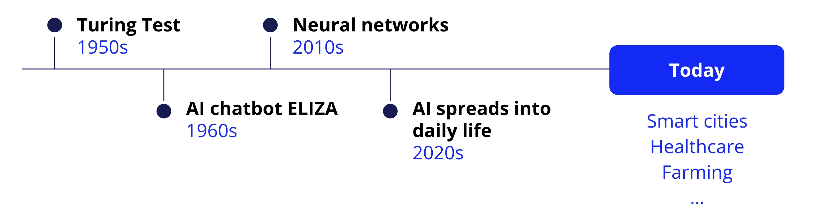
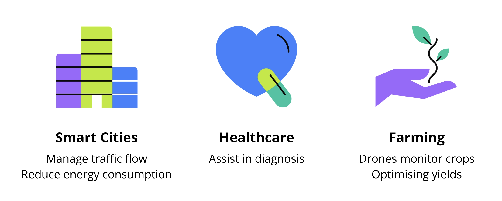
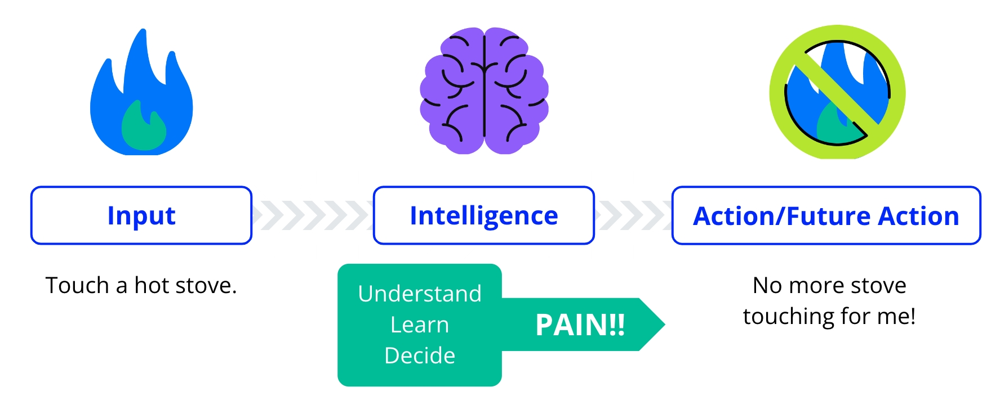
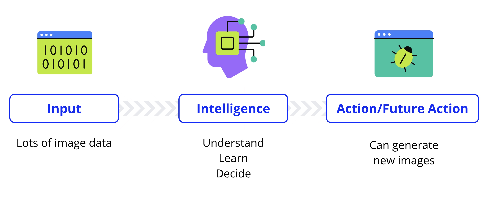
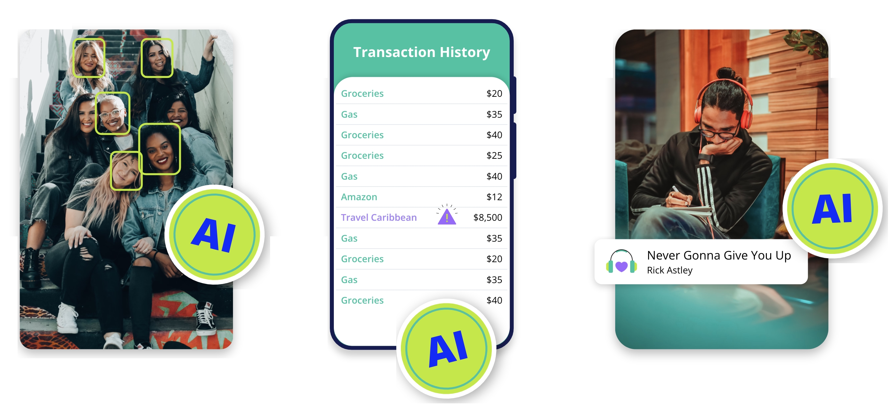
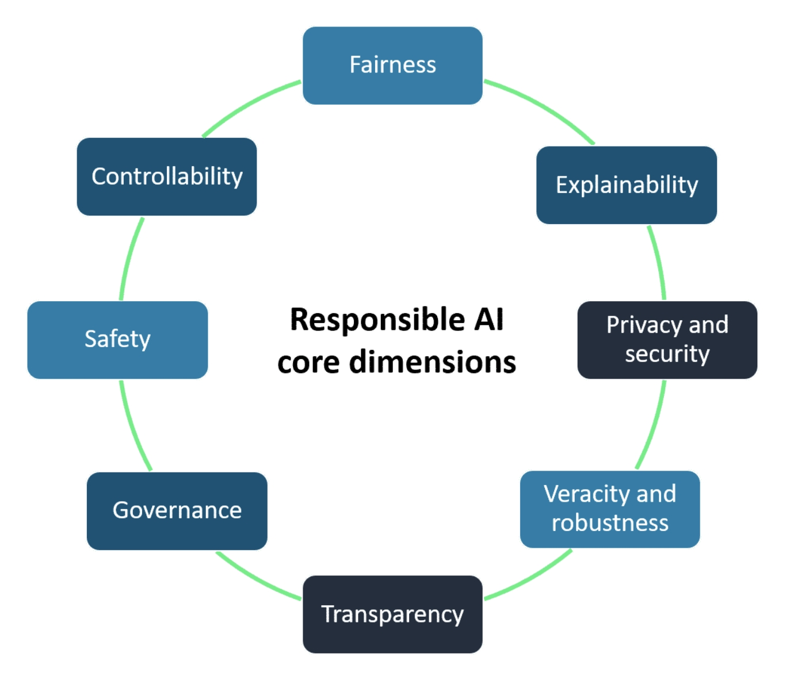

# AI in Context

## Introduction to AI

**Artificial Intelligence (AI)** refers to computers simulating human intelligence processes like learning, reasoning, self-correction, and creativity.

### Historical Development

AI exploration began in the 1940s and 1950s, inspired by the human brain's workings. Notable contributions include:

- **The Turing Test**, by Alan Turing, used to determine a machine's capability to exhibit intelligent behavior.
- **ELIZA**, the first AI chatbot created in the 1960s.

### Acceleration in AI Advancements

The onset of the **internet** and **vast data availability** propelled **Machine Learning (ML)**, a subset of AI, allowing machines to learn and improve from vast data sets.

In the 2010s, Deep Learning, inspired by human brain's neural networks, emerged, aiding in object and voice recognition.

### AI in Everyday Life

AI's role has transitioned from mere fascination to being an integral part of daily lives, aiding in image enhancement, spam filtering, traffic management, healthcare diagnostics, and agricultural optimization, among others.

## ELIZA to Alexa

ELIZA, a computer program created in the 1960s, was one of the first programs designed to have a conversation with people.

ELIZA would respond to what you said by using patterns and rules, making it seem like she understood you. One famous version of ELIZA acted like a therapist, where she'd often just repeat what you said back to you, which made some people feel like they were talking to a real person, creating an illusion of understanding.

We demonstrate ELIZA in the demo below.

In this exercise, you'll chat with [ELIZA](https://web.njit.edu/~ronkowit/eliza.html) and observe how it uses pattern matching and rules to respond to you. Then you'll try to figure out the "rules" ELIZA follows by providing specific inputs and analyzing the outputs.

Use the following link to experiment with an [ELIZA-like Therapist Bot](https://anthay.github.io/eliza.html), provided by Ant & Max Hay. You can type `*help` to get list of commands that you can give to ELIZA. Typing `traceauto` will give you insights into how that response was determined.

- **Pattern Matching** is like a game of recognizing words or phrases and linking them to responses.
- **Rules-based Systems** are a set of instructions that tell ELIZA what to say when it recognizes certain patterns.

**Key Findings:** ELIZA likely recognizes greeting keywords and has rules to respond with related follow-up questions. ELIZA often repeat or rephrase what the user says. Repetition simulates active listening and empathy, mirroring techniques used in therapy. One of ELIZA's key rules is to mirror or rephrase the user's input. This technique, often used in Rogerian psychotherapy, creates the illusion of understanding and keeps the conversation going. When ELIZA encounters inputs without recognizable keywords or patterns, it often responds with generalized or vague statements like "I see" or "Please go on." This allows it to continue the conversation without needing specific keywords.

---
Alexa is an AI-powered virtual assistant housed in an Amazon Echo Dot device. Alexa can:

- Understand and process voice commands.
- Make informed decisions.
- Learn from user interactions to improve its responses over time.
Alexa uses AI to:

- Recognize speech patterns.
- Understand context.
- Predict user preferences for personalized content.

## Defining Artificial Intelligence

**Artificial Intelligence (AI)** involves simulating human-like reasoning and cognitive processes in computers, aimed at creating systems capable of performing tasks requiring intelligence when done by humans. These tasks include:

- Recognizing patterns.
- Speech recognition.
- Decision-making.
- Making predictions.

**Human intelligence** processes information, learns from it, and informs future actions based on the learned information, e.g., learning not to touch a hot stove after experiencing a burn. Just as humans learn from experiences, AI learns by processing vast amounts of data to make informed decisions.

In AI, the goal is to replicate human learning and decision-making processes by creating sophisticated computer programs that can:

- Process vast data.
- Learn patterns.
- Make informed decisions.

A practical example includes streaming platforms using AI to analyze user preferences, compare them with other users, and recommend shows or music, improving recommendations as more data (user interaction) is collected.

## Everyday Applications of AI

**Artificial Intelligence (AI)** is subtly integrated into our daily lives, making tasks simpler, more efficient, and personalized. It's often unnoticed, termed as "silent" AI. Examples include:

- Auto-tagging in social media.
- Fraud detection in banking.
- Recommendation systems in music playlists or online shopping.
- Smart thermostats adjusting temperatures.
- Ride-sharing apps optimizing routes and prices.
- Wearable devices monitoring health metrics.

A sci-fi movie robot is a noticeable or dramatic representation of AI, contrasting with the subtle and unobtrusive examples of 'silent' AI mentioned in the text.

## Responsible Use and AI Ethics

As AI aims to learn like humans, attention must be paid to AI Ethics, which include:

1. What computers learn, and
2. How they learn it.

Because AI learns from all kinds of data, we have to pay attention to where that data comes from and what the AI learns from it. Ensuring AI is fair, unbiased, and respects human rights, equity, and privacy is crucial for societal benefit.

## Responsible AI: A Guide for Future AI Creators

You’ve now seen how AI can understand and respond to human input—whether it’s a chatbot like ELIZA, a voice assistant like Alexa, or a customer support bot. But AI isn't just about getting the right answers; it’s also about making sure the way it works is fair, safe, and trustworthy.

AI is already part of everyday life, from recommendation systems on social media to self-driving cars. But what happens if an AI makes unfair decisions? What if it misuses personal data or operates in a way people don’t understand?

That’s where **responsible AI** comes in. It’s about making AI systems that are fair, safe, transparent, and under human control.

### The 8 Dimensions of Responsible AI

To build AI that people can trust, we need to think about these key areas:

#### 1. Fairness: AI Should Treat Everyone Equally

Imagine you ask Alexa, “What are the best colleges near me?”, but it only recommends colleges for a certain group of people, leaving out others. That would be unfair AI.

Fairness means AI should work for everyone, not just a specific group. AI should avoid discrimination and be designed so that all users get accurate and helpful results.

#### 2. Explainability: AI Shouldn’t Be a Black Box

If you ask a chatbot, “Why did you give me this answer?”, and it can’t explain itself, that’s a problem.

Explainability means AI should be able to clearly describe how it made a decision. If an AI model rejects a loan application or recommends a medical treatment, humans should understand why.

#### 3. Privacy & Security: AI Should Protect Personal Data

Would you be okay if AI recorded every conversation in your house and shared it? Probably not!

Privacy means AI should give users control over their personal data. Security means keeping that data safe from hackers or leaks.

#### 4. Transparency: AI Shouldn’t Hide How It Works

Ever used an app that randomly changes its recommendations without telling you why? That’s a lack of transparency.

Transparency means AI should openly share how it was built, what it can do, and what its limits are. If an AI model is used in hiring, companies should explain how it chooses candidates.

#### 5. Robustness: AI Should Work Even in Unpredictable Situations

What if Alexa misunderstood your question and started ordering random products? Or if a self-driving car misread a stop sign?

Robustness means AI should be able to handle errors, new situations, and unexpected inputs without failing.

#### 6. Governance: AI Should Follow Rules & Ethical Standards

Just like companies have rules for safety and fairness, AI needs rules too. Governance means making sure AI follows laws, ethical guidelines, and company policies.

For example, social media AI should prevent harmful content from spreading, and AI in finance should prevent fraud.

#### 7. Safety: AI Shouldn’t Cause Harm

What if a medical AI recommended the wrong diagnosis? Or a self-driving car didn’t stop at a red light?

AI safety means testing and designing AI carefully to prevent harm to people or the environment.

#### 8. Controllability: Humans Should Stay in Charge

AI should never be completely out of human control. Controllability means people should be able to monitor, correct, or stop AI systems when needed.

For example, an AI chatbot shouldn’t spread false information, and self-driving cars should have emergency stop features.

### Why Should You Care About Responsible AI?

- AI is shaping the future of education, jobs, social media, and even healthcare.
- If you use Alexa, chatbots, or recommendation systems, you’re already interacting with AI every day.
- As future leaders and AI creators, you have the power to help build fair, safe, and transparent AI systems.
By keeping these 8 dimensions of responsible AI in mind, you can help create AI that benefits everyone.
