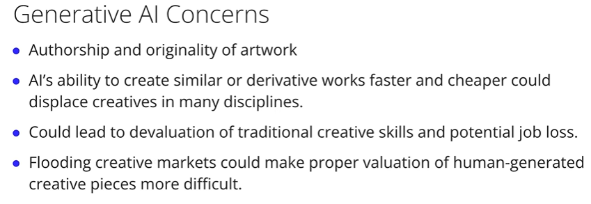
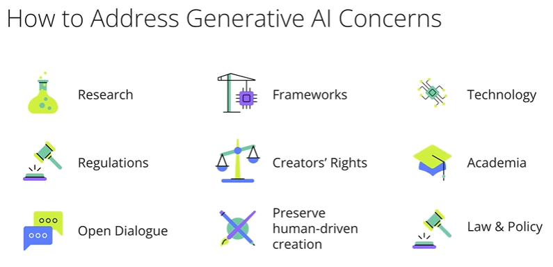
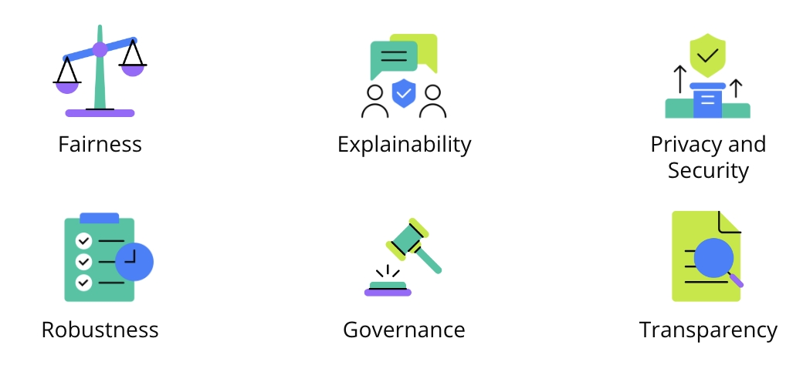

# Generative AI in Real World Applications

## AI in Our World - Opportunities and Responsibilities

In the dynamic world of Artificial Intelligence (AI), we find ourselves at a crossroads of opportunity and responsibility. Imagine AI systems filtering job applicants and empowering musicians with endless creative possibilities. This contrast shows AI's diverse impact on our lives.

### AI's Positive Impact

AI has made significant strides in healthcare, environmental conservation, and cultural preservation. Its capabilities range from diagnosing diseases to predicting natural disasters and protecting endangered species and languages. These achievements highlight AI's potential to better human and environmental health, especially when guided by ethical practices.

### Challenges in AI

Despite its advancements, AI faces significant challenges. Issues of racial bias in facial recognition, gender bias in medical tools, and accent bias in voice recognition illustrate the need for fairness and inclusivity. These challenges emphasize the importance of developing AI systems responsibly.
When governments have used facial recognition technology, reports surfaced about the technology's potential for racial bias. In another instance, diagnostic tools that use machine learning were less accurate for women because they'd been trained predominantly on male data. What about voice recognition technologies having higher error rates for speakers with certain accents or dialects?

### The Path to Responsible AI

Key elements in responsible AI development include:

- **Ethical Principles** - Upholding human rights, equity, privacy, and fairness.
- **Understanding AI's Limitations** - Recognizing its probabilistic nature and the need for human interpretation.
- **Data and Team Diversity** - Ensuring unbiased data and diverse development teams.
- **Continuous Improvement** - Maintaining ongoing validation and feedback mechanisms.

### AWS's Role

AWS provides tools and resources for the responsible development of AI systems, which we'll explore in this lesson. The focus is on leveraging generative AI's benefits while addressing its challenges.

## Impact on Creativity and Content Generation

### Balancing Creativity and Ethics

In today's business landscape, generative AI is emerging as a powerhouse of creativity and efficiency. This technology, capable of producing diverse forms of artistic and creative outputs, is reshaping industries and redefining the boundaries of innovation. Let’s delve into its implications and ethical considerations.

### Widening Creative Horizons

Generative AI democratizes the creative process, enabling individuals and businesses to produce a wide array of content, from visuals and music to writing and game design. Stable diffusion models can generate visuals allowing individuals without traditional artistic training to generate paintings, digital imagery, animations, and video. The Stable Diffusion model is deterministic and it will consistently produce the same output (image) for a given input (text prompt) and seed combination. The seed in configuration settings, determines the starting point of the generative process. Changing the seed while keeping the prompt the same produces different images.

In music, AI platforms help compose and produce new sounds. Large language models assist writers by generating ideas and drafts, expanding creative possibilities. Journalists benefit from AI automating routine tasks. In film, AI aids in scriptwriting, visual effects, and CGI character creation, enriching storytelling. In fashion, AI designs innovative patterns and textiles, accelerating brand innovation. Game developers use AI to generate immersive environments and narratives. Across these fields, AI streamlines the creation of designs, drafts, models, and prototypes, allowing human professionals to refine and innovate further.

### Enhancing Efficiency

By rapidly generating initial concepts, designs, or prototypes, generative AI accelerates the ideation process. This efficiency is a boon for businesses looking to stay ahead in fast-paced industries.

### Ethical and Creative Challenges



While generative AI offers numerous advantages, it also presents ethical and creative challenges:

- **Originality and Authorship** - Differentiating between AI-generated and human-created content raises questions about the authenticity and originality of creative works.
- **Impact on Creative Jobs** - The potential for AI to replicate or outpace human creativity poses a risk to traditional creative roles, potentially leading to job displacement.
- **Market Saturation** - The influx of AI-generated content could overshadow human creativity, making it harder for traditional artists to compete.

### Navigating the Future



To effectively harness generative AI while maintaining ethical standards, businesses need to:

- **Adopt Collaborative Approaches** - Combining AI-generated initial concepts with human expertise ensures a balance between innovation and authentic creativity. Example: Using AI for initial designs and applying human craftsmanship for the final product utilizes AI's capabilities while preserving the brand's reputation for originality and craftsmanship.
- **Maintain Transparency** - Disclosing the use of AI in creative processes helps manage consumer expectations and maintains trust.
- **Foster Ethical Practices** - Implementing guidelines to respect intellectual property and preserve the value of human-driven creation is essential.

In conclusion, Generative AI holds tremendous potential for businesses in creative fields, but it's crucial to navigate its implementation thoughtfully. Balancing innovation with the preservation of human creativity and adhering to ethical standards is key to leveraging its benefits while addressing the challenges it presents.

## Generative AI’s Impact on Society

### A Catalyst for Accessibility and Economic Change

Generative AI is transforming the landscape of accessibility and economic development. Its impact spans across various industries, creating both opportunities and challenges. Let’s explore how generative AI is revolutionizing accessibility and driving economic growth, alongside the ethical considerations it brings.

### Transforming Accessibility

1. Text-to-Speech (TTS) Technology - AI has refined TTS, turning text into remarkably human-like speech. This technology is life-changing for individuals with visual impairments or reading difficulties, enabling them to 'hear' text from images or videos.
2. Language Translation - AI’s translation capabilities bridge communication gaps, fostering global interaction and inclusivity for those with hearing challenges through AI-generated captions and subtitles.
3. Personalized Assistive Devices - generative AI can create synthetic datasets to train AI systems, enhancing their predictive capabilities. This leads to more personalized and effective assistive technologies.

### Economic Impact

1. Job Creation - AI is creating new roles in data science, AI ethics, and machine learning engineering. It's opening niches in creative industries like AI-assisted design, music production, and content creation, particularly in gaming, entertainment, and marketing.
2. Boosting Efficiency and Innovation - AI aids small businesses and entrepreneurs with cost-effective tools for content creation and market analysis. Its predictive capabilities expedite research and development cycles, improving productivity.
3. New Markets and Demand - AI-driven accessibility tools are stimulating investment and job creation in the tech sector, fostering economic growth.

### Benefits and Challenges

Generative AI is a double-edged sword with the potential to invigorate economic growth and democratize information, but also to disrupt traditional industries and create societal challenges.

#### Positive Impacts

- **Innovation & New Markets:** It spurs innovation, creating new markets and job roles (e.g., data science, AI ethics, machine learning engineering).
- **Empowerment for Small Businesses:** Provides cost-effective tools for content creation, market analysis, and customer service, enabling small businesses and entrepreneurs to compete with larger entities.
- **Increased Efficiency & Productivity:** Automates routine tasks, generates prototypes, and simulates outcomes, leading to higher efficiency and productivity.
- **Creative Opportunities:** In gaming, entertainment, and marketing, AI generates new content forms, opening opportunities for creative professionals to collaborate with AI.
- **Accelerated R&D:** Predictive capabilities expedite innovation cycles, reducing time and resources for product development.
- **New Niches:** Creates new roles in AI-assisted design, music production, and content creation.

#### Negative Impacts & Challenges

- **Market Saturation & Devaluation:** AI-generated content can saturate markets, potentially devaluing human-created works (e.g., automated news writing bots raising concerns for human reporters).
- **Decline in Depth Journalism:** While efficient for routine news, AI may struggle with nuanced investigative reporting, potentially leading to a decline in quality journalism.
- **Job Displacement:** Roles involving repetitive or predictable tasks (customer service, manufacturing, logistics, some creative jobs) are at high risk of automation, potentially exacerbating economic inequalities.
- **Skills Gap:** The rapid pace of AI advancement may outstrip the workforce's ability to retrain for new roles, leading to a significant skills gap.

#### Societal Navigation & Solutions

- **Balance is Key:** The challenge is to ensure AI augments human work rather than solely replacing it.
- **Proactive Strategies:** Governments and educational institutions must play a crucial role in:
  - Upskilling workers and preparing future generations for an AI-centric economy.
  - Developing policy-making and ethical AI frameworks.
  - Implementing educational reforms.
- **Inclusive Growth:** The focus must be on ensuring AI serves as a tool for empowerment and inclusion, rather than exclusion. Predicting and addressing these issues now is essential for a lasting positive impact on society.

## Navigating the Complexities: Ethical Use, Education, and Inclusivity

Generative AI is reshaping our digital world, offering incredible opportunities but also posing significant challenges. From facial recognition in public spaces to deepfakes, the implications of this technology touch on privacy, ethics, and societal norms. Let's explore these complexities and how we can navigate them responsibly.

### Ethical Use and Challenges

- **Facial Recognition and Privacy** - The use of AI in public spaces for safety can conflict with personal privacy rights and raise issues of misidentification.
- **Deepfakes and Misinformation** - AI-generated images and videos (deepfakes) blur the line between reality and fabrication, posing risks for misinformation and manipulation of public opinion.

### Education and Awareness

- **User Awareness and Education** - Educating users about the capabilities and limitations of AI technologies is critical. This includes understanding the predictive nature of machine learning and recognizing AI-generated content.
- **Public Awareness Campaigns** - Initiatives like the "Deepfake Education Initiative" and university courses on AI ethics are vital in fostering digital literacy and critical evaluation of AI content.
- **AWS's Role in Education** - AWS partners with organizations to educate and guide policy development for responsible AI systems, offering tools to build unbiased and transparent AI models.

### Fostering an Inclusive AI Environment

- **Inclusive Development Teams** - Diverse teams are essential in mitigating AI biases and ensuring fairness in outcomes.
- **AI for All** - AI systems should be accessible to various languages, cultures, and abilities, promoting inclusivity and empowerment.
- **Guardrails for Ethical AI** - Implementing detailed documentation, warnings, and technical restrictions can prevent misuse and align AI use with human rights and fairness principles.

### Legal and Policy Frameworks

- **Legislative Action** - Laws against creating or distributing deepfakes and other manipulative AI content help govern responsible use.
- **Media and Journalism Initiatives** - Newsrooms and social media platforms are employing tools and policies to detect and manage deepfake content.

## Implementing Responsible Use

The responsible use of AI encompasses leveraging and creating tools that address several overarching themes:

- **Ethical Considerations and Privacy** - AI technologies like facial recognition raise critical ethical questions regarding privacy and surveillance. The challenge is to balance the benefits for public safety with the risks of privacy invasion or misidentification.
- **Responsible and Inclusive Use of AI** - This theme stresses the necessity for AI to be developed and used responsibly and inclusively. It involves a collaborative effort from developers, users, educators, policymakers, and society. Inclusivity ensures that AI technologies are accessible and beneficial to diverse groups, avoiding bias and discrimination.
- **User Education and Awareness** - Educating users about the capabilities and limitations of AI is crucial. This includes awareness of the predictive nature of machine learning, the potential for errors, and the correct application of technologies. It also involves teaching users how to critically evaluate AI-generated content and recognizing signs of AI involvement, such as inconsistencies or lack of depth.
- **Oversight and Human Involvement** - Human oversight is essential, especially in areas impacting civil liberties or human rights. Training for human reviewers and understanding the output of AI systems are necessary to ensure that AI applications are fair, ethical, and effective.
- **Transparency and Trust in AI** - Establishing trust in AI systems requires transparency in how these systems function, their potential for error, and the necessity of human oversight. Initiatives like digital literacy programs and public education campaigns about AI technologies, including deep fakes, play a vital role in building this trust.

Tools and initiatives like AWS's partnerships with organizations such as the Responsible AI Institute(opens in a new tab), the United Nations(opens in a new tab), and the Organization for Economic Cooperation and Development(opens in a new tab) are crucial in achieving these goals. They provide resources for building unbiased and transparent AI models, emphasizing the importance of guiding AI development in a responsible, inclusive, and ethical manner.

## Bias in AI Systems: Definition, Introduction, and Impact

Bias in Artificial Intelligence refers to a system's tendency to produce unfair, prejudiced, or inaccurate decisions or predictions. This often stems from the quality of the data the model was trained on, which may be skewed, unrepresentative, or otherwise flawed.

### How Bias is Introduced and its Impact

1. **Training Data:** All machine learning models learn directly from their training datasets. If this dataset is biased, the model will inherently learn and reflect that bias.
    - **Unrepresentative Data:** Just as a soccer coach who only selects players based on speed creates a biased team, an AI system trained on an unbalanced view of information will make biased decisions. For example, an autonomous car not trained on diverse driving conditions (terrains, weather, traffic from urban to rural settings, or different countries) could navigate unsafely.
    - **Societal Biases Reflected:** AI models, especially large language models (LLMs) and image generation models, are often trained on vast amounts of internet data. The internet, however, is not a neutral source; it reflects existing societal biases.
        - **Language Models:** An overrepresentation of certain English dialects (e.g., American English) and underrepresentation of others (e.g., Indian or Nigerian English) in training data can lead to models performing well on familiar dialects but poorly on others. This impacts machine translation, text completion, and conversational AI across different languages and dialects.
        - **Image Models:** If training data for "professionals" like "doctors" predominantly features men, the AI might generate images of male doctors, perpetuating gender stereotypes. This can lead to biased content creation and, in image recognition, serious ethical concerns like wrongful identification in law enforcement.

2. **Real-World Consequences of Bias:**
    - **Healthcare:** AI diagnostic models trained on non-diverse patient populations may exhibit bias towards certain demographics, leading to less effective diagnoses across different races, genders, and ages.
    - **Finance:** AI credit scoring models trained on unrepresentative financial backgrounds could discriminate against specific underrepresented groups, leading to unfair credit assessments.
    - **Job Displacement:** AI's advancements may outpace workforce retraining, leading to a skills gap and exacerbating economic inequalities as jobs involving repetitive tasks are automated.

### Mitigation Strategies

Building fair and unbiased AI models requires a multi-faceted approach:

1. **Diverse and Representative Datasets:**
    - **Inclusion:** Training data must encapsulate the rich variability of the real world, covering diverse demographics, languages, cultures, contexts, ethnicities, ages, and genders.
    - **Depth and Breadth:** Datasets need to be not only large but also deep, covering a wide spectrum of scenarios and characteristics to ensure models accurately identify and interact with broad human features.
    - **Continuous Monitoring:** Regular auditing and updating of datasets are essential to account for concept drift (data changing over time) and ensure the model remains relevant and fair.

2. **Human Oversight and Diverse Teams:**
    - **Team Diversity:** Teams building AI models should be composed of individuals from various backgrounds. Their diverse perspectives help identify and mitigate potential biases that might otherwise be overlooked.
    - **Human Oversight:** This oversight is invaluable for recognizing subtleties and nuances in data.

3. **Algorithmic and Framework-Based Solutions:**
    - **Fairness Constraints:** Implement fairness constraints directly into learning algorithms (e.g., in credit scoring systems).
    - **Bias Auditing Frameworks:** Utilize structured approaches and tools to systematically identify biases within datasets.
    - **Interpretability and Explainability (XAI):** Use tools to understand the decision-making processes of AI models, which can help in identifying inherent biases.

By proactively addressing bias through diverse data, human oversight, and robust algorithmic approaches, society can work towards developing AI systems that are fair, equitable, and beneficial for all user groups.

## Detecting and Addressing Bias

AWS offers various tools to support these strategies, ensuring responsible AI development:

- **Mitigating Human Error** - Use knowledgeable annotators and accuracy checks.
- **Fairness Metrics** - Establish and measure system performance across demographic groups.
- **Independent Bias Testing** - Engage external parties for unbiased system assessments.
- **Responsive Action Plans** - Address detected biases through data collection adjustments, algorithm modifications, or model retraining.
- **User Feedback Mechanisms** - Allow real-world performance assessments to gather insights on diverse user experiences.

**Key Takeaways:**

Minimizing bias and maximizing fairness in AI models leads to more equitable and effective systems.
The goal is an AI that is not only efficient but also ethically committed to fairness and inclusivity.
Continuous improvement and conscientious practices are essential to prevent AI systems from perpetuating or creating inequities.

## Ethical Frameworks, Inclusivity, and Responsible Development

The advancement of artificial intelligence (AI), especially generative AI, necessitates a strong ethical foundation and a commitment to inclusivity. Recognizing this, governments and organizations like AWS are actively developing policies and guidelines to ensure the responsible use of AI technologies.

### Ethical Guidelines and Frameworks

- **Importance of Ethical Frameworks** - These frameworks are essential to align AI advancements with societal values, ensuring AI development respects moral principles.
- **Key Principles** - Ethical guidelines for AI must include transparency, accountability, fairness, respect for user autonomy, and privacy.
- **AWS’s Responsible AI Framework** - AWS provides a comprehensive framework covering fairness, explainability, privacy and security, robustness, governance, and transparency. This framework guides the responsible development and use of AI systems.

### Inclusivity and Diversity in AI Development

- **Diverse Stakeholder Involvement** - Inclusivity in policy-making requires diverse teams to address a wide range of ethical concerns and potential biases.
- **Collaboration and Feedback Loops** - Collaborative efforts between AI developers and diverse user groups ensure AI technologies are accessible and beneficial to all, promoting the democratization of AI.



### Operationalizing Ethical AI Principles

- **AWS's AI Service Cards and Platform Tools** - These resources offer transparency on AI capabilities and limitations, assist in detecting biases, and enhance the understanding of AI decisions.
- **Education and Training** - Organizations must invest in training their workforce, from engineers to decision-makers, in responsible AI practices, including AI ethics and technical skills for developing inclusive AI systems.

### The Commitment to Responsible AI Development

Responsible and inclusive AI development is an ongoing journey that demands adherence to ethical frameworks and a dedication to diversity.

By embedding ethical values and inclusivity in AI research and development, the tech community can maximize the potential of generative AI while mitigating its risks, ensuring it serves as a beneficial force that reflects and respects the diversity of human experiences.

## Model Cards

A model card is a detailed document or report that provides critical information about a machine learning (ML)/AI model in a structured and accessible format. It's designed to offer transparency and governance for machine learning models, especially when they are deployed in real-world applications.

**Key elements of a model card typically include:**

- **Model Overview** - a general description of the model, its purpose, the problem it's intended to solve, and the algorithm type it employs.
- **Intended Use** - outlines the specific scenarios and applications for which the model is designed. It also mentions scenarios where the model should not be used, thus guiding responsible deployment and use.
- **Risk Ratings** - the model is categorized based on the level of risk associated with its application, which can range from low to high. This helps in understanding the potential implications of the model's predictions and decisions.
- **Training and Evaluation Details** - information about how the model was trained, the data it was trained on, the training environment, and the metrics used to evaluate its performance.
- **Model Performance and Metrics** - specific performance metrics, observations from evaluations, and any relevant graphs or statistical data are documented here.
- **Ethical Considerations and Recommendations** - any ethical concerns related to the model and recommendations for its use, including any limitations or biases that users should be aware of.
- **Versioning** - model cards maintain a record of changes made to the model, ensuring that there is a transparent history of its development and modifications.
- **Additional Information** - custom details, caveats, and any other relevant information that doesn't fit into the standard sections can be included here.

Model cards in Amazon SageMaker follow a JSON schema to standardize the format and make it easier to create, share, and update these documents.

**Example:**

```json
{
  "model_overview": {
    "model_description": "This model predicts the likelihood of a patient being readmitted to a hospital within 30 days of discharge.",
    "model_owner": "XYZ Hospital Data Science Team",
    "model_creator": "ABC University Healthcare AI Lab",
    "problem_type": "Binary Classification",
    "algorithm_type": "Random Forest",
    "model_id": "PRP-2023-XYZ",
    "model_artifact": ["URL to model artifact"],
    "model_name": "Patient Readmission Predictor",
    "model_version": 1.0,
    "inference_environment": {
      "container_image": ["SageMaker inference image uri"]
    }
  },
  "model_package_details": {
    "model_package_description": "A package for predicting patient readmission rates in hospitals.",
    "model_package_arn": "arn:aws:sagemaker:example",
    "created_by": {
      "user_profile_name": "Data Scientist"
    },
    "model_package_status": "Completed",
    "model_approval_status": "Approved",
    "approval_description": "Reviewed and approved for hospital readmission prediction.",
    "model_package_group_name": "PatientCareModels",
    "model_package_name": "PatientReadmissionModelPackage",
    "model_package_version": 1,
    "domain": "Healthcare",
    "task": "Readmission Prediction"
  },
  "intended_uses": {
    "purpose_of_model": "To assist healthcare providers in identifying patients at high risk of readmission.",
    "intended_uses": "Predicting 30-day readmission risk; assisting in post-discharge planning.",
    "factors_affecting_model_efficiency": "Quality of patient data, accuracy of historical records.",
    "risk_rating": "Medium",
    "explanations_for_risk_rating": "Erroneous predictions could impact patient care decisions."
  },
  "business_details": {
    "business_problem": "High patient readmission rates in hospitals.",
    "business_stakeholders": "Healthcare providers, hospital management.",
    "line_of_business": "Healthcare Services"
  },
  "training_details": {
    "objective_function": "Minimize false negatives and false positives.",
    "training_observations": "Trained on a dataset of 10,000 patient records.",
    "training_job_details": {
      "training_arn": "arn:aws:sagemaker:example:training",
      "training_datasets": ["S3 path to training dataset"],
      "training_environment": {
        "container_image": ["SageMaker training image uri"]
      },
      "training_metrics": [{
        "name": "Accuracy",
        "value": 85
      }]
    }
  },
  "evaluation_details": [
    {
      "name": "ModelEvaluation",
      "evaluation_observation": "The model showed an accuracy of 85% in predicting patient readmission.",
      "evaluation_job_arn": "arn:aws:sagemaker:example:evaluation",
      "datasets": ["S3 path to evaluation dataset"],
      "metadata": {
        "Additional Notes": "Evaluated on a separate test dataset of 2,000 records."
      }
    }
  ],
  "additional_information": {
    "ethical_considerations": "The model should not be the sole decision-making tool in patient care.",
    "caveats_and_recommendations": "Recommend further validation and regular updates with new patient data."
  }
}
```
