# Undestanding Large Language Models (LLMs)

## Introduction to Understanding and Using Large Language Models (LLMs)

In this lesson, we delve into the fascinating world of Large Language Models (LLMs), extraordinary tools at the forefront of artificial intelligence. LLMs are not just theoretical constructs but practical tools, aiding in tasks like writing emails, generating creative content, and interpreting complex information.

**Large Language Models (LLMs)** - Advanced machine learning systems that understand and generate human language, mimicking human-like conversation and writing.

**Prompt Engineering** - A skill to effectively use LLMs, involving the crafting of inputs to get desired outputs.

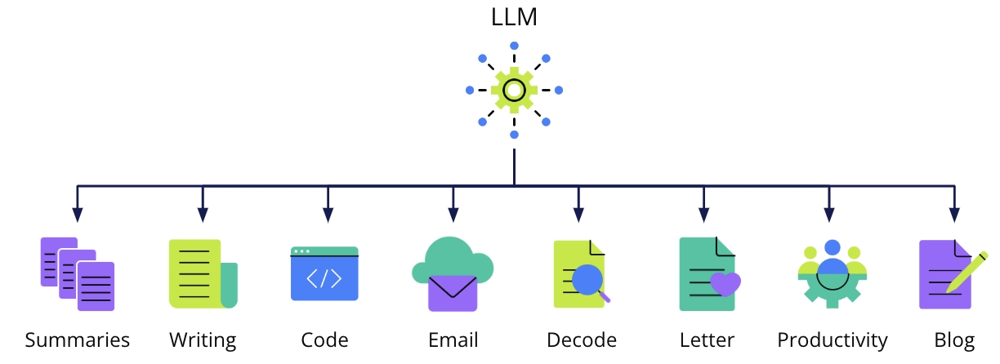

### Applications of LLMs

- Crafting professional emails.
- Generating creative writing prompts.
- Simplifying complex information into summaries.
- Assisting in writing heartfelt letters, blog ideas, or decoding legal documents.
- Writing code and enhancing productivity at work.

## What is a Large Language Model (LLM)

### Understanding Large Language Models (LLMs)

Large Language Models (LLMs) represent a significant advancement in artificial intelligence, specializing in processing, understanding, and generating human language. These models are distinguished by their size, both in terms of the vast number of parameters and their extensive training data.

### Key Characteristics

1. **Extensive Training Data** - LLMs are trained on a wide array of text sources, enabling them to learn diverse linguistic patterns and styles.
2. **High Capacity** - With billions of parameters, LLMs can store and recall extensive information about language.
3. **Deep Understanding** - They can comprehend context and nuances in language, performing complex tasks like summarization, translation, and conversation.
4. **Transformer Architecture** - Most LLMs use transformer architecture for efficient text processing and adaptable attention to different parts of the input.
5. **Content Generation** - Capable of generating coherent and contextually relevant text, including essays, poetry, and code.

### Creation Process

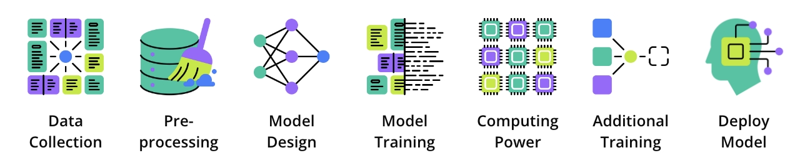

**Data Collection** - Gathering a large and varied dataset from multiple text sources.
**Pre-processing** - Cleaning and preparing the data for training.
**Model Design** - Selecting a neural network architecture, typically a transformer model.
**Training** - Using machine learning algorithms to improve the model's accuracy in predicting text sequences.
**Computing Power** - Requiring powerful GPUs or TPUs for processing and training.
**Additional Training** - Further training on specific datasets for specialized tasks.
**Deploying the Model** - Making the model available for user queries and prompts.

### Challenges and Accessibility

- Creating an LLM requires immense computational resources, data management, and expertise.
- Ensuring fairness, lack of bias, and user privacy are crucial considerations.
- Although resource-intensive to develop, LLMs are often made accessible to the public via APIs and applications.

## Build an App with PartyRock

[PartyRock](https://partyrock.aws/?utm_source=udacity&utm_medium=course&utm_campaign=introtogenai), an Amazon Bedrock Playground, allows you to experiment and create applications that use generative AI without needing an AWS account or credit card.

In the video above, the app is built by providing a prompt to PartyRock, which then uses a large language model to understand the request and generate the application.

> In this demo, the presenter introduces PartyRock, a service by AWS that allows users to experiment with Amazon Bedrock without needing an AWS account. Users can create an account on PartyRock, provide prompts, and the service will build an app using foundation models from Amazon Bedrock. The demo illustrates building an app to recommend clothing for specific occasions. The app uses a large language model to understand prompts and generate recommendations. Users can input occasions like a job interview to receive attire suggestions. The app also features a fashion chat for general advice. The presenter highlights the ability to share and remix apps, encouraging users to explore and create with PartyRock.

**Note:** use a personal account to access PartyRock. PartyRock is free to use.

**Key features include:**

- **Intuitive App Creation** - build apps for various purposes.
- **Learning and Experimentation** - It's an educational tool for understanding generative AI, experimenting with foundation models, and mastering text-based prompting and prompt chaining.
- **Ease of Access** - Require no coding expertise and is accessible via a web-based UI.

## Code Generation

**Amazon CodeWhisperer** is a tool designed to enhance software developers' efficiency. It excels in using an LLM to generate code snippets from text prompts, reducing time spent on routine coding and allowing developers to focus on complex tasks.

> In this demo, the presenter discusses the applications of large language models (LLMs) beyond text generation, focusing on code generation using AWS's CodeWhisperer. CodeWhisperer helps developers by generating code from text prompts, allowing them to focus on writing more value-added and application-specific code. The demo shows how CodeWhisperer integrates with AWS Cloud9 and other editors like Visual Studio. By providing a comment in the code, developers can receive auto-completed code suggestions, such as a class for a simple calculator or code to upload files to AWS S3. This tool enhances developer efficiency by reducing the need to write boilerplate code or consult documentation, showcasing the broader applications of LLMs in software development.

### How It Works

Using the AWS Cloud9 editor:

- Users simply input a comment describing the desired function.
- Amazon CodeWhisperer then uses autocomplete to suggest relevant code.

This service significantly reduces the time spent on writing standard boilerplate code, allowing developers to focus on more complex, value-adding aspects of their projects.

## Natural Language Models

### Exploring Natural Language Processing (NLP)

Natural Language Processing (NLP) is a critical field within artificial intelligence, combining computational linguistics with machine learning and deep learning techniques to enable computers to process and understand human language in both text and voice forms.

### Key Processes in NLP

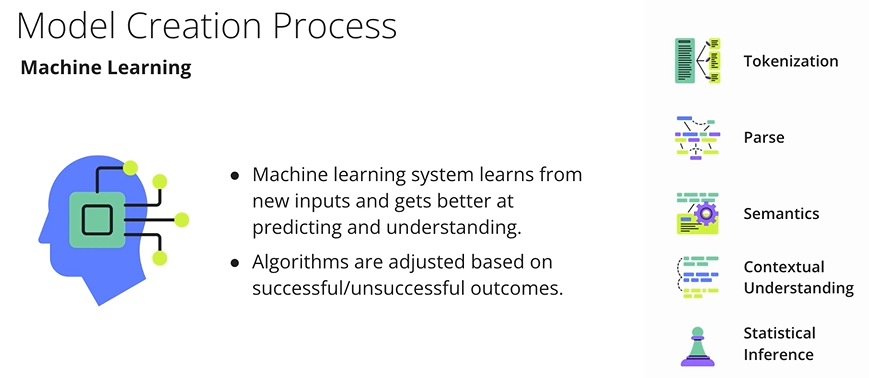

1. **Tokenization** - Breaking down text into smaller units (tokens), such as words or phrases, for easier analysis.
2. **Parsing** - Analyzing the grammatical structure of sentences to understand how words relate to each other.
3. **Semantic Analysis** - Understanding the meaning behind words by considering context, synonyms, and ambiguities.
4. **Contextual Understanding** - Utilizing the context of surrounding sentences to enhance interpretation, including understanding implied meanings and intentions.
5. **Statistical Inference** - Using probabilities to predict subsequent words or appropriate responses in a conversation.
6. **Machine Learning Integration** - Continuously learning from new inputs to improve language prediction and understanding.

NLP is crucial in enabling machines to decode human language, comprehend the intended meaning, and generate coherent, relevant responses.

It represents a complex interplay of various processes that equip machines with linguistic understanding capabilities.

## The Evolution of Large Language Models (LLMs)

The journey of Large Language Models (LLMs) in Natural Language Processing (NLP) is a story of increasing sophistication and capability. Starting from rule-based systems and progressing through various stages of machine learning and deep learning, LLMs have become adept at understanding and generating human-like text.

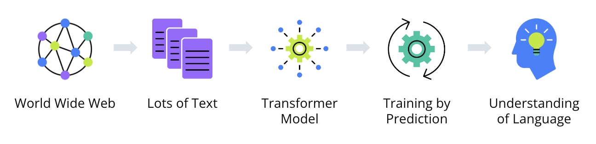

### Evolutionary Stages

**Rule-Based Systems** - Early models based on explicit grammatical and syntactic rules, limited and inflexible. Limited flexibility (e.g., parsing "Alice sits by the riverbank" by tagging nouns/verbs).
**Statistical Models** - Shifted to probability-based predictions, enabling more complex language processing. Better scalability but lacked deep contextual understanding.
**Machine Learning Models** - Began understanding context and patterns, but struggled with long-range dependencies. Handled sequences better but struggled with long-range dependencies.
**Neural Networks (RNNs and LSTMs)** - Improved handling of sequences and memory, marking significant progress.
**Transformer-Based Architectures** - Introduced attention mechanisms, allowing models to weigh the importance of each part of the sentence, thus capturing intricate relationships and context. **Example:** Understands "he" refers to the "white rabbit" and "late" reflects his state.

### Capabilities of Modern LLMs

- LLMs, particularly those based on transformer architectures, demonstrate a deep understanding of context and relationships within text.
- They can predict and generate text coherently, using the context from preceding text.
- LLMs are capable of performing complex tasks like translation, conversation, and content creation, with a nuanced understanding of language.

## How Large Language Models Work

### Processing and Learning from Text with Transformer Models

Understanding how transformer models process language is crucial in appreciating the capabilities of Large Language Models (LLMs). These models use a series of intricate steps to convert text into a numerical format that can be processed by neural networks, leading to a deep understanding of language.

### Key Concepts

1. **Transformer-Based Architectures** - These are types of neural network architectures that have become fundamental in state-of-the-art natural language processing (NLP) models. They're particularly adept at handling long sequences of data and learning complex patterns.
2. **Attention Mechanism** - A core concept in Transformer architectures. The attention mechanism, particularly self-attention, allows the model to weigh the importance of each word in a sentence in relation to every other word.
3. **Context Capture in Text** - Transformers are notable for their ability to capture context across long stretches of text. This is a significant advancement over rule-based, statistical, and traditional machine learning approaches.
4. **Tokenization** - The process of breaking down a sentence into tokens, which can be individual words or parts of words.
reflects how the encoding process takes textual input, vectorizes it for embeddings and other mechanisms that so it can understand the text.

### The Encoding Process

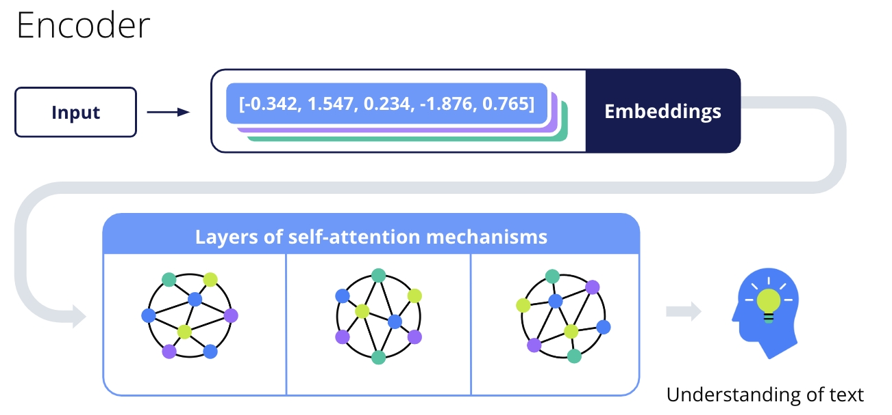

1. **Embeddings** - The numerical representations of words or tokens, typically in the form of vectors. Embeddings convert words into a format that can be processed by neural networks and other algorithms. They capture and quantify aspects of word meanings, their use in different contexts, and their syntactic roles.
2. **Self-Attention in Transformers** - This technique is used to calculate attention scores for each token, determining how much focus to put on other tokens in the sentence. It leads to a context-aware representation of each word.

### Explaination

#### **1. Tokenization & Embeddings: Turning Words into Numbers**

- **Tokenization**: The sentence is split into meaningful chunks (tokens).  
  - Example: *"A young girl named Alice sits bored by a riverbank"* → `["A", "young", "girl", "named", "Alice", "sits", "bored", "by", "a", "riverbank"]`  
  - Complex words (e.g., "riverbank") may split further (`"river" + "bank"`).  

- **Embeddings**: Each token is converted to a numerical vector (e.g., `Alice = [0.2, -1.3, 0.8, ...]`).  
  - These vectors capture semantic meaning (e.g., "Alice" encodes *[name, human, protagonist]*).  
  - Learned during training by analyzing billions of sentences.  

#### **2. Self-Attention: Contextual Understanding**

Transformers use **self-attention** to dynamically weigh relationships between all words in a sentence.  

- **How it works**:  
  - For the word *"follows"*, the model calculates:  
    - How much to focus on *"Alice"* (subject)?  
    - How much to focus on *"rabbit hole"* (destination)?  
  - Assigns **attention scores** (e.g., `"follows"` strongly attends to `"Alice"` and `"rabbit hole"`).  

- **Analogy**: Like planets in a solar system adjusting positions based on gravity (context):  
  - *"Alice"* moves closer to *"girl"* (subject-identity).  
  - *"rabbit hole"* aligns with *"plummet"* (cause-effect).  

#### **3. Why Transformers Beat Older Models**

| **Feature**               | **RNNs/LSTMs**                          | **Transformers**                          |
|---------------------------|----------------------------------------|------------------------------------------|
| **Context Handling**      | Sequential processing (loses distant words) | Parallel processing (sees full context) |
| **Long-Range Dependencies** | Struggles with gaps (e.g., pronoun resolution) | Tracks relationships across entire text |
| **Efficiency**            | Slow (processes words one-by-one)       | Fast (processes all words simultaneously) |

**Example**:  
In *"Alice follows the rabbit... he is late"*, transformers easily link *"he"* to *"rabbit"*, even if separated by many words. Older models might forget the connection.

#### **4. Training LLMs: Predicting the Next Word**

- Transformers learn by predicting masked/next words in massive datasets (e.g., Wikipedia, books).  
- Each prediction refines embeddings and attention mechanisms to better capture:  
  - Grammar (*"sits" → verb, needs a subject*).  
  - Semantics (*"white rabbit" → likely from Alice in Wonderland*).  
  - Narrative flow (*"plummet" → likely leads to "landing"*).  

**Output Generation**: When asked to continue the Alice story, the transformer:  

1. Uses embeddings to represent each word.  
2. Applies self-attention to maintain context (e.g., *"Alice"* is the protagonist).  
3. Predicts plausible next tokens (e.g., *"finds a tiny key"* fits the Wonderland theme).  

## Encoders and Decoders

In Transformer models, these are distinct components. The encoder processes the input text, converting it into numerical values known as embeddings. The decoder then uses these embeddings to generate output text.

### Decoding Strategies

**Greedy Decoding** - Picks the most likely next word at each step. Efficient but can lead to suboptimal sequences.
**Beam Search** - Tracks a number of possible sequences (beam width) to find a better sequence of words. It balances between the best local and overall choices.
**Top-K Sampling** - Randomly picks the next word from the top K most likely candidates, introducing randomness and diversity. 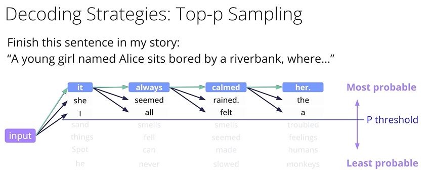
**Top-P (Nucleus) Sampling** - Chooses words from a set whose cumulative probability exceeds a threshold, focusing on high-probability options.

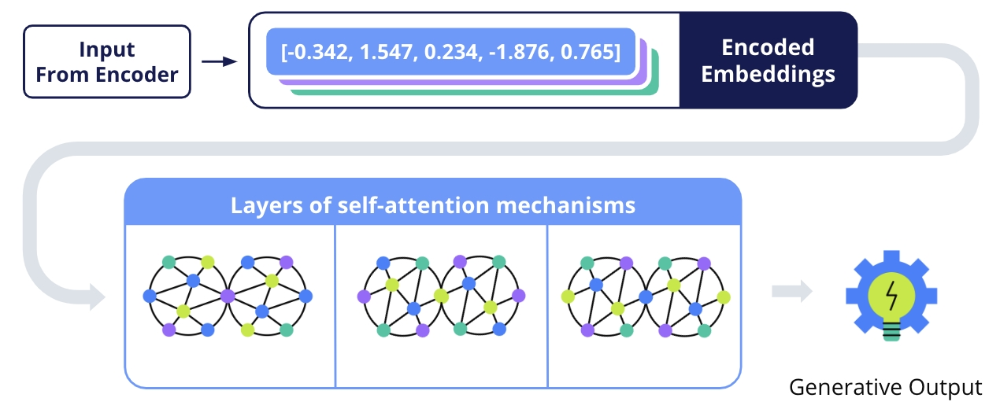

### Temperature Setting

This model setting controls the randomness of token predictions. A higher temperature leads to more randomness, while a lower temperature makes the model more confident (less random) in its predictions.

### Explaination

#### **1. Encoder-Decoder Architecture (Original Transformer)**

##### **Encoder**

- **Role**: Processes input text (e.g., a sentence to translate).  
- **Steps**:  
  1. **Tokenization**: Splits input into tokens (e.g., `"Hello world"` → `["Hello", "world"]`).  
  2. **Embeddings**: Converts tokens to numerical vectors.  
  3. **Self-Attention**: Weights relationships between words (e.g., links `"world"` to `"Hello"`).  
- **Output**: Context-rich representations (e.g., `"Hello"` now encodes *[greeting, subject]*).  

##### **Decoder**

- **Role**: Generates output text (e.g., translated sentence).  
- **Steps**:  
  1. Uses encoder’s output + **previous generated tokens** (autoregressive).  
  2. Self-Attention: Focuses on relevant parts of input (e.g., `"Bonjour"` attends to `"Hello"`).  
  3. **Masked Self-Attention**: Prevents cheating by hiding future tokens during training.  

**Example (Translation)**:

- **Input (Encoder)**: `"Hello world"` → Context: `[greeting, global audience]`.  
- **Output (Decoder)**: Generates `"Bonjour le monde"` step-by-step.  

#### **2. Decoder-Only Models (Modern LLMs like GPT)**

- **Simplified Architecture**: No separate encoder; the decoder handles both input and output.  
- **Self-Attention**: Processes entire input at once (e.g., for text generation).  
- **Example**: ChatGPT reads your prompt (input) and generates a response (output) using the same decoder layers.  

#### **3. Decoding Strategies**  

| **Strategy**       | **How It Works**                                                                 | **Pros & Cons**                          | **Example Output**                     |  
|--------------------|----------------------------------------------------------------------------------|------------------------------------------|----------------------------------------|  
| **Greedy**         | Always picks the highest-probability next word (e.g., `"The cat sat on the mat"`). | Fast but repetitive.                     | `"The cat sat on the mat"` (predictable). |  
| **Beam Search**    | Keeps top `N` (beam width) sequences; chooses best overall (e.g., `N=3`).         | Better coherence; slower.                | `"The cat sat on the rug"` (more fluent). |  
| **Top-K**          | Randomly samples from top `K` likely words (e.g., `K=5`).                         | More diverse; can be nonsensical.        | `"The cat perched on the sofa"` (creative). |  
| **Top-P (Nucleus)**| Samples from smallest set where cumulative probability > `P` (e.g., `P=0.9`).     | Balances creativity/coherence.           | `"The cat lounged on the carpet"` (natural). |  

##### **Temperature**

- **Low (e.g., 0.1)**: Conservative, picks likely words → `"The cat sat on the mat."`  
- **High (e.g., 1.0)**: More random → `"The cat teleported onto the moon."`  

## Building LLMs with Code

Visualization and Code Implementation
Tools like `TensorBoard` or `Matplotlib` in Python can visualize embeddings or attention scores. Code for NLP with transformer models often uses libraries like `Hugging Face`'s transformers and deep learning frameworks like `PyTorch` or `TensorFlow`.

- Tokenization and embedding processes are handled by pre-built classes in NLP libraries.
- The transformer architecture applies self-attention and feed-forward neural networks to process embeddings.
- Visualization of embeddings or attention scores can provide insights into the model's processing.

These steps enable transformer models to understand nuances and context in language, facilitating complex tasks like translation, content generation, and conversation.

Understanding the code and the computational processes behind these models is key for those interested in NLP and AI development.

### Understanding the Process

Let's take the sentence, "A young girl named Alice sits bored by a riverbank, …" and explore how a transformer model processes this text.

- **Tokenization** - The sentence is broken into tokens. "Alice" is one token, while "riverbank" may be split into "river" and "bank".

```py
# Tokenization using Hugging Face's Transformers
from transformers import AutoTokenizer
tokenizer = AutoTokenizer.from_pretrained("gpt-2") # tokenizer converts your input text into token IDs (e.g., "Alice" → token_id=3678)
tokens = tokenizer.tokenize("A young girl named Alice sits bored by a riverbank...")
```

- **Embedding** - Tokens are transformed into numerical vectors. For example, "Alice" becomes a vector like [-0.342, 1.547, 0.234, -1.876, 0.765].

```py
# Embedding and Processing with a Transformer Model
from transformers import AutoModel
model = AutoModel.from_pretrained("gpt-2") # model processes the token IDs through its neural network layers
inputs = tokenizer("A young girl named Alice sits bored by a riverbank...", return_tensors="pt")
outputs = model(**inputs)
last_hidden_states = outputs.last_hidden_state # last_hidden_states contains the final-layer embeddings (shape: [1, sequence_length, hidden_size])
```

- **Self-Attention** - The model calculates attention scores for each token, understanding their importance in context.
- **Layered Processing** - Multiple neural network layers process these embeddings, enhancing understanding at each step.
- **Encoders and Decoders** - The encoder processes input text into embeddings, and the decoder generates output text, using strategies like Greedy Decoding or Beam Search.

```py
# Visualization of Embeddings (Simplified Example)
import matplotlib.pyplot as plt
plt.imshow(last_hidden_states.detach().numpy()[0], cmap='viridis')
plt.colorbar()
plt.show()
```

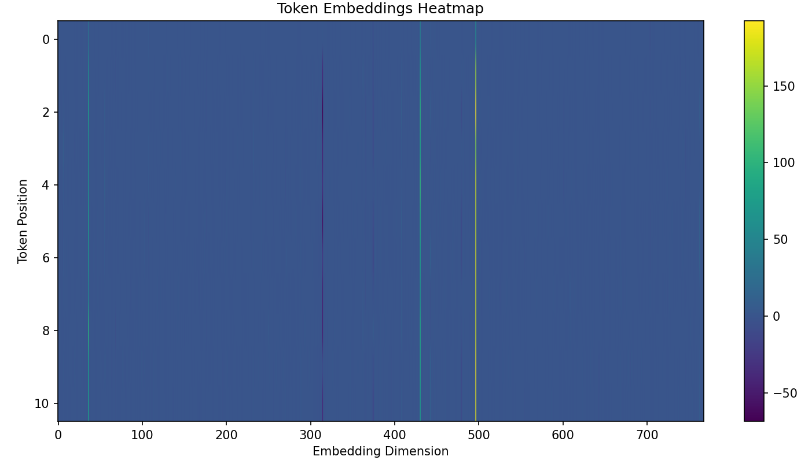

>The heatmap visualizes GPT-2's internal representation of your input text ("A young girl named Alice sits bored by a riverbank...") by displaying the numerical embeddings for each token across all 768 dimensions of the model's hidden state. Each row corresponds to a token's position in the sequence (e.g., "A" at position 0, "Alice" at position 4), while each column represents a specific dimension in the high-dimensional embedding space. The color intensity reflects the magnitude and polarity of activation values, with warm colors (yellow) indicating strong positive activations (up to ~150) and cool colors (purple/black) showing negative values (down to ~-50). The vertical banding patterns reveal how certain dimensions activate consistently across related tokens (e.g., dimensions that fire for both "Alice" and "riverbank" may indicate shared narrative context), while horizontal variations highlight how each token's unique meaning is distributed across different feature detectors. This representation captures GPT-2's ability to encode both semantic meaning (through sustained activations in specific dimensions) and positional relationships (via patterns that evolve across token positions), demonstrating how the model transforms discrete text into a continuous, context-aware numerical space suitable for next-token prediction. Notably, the concentration of high values in certain dimensions (e.g., around 100-200) suggests specialized feature detectors for syntactic or narrative elements, while negative values may suppress irrelevant features for each token's context.

### Transformer Models

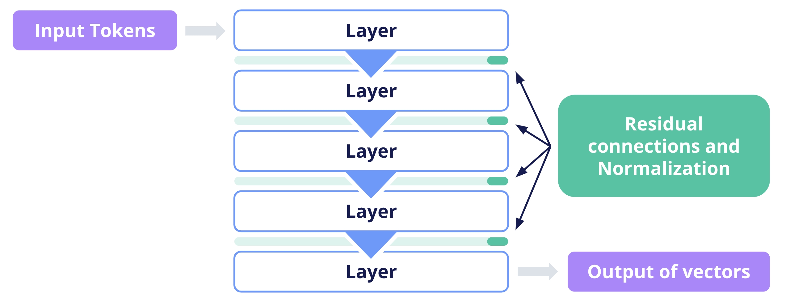

The core of a transformer model consists of multiple layers of self-attention and feed-forward neural networks. Each layer processes the input embeddings and passes its output to the next layer.

The actual processing involves complex mathematical operations, including self-attention mechanisms that allow each token to interact with every other token in the sequence. This is where the contextual understanding of language happens.

The final output from these layers is a set of vectors representing the input tokens in context.

- Python libraries such as Hugging Face's transformers handle tokenization and embedding.
- The transformer architecture's layered processing is managed by deep learning frameworks like PyTorch or TensorFlow.
- Visualization of embeddings or attention scores can be achieved using Python's Matplotlib.

## The Mechanism and Business Impact of Large Language Models

In the advanced field of artificial intelligence, **Large Language Models (LLMs)** stand out for their intricate architecture and ability to store and leverage vast knowledge. These models function through a sophisticated neural network, where **knowledge is encoded in numerical weights**—floating-point numbers representing the strength of connections between artificial neurons. These weights are fine-tuned during training to minimize prediction errors, effectively capturing linguistic patterns, code structures, and contextual relationships. The resulting **model file (e.g., .bin or .h5)** is a compact, binary-encoded representation of all learned parameters, requiring significant computational resources (RAM) to load and execute.  

### Core Mechanism of LLMs

**1. Neural Network Architecture & Weight Optimization**  
LLMs operate via **deep neural networks**, where each neuron’s output is shaped by weighted inputs processed through activation functions. The model’s "knowledge" is distributed across billions of these weights, adjusted during training to align predictions with real-world data. For instance, when trained on code, an LLM internalizes syntax and logic by refining weights to minimize errors in code completion tasks.  

**2. Knowledge Storage & Retrieval**  
The trained weights are stored in **non-human-readable binary files**, usable only within the model’s native architecture. When deployed, the model file is loaded into memory, where software performs **matrix multiplications** across network layers to transform input prompts into coherent outputs. Unlike databases, LLMs **do not copy training data** but generate original text by synthesizing learned patterns—enabling narratives, arguments, and code snippets that mimic human output.  

**3. Limitations: Hallucinations & Contextual Gaps**  
Despite their sophistication, LLMs **lack true understanding**. They generate text probabilistically, leading to **hallucinations** (plausible but false outputs) when prompts are ambiguous or topics exceed training scope. This underscores the need for **critical validation**, especially in high-stakes domains like law or medicine.  

### Business Implications

LLMs revolutionize industries by converting unstructured data into **actionable insights**. Key applications include:

- **Automated Content Generation**: Drafting reports, marketing copy, or code.  
- **Enhanced Decision-Making**: Extracting trends from contracts or customer feedback.  
- **Operational Efficiency**: Reducing manual effort in documentation and analysis.  

For businesses, leveraging LLMs requires:  

1. **Strategic Prompt Design** to elicit accurate, context-aware responses.  
2. **Integration with Real-Time Data** (e.g., APIs) to augment static knowledge.  
3. **Validation Frameworks** to mitigate hallucinations in critical outputs.

## Engaging with Large Language Models (LLMs)

LLMs have emerged as versatile tools, offering a spectrum of interaction methods tailored to diverse applications in natural language processing. While text input remains the crux of these interactions, the modalities in which LLMs are engaged vary significantly, reflecting the evolving needs of users and the innovative scope of applications.

### Direct Interaction

At the simplest level, direct interaction with LLMs involves users inputting text for a variety of tasks, from content summarization to question answering and creative writing. This straightforward method forms the baseline of LLM engagement, showcasing their primary capability in processing and responding to textual data.

### Versatility

The versatility of LLMs extends beyond this direct text input, as they are increasingly integrated into various applications. In the realm of text editors, for instance, LLMs function behind the scenes, enhancing user experience through advanced features such as grammar correction or predictive typing. Here, the user's interaction is primarily with the application interface, while the LLM works subtly in the background, analyzing and responding to the user-generated text.

### Using APIs

For developers, LLMs offer a different mode of interaction through APIs. This method involves more complex engagements where the text input is part of larger request payloads, often accompanied by specific parameters and configurations. Such interactions enable customized processing by the LLM, allowing developers to create sophisticated, AI-driven tools and features.

### Combining AI Models

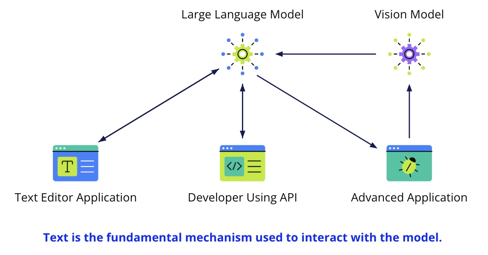

In more advanced applications, LLMs are combined with other AI models, such as vision models that interpret non-textual data. An image described in text by a vision model, for instance, can be transformed into a captivating narrative by an LLM, exemplifying the model's ability to process and contextualize a wide range of information.

### Key Terms

- **Direct Text Input** - The primary method of user interaction with LLMs, involving straightforward text entry for processing.
- **Application Integration** - Embedding LLMs within user-facing software, where they enhance functionality and improve user experience.
- **API Interaction** - A method for developers to access LLM functionalities, offering customizable options for various applications.
- **Cross-Model Collaboration** - Combining LLMs with other AI models to process and contextualize a broader scope of data.

These diverse interaction methods highlight the adaptability of LLMs, making them invaluable across different sectors. From enhancing consumer software to empowering developers and bridging different AI technologies, LLMs stand as a testament to the innovative potential of modern artificial intelligence.

## Prompt and Prompt Engineering

### Understanding Interaction through Prompt Engineering

In the sophisticated field of artificial intelligence, Large Language Models (LLMs) operate on a fundamental principle: the generation of text is conditional upon the input they receive. This input, known as a prompt, is crucial in shaping the model's output, making prompt engineering an essential skill in leveraging LLMs for various tasks.

### The Art and Science of Prompt Engineering

- **Crafting Prompts** - Much like an engineer designs systems for specific functions, prompt engineering involves creating prompts that guide LLMs to achieve desired outcomes. It's a blend of understanding the model's interpretive abilities and creatively eliciting the best responses.
- **Importance of Context** - Context in prompts is vital. It not only guides the model's response but also helps in disambiguating meanings and maintaining coherence in the conversation or text generation.
- **Task Specificity** - LLMs are versatile and can perform a range of tasks. Through prompt engineering, users can direct the model to address specific requirements, whether it's generating text, answering questions, or solving problems.

### Key Elements in Prompt Engineering

- **Clarity** - Prompts should be clear and direct to avoid confusion, guiding the LLM toward the intended task.
- **Conciseness** - While context is important, prompts should also be concise to avoid overloading the model with unnecessary information.
- **Format** - Aligning the prompt with the model's training, such as using a question-answer format, can enhance the accuracy of the response.

### Types of Prompts

1. **Zero-Shot Prompting** - Providing a language model with a task without any examples of how to perform it. The model relies on its pre-training to generate a response. Example: asking for a translation without providing previous examples.

2. **Few-Shot Prompting** - Giving the model a few examples of the task along with the prompt. These examples guide the model in understanding what's expected and demonstrate the desired output format. Example: Prompt a model with a few sentences and their translations and then ask it to translate a new sentence.

3. **Chain of Thought Prompting** - A technique that involves guiding the model through a step-by-step reasoning process. It's useful for complex tasks that require logic or reasoning, like math problems or cause-and-effect questions. Example: Prompt a model with a structure like: "To solve for x, first we need to.." The model will generate text that follows the format of explaining its steps till the solution is reached. the prompt might be structured to lead the model through t.

### Contextual Importance in LLMs

- **Guiding Responses** - The context provided in prompts ensures that the responses are accurate, detailed, and relevant to the query. Example: "Explain the significance of the 1969 moon landing" vs. a generic "Explain space exploration"
- **Disambiguation** - It helps in clarifying ambiguous terms or phrases, enhancing the model's understanding. Comparison: "Apple released new products" → Technology company. "Apple varieties grow best in" → Fruit cultivation
- **Relevance** - The more relevant the context, the more on-point the LLM's output, avoiding generic or off-topic responses.

Effective prompt engineering is about striking a balance – providing enough context to guide the model while keeping the input focused and relevant. This approach enables users to harness the full potential of LLMs, turning them into powerful tools for a wide array of applications in business, research, and creative domains.

Here's a concise summary of the Context Optimization Framework:

### Context Optimization Framework for AI Prompting

This framework enhances AI output quality by structuring prompts for clarity and relevance.

1. **Contextual Layering:** Organize prompt information into distinct levels:
    - **Base Layer:** Core instruction (e.g., "Write a product description").
    - **Specification Layer:** Key parameters (e.g., "For a smartwatch targeting athletes").
    - **Style Layer:** Tone and format (e.g., "Use active voice with bullet points").

2. **Context-Output Correlation:** Relates the level of context to output quality and risk:
    - **Under-contextualized:** Generic, off-target, prone to hallucinations.
    - **Optimally-contextualized:** Focused, relevant, no unnecessary risk.
    - **Over-contextualized:** Confused, fragmented, information overload.

3. **Task-Specific Context Guidelines:** Tailor context detail to the task type:
    - **Factual Queries:** Minimal context needed.
    - **Creative Tasks:** Require rich, detailed context.
    - **Technical Explanations:** Benefit from layered context (audience, key concepts, format).

4. **Practical Implementation:** Build prompts programmatically by iterating through context levels to construct a detailed instruction for the AI.

5. **Advanced Techniques:**
    - **Context Chunking:** Break down complex information into manageable segments with clear headings. Example:
      - >[Background] Parkinson's...  
        >[Task] Compare treatments  
        >[Constraints] Table with efficacy rates
    - **Context Priming:** Use leading statements to set the AI's persona or desired approach. Example: "As a Nature journal virologist..."
    - **Dynamic Context Loading:** Iteratively reference previous AI outputs to build on prior interactions. Example: "Expand Scene 2's neon alley"

### Understanding AI Model Performance: Key Metrics

Whenever you interact with an Artificial Intelligence model, whether it's for generating text, answering questions, or assisting with code, a complex computational process occurs to deliver its response. The efficiency and cost of this process are typically measured by three critical metrics: **token usage**, **latency**, and **computational cost**. Understanding these metrics is vital for optimizing interactions with AI models and appreciating the resources involved in their operation.

1. **Token Usage:**
    - **Definition:** A token is the fundamental unit of data that an AI model processes. While often roughly corresponding to a word, tokens can also represent parts of words, punctuation, or even individual characters, especially for non-English languages or specific encoding schemes.
    - **How it Works:** Every prompt you submit to the model (your "input") is converted into tokens. Similarly, every part of the model's generated answer (its "output") is also measured in tokens. The total token usage for a single interaction is the sum of input tokens and output tokens.
    - **Significance:** Token usage is often directly linked to the **cost** of using commercial AI models (you pay per token). It also impacts **processing time**; a larger number of tokens generally means more data for the model to process, potentially increasing latency. Efficient prompting aims to convey information concisely to minimize input tokens, and clear instructions help the model generate focused, relevant output, thus optimizing output token usage.

2. **Latency:**
    - **Definition:** Latency refers to the time delay between when you send a request (prompt) to the AI model and when you receive its complete response. It's essentially how long you have to wait for the AI to "think" and deliver its answer.
    - **Factors Influencing Latency:**
        - **Model Size and Complexity:** Larger, more complex models (with more parameters) typically require more computation and thus have higher latency.
        - **Token Count:** As mentioned, more tokens (both input and output) usually lead to longer processing times.
        - **Computational Resources:** The power of the hardware (GPUs, TPUs) running the model, and whether it's shared or dedicated, directly affects speed.
        - **Network Conditions:** For cloud-based models, internet speed and server load can introduce delays.
        - **Queue Times:** In shared environments, if many users are making requests simultaneously, your request might be queued.
    - **User Experience Impact:** High latency can degrade the user experience, especially in interactive applications where quick responses are expected. Developers often optimize prompts and choose appropriate models to balance output quality with acceptable latency.

3. **Computational Cost:**
    - **Definition:** Computational cost refers to the total processing power and energy required for an AI model to operate. This encompasses the resources consumed by the CPUs, GPUs, memory, and storage involved in running the model's algorithms.
    - **Impact on Performance and Efficiency:**
        - **Performance:** Models with higher computational costs generally require more powerful and expensive hardware to run efficiently, or they will run slower on less capable systems.
        - **Efficiency:** From a resource perspective, a computationally expensive model consumes more energy and generates more heat, leading to higher operational expenses (e.g., electricity bills for data centers). This is a significant consideration for both cloud providers and organizations deploying AI on-premises.
        - **Model Optimization:** Research in AI often focuses on creating more efficient models (e.g., smaller models, quantized models) that can achieve comparable results with lower computational requirements, making them more accessible and sustainable.
    - **Trade-offs:** There's often a trade-off between model sophistication (leading to higher quality outputs) and its computational cost. Cutting-edge models typically demand more resources, while lighter models might offer faster or cheaper operation at the expense of some advanced capabilities.

## Retrieval Augmented Generation (RAG)

In the evolving landscape of Natural Language Processing (NLP), the integration of Retrieval Augmented Generation (RAG) marks a significant leap. This method synergizes the linguistic finesse of Large Language Models (LLMs) with the precision of external knowledge bases, crafting responses that are not only linguistically coherent but also factually enriched.

### The Mechanism of RAG

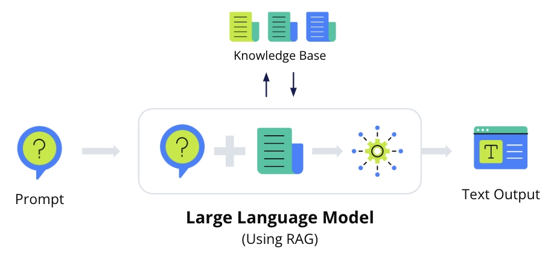

1. **Retrieval Step**

   - Upon receiving a prompt, the RAG system embarks on a quest for knowledge. It delves into vast datasets or specialized knowledge bases, seeking information that resonates with the prompt's essence.
   - Employing a trained retrieval model, it sifts through a multitude of documents, pinpointing those that shimmer with relevance and utility for the given context. (The model identifies and selects documents that are most relevant and useful for a specific context or purpose)

2. **Generation Step**

   - The journey doesn’t end with retrieval. The language model, equipped with the gleaned knowledge, weaves this information into its response fabric.
   - It's a harmonious blend – the innate understanding of language from the LLM's training interlaced with freshly acquired, specific insights from external sources. The outcome? A response that's not just articulate but informed and contextual.

### The Art of Prompt Engineering in RAG

- Here, the craft of prompt engineering ascends to a pivotal role. It's akin to setting the coordinates for a voyage – the prompt doesn't just ignite the generation process; it also steers the retrieval mechanism towards the most pertinent information.
- A meticulously engineered prompt is the compass that guides the RAG system through the vast seas of data, ensuring that the treasures it fetches are exactly what's needed to construct a response that hits the mark.

### The Balance of Power and Responsibility

- While RAG systems are potent tools in the arsenal of NLP, wielding them, especially in critical fields like medicine, calls for responsibility. The information they generate, while advanced and comprehensive, still requires the discerning eye of human validation.
- RAG systems are valuable in domains requiring accuracy and up-to-date information, like medicine.
- They can synthesize information from recent research papers and studies to generate informed content.
- In critical domains like medicine, it's essential to verify RAG-generated information against trusted sources.
- While RAG enhances content generation, careful use and validation are key to ensuring accuracy and reliability.

## Foundation Models in Machine Learning

Foundation models represent a significant shift in machine learning and artificial intelligence. They serve as versatile and powerful platforms for a variety of applications, thanks to their extensive training and generalization capabilities. Here's a concise overview of their key attributes:

1. **Scale** - These models are colossal in size, often encompassing billions of parameters, making them capable of learning from and processing enormous datasets.

2. **Generalization** - Their design enables them to generalize knowledge across different languages, tasks, and domains. This broad scope allows them to capture a vast array of information and nuances.

3. **Adaptability** - One of their standout features is adaptability. Foundation models can be fine-tuned with additional training to cater to specific tasks or requirements, enhancing their flexibility and utility in various applications.

4. **Capabilities** - They boast a range of capabilities across different modalities, such as text and images. This versatility makes them suitable for diverse applications like language translation, question-answering, content summarization, image recognition, and more.

5. **Shared Architecture** - A single foundation model can act as a base for developing numerous specialized models. This approach significantly reduces the resources and time required to develop new models for different tasks, as it eliminates the need to train a new model from the ground up for each specific application.

Examples of foundation models include BERT for natural language understanding, GPT-3 for generative text applications, and T5, which handles a range of text-based tasks. The concept extends beyond language models, encompassing any pre-trained model that offers a foundational platform for further specialized learning and application development.

## Fine-Tuning Large Language Models (LLMs)

Fine-tuning a large language model (LLM) effectively customizes it for specialized tasks, leveraging its broad learning capabilities to adapt to specific domains or industries. Fine-tuning LLMs involves adjusting a pre-trained foundational model to better suit a specific use case or task. This process typically involves training the model on a smaller, task-specific dataset, allowing it to learn nuances and patterns relevant to the new context. While it doesn't change the foundational model's parameters from scratch, it adapts them to improve performance for the desired application, making it more effective for specific tasks or domains. Let’s break down the key stages and outcomes of this process:

**Pre-Trained Model** - The foundation of fine-tuning is a model that has already been trained on a vast corpus of general text data. This extensive pre-training equips the model with a wide-ranging understanding of language.

**Specialized Dataset Preparation** - The specific task or domain dictates the dataset for fine-tuning. For instance, legal documents and texts are prepared for fine-tuning a model for legal applications.

**Fine-Tuning Process** - The model undergoes additional training on this specialized dataset. This stage involves adjusting the model's weights and parameters to align more closely with the domain-specific language, style, and content. During the fine-tuning process of a model, the learning rate is often set to a lower value compared to initial training. This lower learning rate ensures that the adjustments made to the model's parameters are subtle and precise. It allows the model to adapt to new data or tasks without drastically altering the pre-trained knowledge, leading to effective modifications that enhance performance on specific tasks without overfitting.

**Gaining Task-Specific Abilities** - Post fine-tuning, the model becomes more proficient in handling the particularities of the new domain. This includes a better grasp of specific terminologies, writing styles, and types of queries or tasks pertinent to the dataset it was fine-tuned on.

**Enhanced Performance in Specialized Tasks** - The fine-tuned model now exhibits improved performance and accuracy in tasks related to its specialized training. This makes it a valuable asset for professionals within that specific field, such as legal experts, medical practitioners, or chemical engineers, depending on the focus of fine-tuning.

**Customization for Organizational Need**s - Organizations can leverage fine-tuning to tailor LLMs to their unique requirements. This could range from enhancing customer service interactions to generating content that aligns with a brand’s voice or providing technical support in a specific industry.

In essence, fine-tuning transforms a generalist LLM into a specialist tool, extending its utility beyond general applications to more focused, domain-specific tasks. This process exemplifies the flexibility and adaptability of LLMs, showcasing their potential to provide bespoke solutions across various sectors.


### Explore Fine-Tuning Code

The code below fine-tunes a model to be an "expert" on Amazon SEC filings from 2021-2022. The dataset used for fine-tuning is one large text file, containing the text of the SEC filings, the text in the file looks like this:

>"This report includes estimates, projections, statements relating to our business plans, objectives, and expected operating results that are “forward- looking statements” within the meaning of the Private Securities Litigation Reform Act of 1995, Section 27A of the Securities Act of 1933, and Section 21E of the Securities Exchange Act of 1934. Forward-looking statements may appear throughout this report, including the following sections...."

The code below loads the dataset of the SEC filings text file from an AWS S3 storage bucket. Then the dataset is used to fine-tune the open-source Falcon 7B text generation large language model for domain adaptation.

It uses the dataset of financial text from SEC filings to fine-tune huggingface-llm-falcon-7b-bf16 for financial applications.

Here are the requirements for the train and validation data.

- Input: A train and an optional validation directory. Each directory contains a CSV/JSON/TXT file.
- For CSV/JSON files, the train or validation data is used from the column called 'text' or the first column if no column called 'text' is found.
- The number of files under train and validation (if provided) should equal to one.
- Output: A trained model that can be deployed for text generation tasks with specialized domain knowledge.

```py
# Idenfity the foundation model to fine-tune
model_id = "huggingface-llm-falcon-7b-bf16"

# The training data of SEC filing of Amazon has been pre-saved in the S3 bucket.
from sagemaker.jumpstart.utils import get_jumpstart_content_bucket

# Sample training data is available in this bucket
data_bucket = get_jumpstart_content_bucket(aws_region)
data_prefix = "training-datasets/sec_data"

training_dataset_s3_path = f"s3://{data_bucket}/{data_prefix}/train/"
validation_dataset_s3_path = f"s3://{data_bucket}/{data_prefix}/validation/"

#Prepare training parameters
from sagemaker import hyperparameters

my_hyperparameters = hyperparameters.retrieve_default(
    model_id=model_id, model_version=model_version
)

my_hyperparameters["epoch"] = "3"
my_hyperparameters["per_device_train_batch_size"] = "2"
my_hyperparameters["instruction_tuned"] = "False"
print(my_hyperparameters)

# Validate hyperparameters

hyperparameters.validate(
    model_id=model_id, model_version=model_version, hyperparameters=my_hyperparameters
)
# Starting training
from sagemaker.jumpstart.estimator import JumpStartEstimator

domain_adaptation_estimator = JumpStartEstimator(
    model_id=model_id,
    hyperparameters=my_hyperparameters,
    instance_type="ml.p3dn.24xlarge",
)
domain_adaptation_estimator.fit(
    {"train": training_dataset_s3_path, "validation": validation_dataset_s3_path}, logs=True
)

# Extract Training performance metrics. Performance metrics such as training loss and validation accuracy/loss can be accessed through cloudwatch while the training. We can also fetch these metrics and analyze them within the notebook

from sagemaker import TrainingJobAnalytics

training_job_name = domain_adaptation_estimator.latest_training_job.job_name

df = TrainingJobAnalytics(training_job_name=training_job_name).dataframe()
df.head(10)
# Deploying inference endpoints
# We deploy the domain-adaptation fine-tuned and pretrained models separately, and compare their performances.
# We first deploy the domain-adaptation fine-tuned model.

domain_adaptation_predictor = domain_adaptation_estimator.deploy()
# Next, we deploy the pre-trained huggingface-llm-falcon-7b-bf16.

my_model = JumpStartModel(model_id=model_id)
pretrained_predictor = my_model.deploy()

# Running inference queries and compare model performances
parameters = {
    "max_new_tokens": 300,
    "top_k": 50,
    "top_p": 0.8,
    "do_sample": True,
    "temperature": 1,
}


def generate_response(endpoint_name, text):
    payload = {"inputs": f"{text}:", "parameters": parameters}
    query_response = query_endpoint_with_json_payload(
        json.dumps(payload).encode("utf-8"), endpoint_name=endpoint_name
    )
    generated_texts = parse_response(query_response)
    print(f"Response: {generated_texts}{newline}")
test_paragraph_domain_adaption = [
    "This Form 10-K report shows that",
    "We serve consumers through",
    "Our vision is",
]


for paragraph in test_paragraph_domain_adaption:
    print("-" * 80)
    print(paragraph)
    print("-" * 80)
    print(f"{bold}pre-trained{unbold}")
    generate_response(pretrained_predictor.endpoint_name, paragraph)
    print(f"{bold}fine-tuned{unbold}")
    generate_response(domain_adaptation_predictor.endpoint_name, paragraph)

# The fine-tuned model starts to generate responses that are more specific to the domain of fine-tuning data which is relating to SEC report of Amazon.

# Clean up the endpoint
# Delete the SageMaker endpoint
pretrained_predictor.delete_model()
pretrained_predictor.delete_endpoint()
domain_adaptation_predictor.delete_model()
domain_adaptation_predictor.delete_endpoint()
```
