# Artificial Intelligence: Machine Learning

## Enabling Computers to Learn and Decide

**Human Intelligence (HI)** and **Artificial Intelligence (AI)** pertain to information processing and decision-making. While humans naturally process multifaceted information and make decisions, the goal of AI is to enable machines to mimic this ability.

For instance, recognizing a favorite song involves processing various data points:

- Sound
- Lyrics
- Artist
- Video
- Title, and
- Similarity to other songs.

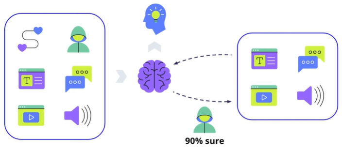
This lesson is about how we can implement machine learning to process information and make informed decisions, like identifying a song's artist with a degree of certainty.

### Key Terms and Concepts

- **Human Intelligence (HI):** The innate ability of humans to process information and make decisions based on it.
- **Artificial Intelligence (AI):** The endeavor to equip machines with human-like information processing and decision-making capabilities.
- **Machine Learning (ML):** A subset of AI, it involves training computers to learn from data and improve over time.
- **Data Points:** Individual pieces of information processed for decision-making.
- **Certainty:** The level of confidence in making a decision based on processed information.

## Machine Learning

The journey of teaching a computer to play a video game unveils the essence of **Machine Learning (ML)**, a vital segment of **Artificial Intelligence (AI)**. In this realm, we craft **machine learning algorithms** to empower a computer system to autonomously learn from data, devoid of manual, step-by-step guidance. Encoded in languages like Python, these algorithms sift through data to unearth patterns, laying the groundwork for future predictions. Python’s user-friendliness and rich ML libraries make it a popular choice. The ensemble of data, ML algorithms, and the learning trajectory constitute a Machine Learning System. At its core lie three pillars:

- **Data** - The myriad forms of digital information like images, text, pixels, and numbers that fuel the learning process.
- **ML Algorithm Code** - The rulebook guiding the processing of data.
- **Machine Learning Model** - Often dubbed as the system's "brain," it harnesses algorithms to process data, paving the path for predictions or decisions. A model in machine learning is the trained algorithm that you use to identify patterns in your data. A model is trained through the machine learning process and captures and stores patterns. The more patterns a model stores, the bigger it will become. Machine learning model sizes are typically described in megabytes. The purpose of a model is to predict outcomes to new data inputs, based on
previously observed patterns.

The venture begins with training the model using a designated algorithm, transitioning next to testing its performance with fresh data, akin to gauging a game-playing bot's prowess in a gaming arena. Through a cycle of training, testing, and adjustments, we endeavor to escalate the model's performance to hit the bullseye—be it triumphing in a game or nailing a song artist identification.

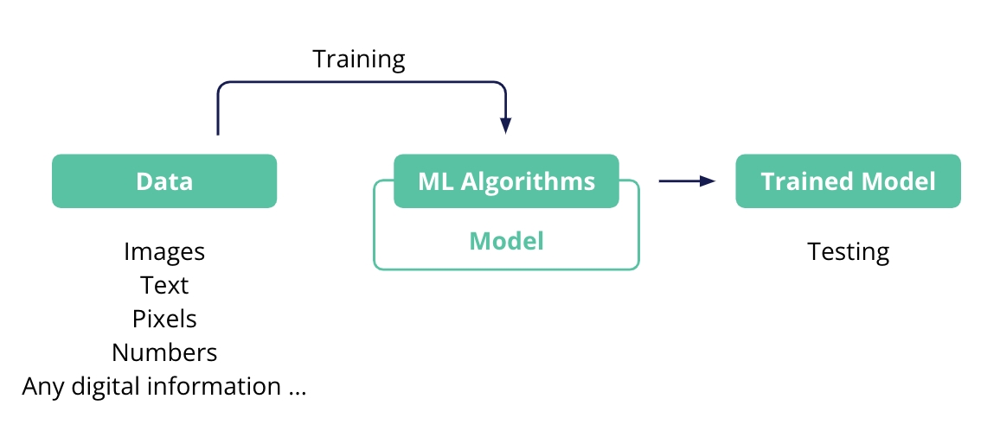

**Key Terms and Concepts:**

- **Machine Learning (ML)** -The compass directing computers towards autonomous learning and pattern discernment from data, under the vast umbrella of AI.
- **Machine Learning System** - The harmonious blend of data, ML algorithms, and a machine learning model.
- **Machine Learning Model** - The system's intellect, processing data through algorithms to forge predictions or decisions.
- **Training** - The saga of nurturing the model by processing data through the ML algorithm code. In macine learning, we can use training algorithms to help us accomplish empirical tasks that require some sort of inductive reference. This objective involves induction becuase it uses data to train algorithms to make generalizable inferences. Thus, algorithms can make statistically reliable predictions or decisions, or complete other tasks, when they apply new data that was used to train them. An algorithm-trained algorithm identifies patterns in our data without requiring any explicit, manually set rules.
- **Testing** - The act of gauging the model's mettle using new data, post-training.
- **Iteration** - The cycle of tweaking algorithms and data, coupled with re-training, aiming to uplift model performance.
- **Compute model instances** - AWS provides a variety of instance types that support machine learning models, depending on the use case of the model. Amazon Elastic Compute Cloud (Amazon EC2) provides a wide selection of instance types (or families) that are optimized to fit different use cases. Instance types comprise varying combinations of CPU, memory, storage, and networking capacity. They give you the flexibility to choose the appropriate mix of resources for your applications. Each instance type includes one or more instance sizes so that you can scale your resources to the requirements of your target workload. AWS ML services, like Amazon SageMaker, use these instances to back computing needs for your ML projects. You will learn more about these instances and the use case for each, later in this course.
- **Inference** - Inference is the process of making predictions using a trained model. In deep learning applications, inference accounts for up to 90 percent of total operational costs for two reasons. First, standalone graphics processing unit (GPU) instances are typically designed for model training-not for inference. Though training jobs batch process hundreds of data samples in parallel, inference jobs usually process a single input in real time. Thus, they consume a small amount of GPU compute, which makes standalone GPU inference cost-inefficient. On the other hand, standalone CPU instances are not specialized for matrix operations, and thus are often too slow for deep learning inference.
Secondly, different models have different CPU, GPU, and memory requirements. Optimizing for one resource can lead to underutilization of other resources and higher costs. Amazon Web Services (AWS) resolves these cost-inefficient issues with Amazon Elastic Inference. You will learn more about Amazon Elastic Inference and when to use it in the next module.

### DEMO

we explain the fundamentals of creating artificial intelligence (AI) using machine learning (ML). The key points covered include:

1. **AI and ML Process** - This involves gathering data, employing ML algorithms to learn from it, and developing predictive models.
2. **AWS and Pre-Trained Models** - Amazon Web Services (AWS) provides pre-trained models for common tasks, saving users the effort of creating and maintaining their own models.
3. **Amazon Rekognition** - An AWS service that uses deep learning to analyze images and videos for tasks such as facial analysis and object identification, it requires no ML expertise from the user.
4. **Label Detection Demo** - The video showcases how Rekognition detects and labels objects in images—such as people, skateboards, or trains—and gives confidence scores for each detection.
5. **Integration with Applications** - The Rekognition API facilitates integration with applications, enabling users to send images for analysis and receive detailed information, including the locations of objects within the images.

> In the demo showcasing Amazon Rekognition, we began by uploading an image to the platform, which allowed the service to analyze it for object identification and labeling. The demo illustrated how Rekognition detected various entities within the image, such as a train and a person, and provided bounding boxes around these objects along with confidence scores indicating the accuracy of its predictions. After observing the results, the video explained how to utilize the Rekognition API to programmatically send images for analysis. By constructing a JSON document that represents the image data, developers can receive detailed information about the detected objects, including their locations within the image, enabling seamless integration of image recognition capabilities into applications. 

## Types of Machine Learning

When embarking on creating a machine learning model, one of the first choices you'll need to make is the type of learning approach to use. This decision hinges on the kind of data you have and the problem you're tackling. Here’s a simple breakdown of the three primary learning types: Supervised, Unsupervised, and Reinforcement Learning.

### Supervised Learning

Uses Labeled Data to Train the Model

- **Like Learning with a Teacher** - You provide the model with data and the correct answers (labels) for each data point, much like showing a picture of a cat and telling the model it's a cat. Labels provide the correct answers which guide the model’s learning, not to categorize data.
- **When to Use** - If you have labeled data and you want the model to learn the right answer from this data.
- **Examples** - Classifying images, speech recognition, self-driving car tasks like identifying pedestrians, bank fraud detection.

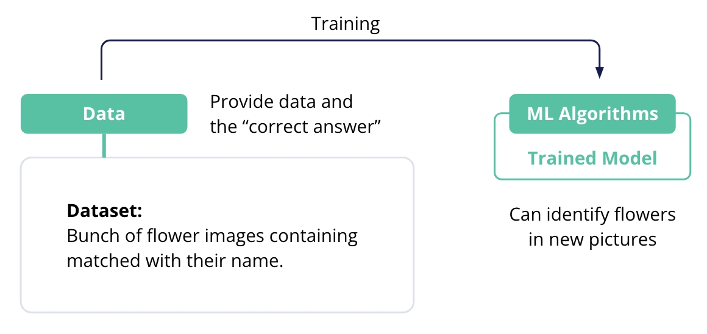

### Unsupervised Learning

Uses Unlabeled Data and the Model Finds the Patterns

- **Learning on its Own** - The model explores a lot of data on its own to find patterns and structures, akin to solving a puzzle without seeing the picture on the box.
- **When to Use** - If you have unlabeled data and you want the model to find patterns or structures in the data. Unsupervised learning can discover patterns in unlabeled data, which is often the case in massive datasets.
- **Examples** - Generating new songs, speech recognition, writing code, handling massive datasets with unlabeled data. A common subcategory of unsupervised learning is called clustering where the algorithm groups data into different clusters based on similar features to better understand the attributes of a specific cluster.

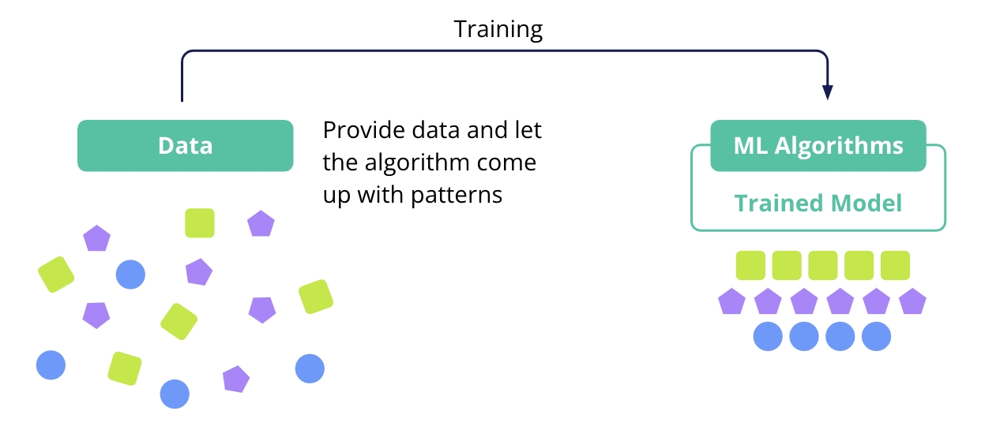

### Reinforcement Learning

Uses Rewards and Penalties (Trial and Error) to learn behaviors for success

- **Learning by Trial and Error** - The model learns by interacting with an environment, receiving rewards for right actions and penalties for wrong ones, much like training a pet.
- **When to Use** - When you want your model to learn from its interactions and feedback, without needing labeled data.
- **Examples** - Playing video games, robotics, real-time decision-making in self-driving cars.

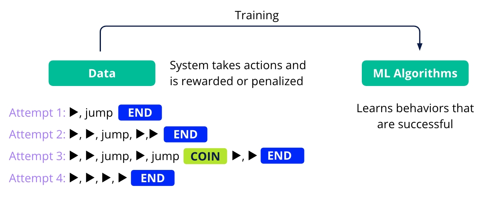

### Combination of models

In more complex real-world problems, a blend of these learning types might be employed, with multiple models each handling specific tasks, much like a team of specialists working together towards a common goal. **For example:-**

In the context of self-driving cars, different machine learning models can be employed to handle specific tasks, each utilizing a different learning approach to optimize performance.

1. **Supervised Learning for Pedestrian Detection**: A model trained with supervised learning is provided with labeled data, such as images of pedestrians marked as "pedestrian" or "not pedestrian." This model learns to recognize and detect pedestrians in various environments, ensuring the car can identify people on the road and react accordingly.

2. **Unsupervised Learning for Road Condition Clustering**: Another model uses unsupervised learning, which doesn't require labeled data. Instead, it analyzes various road conditions (like wet, dry, or icy) and groups them based on similarities. This helps the car understand different driving environments without needing explicit labels, allowing it to adapt to changing conditions.

3. **Reinforcement Learning for Real-Time Driving Decisions**: A third model employs reinforcement learning, where the car learns to make decisions through trial and error. It interacts with its environment (e.g., navigating traffic) and receives feedback in the form of rewards or penalties based on its actions. This model helps the car make real-time driving decisions, such as when to accelerate, brake, or change lanes, based on dynamic conditions.

By combining these specialized models, the self-driving car can function cohesively, much like a team of specialists working together. Each model contributes its unique expertise to tackle complex tasks, enabling the car to navigate safely and efficiently in various driving scenarios. This collaborative approach is essential for achieving advanced capabilities in artificial intelligence.

## Create a Tech Gadget Customer Support Chatbot

This is a simple customer support chatbot designed to assist users with common inquiries related to TechGadget products and services. It works by matching user input to predefined keywords and providing corresponding responses. Here's how it functions:

1. **Keyword Matching**: The chatbot listens for specific keywords in the user's input. For example, if a user mentions "smartwatches," the chatbot will respond with information about the availability of smartwatches.

2. **Predefined Responses**: Each keyword is associated with a predefined response. When a keyword is detected in the user's input, the chatbot returns the corresponding response.

3. **Fallback Response**: If the user's input doesn't match any predefined keywords, the chatbot provides a fallback response, asking the user to rephrase their question.

4. **Conversation Flow**: The chatbot continues to interact with the user until the user decides to end the conversation by typing "quit," "exit," or "bye."

This chatbot is a basic implementation and is useful for handling frequently asked questions and providing quick support to users.

```python
# Simple Customer Support Chatbot
responses = {
      "hi": "Hello! Welcome to TechGadget Support. How can I assist you today?",
      "do you have smartwatches": "Yes, we have a variety of smartwatches. You can check them out on our products page.",
      "shipping time": "Shipping usually takes 3-5 business days.",
      "shipping methods": "We offer standard, expedited, and overnight shipping.",
      "return policy": "You can return products within 30 days of receipt for a full refund.",
      "how to return": "To return a product, please visit our returns page for a step-by-step guide.",
      "won’t turn on": "Make sure your gadget is charged. If it still won’t turn on, you can visit our troubleshooting page.",
      "reset device": "To reset your device, hold down the power button for 10 seconds. If that doesn't work, please check the manual for a factory reset.",
      "bye": "Thank you for visiting TechGadget. If you have more questions, feel free to ask. Goodbye!"
}

def get_bot_response(user_input):
      user_input = user_input.lower()

      for keyword, response in responses.items():
          if keyword in user_input:
              return response

      return "I'm not sure how to respond to that. Can you try asking something else?"

while True:
      user_input = input("You: ")
      if user_input.lower() in ["quit", "exit", "bye"]:
          print("Bot: Goodbye! If you have any more questions, we're here to help.")
          break

      response = get_bot_response(user_input)
      print(f"Bot: {response}")
```

>You: hi
> Bot: Hello! Welcome to TechGadget Support. How can I assist you today?
>
> You: do you sell ayurvedic medicines too?
>
> Bot: I'm not sure how to respond to that. Can you try asking something else?
>
> You: i want you to turn you off
>
> Bot: I'm not sure how to respond to that. Can you try asking something else?
>
> You: what is your return policy?
>
> Bot: You can return products within 30 days of receipt for a full refund.
>
> You: are you sure?
>
> Bot: I'm not sure how to respond to that. Can you try asking something else?
>
> You: ok bye
>
> Bot: Thank you for visiting TechGadget. If you have more questions, feel free to ask. Goodbye!
>
> You: exit
>
> Bot: Goodbye! If you have any more questions, we're here to help.

## Predicting Building Energy Efficiency (Supervised Learning)

**Scenario** - You are working for an architecture firm, and your task is to build a model that predicts the energy efficiency rating of buildings based on features like wall area, roof area, overall height, etc.

```py
# Import necessary libraries
import pandas as pd
import numpy as np
import matplotlib.pyplot as plt
import seaborn as sns
import warnings
from sklearn.model_selection import train_test_split
from sklearn.ensemble import RandomForestRegressor
from sklearn.metrics import mean_squared_error

warnings.filterwarnings('ignore')

# Generate synthetic dataset for building features and energy efficiency ratings
np.random.seed(0)
data_size = 500
data = {
    'WallArea': np.random.randint(200, 400, data_size),
    'RoofArea': np.random.randint(100, 200, data_size),
    'OverallHeight': np.random.uniform(3, 10, data_size),
    'GlazingArea': np.random.uniform(0, 1, data_size),
    'EnergyEfficiency': np.random.uniform(10, 50, data_size)  # Energy efficiency rating
}
df = pd.DataFrame(data)

# Data preprocessing
X = df.drop('EnergyEfficiency', axis=1)
y = df['EnergyEfficiency']

# Visualize the relationships between features and the target variable (Energy Efficiency)
sns.pairplot(df, x_vars=['WallArea', 'RoofArea', 'OverallHeight', 'GlazingArea'], y_vars='EnergyEfficiency', height=4, aspect=1, kind='scatter')
plt.show()
```

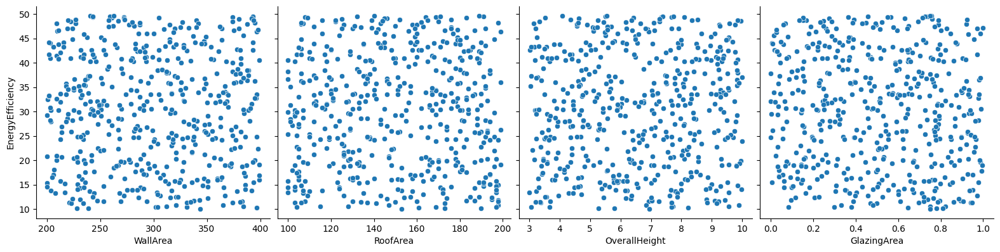

```py
# Split the data into training and testing sets
X_train, X_test, y_train, y_test = train_test_split(X, y, test_size=0.2, random_state=42)

# Train a Random Forest model
model = RandomForestRegressor()
model.fit(X_train, y_train)

# Predict and evaluate
predictions = model.predict(X_test)
mse = mean_squared_error(y_test, predictions)
print(f"Mean Squared Error: {mse}")
```

>Mean Squared Error: 146.02051889440582

```py
# Plot the True values vs Predicted values
plt.figure(figsize=(10, 6))
plt.scatter(y_test, predictions)
plt.xlabel("True Values")
plt.ylabel("Predictions")
plt.title("True Values vs Predicted Values")
plt.plot([y_test.min(), y_test.max()], [y_test.min(), y_test.max()], 'k--')
plt.show()
```

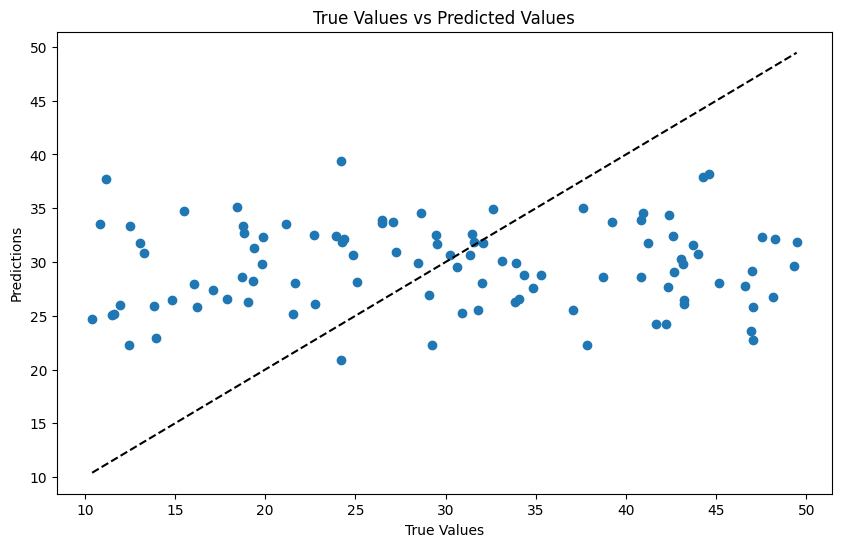

In this exercise, we trained a RandomForestRegressor model to predict the energy efficiency of buildings based on features such as wall area, roof area, overall height, and glazing area.

**Results:**

1. **Data Visualizations** - Scatter plots will show the relationship between each feature and the target variable (energy efficiency). Students should observe how changes in features may relate to energy efficiency, although with synthetic data, these relationships might not show clear trends.
2. **Model Performance** - After training the model and making predictions, students will evaluate the model using Mean Squared Error (MSE). With synthetic data, the MSE value may vary, but it gives an idea of the average error in the model's predictions. The closer this value is to zero, the better the model's performance.
3. **Prediction vs. True Value Plot** - The scatter plot comparing true values and model predictions should ideally show points along the diagonal line (y=x), indicating accurate predictions. Deviations from this line suggest prediction errors.

## Vehicle Clustering (Unsupervised Learning)

**Scenario** - You are working for an automotive company, and your task is to cluster vehicles into groups based on their features such as weight, engine size, and horsepower.

```py
# Import necessary libraries
import pandas as pd
import numpy as np
import matplotlib.pyplot as plt
import warnings
from sklearn.cluster import KMeans

warnings.filterwarnings('ignore')

# Generate synthetic dataset for vehicles
np.random.seed(0)
data_size = 300
data = {
    'Weight': np.random.randint(1000, 3000, data_size),
    'EngineSize': np.random.uniform(1.0, 4.0, data_size),
    'Horsepower': np.random.randint(50, 300, data_size)
}
df = pd.DataFrame(data)

# No labels are needed for unsupervised learning
X = df

# Perform KMeans clustering
kmeans = KMeans(n_clusters=3, random_state=42)
kmeans.fit(X)

# Plotting the clusters
plt.scatter(df['Weight'], df['Horsepower'], c=kmeans.labels_)
plt.xlabel('Weight')
plt.ylabel('Horsepower')
plt.title('Vehicle Clusters')
plt.show()
```

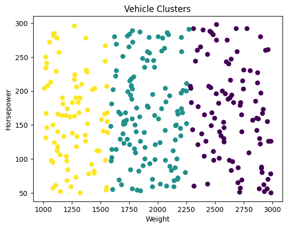

In this exercise, we used KMeans clustering to group vehicles based on their features like weight, engine size, and horsepower.

**Results:**

1. **Cluster Visualization** - The scatter plot will visually depict how vehicles are grouped based on weight and horsepower. Each cluster will be represented by a different color. With synthetic data, the distinctness of clusters may vary, but students should be able to see groupings based on the chosen features.
2. **Interpreting Clusters** - There are no 'correct' labels in unsupervised learning, but students should observe how vehicles are grouped based on similarities in their features. They might see, for example, that heavier vehicles with higher horsepower are grouped together.

>In both tasks, the exact numerical results can vary based on the randomness in the synthetic data generation and the inherent variability in machine learning models. The key learning outcome is understanding the process of applying machine learning techniques and interpreting the results, rather than achieving specific numerical accuracy or clustering results.

## Machine Learning Approaches

Building a machine learning model involves deciding on the learning type, selecting an approach or algorithm, and then training the model to optimize its performance. This journey begins with traditional machine learning approaches like:

- Decision Trees
- Regression
- Clustering Algorithms

which are apt for structured data. However, for handling large volumes of unstructured data and achieving high accuracy in complex tasks, deep learning, powered by neural networks, becomes the go-to.

The choice between traditional machine learning and deep learning hinges on the data, the problem at hand, and the available resources.

### Traditional Machine Learning

- **Decision Trees** - Flowchart-like structures aiding in decision-making based on data features.
- **Regression Algorithms** - Useful for predicting numerical values by modeling relationships between variables.
- **Clustering Algorithms** - Group data into clusters based on similarity, aiding in data segmentation and categorization.

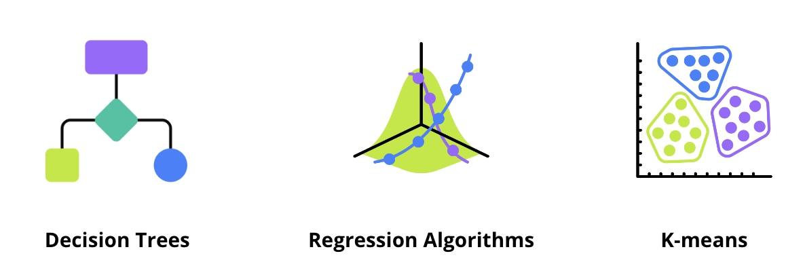

### Deep Learning

**Artificial Neural Networks** - Inspired by the human brain, these networks excel in processing huge amounts of data and learning patterns from it.
**Convolutional Neural Networks (CNNs)** - Specialized for vision tasks, preserving spatial context of images.
**Recurrent Neural Networks (RNNs)** - Efficient for sequential data, aiding in tasks like predictive text. RNNs are adept at handling sequential data, making them suitable for tasks like time-series predictions in stock prices.

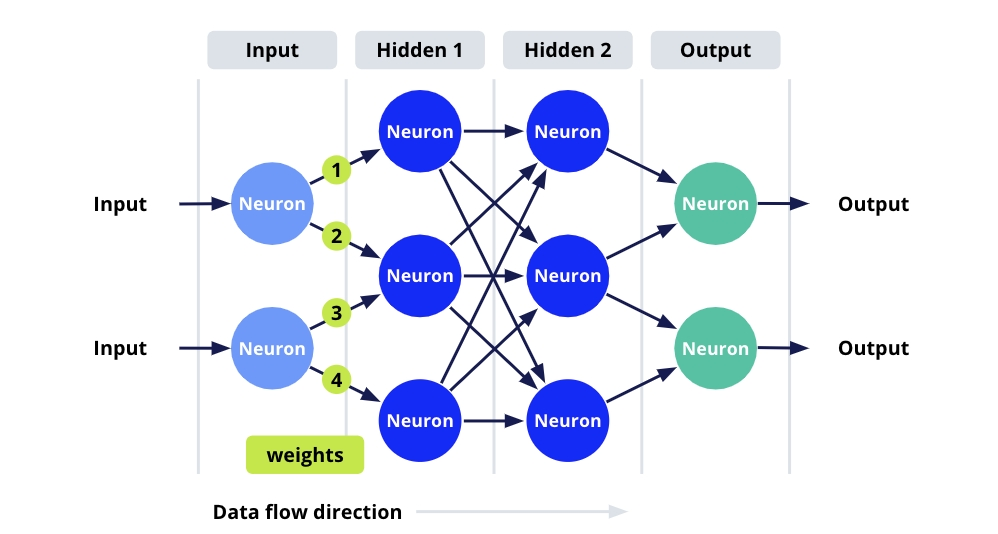

### Advanced Deep Learning

- **Generative Models** - Aim to generate new data samples similar to input data, useful in creating new content.
- **Transformer Architecture** - Consisting of encoders and decoders, crucial in language translation and code generation tasks.

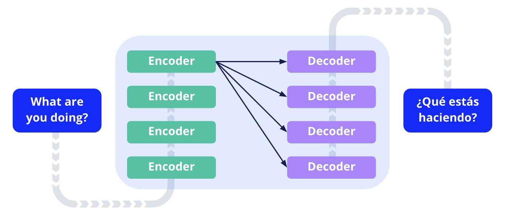

## Building a Decision Tree to Predict Customer Churn

Imagine you are a data analyst at a telecom company. The marketing department has noticed an increase in customer churn and needs your help to identify which customers are most likely to leave next month.

**Your Tasks**
In this exercise, you will build a decision tree model to predict customer churn for a telecom company. Customer churn refers to when a customer stops doing business with a company. Predicting churn is crucial for businesses to retain customers by addressing their issues proactively.

**Dataset Description**
We will use a synthetic dataset for this exercise. The dataset contains the following columns:

- **CustomerID**: A unique identifier for each customer.
- **Age**: The age of the customer.
- **MonthlyCharge**: The monthly bill amount for the customer.
- **CustomerServiceCalls**: The number of times the customer contacted customer service.
- **Churn**: This is our target variable, indicating whether the customer churned (Yes) or not (No).

With this exercise, you will gain hands-on experience in building and evaluating a decision tree model. You will also understand how machine learning can provide actionable insights to help businesses make informed decisions, such as reducing customer **churn**. In the context of business and customer service, "churn" refers to the rate at which customers stop doing business with a company over a given period. It's often used as a key metric to assess customer retention and satisfaction.

```py
# Import necessary libraries
import pandas as pd
import matplotlib.pyplot as plt
import warnings
from sklearn.model_selection import train_test_split
from sklearn.tree import DecisionTreeClassifier
from sklearn.metrics import accuracy_score
from sklearn import tree

warnings.filterwarnings('ignore')

# Creating a synthetic dataset
# This dataset simulates customer data for a telecom company
data = {
      'CustomerID': range(1, 101),  # Unique ID for each customer
      'Age': [20, 25, 30, 35, 40, 45, 50, 55, 60, 65]*10,  # Age of customers
      'MonthlyCharge': [50, 60, 70, 80, 90, 100, 110, 120, 130, 140]*10,  # Monthly bill amount
      'CustomerServiceCalls': [1, 2, 3, 4, 0, 1, 2, 3, 4, 0]*10,  # Number of customer service calls
      'Churn': ['No', 'No', 'Yes', 'No', 'Yes', 'No', 'Yes', 'Yes', 'No', 'Yes']*10  # Churn status
}
df = pd.DataFrame(data)

# Splitting the dataset into features and target variable
# Features include age, monthly charge, and customer service calls
# The target variable is churn (Yes or No)
X = df[['Age', 'MonthlyCharge', 'CustomerServiceCalls']]
y = df['Churn']

# Splitting the dataset into training and testing sets
# 70% of the data is used for training and 30% for testing
X_train, X_test, y_train, y_test = train_test_split(X, y, test_size=0.3, random_state=42)

# Training the Decision Tree model
clf = DecisionTreeClassifier()
clf.fit(X_train, y_train)

# Making predictions on the test set
y_pred = clf.predict(X_test)

# Evaluating the model using accuracy
# Accuracy is the proportion of correct predictions among the total number of cases processed
accuracy = accuracy_score(y_test, y_pred)
print(f'Model Accuracy: {accuracy}')

# Visualizing the decision tree
# This visualization helps in understanding how the model makes decisions
plt.figure(figsize=(12,8))
tree.plot_tree(clf, filled=True, feature_names=['Age', 'MonthlyCharge', 'CustomerServiceCalls'], class_names=['No Churn', 'Churn'])
plt.title('Decision Tree for Predicting Customer Churn')
plt.show()
```

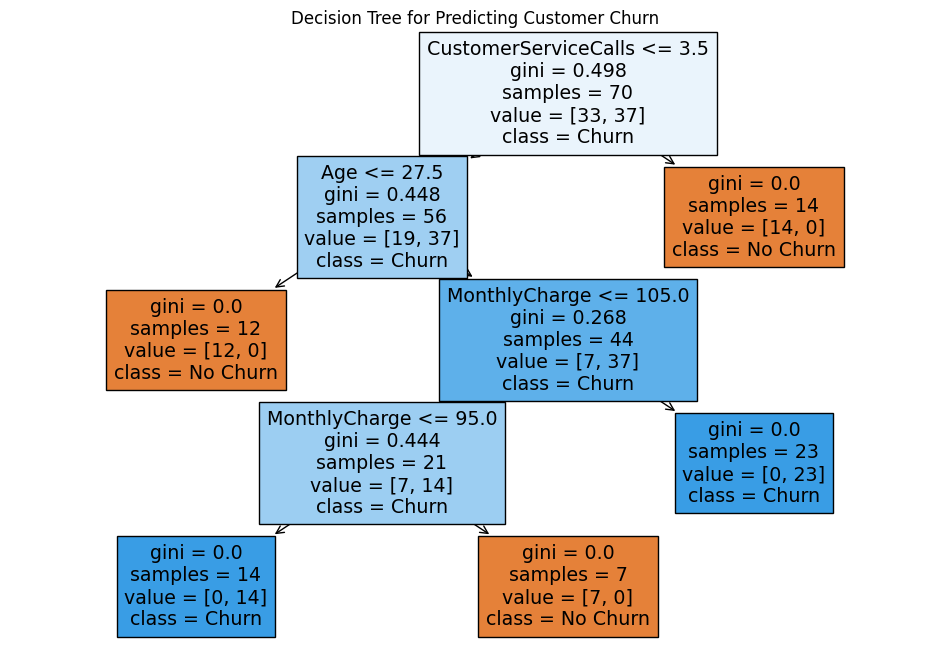

When you visualize a decision tree, especially one created using Scikit-learn's DecisionTreeClassifier, you'll notice several terms on each node of the tree. Understanding these terms is crucial for interpreting the tree's decision-making process. Let's break down each of these terms:

- **Gini**
  - The Gini impurity is a measure of how often a randomly chosen element from the set would be incorrectly labeled if it was randomly labeled according to the distribution of labels in the subset.
  - The Gini impurity ranges from 0 to 0.5, where 0 indicates that all elements in the subset belong to the same class (perfect purity), and 0.5 means the data is randomly distributed across various classes.
  - In decision trees, a lower Gini impurity is generally preferred as it indicates greater purity of the node.
- **Samples**
  - This value represents the number of samples (or records) that reach the node.
  - It gives an idea of how much of the training data is affected by the conditions leading to this node.
  - A high number of samples in a node means that the condition or rule associated with that node is relevant for a significant portion of the dataset.
- **Value**
  - This shows the distribution of the samples in different classes at that particular node.
  - For a binary classification problem (like churn prediction with 'Yes' or 'No'), the value is presented as a list of two numbers. The first number indicates the count of samples in the first class, and the second number indicates the count of samples in the second class.
  - This distribution helps in understanding which class is predominant at a particular node.
- **Class**
  - This indicates the class that would be predicted if the decision tree traversal ends at that node.
  - It is determined based on the majority class of the samples that reach the node. For instance, if most samples at a node belong to the 'No Churn' class, the node will predict 'No Churn'.
  - In a decision tree, it's possible to have more than two categories, known as a multi-class classification problem. Each node can represent the distribution of samples across all classes, like [10, 15, 5], indicating 10 samples of the first class, 15 of the second, and 5 of the third. Decision trees split data to best separate these categories based on available features.
- **Feature Name (e.g., 'Monthly Charge')**
  - This is not a standard part of the decision tree node description, but it may appear in the tree's branches.
  - It represents the feature (or attribute) used to split the data at that node.
  - For example, if you see "MonthlyCharge <= 80", it means that the tree is splitting the data at this node based on whether the monthly charge is less than or equal to 80.

Understanding these components is essential for interpreting how the decision tree makes its predictions and which features are influential in the decision-making process. This can provide valuable insights, especially in business contexts like customer churn prediction.

**Key Concepts:**

1. **Splitting the Dataset** - The dataset is divided into training and testing sets. Typically, 70% of the data is used for training the model, and the remaining 30% is reserved for testing.

2. **Training Data vs. Testing Data** - Training data is used to train the machine learning model. In contrast, testing data, which the model has not seen during training, is used to evaluate the model's performance and generalization ability.

3. **Model Training Process** - The process involves using a 'fit' method where the model is trained using features (X_train) and targets (Y_train). The testing data is not used in this stage.

4. **Prediction and Accuracy Assessment** - After training, the model makes predictions on the test data (X_test). These predictions are then compared with the actual outcomes (Y_test) to calculate the model's accuracy.

## Neural Network

For this exercise, you will create a simple neural network example. We'll use a synthetic dataset to predict whether a customer will make a purchase based on two features:

- Website visit duration
- Number of pages visited.
  
This is a binary classification problem, and we'll use a small neural network for quick execution.

```py
# Step 1: Generate Synthetic Data
import numpy as np
import pandas as pd
import warnings

warnings.filterwarnings('ignore')

# Generating synthetic data
np.random.seed(0)
data_size = 200
features = np.random.rand(data_size, 2)  # Two features: visit duration and pages visited
labels = (features[:, 0] + features[:, 1] > 1).astype(int)  # Purchase (1) or not (0)

# Convert to DataFrame for easier manipulation
df = pd.DataFrame(features, columns=['VisitDuration', 'PagesVisited'])
df['Purchase'] = labels

# Step 2: Preprocess the Data
from sklearn.model_selection import train_test_split

# Split the data
X_train, X_test, y_train, y_test = train_test_split(df[['VisitDuration', 'PagesVisited']], df['Purchase'], test_size=0.2, random_state=42)

# Step 3: Build and Train the Neural Network
import tensorflow as tf
from tensorflow.keras.models import Sequential
from tensorflow.keras.layers import Dense

# Define the model
model = Sequential([
    Dense(10, activation='relu', input_shape=(2,)),  # Input layer with 2 features
    Dense(1, activation='sigmoid')  # Output layer with sigmoid activation for binary classification
])

# Compile the model
model.compile(optimizer='adam', loss='binary_crossentropy', metrics=['accuracy'])

# Train the model
model.fit(X_train, y_train, epochs=10, batch_size=10)
```

> Epoch 1/10
> 16/16 [------------------] - 1s 2ms/step - loss: 0.6838 - accuracy: 0.5875
> Epoch 2/10
> 16/16 [------------------] - 0s 2ms/step - loss: 0.6803 - accuracy: 0.6375
> Epoch 3/10
> 16/16 [------------------] - 0s 1ms/step - loss: 0.6760 - accuracy: 0.6687
> Epoch 4/10
> 16/16 [------------------] - 0s 1ms/step - loss: 0.6713 - accuracy: 0.7375
> Epoch 5/10
> 16/16 [------------------] - 0s 1ms/step - loss: 0.6664 - accuracy: 0.7375
> Epoch 6/10
> 16/16 [------------------] - 0s 1ms/step - loss: 0.6622 - accuracy: 0.7437
> Epoch 7/10
> 16/16 [------------------] - 0s 1ms/step - loss: 0.6579 - accuracy: 0.7500
> Epoch 8/10
> 16/16 [------------------] - 0s 1ms/step - loss: 0.6536 - accuracy: 0.7437
> Epoch 9/10
> 16/16 [------------------] - 0s 1ms/step - loss: 0.6488 - accuracy: 0.7437
> Epoch 10/10
> 16/16 [------------------] - 0s 1ms/step - loss: 0.6447 - accuracy: 0.7437

```py
# Step 4: Evaluate the Model
# Evaluate the model on the test set
loss, accuracy = model.evaluate(X_test, y_test)
print(f"Test Accuracy: {accuracy}")
```

>2/2 [------------------] - 0s 5ms/step - loss: 0.6374 - accuracy: 0.8250
>Test Accuracy: 0.824999988079071

This exercise introduces you to the basics of building and training a simple neural network with synthetic data. The model predicts customer purchase behavior, a typical business problem, using a fast and straightforward neural network architecture.

Unlike decision trees, neural networks are not easily visualizable in terms of their decision-making process because they are considered "black box" models. However, there are some aspects of neural network models that you can visualize to gain insights. For the given example, we can visualize the following:

- **Training Process** - You can plot the training and validation loss and accuracy over epochs to understand how the model is learning.
- **Decision Boundary** - For a simple neural network like the one in our example (with two input features), you can visualize the decision boundary on a 2D plot.
Here's how you can implement these visualizations:

### Model Accuracy and Loss

In the context of the neural network exercise for predicting customer purchase behavior, "model accuracy" and "model loss" are two important metrics used to evaluate the performance of the model. Here's a concise explanation of each:

Model Accuracy is the fraction of predictions our model got right. In the context of the exercise, it is the proportion of correctly predicted purchase decisions (both purchases and non-purchases) out of all predictions made.

- **Formula** - Accuracy = (Number of Correct Predictions) / (Total Number of Predictions)
- **Interpretation** - a higher accuracy indicates a better performing model. For example, an accuracy of 0.90 means that 90% of the model's predictions are correct.
Model Loss measures how far the model's predictions are from the actual class labels. It is a measure of the model's error.
- **Binary Cross-Entropy** - is commonly used in binary classification tasks. It calculates the loss for each instance by comparing the predicted probability with the actual label (either 0 or 1), and then takes the average over all instances.
- **Interpretation** - lower loss values are better, indicating that the model's predictions are closer to the actual labels. A high loss value means the model's predictions are far off from the actual labels.

### Visualizing Training Process

You can modify the training code to save the history of training and then plot it:

```py
#Supress Warnings
import warnings
warnings.filterwarnings('ignore')

# Train the model and save the history
history = model.fit(X_train, y_train, epochs=10, batch_size=10, validation_split=0.2)

# Plotting training and validation loss and accuracy
import matplotlib.pyplot as plt

plt.figure(figsize=(12, 5))

# Plot training & validation accuracy values
plt.subplot(1, 2, 1)
plt.plot(history.history['accuracy'])
plt.plot(history.history['val_accuracy'])
plt.title('Model accuracy')
plt.ylabel('Accuracy')
plt.xlabel('Epoch')
plt.legend(['Train', 'Validation'], loc='upper left')

# Plot training & validation loss values
plt.subplot(1, 2, 2)
plt.plot(history.history['loss'])
plt.plot(history.history['val_loss'])
plt.title('Model loss')
plt.ylabel('Loss')
plt.xlabel('Epoch')
plt.legend(['Train', 'Validation'], loc='upper left')

plt.show()
```

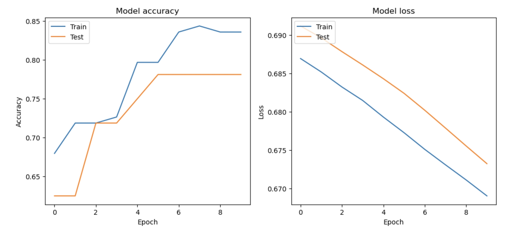

### Decision Boundary

In the context of the neural network exercise for predicting customer purchase behavior, the decision boundary is a concept used to visualize how the neural network categorizes or classifies the data.

The Decision Boundary is a boundary in the feature space that separates the data points into different classes based on the predictions made by the model. In our exercise, we have two input features: website visit duration and number of pages visited. The decision boundary will be a line or curve in this 2-dimensional space that separates the points predicted to make a purchase (class 1) from those predicted not to make a purchase (class 0).

- **How It's Determined** - The neural network learns the decision boundary during training. It adjusts its internal parameters (weights and biases) to correctly classify the training data. The boundary is where the model's output (before applying a threshold) is at some critical value, often 0.5 for binary classification with a sigmoid output. Points on one side of the boundary are classified as one class, and points on the other side as the other class.
- **Visualization** - In the plot, the decision boundary is typically represented by a line or contour. Points falling on one side of the boundary are predicted to be in one class, and those on the other side in the other class. The decision boundary can be linear or non-linear depending on the complexity of the model and the nature of the data.

The decision boundary in our neural network example serves as a visual tool to understand how the model differentiates between customers likely to make a purchase and those who are not, based on their website engagement metrics.

### Creating the Visual

For a simple model with two input features, you can plot the decision boundary:

```py
# Generate a grid over the feature space
x_min, x_max = df['VisitDuration'].min() - 0.1, df['VisitDuration'].max() + 0.1
y_min, y_max = df['PagesVisited'].min() - 0.1, df['PagesVisited'].max() + 0.1
xx, yy = np.meshgrid(np.linspace(x_min, x_max, 100), np.linspace(y_min, y_max, 100))

# Predict over the grid
Z = model.predict(np.c_[xx.ravel(), yy.ravel()])
Z = Z.reshape(xx.shape)

# Plot the contour and training examples
plt.contourf(xx, yy, Z, alpha=0.8)
plt.scatter(df['VisitDuration'], df['PagesVisited'], c=df['Purchase'], edgecolor='k')
plt.xlabel('Visit Duration')
plt.ylabel('Pages Visited')
plt.title('Decision Boundary of Neural Network')
plt.show()
```

Remember, these visualizations are more about understanding the model's structure and learning process rather than explaining its decision-making process in detail, which is more straightforward with models like decision trees.

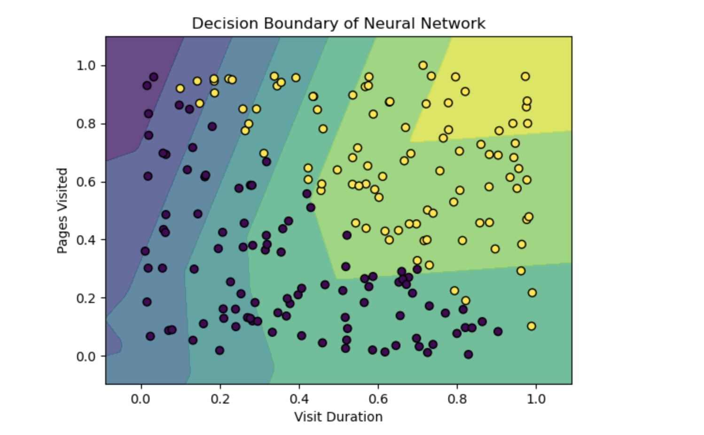

## Discriminative, Predictive, and Generative AI

### Discriminative Models

Machine Learning (ML) has progressed significantly with the advent of Deep Learning and Transformer Architecture, providing two prime categories:

- Discriminative (Predictive) AI
- Generative AI

Discriminative AI excels in categorization, and spotting boundaries in data to predict outcomes. Examples of discriminative models include:

- Decision Trees
- Linear Regression
- Convolutional Neural Networks (CNNs)
- Recurrent Neural Networks (RNNs)

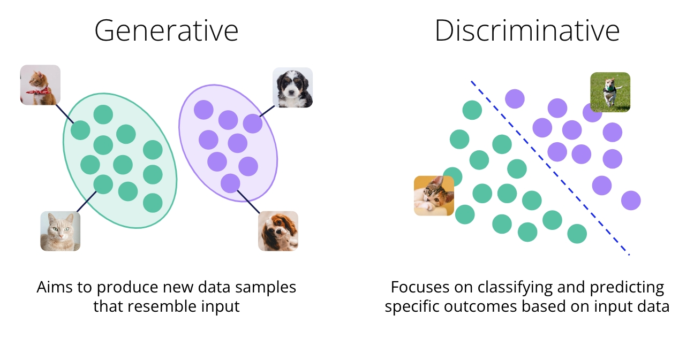

### Generative AI

Generative AI shines in creating new data resembling the input, with models like:

- Generative Adversarial Networks
- Variational Autoencoders

The choice between these paths is based on:

- Task complexity
- Data quality
- Computational resources.
