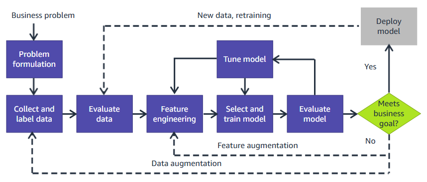
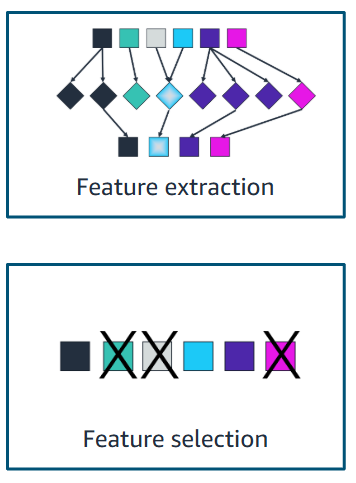
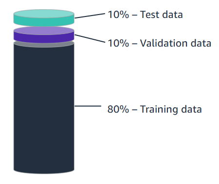
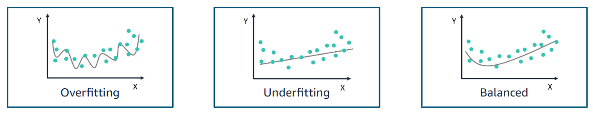

# Machine Learning Pipeline

The machine learning (ML) pipeline is a structured workflow that transforms a business problem into a deployable ML solution. This guide covers the complete pipeline—problem formulation, data sourcing, data preparation/preprocessing, model training, model evaluation, and deployment—enhanced with insights from an AWS training module. The focus is on practical steps, challenges, and ensuring the model aligns with business goals.

## **Introduction to the ML Pipeline**

The ML pipeline outlines the steps needed to solve a business problem using machine learning. The process begins with defining a business problem and proceeds through stages like data collection, preprocessing, feature engineering, model training, evaluation, and deployment. A critical aspect is the iterative nature of the pipeline—models may need retraining with new data, and deployment is revisited if business goals aren’t met. This flowchart provides a high-level understanding of the workflow, emphasizing the importance of aligning each step with the business objective.

## **Step 1: Problem Formulation**

### **Defining the Business Problem**

The first step in the ML pipeline is to articulate the business problem and convert it into an ML problem. Start with a clear business issue that can benefit from ML, asking critical questions to refine the problem:

- How is the task done today?
- How will the business measure success?
- How will the solution be used?
- Do similar solutions exist, and what can be learned from them?
- What assumptions have been made?
- Who are the domain experts?

These questions ensure the problem is well-understood and actionable. For example, identifying domain experts early can help validate assumptions and guide the solution design.

### **Example: Formulating a Fraud Detection Problem**

Consider a business problem where an increase in customers ending their credit card membership is due to fraudulent transactions. The stated problem is to identify fraudulent transactions to stop them before processing, with the goal of reducing customer churn due to fraud. Success is defined as a 10% reduction in customers filing for fraudulent claims within a 6-month period.

This example highlights a key insight: translating a qualitative business goal (reducing churn) into a quantitative ML objective (10% reduction in fraud-related claims) is essential for tracking progress and evaluating success. As illustrated in the AWS training module, the model metric chosen at this stage should be closely linked to the business metric, ideally with a high correlation between the two. For instance, reducing fraudulent transactions directly contributes to the success metric of a 10% reduction in fraud claims. A challenge here is ensuring the metric aligns with broader business priorities—focusing solely on fraud detection might miss other factors affecting churn, such as customer experience.

### **Framing the Problem for ML**

Assess whether ML is the right approach by considering:

- **ML vs. Traditional Approaches**: Can ML solve the problem, or would a rule-based system be more effective? For fraud detection, ML can identify patterns in transaction data that rules might miss, but simple rules (e.g., flagging transactions above a threshold) might suffice for basic cases.
- **Supervised, Unsupervised, or Reinforcement Learning**: The AWS training module outlines three types of ML algorithms:
  - **Supervised Learning**: Requires labeled data (e.g., transactions labeled as "fraud" or "not fraud"). It’s ideal for problems where historical data with known outcomes exists, represented visually with a labeled dataset icon.
  - **Unsupervised Learning**: Works with unlabeled data to find patterns (e.g., clustering unusual transactions). This is depicted with a checklist icon, symbolizing the discovery of hidden structures.
  - **Reinforcement Learning**: Learns through trial and error (e.g., optimizing fraud detection policies over time). It’s illustrated with a car icon, reflecting real-time decision-making, such as in autonomous systems.
- You have many questions to ask yourself and the business. Ultimately, you should try to validate the use of machine learning and confirm that you have access to the right people and data. Then devise the simplest solution to the problem.
- You start to think about the problem in terms of your ML model. What output do you want to see from your model? Be specific - ut should be a statement that reflects what an ML model can output.

In the fraud detection example, it’s a supervised learning problem, specifically a binary classification task (fraud vs. not fraud). This classification is critical because it determines the type of model and data needed. The AWS module emphasizes that Amazon SageMaker provides high-performance, scalable algorithms optimized for speed, scale, and accuracy, which are built into SageMaker for such tasks. A potential challenge is class imbalance—fraudulent transactions are often rare, which can bias the model toward predicting "not fraud". Techniques like oversampling or using metrics like F1-score can help address this.

## **Step 2: Data Sources**

Once the problem is framed, the next step is identifying and collecting data. After the business problem is fully developed, you must ask yourself some questions. Which data do you need to train your model to reach the intended output and, subsequently, your specified business outcome? Do you have access to that data? If so, how much data do you have, and where is it? What solution can you use to bring all this data into one centralized repository? Answering these questions is essential at this stage. Three main types of data are considered:

### **Private Data**

Private data refers to internal data within an organization’s systems, such as log files or customer invoice databases. This data can reside in multiple systems, requiring integration. For the fraud detection example, private data might include transaction logs, customer profiles, and historical fraud reports. A challenge here is data silos—different departments might use incompatible systems, making data aggregation difficult. Using tools like ETL (Extract, Transform, Load) pipelines can help centralize this data.

### **Commercial Data**

Commercial data is collected and sold by entities like Reuters, Change Healthcare, Dun & Bradstreet, and Foursquare, including curated news, anonymized healthcare transactions, global business records, and location data. Supplementing private data with commercial data can provide insights not available internally. For fraud detection, commercial data might include industry-wide fraud trends or geolocation data to flag unusual transaction locations. However, a challenge is ensuring compliance with data privacy regulations, especially with sensitive data like healthcare transactions.

### **Open-Source Data**

Open-source data includes publicly available datasets, often used for research or teaching, hosted on platforms like AWS, Kaggle, and the UC Irvine Machine Learning Repository, as well as government and health organizations. For fraud detection, open-source datasets might include anonymized transaction datasets for model training. A limitation is that open-source data may not be specific to the business context, requiring careful preprocessing to ensure relevance.

### **Key Considerations for Data Collection**

Before proceeding, ask critical questions:

- What data is needed to train the model?
- Do you have access to that data? If so, how much, and where is it stored?
- How can you centralize the data?

These questions ensure the data collection aligns with the ML problem. In the fraud detection case, labeled transaction data is needed for supervised learning. If the data is scattered across systems, a centralized repository (e.g., a data lake) is essential. A practical tip is to assess data quality early—missing or noisy data can derail the pipeline, so cleaning and validation are crucial.

## **Step 3: Data Preparation and Preprocessing**

### Data Considerations

Data preparation and preprocessing transform raw data into a format suitable for ML model training. This stage involves understanding the data, evaluating its quality, identifying features and labels, and addressing labeled data needs.

#### **Understand the Data**

Gain a comprehensive understanding of the dataset by exploring its structure and content.
You have further formulated the problem, but what data do you need to actually train the model to reach the desired output and intended business outcome? Do you have access to that data? If so, how much data do you have and where is it?
What solution can you use to bring all of this data into one centralized repository? These questions are essential to answer at this stage. To answer these questions, it's a good idea to start with an overview of the typical elements of an ML dataset.
For example, a dataset might include columns like Name, Country, Sex, and Date of Birth:

| **Name**         | **Country** | **Sex** | **Date of Birth** |
|------------------|-------------|---------|-------------------|
| Richard Roe      | UK          | Male    | 18/2/1972         |
| Paulo Santos     | Male        |         | 11/2/1969         |
| Mrs. Mary Major  | Denver      | F       | 37                |
| Desai, Arnav     | USA         | M       | 1/22/1962         |

This dataset reveals inconsistencies (e.g., "Male" in the Country column, "37" in Date of Birth) that need to be addressed. Understanding the data involves identifying such issues and determining how to handle them.

#### **Get a Domain Expert**

Domain expertise is crucial for interpreting data and defining relevant features and labels. For the fraud detection example, a domain expert can help identify patterns in fraudulent transactions (e.g., unusual transaction amounts or locations) and ensure the data is representative of real-world scenarios, you must collect both positive (fraudulent transactions) and negative
(non-fraudulent transactions) data. Both types are necessary for the machine learning algorithm to be able to find patterns that will distinguish between the two types. The expert can also validate assumptions, such as whether the dataset’s fraud rate (e.g., 0.4%) reflects production data (e.g., 3%). If the training data underrepresents fraud, the model may struggle to generalize, necessitating techniques like data augmentation or synthetic data generation.
Given what you know about the elements of an ML dataset, recall one of the original questions. Which data do you need to actually train the model to reach the desired output and intended business outcome? At this stage in the ML pipeline, it's vital to get domain expertise. With domain knowledge, you can begin to determine the features and target data that your model needs to make accurate predictions.

#### **Evaluate Data Quality**

High-quality data contains a strong signal about the phenomenon being modeled. For instance, suppose that a wholesaler is trying to forecast demand for a few of their products. They might track the number of sales that they've had previously, which is a good start. However, what if they forget to log when certain products were out of stock? If you're trying to forecast demand, it's important to know when you were out of stock. Therefore, it is critical to have that data represent one of your features.

| **Product name** | **Price** | **Max stock** | **Current stock** | **Sales this week** |
|------------------|-----------|---------------|-------------------|---------------------|
| Soap             | 1.99      | 20            | 14                | 49                  |
| Shampoo          | 6.99      | 20            | 2                 | 23                  |
| Hair brushes     | 12.95     | 30            | 12                | 2                   |
| Toothpaste       | 3.50      | 30            | 13                | 40                  |
| Toothbrushes     | 5.00      | 20            | ?                 | ?                   |
| Lotion           | 8.75      | 10            | ?                 | ?                   |

Missing values (e.g., "?" for Toothbrushes and Lotion) can hinder forecasting accuracy. Data quality issues like missing data, inconsistencies, or outliers must be addressed through imputation, removal, or other preprocessing techniques. For instance, imputing missing sales data using the average sales of similar products can help, but it risks introducing bias if the missingness isn’t random.

#### **Identify Features and Labels**

Features are attributes used to identify patterns, while labels are the target variable the model predicts. In the fraud detection example, a dataset might include:

| **Customer** | **Date of transaction** | **Vendor** | **Charge amount** | **Was this fraud?** |
|--------------|-------------------------|------------|-------------------|---------------------|
| ABC          | 10/5                    | Store 1    | 10.99             | No                  |
| DEF          | 10/5                    | Store 2    | 999.99            | Yes                 |
| GHI          | 10/5                    | Store 2    | 15.00             | No                  |
| JKL          | 10/6                    | Store 2    | 659.99            | No                  |
| MNO          | 10/6                    | Store 1    | 999.99            | Yes                 |

Here, features include Customer, Date of transaction, Vendor, and Charge amount, while the label is "Was this fraud?" (Yes/No). Identifying features and labels early helps focus preprocessing efforts on relevant data.

#### **Identify Labeled Data Needs**

Labeled data is essential for supervised learning but can be challenging to obtain. For example, training data for autonomous driving requires precise labels for objects like cars, road signs, and the road itself. Without accurate labels, the model’s performance suffers, potentially leading to fatal mistakes. If labeled data is scarce, consider alternatives like semi-supervised learning (using a small labeled dataset with a larger unlabeled one) or data annotation services, though these can be costly and time-consuming.

### Preparing Data

The data that you gather won't be ready to be used. The data might be dirty, which means that it contains errors or duplicate data. Dirty data has possibly been collected by using the wrong method or population for your business problem or has some other data integrity issue. Using dirty data in your machine learning models will lead to incorrect results or an inability to run the
model effectively.
For this reason, the data that you have gathered must be prepared for use in a machine learning model. There are four considerations for preparing your data.

#### Encoding Data

Most ML algorithms work best with numerical data. Therefore, you must make sure that all columns in your dataset contain numeric data by converting or encoding the data.
You might need to make several passes through the dataset before you can encode it. For example, you might have variability in the text values (for example, some rows might contain both Medium and Med).
If the categorical data has order to it, you can encode the text into numerical values that capture this ordinal relationship. For data that shows maintenance costs, you might encode Low to 1, Medium to 2, High to 3, and Very High to 4.

#### Cleaning Data

In addition to converting string data to numerical data, you must clean your dataset for several other potential problem areas. Before you encode the string data, you must make sure that the strings are all consistent.

. Adjust variables to use a consistent scale.
. Split items that capture more than one variable.

| **Type**                          | **Example**                 | **Action**                        |
|-------------------------------|-------------------------|-------------------------------|
| Variations in strings         | Med. vs. Medium         | Convert to standard text      |
| Variations in scale           | Number of doors vs. number purchased     | Normalize to a common scale   |
| Columns with multiple data items   | Safe high maintenance   | Parse into multiple columns   |
| Missing data       |   Missing columns of data                      | Delete rows or impute data    |

#### Finding missing data

You might also find that you have missing data. For example, some columns in your dataset might be missing data because of a data collection error. Perhaps data wasn't collected on a particular feature until some time after the data collection process was in operation. Missing data can make it difficult to accurately interpret the relationship between the related feature and the target variable. Thus, regardless of what caused the data to be missed, it is important that you deal with the issue.
Unfortunately, most ML algorithms can't deal with missing values automatically. You must update missing values with something meaningful and relevant to the problem.

#### Handling Outliers

You might also need to clean your data because of any outliers that might exist. Outliers are points in your dataset that lie at an abnormal distance from other values. They are not always something that you want to clean up, because they can add richness to your dataset. However, they can also make it more difficult to make accurate predictions. The outliers affect accuracy because they skew values away from the other more normal values that are related to that feature. In addition, an outlier might indicate that the data point belongs to another column.
You can think of outliers as falling into two broad categories. The two categories are a single variation for a single variable (univariate) and a variation of two or more variables (multivariate).

### **Feature Engineering**

Feature engineering involves creating and selecting features to improve model performance. This process includes feature extraction and feature selection.

#### **Feature Extraction**

Feature extraction transforms raw data into new features that better capture relevant patterns. Feature extraction covers many activities that range from handling missing data to converting text data into numerical data. Although the list is not exhaustive, it should give you some idea of the data handling that's needed to get data into a useful state. You must make sure that data is in the correct format, with consistent representations of data, spelling, and the like. You might combine data, extract data into multiple columns, or remove them altogether. Tasks specific to machine learning include being able to convert text columns to numerical values, deciding how to handle outliers, and potentially rescaling your data.

Common tasks include:
. Encoding ordinal and non-ordinal data
. Finding missing data
. Handling outliers in the data

For example, from the Date of Birth column, you can extract a feature like "Age" by calculating the difference between the current date (June 17, 2025) and the birth date:

- Richard Roe (18/2/1972): Age = 53
- Paulo Santos (11/2/1969): Age = 56
- Desai, Arnav (1/22/1962): Age = 63

This new feature may be more predictive than the raw date. Feature extraction can also involve combining features (e.g., creating a feature for "Transaction frequency per customer" in fraud detection) or encoding categorical variables (e.g., one-hot encoding for Country).

#### **Feature Selection**

Feature selection identifies the most relevant features to reduce redundancy and prevent overfitting. After you extract features, you must select the most appropriate features to train your model. Three main feature selection methods are available: filter, wrapper, and embedded.

. **Filter methods** use statistical methods to measure the relevance of features by their correlation with the target variable.
. **Wrapper methods** measure the usefulness of a subset of features by training a model on it and measuring the success of the model.
. **Embedded methods** are algorithm-specific and might use a combination of both.

Filter methods are faster and cheaper than wrapper methods because they do not involve training the models repeatedly. Wrappers typically find the best subset of features, with a risk of overfitting compared to using subsets of features from filter methods.

In the fraud detection dataset, if Vendor and Charge amount strongly correlate with fraud but Customer and Date of transaction do not, the latter features might be discarded. Techniques like correlation analysis or recursive feature elimination can help prioritize features. For the earlier dataset with Name, Country, Sex, and Date of Birth, Name might be irrelevant for most tasks and can be excluded to simplify the model.

## **Step 4: Model Training**

Model training involves selecting an algorithm, preparing the data for training, and optimizing the model to learn patterns from the data.

### **Split the Data**

To train and evaluate the model, the dataset must be split into three parts. The standard split is:

- **Training Set (80%)**: Used to train the model.
- **Validation Set (10%)**: Used to tune hyperparameters and monitor performance during training.
- **Test Set (10%)**: Used to evaluate the final model’s performance on unseen data. The performance you get here with the test dataset is what you can reasonably expect to see in production.

For the fraud detection dataset, if you have 10,000 transactions, you’d allocate 8,000 for training, 1,000 for validation, and 1,000 for testing. The module stresses the importance of setting aside enough test data and not using it for training or validation to ensure an unbiased evaluation. A challenge here is ensuring the split preserves the class distribution—random splitting might result in a test set with no fraudulent transactions, skewing evaluation. Stratified sampling can help maintain the fraud rate (e.g., 3%) across all sets.

### **Select an Algorithm**

Choosing the right algorithm depends on the problem type and data characteristics. The AWS training module emphasizes that the type of ML problem dictates the algorithm choice. For the fraud detection example (a binary classification problem), common supervised learning algorithms include:

- **Logistic Regression**: A simple, interpretable model for binary classification.
- **Decision Trees/Random Forests**: Effective for handling non-linear relationships and feature interactions.
- **Gradient Boosting (e.g., XGBoost)**: Powerful for imbalanced datasets like fraud detection.
- **Neural Networks**: Suitable for complex patterns but require more data and computational resources.

The choice of algorithm involves trade-offs. Logistic regression is fast and interpretable but may underperform on complex data. Random forests handle non-linearity well but can overfit if not tuned properly. The AWS module notes that Amazon SageMaker offers optimized algorithms for such tasks, balancing speed, scale, and accuracy. A practical approach is to start with a simple model (e.g., logistic regression) as a baseline and experiment with more complex models if needed.

### **Train the Model**

During training, the model learns to map features to labels by optimizing a loss function (e.g., cross-entropy loss for classification). Put another way, you want your model to do well
on both the data it already has and the data it does not have.

- **Underfitting**: The image shows a linear model (a straight line) failing to capture the non-linear pattern of scattered data points. The model performs poorly on the training data because it can’t capture the relationship between features (X) and labels (Y). In the fraud detection case, a simple logistic regression might underfit if the fraud patterns are complex, missing key relationships in the data.
- **Overfitting**: The image depicts a model (a highly irregular curve) that fits the training data too closely, following every fluctuation in the scattered points. While it performs well on the training data, it fails on evaluation data because it has essentially memorized the training set rather than learning general patterns. For fraud detection, an overfit random forest might memorize specific transactions (e.g., high charges at Store 2) but fail to generalize to new fraud patterns.
- **Balanced Model**: The image shows a model (a smoother curve) that captures the general trend of the data without fitting too closely to noise. This balance is crucial for generalization, ensuring the model performs well on both training and evaluation data.

Hyperparameters like learning rate, number of trees (for random forests), or number of layers (for neural networks) are tuned using the validation set. You can take an instance of the model, use it to make predictions on the test data, compare predictions to known targets, and calculate metrics to assess performance. From there, you modify the model’s data, features, or hyperparameters until achieving the best results. For fraud detection, you might notice that a random forest model achieves high accuracy but struggles with recall (missing many fraudulent transactions). Adjusting the model’s decision threshold or using techniques like SMOTE (Synthetic Minority Oversampling Technique) can improve performance on the minority class.

## **Step 5: Model Evaluation and Tuning**

Model evaluation assesses how well the trained model performs on unseen data, ensuring it generalizes well and meets business objectives.

### **Evaluate the Model**

Use the test set to evaluate the model with appropriate metrics. The validation data provides an unbiased evaluation during tuning, while the test data assesses final accuracy. For fraud detection, common metrics include:

- **Accuracy**: The proportion of correct predictions (e.g., 95% accuracy might seem good but can be misleading if fraud is only 3% of the data).
- **Precision**: The proportion of predicted fraud cases that are actually fraud (important to minimize false positives, which might inconvenience customers).
- **Recall**: The proportion of actual fraud cases correctly identified (crucial to catch as many fraudulent transactions as possible).
- **F1-Score**: The harmonic mean of precision and recall, balancing both concerns.
- **ROC-AUC**: Measures the model’s ability to distinguish between classes across all thresholds.

Suppose the model achieves 90% precision but only 60% recall on the test set. This means it’s good at avoiding false positives but misses 40% of fraudulent transactions, which might not meet the business goal of reducing fraud-related churn. A challenge here is metric selection—optimizing for precision might reduce customer complaints, but low recall could fail to address the core problem. The AWS module suggests that if the model performs well on the test data, it’s likely to perform well on new data with unknown target values, reinforcing the importance of a proper data split.

### **Compare to Business Objectives**

The model’s performance must align with the defined success metric (e.g., 10% reduction in fraud-related claims within 6 months). The model metric (e.g., precision or recall) should be closely linked to the business metric, with a high correlation between the two. In the fraud detection example, if the model identifies 60% of fraud cases, you’d need to estimate its impact on churn. If fraud accounts for 50% of churn and the model catches 60% of fraud, it might reduce fraud-related churn by 30% (0.5 * 0.6), exceeding the 10% target. However, real-world factors like delayed fraud reporting might affect this estimate, requiring continuous monitoring post-deployment.

### Model Tuning

You can take an instance that the model has not seen, and use it to perform a prediction. Because you already know the target in your test data, you can compare the two values. From these comparisons, you can calculate metrics, which give you data on how well the model performs. You then modify the model's data, features, or hyperparameters until you find the model that yields the best results.

## **Step 6: Deployment**

Deployment integrates the trained model into the business workflow, ensuring it delivers value while addressing operational challenges.

### **Deploy the Model**

Deployment involves integrating the model into production systems. After the model is trained, tuned, and tested, it’s ready for deployment to make inferences or predictions, which typically requires deployment. For fraud detection, the model might be deployed as an API that evaluates transactions in real-time, flagging potential fraud for review. Deployment options include:

- **Batch Inference**: Process transactions in batches (e.g., nightly) for non-urgent cases.
- **Real-Time Inference**: Evaluate transactions as they occur, critical for fraud prevention.

The AWS module notes that deployment for testing differs from production, though the mechanics are the same, and can involve anything from a few requests to deployments handling tens of thousands of requests. For real-time fraud detection, the model might be hosted on a cloud service like AWS SageMaker, which supports low-latency inference. A challenge is ensuring the system can handle high transaction volumes—latency must be low (e.g., under 100ms) to avoid delaying legitimate transactions.

### **Monitor and Maintain**

Post-deployment, the model must be monitored for performance drift. Data drift occurs when the production data differs from the training data (e.g., new fraud patterns emerge). For example, if fraudsters start using new tactics, the model’s recall might drop. Concept drift occurs when the relationship between features and labels changes (e.g., economic conditions change what constitutes a "suspicious" transaction amount).

Monitoring involves tracking metrics like precision and recall over time and setting up alerts for significant drops. If performance degrades, the model may need retraining with new data. A practical tip is to implement a feedback loop—flagged transactions reviewed by human experts can be used to update the training dataset, improving the model over time.

