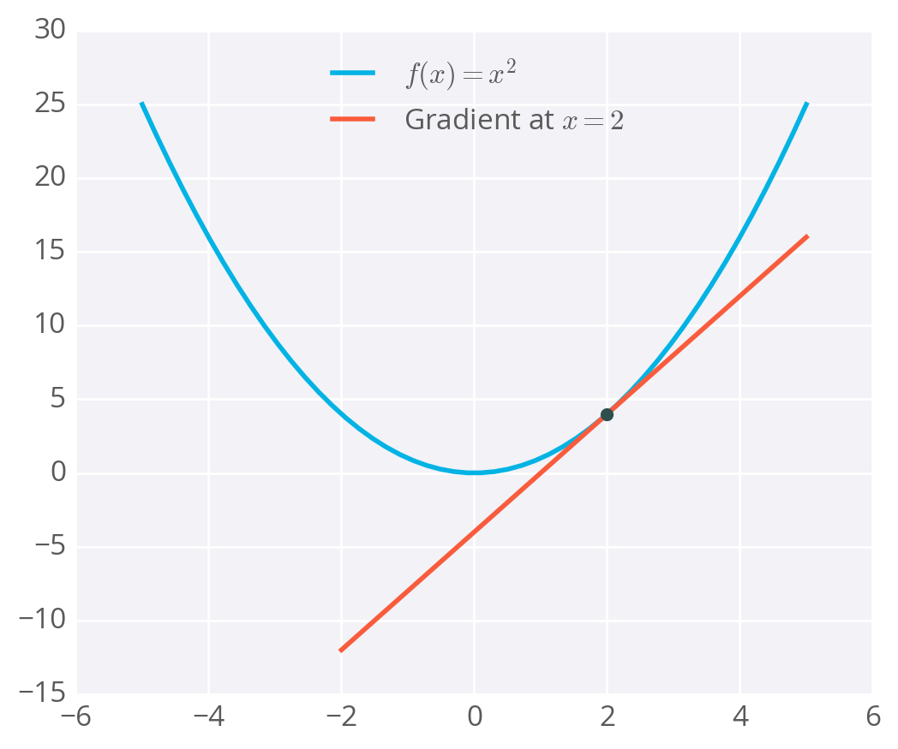
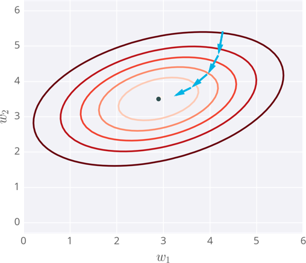
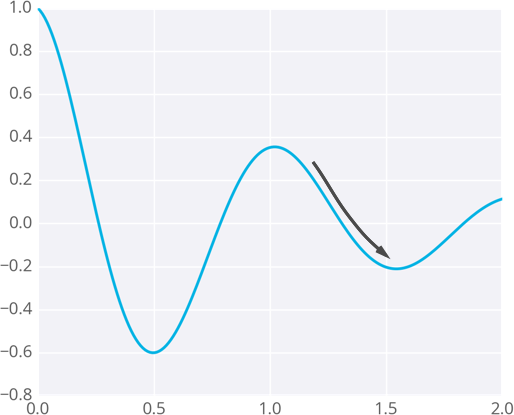
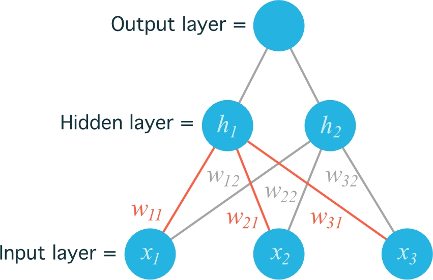
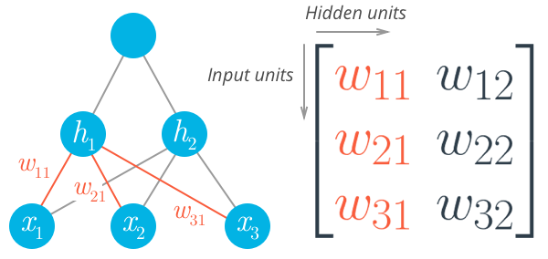
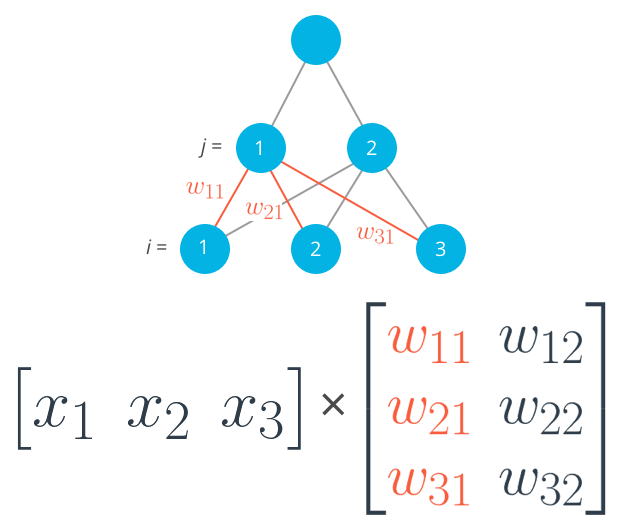

# Gradient Descent

## Gradient Descent with Squared Errors 📉

To train a neural network, we need to find the best possible weights. We start by defining a goal: the network's predictions should be as close as possible to the real values. We measure how "wrong" the predictions are using an **error function**. A common and effective choice is the **sum of the squared errors (SSE)**.

The formula for SSE is:
$$E = \frac{1}{2}\sum_{\mu}\sum_{j} [y_j^\mu - \hat{y}_j^\mu]^2$$

Let's break this down:

* $\hat{y}$ is the network's prediction and $y$ is the true value.
* The inner sum ($\sum_{j}$) calculates the squared difference between the prediction and the true value for **each output unit** of the network.
* The outer sum ($\sum_{\mu}$) adds up these errors for **every data point** in your dataset.

The SSE is a good choice for an error function because the square ensures the error is always positive and penalizes larger errors more heavily. It also simplifies the underlying math for calculating gradients.

Since the network's prediction, $\hat{y}_j^\mu = f(\sum_{i} w_{ij}x_i^\mu)$, is a function of the weights, the error also depends on the weights:
$$E = \frac{1}{2}\sum_{\mu}\sum_{j} \left[y_j^\mu - f\left(\sum_{i} w_{ij}x_i^\mu\right)\right]^2$$
Our goal is to find the set of weights ($w_{ij}$) that makes the total error $E$ as small as possible. The algorithm we use to do this is **gradient descent**.

-----

## How Gradient Descent Works

With **gradient descent**, we adjust the weights in a series of small steps to minimize the error. Imagine the error as a mountain landscape; our goal is to get to the lowest valley. The fastest way down is always in the steepest direction.

This "steepest direction" is given by the **gradient**. The gradient is just a term for the slope or rate of change of a function with multiple variables. To find it, we use calculus, specifically derivatives.

A derivative of a function, like $f(x) = x^2$, gives us another function, $f'(x) = 2x$, that tells us the slope at any point $x$. For example, at $x=2$, the slope is $f'(2) = 4$.



The gradient of our error function tells us the slope of the error "mountain" for our current set of weights. At each step, we calculate the error and the gradient, then take a small step in the opposite direction of the gradient (downhill) to update our weights.



By repeating this process, the weights will eventually settle in a location where the error is at a minimum.

-----

## A Caveat: Local Minima

A potential issue with gradient descent is that the algorithm can get stuck in **local minima**. These are valleys in the error landscape that are low, but not the lowest possible point (the global minimum). If the weights are initialized in an unfortunate position, the gradient might lead them into one of these traps.



Fortunately, there are more advanced techniques, such as adding **momentum**, that help the algorithm overcome these local minima and improve its chances of finding the global minimum.

## Gradient Descent: The Math 🧠

To train a neural network, we need to find the optimal weights. We achieve this by showing the network labeled data and adjusting the weights to minimize the prediction error. A common metric for this error is the **sum of the squared errors (SSE)**:
$$E = \frac{1}{2}\sum_{\mu} (y^\mu - \hat{y}^\mu)^2$$
Here, the sum is taken over all data points $\mu$. A high SSE means the network's predictions are poor, while a low SSE means they are good. The goal of gradient descent is to minimize this value.

The process is like walking down a hill:

1.  Start at a random point (random weights).
2.  Determine the steepest direction downhill (the negative gradient of the error).
3.  Take a small step in that direction.
4.  Repeat until you reach the bottom of the hill (the minimum error).

-----

## Gradient Descent: The Code 🤖

From the math, we know that a single weight update ($\Delta w_i$) can be calculated as:
$$\Delta w_i = \eta \delta x_i$$Where $\eta$ is the learning rate, $x_i$ is the input, and $\delta$ is the **error term**. The error term is calculated as:$$\delta = (y - \hat{y}) f'(h) = (y - \hat{y}) f'\left(\sum w_i x_i\right)$$
Here, $(y - \hat{y})$ is the **output error** and $f'(h)$ is the derivative of the activation function (the **output gradient**).

Below is the code for a single gradient descent step using the sigmoid activation function.

```python
import numpy as np

def sigmoid(x):
    """
    Calculate sigmoid
    """
    return 1/(1+np.exp(-x))

def sigmoid_prime(x):
    """
    # Derivative of the sigmoid function
    """
    return sigmoid(x) * (1 - sigmoid(x))

# Hyperparameters
learnrate = 0.5
x = np.array([1, 2, 3, 4])
y = np.array(0.5)

# Initial weights
w = np.array([0.5, -0.5, 0.3, 0.1])

### Calculate one gradient descent step for each weight
# TODO: Calculate the node's linear combination of inputs and weights
h = np.dot(x, w)

# TODO: Calculate output of neural network
nn_output = sigmoid(h)

# TODO: Calculate error of neural network
error = y - nn_output

# TODO: Calculate the error term.
# Note: The derivative of the sigmoid is sigmoid(h) * (1 - sigmoid(h)),
# which is equivalent to nn_output * (1 - nn_output).
error_term = error * sigmoid_prime(h)

# TODO: Calculate change in weights
del_w = learnrate * error_term * x

# Optional print
print('Neural Network output:')
print(nn_output)
print('Amount of Error:')
print(error)
print('Change in Weights:')
print(del_w)
```

> Neural Network output:
> 0.689974481128
> Amount of Error:
> \-0.189974481128
> Change in Weights:
> [-0.02031869 -0.04063738 -0.06095608 -0.08127477]

## Implementing Gradient Descent

We know the formula for a single weight update is $\Delta w_{ij} = \eta \cdot \delta_j \cdot x_i$. Now, let's translate that into a full training loop to make our network learn from an entire dataset.

As an example, we'll use gradient descent to predict graduate school admissions based on three features: **GRE score**, **GPA**, and **undergraduate school rank** (1-4, where 1 is the most prestigious). Our network will have a single output unit with a sigmoid activation function to predict the probability of admission.

### Data Cleanup

Before training, the data needs to be prepared. This involves two critical steps:

1.  **Creating Dummy Variables:** The `rank` feature is categorical. A rank of 2 isn't twice a rank of 1. To handle this correctly, we convert the single `rank` column into four binary columns (e.g., `rank_1`, `rank_2`, etc.) using one-hot encoding. A student with rank 1 will have a `1` in the `rank_1` column and `0`s in the others.

2.  **Standardizing Features:** The GRE (200-800) and GPA (1-4) features have very different scales. If we feed these directly into the network, the large GRE values can cause the inputs to the sigmoid function to become very large, "saturating" the neuron and causing its gradient to become zero. This effectively stops the network from learning. To prevent this, we **standardize** the data, scaling the values to have a mean of 0 and a standard deviation of 1.

After preprocessing, the data has six input features. Here's a sample:

| admit | gre | gpa | rank\_1 | rank\_2 | rank\_3 | rank\_4 |
| :---: | :---: | :---: | :---: | :---: | :---: | :---: |
| 0 | 0.22 | 0.26 | 0 | 0 | 1 | 0 |
| 1 | 0.82 | 0.44 | 0 | 0 | 1 | 0 |
| 1 | 1.00 | 0.64 | 1 | 0 | 0 | 0 |
| 1 | 0.80 | 0.09 | 0 | 0 | 0 | 1 |

-----

### Mean Square Error (MSE)

We'll make a small change to our error calculation. Instead of the Sum of Squared Errors (SSE), we'll use the **Mean of the Square Errors (MSE)**. By dividing the total error by the number of records, $m$, we average it. This makes the learning process more stable, regardless of the dataset size, and allows us to use more consistent learning rates (typically between 0.001 and 0.01).

### The Algorithm

Here is the general algorithm for updating weights using batch gradient descent:

1.  Initialize the weight step for each weight to zero: $\Delta w_i = 0$.
2.  For each record in the training data:
    a. Make a forward pass to calculate the output, $\hat{y} = f(\sum_i w_i x_i)$.
    b. Calculate the error term for the output unit, $\delta = (y - \hat{y}) \cdot f'(\sum_i w_i x_i)$.
    c. Add the error term contribution to the weight step: $\Delta w_i = \Delta w_i + \delta x_i$.
3.  After iterating through all records, update the weights: $w_i = w_i + \eta \frac{\Delta w_i}{m}$.
4.  Repeat this entire process for a set number of epochs.

Remember that for a sigmoid activation function, the derivative is $f'(h) = f(h)(1 - f(h))$.

-----

### Implementing with NumPy

NumPy makes this implementation straightforward.

  * **Initializing Weights:** Weights should be initialized randomly to small values. A good practice is to draw them from a normal distribution with a scale of $1/\sqrt{n}$, where $n$ is the number of input features. This helps keep the initial inputs to the sigmoid function in their sensitive, linear range.
    ```python
    weights = np.random.normal(scale=1/n_features**.5, size=n_features)
    ```
  * **Dot Product:** The weighted sum of inputs, $h = \sum_i w_i x_i$, can be calculated efficiently using NumPy's `dot()` function.
    ```python
    output_in = np.dot(weights, inputs)
    ```

-----

## Programming Exercise: Admissions Prediction 

Below is the complete implementation of gradient descent to train the network on the admissions data. The `TODO` comments mark the key steps you need to implement.

```python
import numpy as np
from data_prep import features, targets, features_test, targets_test

def sigmoid(x):
    """
    Calculate sigmoid
    """
    return 1 / (1 + np.exp(-x))

# Use to same seed to make debugging easier
np.random.seed(42)

n_records, n_features = features.shape
last_loss = None

# Initialize weights
weights = np.random.normal(scale=1 / n_features**.5, size=n_features)

# Neural Network hyperparameters
epochs = 1000
learnrate = 0.5

for e in range(epochs):
    del_w = np.zeros(weights.shape)
    for x, y in zip(features.values, targets):
        # Loop through all records, x is the input, y is the target
        
        # TODO: Calculate the output
        output = sigmoid(np.dot(x, weights))
        
        # TODO: Calculate the error
        error = y - output
        
        # TODO: Calculate the error term
        # The derivative of the sigmoid is output * (1 - output)
        error_term = error * output * (1 - output)
        
        # TODO: Calculate the change in weights for this sample
        #       and add it to the total weight change
        del_w += error_term * x
    
    # TODO: Update weights using the learning rate and the average change in weights
    weights += learnrate * del_w / n_records
    
    # Printing out the mean square error on the training set
    if e % (epochs / 10) == 0:
        out = sigmoid(np.dot(features, weights))
        loss = np.mean((out - targets) ** 2)
        if last_loss and last_loss < loss:
            print("Train loss: ", loss, "  WARNING - Loss Increasing")
        else:
            print("Train loss: ", loss)
        last_loss = loss

# Calculate accuracy on test data
tes_out = sigmoid(np.dot(features_test, weights))
predictions = tes_out > 0.5
accuracy = np.mean(predictions == targets_test)
print(f"Prediction accuracy: {accuracy:.3f}")
```

> Train loss:  0.2627609384996635
> Train loss:  0.20928619409324875
> Train loss:  0.20084292908073426
> Train loss:  0.19862156475527873
> Train loss:  0.1977985139668603
> Train loss:  0.19742577912189868
> Train loss:  0.1972350774624106
> Train loss:  0.1971294562509248
> Train loss:  0.19706766341315082
> Train loss:  0.1970300580177737
> Prediction accuracy: 0.725

Of course. Here is the material on implementing a hidden layer, formatted as requested.

## Implementing the Hidden Layer 🧠

With multiple perceptrons working together, our calculations are best handled using linear algebra, specifically vectors and matrices.

  * **Prerequisites:**
      * Khan Academy's [introduction to vectors](https://www.khanacademy.org/math/linear-algebra/vectors-and-spaces)
      * Khan Academy's [introduction to matrices](https://www.khanacademy.org/math/linear-algebra/matrix-transformations)

### Derivation: From Vectors to Matrices

When moving from a single perceptron to a network with a hidden layer, we need to update our indexing for the weights. A weight now connects an input unit $i$ to a hidden unit $j$, so we denote it as $w_{ij}$.

Consider a network with 3 input units ($x_1, x_2, x_3$) and 2 hidden units ($h_1, h_2$):



To index the weights, we use the input unit number for $i$ and the hidden unit number for $j$. For example, $w_{12}$ is the weight from input $x_1$ to hidden unit $h_2$.

These weights are stored in a **matrix**. Each row in the matrix corresponds to the weights leading out of a single input unit, and each column corresponds to the weights leading into a single hidden unit.



To initialize this weight matrix in NumPy:

```python
# Number of records and input units
n_records, n_inputs = features.shape

# Number of hidden units
n_hidden = 2

weights_input_to_hidden = np.random.normal(0, n_inputs**-0.5, size=(n_inputs, n_hidden))
```

This creates a 2D array (a matrix) with dimensions `n_inputs` by `n_hidden`.

-----

### Forward Pass with Matrix Multiplication

The input to a hidden unit, $h_j$, is the sum of all inputs multiplied by their corresponding weights.
$$h_j = \sum_i w_{ij}x_i$$
This is a **dot (inner) product**. To calculate the input to the first hidden unit ($h_1$), you take the dot product of the input vector with the first column of the weight matrix.

$$h_1 = x_1w_{11} + x_2w_{21} + x_3w_{31}$$



In NumPy, we can perform this **matrix multiplication** for all hidden units at once using `np.dot()`:

```python
hidden_inputs = np.dot(inputs, weights_input_to_hidden)
```

-----

### A Note on Matrix Dimensions

The most important rule in matrix multiplication is that **the inner dimensions must match**. If you are multiplying a 1x3 input vector by a 3x2 weight matrix, it works because the inner dimensions (3 and 3) match. If you try to multiply a 3x2 matrix by a 3-element vector, you will get an error.

> ```
> ValueError: shapes (3,2) and (3,) not aligned: 2 (dim 1) != 3 (dim 0)
> ```

The number of columns in the first matrix must equal the number of rows in the second matrix.

### Making a Column Vector in NumPy

By default, 1D NumPy arrays act like **row vectors**. If you need a **column vector**, transposing with `.T` will not work on a 1D array. Instead, you must add a new axis using `arr[:, None]`.

> `print(features)`
> `> array([ 0.496, -0.138,  0.647])`
>
> `print(features.T)`
> `> array([ 0.496, -0.138,  0.647])`
>
> `print(features[:, None])`
> `> array([[ 0.496], [-0.138], [ 0.647]])`

Alternatively, you can create the array as a 2D object (`ndmin=2`), after which `.T` will work as expected.

-----

## Programming Exercise: Forward Pass ✍️

Here, you'll implement the forward pass for a simple network.

```python
import numpy as np

def sigmoid(x):
    """
    Calculate sigmoid
    """
    return 1/(1+np.exp(-x))

# Network size
N_input = 4
N_hidden = 3
N_output = 2

np.random.seed(42)

# Make some fake data
X = np.random.randn(4)

weights_input_to_hidden = np.random.normal(0, scale=0.1, size=(N_input, N_hidden))
weights_hidden_to_output = np.random.normal(0, scale=0.1, size=(N_hidden, N_output))

# TODO: Make a forward pass through the network (hidden layer)
hidden_layer_in = np.dot(X, weights_input_to_hidden)
hidden_layer_out = sigmoid(hidden_layer_in)

print('Hidden-layer Output:')
print(hidden_layer_out)
```

> Hidden-layer Output:
> [0.42604313 0.5002434  0.43594115]
> Good job\! You got the correct calculation on the hidden layer.

## Backpropagation ⬅️

Now we'll tackle how to make a multi-layer neural network learn. The **backpropagation** algorithm is an extension of gradient descent that uses the **chain rule** to determine how weights in earlier layers (e.g., input-to-hidden) contribute to the overall error.

To update the weights of a hidden layer, you need to know how much error each hidden unit was responsible for. Since we only know the error at the final output, we must work backward. The error from an output unit is scaled by the weight connecting it to a hidden unit, effectively distributing the "blame" back to the hidden layer.

The error term for a hidden unit $j$ is the sum of the output errors, scaled by the weights, and multiplied by the gradient of the hidden unit's activation function:
$$\delta_j^h = \sum_k W_{jk} \delta_k^o f'(h_j)$$Once you have this hidden error term, the gradient descent step is the same as before:$$\Delta w_{ij} = \eta \delta_j^h x_i$$
This general form holds for any number of layers. The weight update is always a product of the learning rate, the layer's error term (propagated from the layer above), and the inputs to that layer.

-----

### Working Through an Example

Let's walk through a single backpropagation step for a simple two-layer network with two inputs, one hidden unit, and one output unit.

Assume the target value is $y=1$.

1.  **Forward Pass**

      * Input to hidden unit: $h = \sum_i w_i x_i = (0.1 \times 0.4) + (-0.2 \times 0.3) = -0.02$
      * Output of hidden unit: $a = f(h) = \text{sigmoid}(-0.02) = 0.495$
      * Input to output unit: $W \cdot a = 0.1 \times 0.495 = 0.0495$
      * Final network output: $\hat{y} = f(W \cdot a) = \text{sigmoid}(0.0495) = 0.512$

2.  **Backward Pass**

      * **Output error term:** $\delta^o = (y - \hat{y}) f'(W \cdot a) = (1 - 0.512) \cdot \hat{y}(1-\hat{y}) = 0.488 \times 0.512(1-0.512) = 0.122$
      * **Hidden error term:** We propagate the output error back.
        $\delta^h = W \delta^o f'(h) = 0.1 \times 0.122 \times a(1-a) = 0.0122 \times 0.495(1-0.495) = 0.003$

3.  **Weight Updates**

      * **Hidden-to-Output weight:** $\Delta W = \eta \delta^o a = 0.5 \times 0.122 \times 0.495 = 0.0302$
      * **Input-to-Hidden weights:** $\Delta w_i = \eta \delta^h x_i$
        $\Delta w_1 = 0.5 \times 0.003 \times 0.4 = 0.0006$
        $\Delta w_2 = 0.5 \times 0.003 \times 0.3 = 0.00045$

> A key observation here is the **vanishing gradient problem**. The derivative of the sigmoid function has a maximum value of 0.25. This means that with each layer we propagate backward, the error term is scaled down significantly. For deep networks, the gradients in the early layers can become almost zero, effectively stopping them from learning.

-----

### Implementing in NumPy

When implementing backpropagation, the weight update for the input-to-hidden layer, $\Delta w_{ij} = \eta \delta_j^h x_i$, requires careful handling of matrix shapes. The hidden layer's error term $\delta^h$ is a vector, and the input $x$ is also a vector. A simple element-wise multiplication will fail if they have different numbers of elements.

> ```
> ValueError: operands could not be broadcast together with shapes (3,) (6,)
> ```

To get the correct 2D matrix for the weight update step, you can multiply the hidden error term (as a row vector) by the input (as a column vector). NumPy handles this automatically.

```python
# hidden_error is a 1D row vector, inputs is a 1D row vector
# inputs[:, None] converts inputs to a column vector
weight_step = hidden_error * inputs[:, None]
```

This performs an outer product, resulting in a matrix with the correct dimensions to update the `weights_input_hidden` matrix.

-----

## Backpropagation Exercise 1: Single Step ✍️

Here, you'll implement the backward pass for a single step.

```python
import numpy as np

def sigmoid(x):
    return 1 / (1 + np.exp(-x))

x = np.array([0.5, 0.1, -0.2])
target = 0.6
learnrate = 0.5

weights_input_hidden = np.array([[0.5, -0.6],
                                 [0.1, -0.2],
                                 [0.1, 0.7]])
weights_hidden_output = np.array([0.1, -0.3])

## Forward pass
hidden_layer_input = np.dot(x, weights_input_hidden)
hidden_layer_output = sigmoid(hidden_layer_input)
output_layer_in = np.dot(hidden_layer_output, weights_hidden_output)
output = sigmoid(output_layer_in)

## Backwards pass
# TODO: Calculate output error
error = target - output

# TODO: Calculate error term for output layer
output_error_term = error * output * (1 - output)

# TODO: Calculate error term for hidden layer
hidden_error_term = np.dot(output_error_term, weights_hidden_output) * \
                    hidden_layer_output * (1 - hidden_layer_output)
                    
# TODO: Calculate change in weights for hidden layer to output layer
delta_w_h_o = learnrate * output_error_term * hidden_layer_output

# TODO: Calculate change in weights for input layer to hidden layer
delta_w_i_h = learnrate * hidden_error_term * x[:, None]

print('Change in weights for hidden layer to output layer:')
print(delta_w_h_o)
print('Change in weights for input layer to hidden layer:')
print(delta_w_i_h)
```

> Change in weights for hidden layer to output layer:
> [ 0.00804047  0.00555918]
> Change in weights for input layer to hidden layer:
> [[  1.77005547e-04  -5.11198285e-04]
> [  3.54011093e-05  -1.02239657e-04]
> [ -7.08022187e-05   2.04479314e-04]]

-----

## Implementing Backpropagation

The error term for the output layer is $\delta_k = (y_k - \hat{y}_k) f'(a_k)$ and the error term for the hidden layer is:

### The Algorithm

For a network with one hidden layer, the full algorithm is:

1.  Initialize weight steps to zero: $\Delta w_{ij}=0$, $\Delta W_j = 0$.
2.  For each record in the training data:
    a. Perform a forward pass to get the prediction $\hat{y}$.
    b. Calculate the output error term: $\delta^o = (y - \hat{y}) f'(z)$, where $z$ is the input to the output layer.
    c. Propagate the error to the hidden layer: $\delta_j^h = \delta^o W_j f'(h_j)$.
    d. Update the weight steps:
    \* $\Delta W_j = \Delta W_j + \delta^o a_j$
    \* $\Delta w_{ij} = \Delta w_{ij} + \delta_j^h x_i$
3.  After all records, update the weights:
      * $W_j = W_j + \eta \frac{\Delta W_j}{m}$
      * $w_{ij} = w_{ij} + \eta \frac{\Delta w_{ij}}{m}$
4.  Repeat for a number of epochs.

-----

## Backpropagation Exercise 2: Full Training Loop 🎓

```python
import numpy as np
from data_prep import features, targets, features_test, targets_test

np.random.seed(21)

def sigmoid(x):
    return 1 / (1 + np.exp(-x))

# Hyperparameters
n_hidden = 2  # number of hidden units
epochs = 900
learnrate = 0.005
n_records, n_features = features.shape
last_loss = None

# Initialize weights
weights_input_hidden = np.random.normal(scale=1 / n_features ** .5,
                                        size=(n_features, n_hidden))
weights_hidden_output = np.random.normal(scale=1 / n_features ** .5,
                                         size=n_hidden)
for e in range(epochs):
    del_w_input_hidden = np.zeros(weights_input_hidden.shape)
    del_w_hidden_output = np.zeros(weights_hidden_output.shape)
    for x, y in zip(features.values, targets):
        ## Forward pass ##
        hidden_input = np.dot(x, weights_input_hidden)
        hidden_output = sigmoid(hidden_input)
        output = sigmoid(np.dot(hidden_output, weights_hidden_output))

        ## Backward pass ##
        error = y - output
        output_error_term = error * output * (1 - output)

        ## Propagate errors to hidden layer
        hidden_error = np.dot(output_error_term, weights_hidden_output)
        hidden_error_term = hidden_error * hidden_output * (1 - hidden_output)
        
        ## Update the change in weights
        del_w_hidden_output += output_error_term * hidden_output
        del_w_input_hidden += hidden_error_term * x[:, None]

    # Update weights
    weights_input_hidden += learnrate * del_w_input_hidden / n_records
    weights_hidden_output += learnrate * del_w_hidden_output / n_records

    # Printing out the mean square error on the training set
    if e % (epochs / 10) == 0:
        hidden_output = sigmoid(np.dot(features, weights_input_hidden))
        out = sigmoid(np.dot(hidden_output, weights_hidden_output))
        loss = np.mean((out - targets) ** 2)
        if last_loss and last_loss < loss:
            print("Train loss:", loss, "WARNING - Loss Increasing")
        else:
            print("Train loss:", loss)
        last_loss = loss

# Calculate accuracy on test data
hidden = sigmoid(np.dot(features_test, weights_input_hidden))
out = sigmoid(np.dot(hidden, weights_hidden_output))
predictions = out > 0.5
accuracy = np.mean(predictions == targets_test)
print("Prediction accuracy: {:.3f}".format(accuracy))
```

> Train loss: 0.251357252781
> Train loss: 0.249506583098
> Train loss: 0.247904018334
> Train loss: 0.246497334753
> Train loss: 0.245244519998
> Train loss: 0.244111326233
> Train loss: 0.243070445389
> Train loss: 0.242099988972
> Train loss: 0.241183179427
> Train loss: 0.240307924844
> Prediction accuracy: 0.725
