# Neural Networks

## Classification Problems 🤓

As we mentioned, classification problems are a common application of neural networks. Let's look at a simple example to build some intuition.

Suppose you're the admissions officer at a university, and your job is to accept or reject students. You have data on a bunch of past students, including:

* Test results
* Grades in school
* Whether they were accepted or rejected

This data is plotted in the graph below, with the red dots (on the left) showing students who were rejected, and the blue dots (on the right) showing students who were accepted.

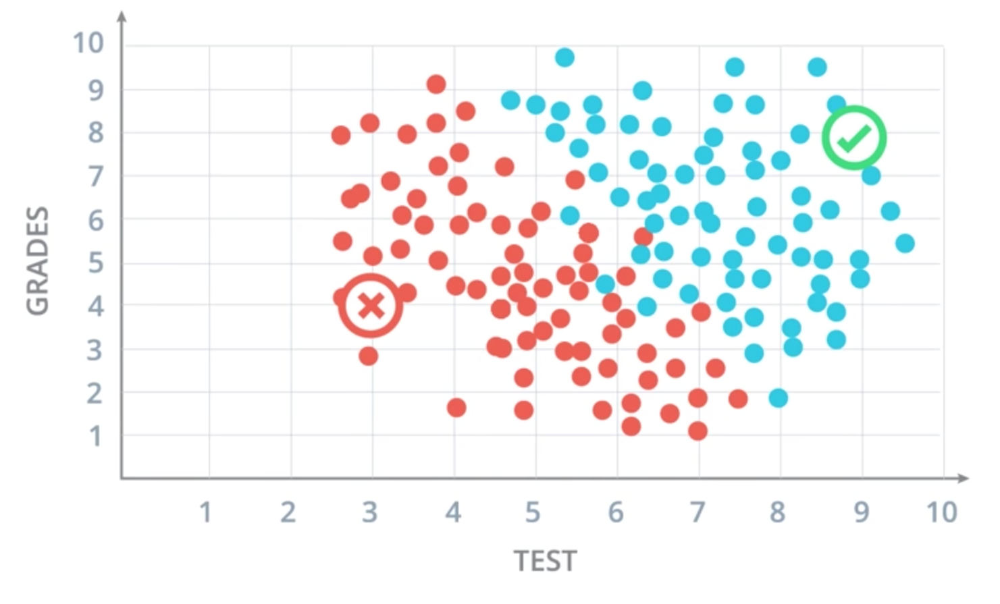

A new student (we'll call them student 3) applies with the following scores:

* **Test results:** 7/10
* **Grades:** 6/10

Should this student be accepted?

> Certainly! The student is represented by the point with coordinates (7,6), and this point falls in the positive area of the model.

---

## Linear Boundaries

### A Linear Equation

We'll go over all the math from the video for your reference. First, we label the axes:

* The horizontal axis (the test scores) is $x_1$.
* The vertical axis (for grades) is $x_2$.

Using these two variables, our goal is to find the boundary that separates accepted students from rejected students. In this example, the boundary can be modeled with a straight line.

We can model this using a linear equation (i.e., the equation of a straight line). The line drawn in the graph above has the equation:

$$2x_1 + x_2 - 18 = 0$$

This line simply represents our method for accepting or rejecting students. Remember, $x_1$ and $x_2$ represent the test results and grades, so we can also write the equation like this to better understand what it means:

$$2 \cdot \text{test} + \text{grades} - 18 = \text{score}$$

When a student applies, we input their test results and grade to calculate a score, which we can then use to predict whether their application will be accepted or rejected.

If the score is **negative**, they fall under the line, and we predict they will be **rejected**. If the score is **positive**, they land above the line, and we predict they will be **accepted**.

For example, suppose we have a student with $x_1 = 4$ and $x_2 = 2$. If we plug these into our equation, we get:

$$2 \cdot 4 + 2 - 18 = -8$$

Since the score is negative, we reject their application. (If you're not convinced, you can plot the coordinates $(4,2)$ on the graph above and you'll see it is well below the line and falls amidst the other rejected applications.)

> **Note:**
> We also need to decide what to do if a student falls exactly on the line itself. For this example, we will say that falling on the line means the same thing as falling above it—that is, we predict the student will be accepted.

The general idea here is that we've used our past data to create a **model** (in this case a simple linear equation) which we can then apply to new data to make a prediction. We don't know for sure that the new student at point $(4,2)$ will be rejected, but given the past data, it is very likely.

### The More General Model
Of course, not all models are linear. In the more general case, our boundary will be an equation of the form:

$$w_1x_1 + w_2x_2 + b = 0$$

We can abbreviate this equation in vector notation as:

$$Wx + b = 0$$

Where $b$ is the **bias** and $W$ and $x$ are vectors:

$$W = (w_1, w_2)$$
$$x = (x_1, x_2)$$

Thus, our general model is the product of the two vectors $W$ and $x$, plus the bias, $b$.

For each student, we give them a classification or **label** indicating acceptance or rejection. We can denote this label as $y$ and we can represent the two possible results as $0$ or $1$:

$$y = \text{label}: 0 \text{ or } 1$$

Where $0$ represents "reject" and $1$ represents "accept". We know this label for our past data, but we need to predict it for our new students.

This prediction is commonly denoted using $\hat{y}$. In our example, a student's predicted label is $1$ (accepted) if they fall above or on the line—in other words, $\hat{y}=1$ if $Wx + b \ge 0$. A student's predicted label is $0$ (rejected) if they fall below the line—in other words, $\hat{y}=0$ if $Wx + b < 0$.

It may seem confusing that we have both $y$ (the label) and $\hat{y}$ (the predicted label). The main reason is that our prediction does not always give the perfect classification. We saw this earlier when we noted that some of the red dots fall above the line and some of the blue dots fall below it. Few models are perfectly accurate, but our goal is to find a model for $\hat{y}$ that will resemble $y$ as closely as possible.

---

## Higher Dimensions 📈

In our previous example, we had only two variables (test and grades). What if we also knew the class rank of the students? Adding this third dimension could improve our model. However, we can no longer plot the data on a two-dimensional graph. Instead, we get something like this:

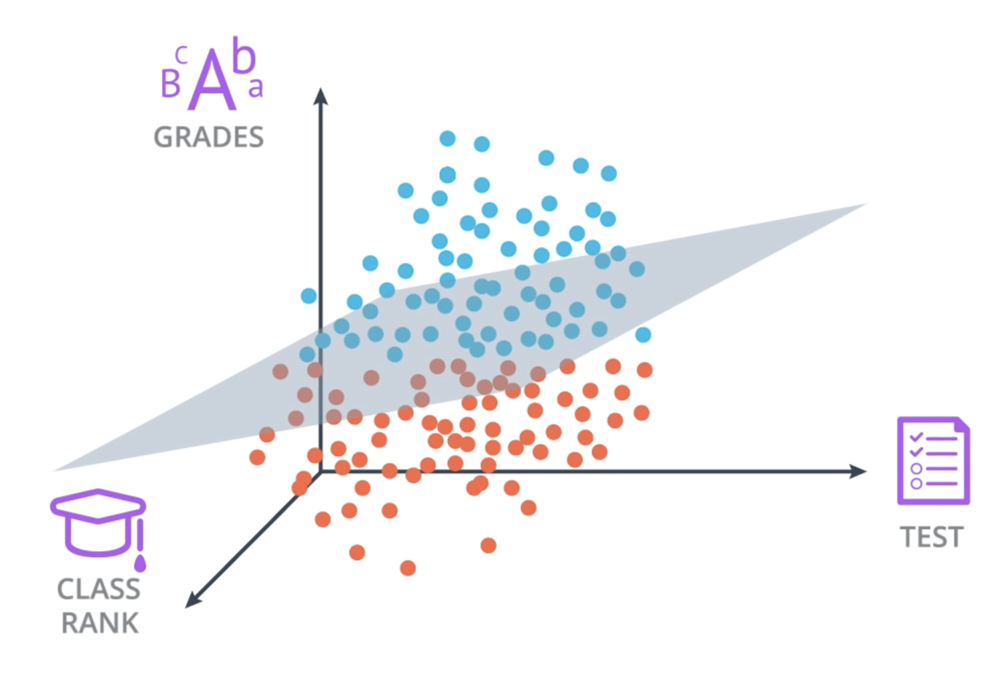

The boundary separating the groups is no longer a line, but rather a **plane**. The equation is similar to the equation for our line, but with an additional term:

$$w_1x_1 + w_2x_2 + w_3x_3 + b = 0$$

This can still be abbreviated in vector notation as $Wx + b = 0$. The only difference is that we have added a third term for the third dimension.

What if we had even more data for the students, like their results on several different exams? This is no problem—we can continue to add this data as additional dimensions. Visualizing these additional dimensions on a graph is no longer possible, but we can look at the data in the form of columns in a table:

| Student ID | Test Score ($x_1$) | Grades ($x_2$) | Class Rank ($x_3$) | ... | Exam N ($x_n$) |
| :--------: | :----------------: | :------------: | :----------------: | :---: | :------------: |
|     1      |        3.5         |      4.2       |        150         |  ...  |      78        |
|     2      |        8.1         |      9.5       |         12         |  ...  |      92        |
|     3      |        6.7         |      5.8       |         89         |  ...  |      85        |

Here we have $n$ columns, labeled as $x_1, x_2, \dots, x_n$. Thus, the general form for our equation is:

$$w_1x_1 + w_2x_2 + \dots + w_nx_n + b = 0$$

Although it becomes impossible to visualize these dimensions on a graph, the model is essentially the same. We still label the data, generate a model, and make predictions in the same way.

When there are more than three dimensions, the boundary is no longer a line or a 2D plane. Instead, we call it a **hyperplane**. A hyperplane is equivalent to a line or a plane, but it is generalized to account for any number of dimensions. Specifically, a hyperplane has $n-1$ dimensions.

* If our data has 3 dimensions, the hyperplane has $3-1=2$ dimensions—in other words, a 2D plane.
* If our data has 11 dimensions, the hyperplane has $11-1=10$ dimensions.

Again, although a "10-dimensional hyperplane" is hard to imagine, mathematically we can use it just like a 2D plane or a simple line—in all cases, they serve as decision boundaries for our data.

## Perceptrons 🧠

A **perceptron** is a fundamental building block of neural networks. Perceptrons are graphs that have nodes and edges. In the general case, they look like this:

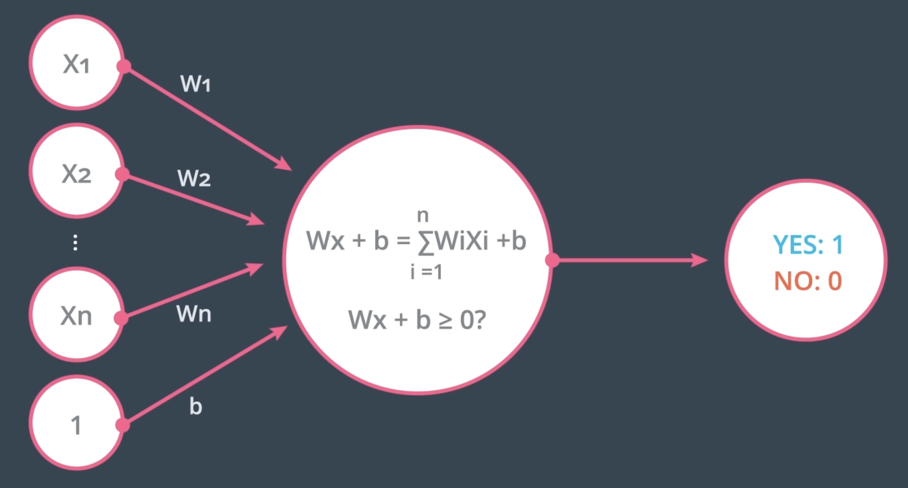

On the left, we have $n$ inputs coming in, with values $x_1$ to $x_n$ (and a $1$ for the bias unit). These inputs are connected by edges with weights $W_1$ to $W_n$ and $b$ (for the bias). The node takes these weighted inputs and calculates a linear combination:

$$Wx + b = \sum_{i=1}^{n} W_i X_i + b$$

The node then applies a **step function**. It checks if the calculated value is greater than or equal to zero—returning a value of `1` (Yes) if it is and `0` (No) if it is not.

-----

## Why "Neural Networks"?

Neural networks get their name from the fact that they are—loosely—modeled after biological neurons. Perceptrons take inputs, perform calculations, and decide whether to output one result or another (e.g., a one or a zero).

In a similar way, neurons in the brain receive inputs from other neurons through their dendrites. Based on these signals, the neuron then decides whether to fire and send a signal of its own down its axon.

Just as real neurons connect to form complex biological networks, we can connect our artificial perceptrons into layers, using the output from one layer as the input for the next.

-----

## Perceptrons as Logical Operators

One of the classic applications of perceptrons is to model logical operators. We'll look at how to build perceptrons for AND, OR, and NOT, and then tackle the more complex XOR operator.

### AND Perceptron

An AND perceptron should only output `1` when both inputs ($x_1$ and $x_2$) are `1`.

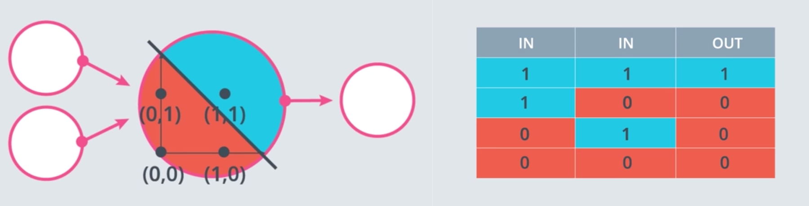

### OR Perceptron

The OR perceptron is very similar, but it should output `1` if *either* of its inputs is `1`. This can be achieved by shifting the decision boundary of the AND perceptron.

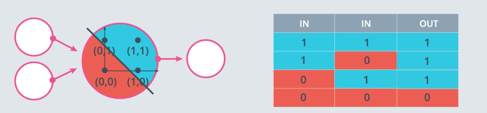

How can we get from an AND perceptron to an OR perceptron by changing the weights and/or bias?

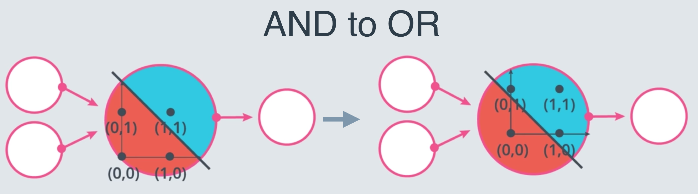

**Explanation:** The OR perceptron has a lower threshold for firing. To achieve this, you can lower the magnitude of the bias (e.g., from -1.5 for AND to -0.5 for OR), making the linear combination more likely to be positive.

### NOT Perceptron

The NOT operator is unique because it only considers one input. It returns `1` if the input is `0`, and `0` if the input is `1`.

-----

## Coding AND and NOT Perceptrons in Python 🤖

### What are the weights and bias for the AND perceptron?

Here, we set weights (`and_weight1`, `and_weight2`) and a bias (`and_bias`) to correctly model the AND operation. Multiple solutions exist\!

```python
# Values that correctly determine the AND operation.
and_weight1 = 0.5
and_weight2 = 0.5
and_bias = -0.8

### Notebook grading
# Inputs and outputs (only 1 AND 1 should result in True)
and_test_inputs = [(0, 0), (0, 1), (1, 0), (1, 1)]
and_correct_outputs = [False, False, False, True]
and_outputs = []

# Generate output
for test_input in and_test_inputs:
    linear_combination = and_weight1 * test_input[0] \
                         + and_weight2 * test_input[1] \
                         + and_bias
    output = linear_combination >= 0
    and_outputs.append(output)

# Check output correctness
if and_outputs == and_correct_outputs:
    print('Nice! You got it all correct.')
else:
    # ... (error reporting code) ...
```

> Nice\! You got it all correct.

### What are the weights and bias for the NOT perceptron?

Here, we set the weights and bias to perform the NOT operation on the *second* input and ignore the first one.

```python
# Values that calculate the NOT operation on the second input.
not_weight1 = 0.0
not_weight2 = -0.5
not_bias = 0.1

### Notebook grading
# Inputs and outputs (True only if the second value is 0)
not_test_inputs = [(0, 0), (0, 1), (1, 0), (1, 1)]
not_correct_outputs = [True, False, True, False]
not_outputs = []

# Generate output
for test_input in not_test_inputs:
    linear_combination = not_weight1 * test_input[0] \
                         + not_weight2 * test_input[1] \
                         + not_bias
    output = linear_combination >= 0
    not_outputs.append(output)

# Check output correctness
if not_outputs == not_correct_outputs:
    print('Nice! You got it all correct.')
else:
    # ... (error reporting code) ...
```

-----

## XOR Perceptron

The XOR (exclusive OR) operator is interesting because it's not **linearly separable**. This means you can't draw a single straight line to separate the `True` outputs from the `False` outputs.

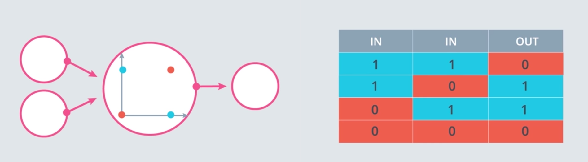

To solve this, we need a **multi-layer perceptron**—our first true neural network\!

### Build an XOR Multi-Layer Perceptron

The network below uses three perceptrons (A, B, and C) to calculate XOR. Set the correct logical operation for each one.

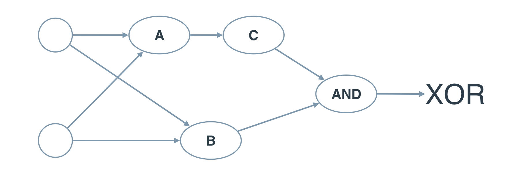

**Answer and Explanation:**

The XOR operation is true if "one or the other is true, but not both". This can be expressed as:
`(x1 OR x2) AND (NOT (x1 AND x2))`

This logical statement can be translated directly to our network:

  * **Perceptron A:** `OR`
  * **Perceptron B:** `NAND` (which is `NOT` + `AND`)
  * **Perceptron C:** `AND`

This structure combines the outputs of simpler perceptrons to solve a problem that a single perceptron cannot. This is the core idea behind deep learning\!

-----

## The Perceptron Trick 💡

In real life, we don't manually set the weights and biases. We want the algorithm to learn them from the data. The **Perceptron Trick** is an algorithm that allows a perceptron to learn the correct decision boundary.

The idea is to start with a random line and iteratively adjust it. For each point that is misclassified, we "nudge" the line slightly closer to it.

Let's say we have the random line:
$$3x_1 + 4x_2 - 10 = 0$$

And we have a misclassified red point at (4, 5) that is currently in the blue (positive) region.

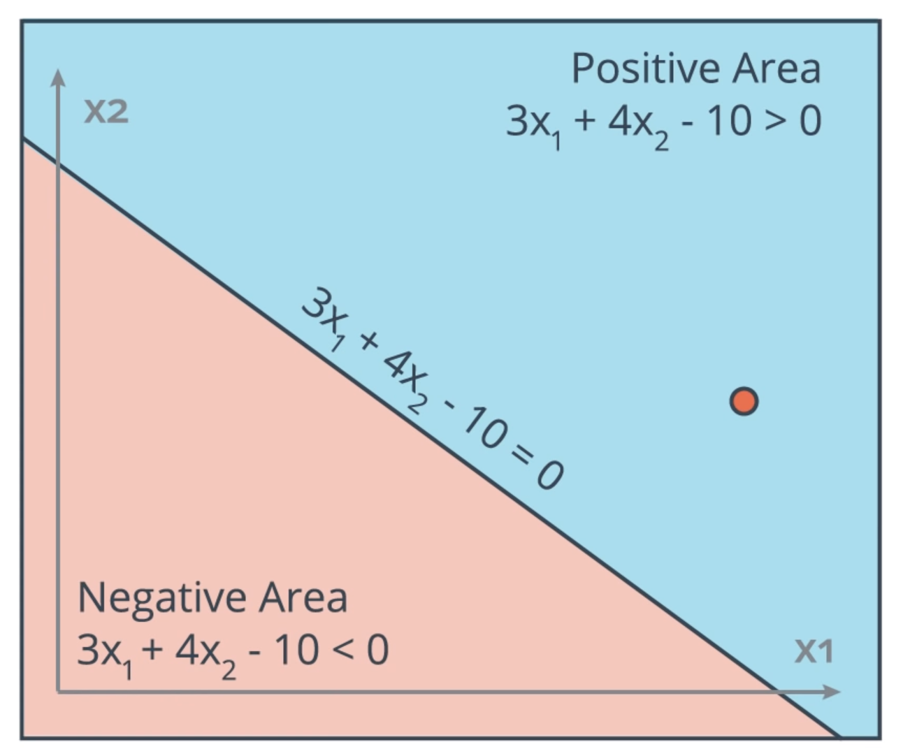

To move the line closer to the point, we subtract the point's coordinates (and a 1 for the bias) from the line's coefficients.

| | $w_1$ | $w_2$ | $b$ |
| :--- | :---: | :---: | :---: |
| Initial | 3 | 4 | -10 |
| Subtract | 4 | 5 | 1 |
| **New** | **-1** | **-1** | **-11** |

This moves the line, but the change is too drastic. To make smaller, more controlled adjustments, we introduce a **learning rate** ($\alpha$), a small number like 0.1. We multiply the point's coordinates by this rate before subtracting.

| | $w_1$ | $w_2$ | $b$ |
| :--- | :---: | :---: | :---: |
| Initial | 3 | 4 | -10 |
| Subtract | $0.1 \times 4 = 0.4$ | $0.1 \times 5 = 0.5$ | $0.1 \times 1 = 0.1$ |
| **New** | **2.6** | **3.5** | **-10.1** |

This gives us a new, slightly adjusted equation for our line:
$$2.6x_1 + 3.5x_2 - 10.1 = 0$$

By repeating this process for all misclassified points over many iterations (epochs), the line will gradually converge to a good solution.

-----

## The Perceptron Algorithm

The Perceptron Trick gives us the full Perceptron Algorithm. For a point $(p,q)$ with true label $y$ and predicted label $\hat{y}$:

  * **If the point is correctly classified** ($y = \hat{y}$), do nothing.
  * **If the point is classified positive but should be negative** ($y=0, \hat{y}=1$), we subtract $\alpha p, \alpha q,$ and $\alpha$ from $w_1, w_2,$ and $b$.
  * **If the point is classified negative but should be positive** ($y=1, \hat{y}=0$), we add $\alpha p, \alpha q,$ and $\alpha$ to $w_1, w_2,$ and $b$.

### Coding the Perceptron Algorithm

Here is a Python implementation of the algorithm.

```python
import matplotlib.pyplot as plt
import numpy as np
import pandas as pd

# Setting the random seed for reproducibility
np.random.seed(42)

def step_function(t):
    if t >= 0:
        return 1
    return 0

def prediction(X, W, b):
    return step_function((np.matmul(X,W)+b)[0])

# Implementation of the perceptron update rule.
def perceptron_step(X, y, W, b, learn_rate = 0.01):
    for i in range(len(X)):
        y_hat = prediction(X[i], W, b)
        # If prediction is wrong (y=1, y_hat=0 or y=0, y_hat=1)
        if y[i] - y_hat == 1: # Point is positive, classified negative
            W[0] += X[i][0] * learn_rate
            W[1] += X[i][1] * learn_rate
            b += learn_rate
        elif y[i] - y_hat == -1: # Point is negative, classified positive
            W[0] -= X[i][0] * learn_rate
            W[1] -= X[i][1] * learn_rate
            b -= learn_rate
    return W, b

def train_perceptron_algorithm(X, y, learn_rate=0.01, num_epochs=25):
    # ... (function to run the algorithm for multiple epochs)
    x_min, x_max = min(X.T[0]), max(X.T[0])
    y_min, y_max = min(X.T[1]), max(X.T[1])
    W = np.array(np.random.rand(2,1))
    b = np.random.rand(1)[0] + x_max
    boundary_lines = []
    for i in range(num_epochs):
        W, b = perceptron_step(X, y, W, b, learn_rate)
        boundary_lines.append((-W[0]/W[1], -b/W[1]))
    return boundary_lines

# --- Plotting Code ---
# Load data
data = np.asarray(pd.read_csv("data.csv", header=None))
X = data[:,0:2]
y = data[:,2]

# Get list of boundary lines
boundary_lines = train_perceptron_algorithm(X, y)

# ... (plotting helper code) ...
def train_perceptron_algorithm(X, y, learn_rate=0.01, num_epochs=25):
    """
    This function runs the perceptron algorithm repeatedly on the dataset,
    and returns a few of the boundary lines obtained in the iterations,
    for plotting purposes.
    """
    x_min, x_max = min(X.T[0]), max(X.T[0])
    y_min, y_max = min(X.T[1]), max(X.T[1])
    W = np.array(np.random.rand(2,1))
    b = np.random.rand(1)[0] + x_max
    # These are the solution lines that get plotted below.
    boundary_lines = []
    for i in range(num_epochs):
        # In each epoch, we apply the perceptron step.
        W, b = perceptron_step(X, y, W, b, learn_rate)
        boundary_lines.append((-W[0]/W[1], -b/W[1]))
    return boundary_lines

def plot_line(m, b, linestyle='dashed', color='gray', fill=False):
    """
    Helper function to avoid repetitive code when plotting boundary lines
    """
    x = np.arange(-10.0, 10.0, 0.1)
    plt.plot(x, m*x+b, linestyle=linestyle, color=color)
    if fill:
        plt.fill_between(x, m*x+b, -0.05, color=blue, alpha=0.3)
        plt.fill_between(x, m*x+b, 1.05, color=red, alpha=0.3)
        
# Load data
data = np.asarray(pd.read_csv("data.csv", header=None))
X = data[:,0:2]
y = data[:,2]

# Get list of boundary lines
# Feel free to play with the learning rate and the num_epochs, and see
# your results plotted below
boundary_lines = train_perceptron_algorithm(X, y)

# Set up plot styling
plt.xlim(-0.05,1.05)
plt.ylim(-0.05,1.05)
plt.grid(False)
plt.tick_params(axis='x', which='both', bottom='off', top='off')

# Plot data points
red = [1,0.3,0.3]
blue = [0.25,0.5,1]
red_points = X[np.argwhere(y==0).flatten()]
blue_points = X[np.argwhere(y==1).flatten()]
plt.scatter(red_points[:,0], red_points[:,1], s=50, color=red, edgecolor='k')
plt.scatter(blue_points[:,0], blue_points[:,1], s=50, color=blue, edgecolor='k')

# Plot boundary lines and solution regions
for line in boundary_lines:
    slope = line[0]
    b = line[1]
    plot_line(slope, b)
solution_slope = boundary_lines[-1][0]
solution_intercept = boundary_lines[-1][1]
plot_line(solution_slope, solution_intercept, 'solid', 'k', True)
```

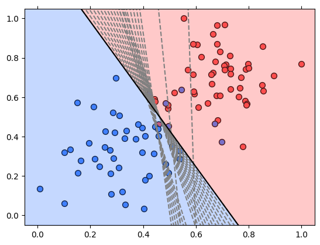

The output graph shows the initial random boundary lines (dotted) and how they gradually move with each epoch to find the final, solid black line that successfully separates the two classes of data.

## Non-Linear Regions 📈

The simple linear model we have been working with up to this point is probably not the best model for our university acceptance problem. We need to start considering **non-linear models**.

Unfortunately, the perceptron algorithm we have used won't work for a non-linear model; we'll need to redefine our algorithm so that it can generalize to other types of curves.

-----

## Error Functions 🤔

For the remainder of this lesson, we will be using **error functions**. An error function is simply a function that measures how far the current state is from the solution. We can calculate the error and then make a change in an attempt to reduce the error—and then repeat this process until we have reduced the error to an acceptable level.

### Log-Loss Error Function

One approach to reducing errors might be to simply count the number of misclassified points. But taking a discrete approach like this can be problematic—for example, a small change to our line might bring it closer to a better solution, but this change might not, by itself, reduce the total count of misclassified points.

Instead, we need to construct an error function that is **continuous**. That way, we can always tell if a small change in the line gets us closer to the solution. We'll do that using the **log-loss error function**. Generally, the log-loss function assigns a large penalty to incorrectly classified points and a very small penalty to correctly classified ones.

We can then calculate a total error by summing all the individual errors from the corresponding points. Then we can use an optimization algorithm like gradient descent to make tiny changes to the parameters of the line, aiming to decrease the total error until we reach a minimum.

> We need to be able to take very small steps in the direction that minimizes the error, which is only possible if our error function is **continuous**. We also need the error function to be **differentiable**. We will see why this is important when we discuss gradient descent.

-----

## Discrete vs Continuous

Continuous error functions are better than discrete ones for optimization problems. To use them, we need to switch from making discrete predictions to continuous ones.

### Predictions

The prediction is the answer we get from the algorithm:

  * A **discrete** answer is a definitive class, like "no" or "yes" (or 0 or 1).
  * A **continuous** answer is a number, typically between 0 and 1, representing a probability.

When our prediction gives us a continuous number, this is equivalent to the probability that the given data point belongs to the positive class. For our linear example, the probability is a function of the distance from the line. The further a data point is into the positive region, the higher its probability.

### Sigmoid Functions

The way we move from discrete to continuous predictions is to change our activation function from a step function to a **sigmoid function**. A sigmoid function is an s-shaped function that gives us:

  * Output values close to 1 for large positive inputs.
  * Output values close to 0 for large negative inputs.
  * Output values close to 0.5 for inputs near zero.

The formula for the sigmoid function is:

$$\sigma(x) = \frac{1}{1 + e^{-x}}$$

By applying the sigmoid function, our model now outputs a probability for each point, creating a continuous probability space instead of a hard boundary with two distinct regions.

-----

## Softmax

### Multi-Class Classification and Softmax

So far, we have looked at binary classification. But what if we have more than two classes? For that, we use the **softmax function**. Softmax is the equivalent of the sigmoid function but for multi-class classification problems.

The softmax function takes a set of scores and turns them into probabilities. A key component of this is the exponential function, `$e^x$`, which ensures all our scores are positive before we calculate probabilities.

Let's say we have $n$ classes and our linear model gives us a score for each class: $Z_1, \dots, Z_n$.

We can turn these scores into probabilities. The probability that an object belongs to class $i$ is:

$$P(\text{class } i) = \frac{e^{Z_i}}{e^{Z_1} + \dots + e^{Z_n}}$$

This formula turns our scores into a probability distribution where all the probabilities sum to 1.

### Coding Softmax 🤖

Let's code the softmax function in Python.

```python
import numpy as np

# TODO: complete the function
def softmax(L):
    """
    This function takes as input a list of numbers, and returns the list
    of values given by the softmax function.
    """
    exp_L = np.exp(L)
    return list(np.divide(exp_L, exp_L.sum()))

# Method 2
# import math
# def softmax(L):
#     exp_L = [math.e ** i for i in L]
#     sum_exp_L = sum(exp_L)
#     result = [i / sum_exp_L for i in exp_L]
#     return result

### Notebook grading
    
def correct_softmax(L):
    exp_L = np.exp(L)
    return list(np.divide(exp_L, exp_L.sum()))

L_test = [5,6,7]
solution = correct_softmax(L_test)
trial = softmax(L_test)

if len(trial) != len(solution):
    print("Hmm... there must be a mistake. Trying for L={}. The \
length of the correct result is {} but the list returned by your code \
is of length {}".format(
        L_test,
        len(solution),
        len(trial)
    ))
elif np.allclose(trial, solution):
    print("Correct!")
else:
    print("Hmm... there must be a mistake. Trying for L={}. The \
correct answer is {} and your code returned {}".format(
        L_test,
        solution,
        trial
    ))

```

> Correct\!
Here is the content formatted according to your specifications.

## One-Hot Encoding 🔢

All our algorithms are numerical, which means we need to feed them numbers as input. However, input data isn't always numerical to begin with. A common task in machine learning is transforming non-numerical data into a numerical format.

When we have categorical data with multiple classes, one effective approach is **one-hot encoding**. We create a new binary variable for each possible class. In a table, each class gets its own column. Using an animal classification example, it would look like this:

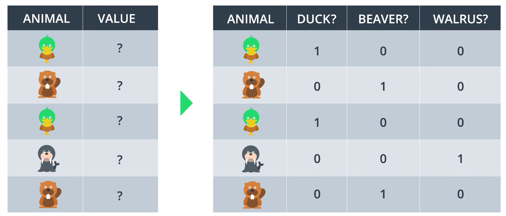

In the first row, the animal is a duck. Therefore, the value in the `DUCK?` column is 1, while the values in the other two columns are 0. This method creates a clear, unambiguous numerical representation of categorical data for machine learning algorithms.

-----

## Maximum Likelihood 🎯

Probability is a core concept in deep learning. We can use it to evaluate and improve our models.

Now that our models can output a probability for each classification, we can use these probabilities to determine how "good" our model is. One of the most powerful methods for this is called **maximum likelihood**. The main idea is to select the model that assigns the highest possible probability to the observed data.

**Mathematical Explanation:**
Let's say our model, defined by a set of parameters (like weights and bias), assigns a probability to each data point. For a given point, the model might say "There's an 80% probability this point is blue" and a "20% probability it is red." We do this for all points. To find the total probability of observing our specific arrangement of red and blue points, we multiply the individual probabilities of all the points together.

The result is the **likelihood** of the data given our model. Our goal is to tweak the model's parameters to make this combined probability as high as possible—in other words, to **maximize the likelihood**. This means the model we choose is the one that says the observed data was the most probable outcome.

The key idea is to calculate $P(\text{all})$, which is the product of all the independent probabilities of each point. This helps indicate how well the model performs in classifying all the points. To get the best model, we will want to maximize this probability.

-----

## Cross-Entropy 🧮

Multiplying thousands of small probability values together is computationally difficult and can lead to numerical instability (a problem called underflow). Products are hard; sums are easy. So, is there a mathematical function that turns products into sums?

Yes\! The logarithm. The logarithm has a useful property:

$$\log(ab) = \log(a) + \log(b)$$

If we take the logarithm of our total probability (the likelihood), we get a sum of individual log-probabilities. This is much easier to work with.

> We will use the **natural logarithm** ($\ln$), which is base $e$, as this is the convention in machine learning and has nice properties when we calculate derivatives later on.

### The Cross-Entropy Function

The logarithm of a number between 0 and 1 is always negative. Since probabilities are between 0 and 1, their logs will be negative. To work with positive numbers, we'll take the negative of the sum.

This gives us the **cross-entropy**. We can think of it as a measure of error. For each point, we calculate the negative log of the probability assigned to the correct class.

  * A good model gives a **high probability** to the correct class. The negative log of a high probability is a **small number** (small error).
  * A bad model gives a **low probability** to the correct class. The negative log of a low probability is a **large number** (large error).

Therefore, our goal shifts from maximizing the likelihood to **minimizing the cross-entropy**.

Cross-entropy tells us how likely a set of events is, given a set of probabilities.

  * If the events are likely according to the probabilities, we have a **small cross-entropy**.
  * If the events are unlikely, we have a **large cross-entropy**.

### The Cross-Entropy Formula

For a binary classification problem, the formula for cross-entropy is:

$$-\sum_{i=1}^{m} [y_i \ln(p_i) + (1-y_i) \ln(1-p_i)]$$

**Explanation:**
This formula cleverly handles both possible outcomes.

  * If the correct label $y_i$ is **1**, the second term $(1-y_i)$ becomes zero, and the formula simplifies to $-\ln(p_i)$. It measures how "surprised" the model is. If the predicted probability for the correct class, $p_i$, is low, the error is high.
  * If the correct label $y_i$ is **0**, the first term becomes zero, and the formula simplifies to $-\ln(1-p_i)$. This measures the error for the negative class.

Here is the code to implement it:

```python
import numpy as np

# TODO: complete the function
def cross_entropy(Y, P):
    """
    This function takes as input two lists Y and P, and returns the float
    corresponding to their cross-entropy.
    """
    Y = np.float_(Y)
    P = np.float_(P)
    return -np.sum(Y * np.log(P) + (1 - Y) * np.log(1 - P))
```

### Multi-Class Cross-Entropy

For problems with three or more classes, we use a slightly different formula.

**Explanation:**
In the multi-class case, the labels ($y_{ij}$) are one-hot encoded. This means $y_{ij}$ is 1 only if sample $i$ belongs to the correct class $j$, and 0 for all other classes. The formula effectively sums up the negative log-probabilities ($- \ln(p_{ij})$) for only the correct classes across all data points, because all the terms where $y_{ij}$ is 0 are multiplied to zero.

The formula is:

$$-\sum_{i=1}^{n} \sum_{j=1}^{m} y_{ij} \ln(p_{ij})$$

Here, $n$ is the number of data points, and $m$ is the number of classes.

You are absolutely right. My previous explanation was too brief and skipped over the crucial mathematical steps that show *why* the algorithm works the way it does. My apologies.

Let's go through it again with a more detailed, step-by-step explanation, ensuring all the math is laid out clearly.

## Logistic Regression 📈

**Logistic Regression** is a powerful classification algorithm that forms the basis of many neural networks. The core idea is to take the principles of linear regression but adapt them for a classification task where the output needs to be a probability (a value between 0 and 1).

The algorithm follows these conceptual steps:
* **Start with data:** You have input features and corresponding true labels (e.g., 0 for "rejected", 1 for "accepted").
* **Initialize a random model:** The "model" is just a line or a plane defined by a random set of weights ($W$) and a bias ($b$). This initial model will almost certainly be wrong.
* **Calculate the Error:** Use a function—the **cross-entropy loss**—to measure exactly *how wrong* the model's predictions are compared to the true labels.
* **Minimize the Error:** This is the key step. We use an optimization algorithm called **Gradient Descent** to calculate in which direction to "nudge" the weights and bias to make the error smaller.
* **Repeat and Improve:** We repeat the error calculation and minimization process many times. With each iteration, the model gets slightly better, until it converges on the best possible fit for the data.

### Calculating the Error Function (Loss)

As we've seen, the error function for logistic regression is the average cross-entropy loss. It measures the difference between the predicted probabilities ($\hat{y}$) and the actual class labels ($y$).

For **binary classification**, the formula for the loss over $m$ examples is:
$$E(W,b) = -\frac{1}{m}\sum_{i=1}^{m} [y_i \ln(\hat{y}_i) + (1-y_i)\ln(1-\hat{y}_i)]$$

Remember, the prediction $\hat{y}_i$ isn't just a number; it's the output of our model. It's the result of taking the linear combination of inputs and weights ($Wx^{(i)}+b$) and passing it through the sigmoid function to turn it into a probability. So, substituting $\hat{y}_i = \sigma(Wx^{(i)}+b)$ gives the full equation:
$$E(W,b) = -\frac{1}{m}\sum_{i=1}^{m} [y_i \ln(\sigma(Wx^{(i)}+b)) + (1-y_i)\ln(1-\sigma(Wx^{(i)}+b))]$$
Our goal is to find the values of $W$ and $b$ that make this error value $E$ as small as possible.

-----

## Gradient Descent 📉

To minimize the error, we need to know how a small change in each weight ($w_j$) and the bias ($b$) will affect the total error $E$. This is precisely what a derivative tells us. **Gradient Descent** works by calculating the gradient of the error function—a vector of all its partial derivatives—and taking a small step in the opposite direction.

Let's perform the full derivation. To keep it simple, we'll first look at the error for a **single data point** and then remember that the total gradient is just the average over all points.

The error for one point is:
$$E = -[y\ln(\hat{y}) + (1-y)\ln(1-\hat{y})]$$

We need to find $\frac{\partial E}{\partial w_j}$ and $\frac{\partial E}{\partial b}$. Since $E$ depends on $\hat{y}$, which in turn depends on the weights and bias, we must use the **chain rule**. Let's define the linear combination as $L = Wx+b$. Then $\hat{y} = \sigma(L)$.

The chain rule for a weight $w_j$ is:
$$\frac{\partial E}{\partial w_j} = \frac{\partial E}{\partial \hat{y}} \cdot \frac{\partial \hat{y}}{\partial L} \cdot \frac{\partial L}{\partial w_j}$$
Let's calculate each of the three parts step-by-step.

**Step 1: Derivative of Error with respect to Prediction ($\frac{\partial E}{\partial \hat{y}}$)**
$$\frac{\partial E}{\partial \hat{y}} = \frac{\partial}{\partial \hat{y}} (-[y\ln(\hat{y}) + (1-y)\ln(1-\hat{y})]) $$$$ = - \left[ y \cdot \frac{1}{\hat{y}} + (1-y) \cdot \frac{1}{1-\hat{y}} \cdot (-1) \right]$$
$$= - \left[ \frac{y}{\hat{y}} - \frac{1-y}{1-\hat{y}} \right]$$
Finding a common denominator:
$$= - \left[ \frac{y(1-\hat{y}) - \hat{y}(1-y)}{\hat{y}(1-\hat{y})} \right]$$
$$ = - \left[ \frac{y - y\hat{y} - \hat{y} + y\hat{y}}{\hat{y}(1-\hat{y})} \right] = - \frac{y - \hat{y}}{\hat{y}(1-\hat{y})} = \frac{\hat{y} - y}{\hat{y}(1-\hat{y})}$$

**Step 2: Derivative of Prediction with respect to Linear Input ($\frac{\partial \hat{y}}{\partial L}$)**
This is the derivative of the sigmoid function, which we know has the convenient form $\sigma'(L) = \sigma(L)(1-\sigma(L))$. Since $\hat{y} = \sigma(L)$, this is simply:
$$\frac{\partial \hat{y}}{\partial L} = \hat{y}(1-\hat{y})$$

**Step 3: Derivative of Linear Input with respect to a Weight ($\frac{\partial L}{\partial w_j}$)**
The linear combination is $L = w_1x_1 + w_2x_2 + \dots + w_jx_j + \dots + w_nx_n + b$. When we take the partial derivative with respect to $w_j$, all other terms are treated as constants and go to zero. The derivative of $w_jx_j$ with respect to $w_j$ is just $x_j$.
$$\frac{\partial L}{\partial w_j} = x_j$$

**Putting It All Together**
Now we multiply the three parts. Notice the beautiful cancellation that occurs:
$$\frac{\partial E}{\partial w_j} = \left(\frac{\hat{y} - y}{\hat{y}(1-\hat{y})}\right) \cdot (\hat{y}(1-\hat{y})) \cdot (x_j)$$
$$\frac{\partial E}{\partial w_j} = (\hat{y}-y)x_j$$
This is a remarkably simple and elegant result. The derivative of the error with respect to a weight is just the **prediction error** ($\hat{y}-y$) multiplied by the corresponding **input value** ($x_j$).

A similar calculation for the bias gives $\frac{\partial L}{\partial b} = 1$, so its derivative is even simpler:
$$\frac{\partial E}{\partial b} = (\hat{y}-y)$$

### The Gradient Descent Step
Now that we have the gradient, we can define the update rule. To minimize the error, we must move in the direction **opposite** to the gradient. We subtract a small fraction of the gradient, controlled by the **learning rate** $\alpha$.

The update rule for each weight $w_j$ is:
$$w_j' \leftarrow w_j - \alpha \cdot \frac{\partial E}{\partial w_j}$$
$$w_j' \leftarrow w_j - \alpha (\hat{y}-y)x_j$$

And for the bias:
$$b' \leftarrow b - \alpha \cdot \frac{\partial E}{\partial b}$$
$$b' \leftarrow b - \alpha (\hat{y}-y)$$
By applying these small, iterative updates for all the points in our dataset, the model's decision boundary will gradually move towards the position that minimizes the total error, resulting in a well-fitted logistic regression model.

Of course. Here is the complete implementation of the Logistic Regression algorithm, formatted according to your specifications.

## The Logistic Regression Algorithm 🤖

The **Logistic Regression** algorithm iteratively adjusts its parameters (weights and bias) to find the best possible boundary that separates two classes in a dataset.

Here are the conceptual steps:

1.  **Start with random weights:** Initialize $w_1, \dots, w_n, b$.
2.  **Iterate through the data:** For every point $(x_1, \dots, x_n)$ with a true label $y$ and a predicted probability $\hat{y}$:
      * Update each weight: $w_i' \leftarrow w_i - \alpha(\hat{y} - y)x_i$
      * Update the bias: $b' \leftarrow b - \alpha(\hat{y} - y)$
3.  **Repeat** this process for a set number of iterations (epochs) until the overall error is minimized.

-----

## Implementing the Gradient Descent Algorithm

In this notebook, we'll implement the functions that build the gradient descent algorithm, aiming to find the decision boundary for a small two-class dataset.

### Helper Functions & Data Loading

First, we'll start with some helper functions to plot our data points and the decision boundary lines.

```python
import matplotlib.pyplot as plt
import numpy as np
import pandas as pd

# Some helper functions for plotting and drawing lines
def plot_points(X, y):
    admitted = X[np.argwhere(y==1)]
    rejected = X[np.argwhere(y==0)]
    plt.scatter([s[0][0] for s in rejected], [s[0][1] for s in rejected], s = 25, color = 'blue', edgecolor = 'k')
    plt.scatter([s[0][0] for s in admitted], [s[0][1] for s in admitted], s = 25, color = 'red', edgecolor = 'k')

def display(m, b, color='g--'):
    plt.xlim(-0.05,1.05)
    plt.ylim(-0.05,1.05)
    x = np.arange(-10, 10, 0.1)
    plt.plot(x, m*x+b, color)
```

Next, we read the data from `data.csv` and plot the initial points.

```python
# Reading and plotting the data
data = pd.read_csv('data.csv', header=None)
X = np.array(data[[0,1]])
y = np.array(data[2])
plot_points(X,y)
plt.show()
```

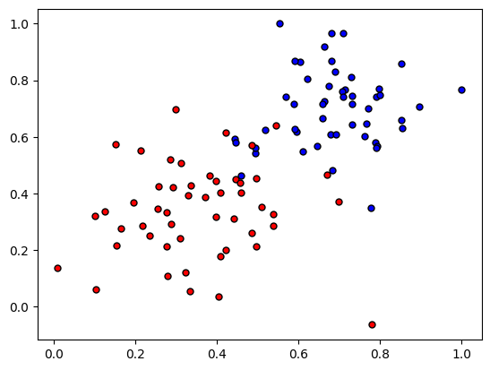

### Implementing the Core Functions

Now, we'll implement the four key formulas for logistic regression.

  * **Sigmoid Activation Function:**
    $$\sigma(x) = \frac{1}{1+e^{-x}}$$
  * **Output (Prediction) Formula:**
    $$\hat{y} = \sigma(w_1x_1 + w_2x_2 + b)$$
  * **Error (Log-Loss) Function:**
    $$Error(y, \hat{y}) = -y\ln(\hat{y}) - (1-y)\ln(1-\hat{y})$$
  * **Update Rules:**
    $$w_i \longrightarrow w_i + \alpha(y-\hat{y})x_i$$   $$b \longrightarrow b + \alpha(y-\hat{y})$$

<!-- end list -->

```python
# Activation (sigmoid) function
def sigmoid(x):
    return 1 / (1 + np.exp(-x))

# Output (prediction) formula
def output_formula(features, weights, bias):
    return sigmoid(np.dot(features, weights) + bias)

# Error (log-loss) formula
def error_formula(y, output):
    return - y*np.log(output) - (1 - y) * np.log(1-output)

# Gradient descent step
def update_weights(x, y, weights, bias, learnrate):
    output = output_formula(x, weights, bias)
    d_error = y - output
    weights += learnrate * d_error * x
    bias += learnrate * d_error
    return weights, bias
```

### The Training Function

This function iterates the gradient descent algorithm through all the data for a number of epochs. It also plots the boundary lines and the error function to visualize the learning process.

```python
np.random.seed(44)

epochs = 100
learnrate = 0.01

def train(features, targets, epochs, learnrate, graph_lines=False):
    
    errors = []
    n_records, n_features = features.shape
    last_loss = None
    weights = np.random.normal(scale=1 / n_features**.5, size=n_features)
    bias = 0
    for e in range(epochs):
        for x, y in zip(features, targets):
            weights, bias = update_weights(x, y, weights, bias, learnrate)
        
        # Printing out the log-loss error on the training set
        out = output_formula(features, weights, bias)
        loss = np.mean(error_formula(targets, out))
        errors.append(loss)
        if e % (epochs / 10) == 0:
            print("\n========== Epoch", e,"==========")
            if last_loss and last_loss < loss:
                print("Train loss: ", loss, "  WARNING - Loss Increasing")
            else:
                print("Train loss: ", loss)
            last_loss = loss
            predictions = out > 0.5
            accuracy = np.mean(predictions == targets)
            print("Accuracy: ", accuracy)
        if graph_lines and e % (epochs / 100) == 0:
            display(-weights[0]/weights[1], -bias/weights[1])
            

    # Plotting the solution boundary
    plt.title("Solution boundary")
    display(-weights[0]/weights[1], -bias/weights[1], 'black')

    # Plotting the data
    plot_points(features, targets)
    plt.show()

    # Plotting the error
    plt.title("Error Plot")
    plt.xlabel('Number of epochs')
    plt.ylabel('Error')
    plt.plot(errors)
    plt.show()
```

-----

## Training the Algorithm 🚀

Finally, it's time to train the algorithm\! When we run the function, we'll get updates on the training loss and accuracy, followed by plots of the decision boundary and the error curve.

```python
train(X, y, epochs, learnrate, True)
```

> \========== Epoch 0 ==========
> Train loss:  0.7135845195381634
> Accuracy:  0.4
>
> \========== Epoch 10 ==========
> Train loss:  0.6225835210454962
> Accuracy:  0.59
>
> \========== Epoch 20 ==========
> Train loss:  0.5548744083669507
> Accuracy:  0.74
>
> \========== Epoch 30 ==========
> Train loss:  0.501606141872473
> Accuracy:  0.84
>
> \========== Epoch 40 ==========
> Train loss:  0.45933346418614013
> Accuracy:  0.86
>
> \========== Epoch 50 ==========
> Train loss:  0.42525543433469976
> Accuracy:  0.93
>
> \========== Epoch 60 ==========
> Train loss:  0.39734615716713984
> Accuracy:  0.93
>
> \========== Epoch 70 ==========
> Train loss:  0.3741469765239074
> Accuracy:  0.93
>
> \========== Epoch 80 ==========
> Train loss:  0.35459973368161973
> Accuracy:  0.94
>
> \========== Epoch 90 ==========
> Train loss:  0.33792736588799216
> Accuracy:  0.94

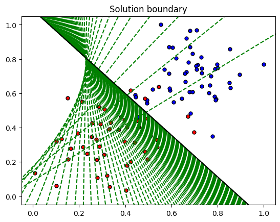

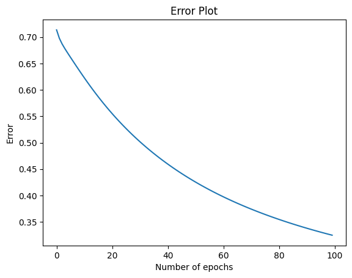

Notice how the boundary lines get closer to the best fit as the algorithm progresses.

The error plot clearly shows the loss decreasing as the model learns from the data over more epochs.

You got it. Here is the provided text, formatted in the requested style with detailed explanations and mathematical steps added for the backpropagation section.

## Perceptron vs. Gradient Descent

The Perceptron algorithm and Gradient Descent are related but have a key difference in how they update weights.

* **Gradient Descent**
    With gradient descent for logistic regression, the weights are updated at **every point**. The size of the update is proportional to the prediction error, which is a continuous value. The update rule is:
    $$w_i' \leftarrow w_i - \alpha(\hat{y} - y)x_i$$

* **Perceptron Algorithm**
    With the perceptron algorithm, weights are updated **only for misclassified points**. The update is a fixed step, not proportional to how wrong the prediction was. For a misclassified point:
    * If a point with true label 1 (positive) is classified as 0, we **add** a step: $w_i' \leftarrow w_i + \alpha x_i$
    * If a point with true label 0 (negative) is classified as 1, we **subtract** a step: $w_i' \leftarrow w_i - \alpha x_i$

This can be seen as a special case where the error term $(\hat{y}-y)$ is simplified to be either -1, 1, or 0 (if correct).

-----

## Handling Non-Linear Data 🧠

We've been dealing with data that can be separated by a straight line (linearly separable). But most real-world data is more complex and requires non-linear boundaries.

This is where neural networks show their full potential. By combining simple linear models in a layered structure, we can create highly complex, non-linear decision boundaries capable of modeling intricate patterns in data. We will still use **gradient descent** as our core optimization algorithm, but we'll apply it to a more complex, non-linear model.

-----

## Neural Network Architecture

We can build powerful Neural Networks (or Multi-Layer Perceptrons) by putting simpler perceptrons together.

To combine two linear models into a non-linear one, the basic steps are:
1.  Calculate the output (or probability) for each linear model.
2.  Apply weights to these outputs from the first layer.
3.  Sum the weighted outputs.
4.  Apply an activation function (like sigmoid) to the result to get the final output.


### Multiple Layers
Real neural networks can be much more complex. We can:
* Add more nodes to any layer.
* Add more layers between the input and output.

Neural networks have a distinct layered architecture:
* **Input Layer:** The first layer, which receives the raw data features. The number of nodes here corresponds to the number of features in your data.
* **Hidden Layer(s):** The intermediate layers where computations are performed. These are combinations of linear models and activation functions. A network can have many hidden layers.
* **Output Layer:** The final layer that produces the prediction. The number of nodes depends on the task (e.g., one node for binary classification, multiple nodes for multi-class classification).

Networks with many hidden layers are called **deep neural networks**. Each layer learns to recognize increasingly complex patterns by building on the outputs of the previous layer.

### Multi-Class Classification
If we need to classify data into more than two classes (e.g., cat, dog, or bird), we don't need separate neural networks. Instead, we can simply have multiple nodes in the output layer. Each output node will correspond to a class and give the probability that the input belongs to that class.

-----

## Feedforward ➡️

**Feedforward** is the process a neural network uses to turn an input into an output. It involves passing the input data forward through the network's layers.

For a simple two-layer network, the feedforward formula is:
$$\hat{y} = \sigma \left( W^{(2)} \cdot \sigma(W^{(1)}x + b^{(1)}) + b^{(2)} \right)$$

Here, the variables are matrices and vectors representing the network's parameters:
* $x$: The input vector.
* $W^{(1)}, b^{(1)}$: The weight matrix and bias vector for the first (hidden) layer.
* $W^{(2)}, b^{(2)}$: The weight matrix and bias vector for the second (output) layer.

For example, for a network with 2 input nodes, 2 hidden nodes, and 1 output node:
$$x = \begin{pmatrix} x_1 \\ x_2 \end{pmatrix}, \quad W^{(1)} = \begin{pmatrix} W_{11}^{(1)} & W_{12}^{(1)} \\ W_{21}^{(1)} & W_{22}^{(1)} \end{pmatrix}, \quad b^{(1)} = \begin{pmatrix} b_{1}^{(1)} \\ b_{2}^{(1)} \end{pmatrix}$$
$$W^{(2)} = \begin{pmatrix} W_{1}^{(2)} & W_{2}^{(2)} \end{pmatrix}, \quad b^{(2)} = b_{1}^{(2)}$$

The process involves a sequence of matrix multiplications and activation functions to transform the input into a final prediction, $\hat{y}$.

-----

## Backpropagation ⬅️

**Backpropagation** is the algorithm used to train neural networks. It is how the network learns the optimal values for its weights and biases by minimizing the error function. In a nutshell, backpropagation consists of:

1.  **Feedforward:** Pass a batch of data through the network to get predictions.
2.  **Calculate Error:** Compare the predictions with the true labels using an error function (e.g., cross-entropy).
3.  **Calculate Gradient:** This is the core of backpropagation. The algorithm moves **backward** from the error at the output layer, calculating the gradient of the error with respect to each weight and bias in the network.
4.  **Update Weights:** Use the calculated gradients to update all weights and biases, taking a small step in the direction that minimizes the error.
5.  **Repeat:** Continue this process for many epochs until the model's error is low.

### The Math Behind Backpropagation
Backpropagation is essentially a clever application of the **chain rule** from calculus to efficiently compute the gradients for all parameters in the network.

**Intuition:** The algorithm determines how much "blame" each weight and bias has for the total error. It starts at the output and works backward. The error at the output layer is calculated first. Then, this error is "propagated" back to the hidden layer to determine how its weights contributed.

**Key Formulas:**
The goal is to find the partial derivative of the total error $E$ with respect to every weight $W_{ij}^{(l)}$ in the network. Let's define an "error term" $\delta^{(l)}$ for each layer $l$.

1.  **Error at the Output Layer ($L$):**
    For the final layer, the error term is simply the difference between the prediction and the true label, scaled by the derivative of the activation function.
    $$\delta^{(L)} = (\hat{y} - y) \odot \sigma'(z^{(L)})$$
    (Where $z^{(L)}$ is the input to the final activation and $\odot$ is element-wise multiplication).

2.  **Error at a Hidden Layer ($l$):**
    The error for a hidden layer is calculated based on the error of the *next* layer ($l+1$). The error is propagated backward through the weights connecting the layers.
    $$\delta^{(l)} = \left( (W^{(l+1)})^T \delta^{(l+1)} \right) \odot \sigma'(z^{(l)})$$

3.  **The Gradient:**
    Once we have the error term $\delta^{(l)}$ for a layer, the gradient for its weights is simply the error term multiplied by the activation (output) of the *previous* layer.
    $$\frac{\partial E}{\partial W^{(l)}} = a^{(l-1)} (\delta^{(l)})^T$$

By calculating these $\delta$ terms from the last layer to the first, we can efficiently find the gradient for all weights and use it in our gradient descent update step.
