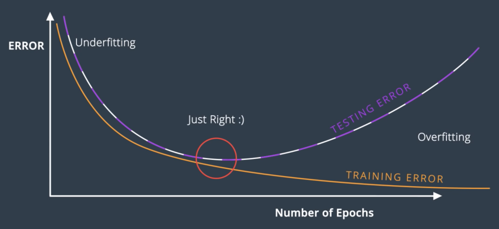

# Training and Testing Neural Networks 🧪

## Testing
To objectively evaluate and compare different models, we must separate our data into two sets:
* A **training set** used to teach the model.
* A **testing set** used *only* to evaluate the trained model's performance on unseen data.

A model that performs well on the training data might not generalize well to the testing data. This discrepancy often points to one of two common problems: underfitting or overfitting.

## Overfitting and Underfitting
* **Underfitting (Error due to Bias):** This occurs when a model is too simple to capture the underlying patterns in the data. It has a "biased" and oversimplified view of the problem. For example, if a model trained only on four-legged dogs learns the rule "if it has four legs, it's a dog," it will underfit and misclassify a cat.

* **Overfitting (Error due to Variance):** This occurs when a model is too complex and learns the training data *too* well, including its noise and random fluctuations. It fails to generalize to new data. For example, if a model learns to recognize only "yellow, orange, or grey dogs" from the training set, it will overfit and fail to recognize a brown dog in the test set.

For neural networks, underfitting often results from an overly simple architecture, while overfitting comes from an overly complex one. A common strategy is to start with a more complex model and then use specific techniques to combat overfitting.

-----

## Early Stopping 🛑

As we train a neural network over many epochs, its performance on the training data will consistently improve. However, its performance on the unseen testing data will improve only up to a point, after which it will start to get worse as the model begins to overfit.

We can monitor both training and testing error during the training process. **Early stopping** is the technique of halting the training as soon as the testing error stops decreasing and begins to rise. This ensures we save the model at its point of optimal generalization.

* **Left side:** High training and testing error indicates **underfitting**.
* **Right side:** Low training error but high testing error indicates **overfitting**.
* **Middle:** The "Goldilocks point" where testing error is at its minimum is the optimal model complexity.

-----

## Regularization
Large weights in a neural network can be a sign of overfitting. A model with large weights can become "overconfident," producing predictions that are very close to 0 or 1. This results in a very steep activation function, which makes the gradient nearly zero and slows down or stops the learning process.

**Regularization** is a technique that combats this by adding a penalty to the error function for large weights. Our goal is no longer just to minimize the error, but to minimize the error *and* the size of the weights.

Given the standard cross-entropy error function:
$$-\frac{1}{m}\sum_{i=1}^{m} [y_i \ln(\hat{y}_i) + (1-y_i)\ln(1-\hat{y}_i)]$$
We add a regularization term. There are two common types:

* **L1 Regularization:** Adds the sum of the absolute values of the weights. It encourages sparsity, meaning many weights are pushed to exactly zero. This is useful for feature selection.
    $$+ \lambda \sum_i |w_i|$$
* **L2 Regularization:** Adds the sum of the squared values of the weights. It encourages all weights to be homogeneously small without forcing them to zero. This is the most common type and often leads to better model performance.
    $$+ \lambda \sum_i w_i^2$$

-----

## Dropout
**Dropout** is another powerful technique to prevent overfitting. Sometimes, a small part of the network with large weights can dominate the learning process, while other parts are left undertrained.

Dropout addresses this by randomly "turning off" a fraction of the nodes in the network during each training epoch.
* This forces the remaining nodes to learn more robust and redundant features, as they can't rely on any single part of the network.
* The dropout rate (e.g., 0.2) is a parameter that sets the probability that any given node will be dropped during an epoch.

-----

## Other Training Techniques 🛠️

### Local Minima and Random Restart
Gradient descent can get stuck in a **local minimum**—a point that is the lowest in its immediate vicinity but not the overall lowest point (the global minimum). A simple and effective technique to mitigate this is **random restart**, where you train the same model multiple times from different random initial weights and choose the one that results in the lowest final error.

### Other Activation Functions
The sigmoid function suffers from the **vanishing gradient problem**: its derivative is nearly zero for very high or low inputs, which can stop the network from learning. Two popular alternatives are:

* **Hyperbolic Tangent (tanh):** Similar to sigmoid but outputs values between -1 and 1. Its derivatives are steeper, which can lead to faster training.
    $$\tanh(x) = \frac{e^x - e^{-x}}{e^x + e^{-x}}$$
* **Rectified Linear Unit (ReLU):** A very popular and computationally efficient function. It outputs the input if it's positive, and zero otherwise. It helps mitigate the vanishing gradient problem.
    $$\text{ReLU}(x) = \begin{cases} x & \text{if } x \ge 0 \\ 0 & \text{if } x < 0 \end{cases}$$

### Batch vs. Stochastic Gradient Descent
* **Batch Gradient Descent:** Calculates the gradient based on the **entire** training dataset. This is computationally expensive and memory-intensive for large datasets.
* **Stochastic Gradient Descent (SGD):** Approximates the gradient by calculating it on a small, random subset (a "mini-batch") of the data. This is much faster and allows the model to learn from huge datasets. While each step is less accurate, taking many fast steps is often more effective in practice.

### Learning Rate Decay
Choosing a learning rate is a trade-off: too large, and you risk overshooting the minimum; too small, and training is too slow. A common technique is **learning rate decay**, where you start with a larger learning rate for faster initial progress and gradually decrease it as the model gets closer to a solution, allowing for finer-grained adjustments.

### Momentum
**Momentum** helps the gradient descent algorithm overcome shallow local minima and accelerate towards the global minimum. It adds a fraction ($\beta$) of the previous update step to the current one, creating a "weighted average" of past steps.
$$\text{step}(n) + \beta\cdot\text{step}(n-1) + \beta^2\cdot\text{step}(n-2) + \dots$$
This helps the updates build "momentum" in a consistent direction and smooths out the optimization path.