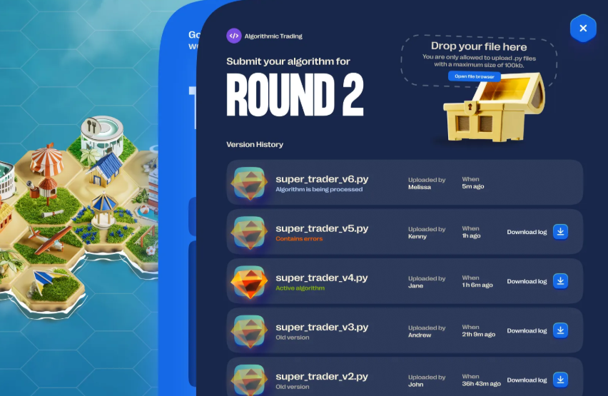
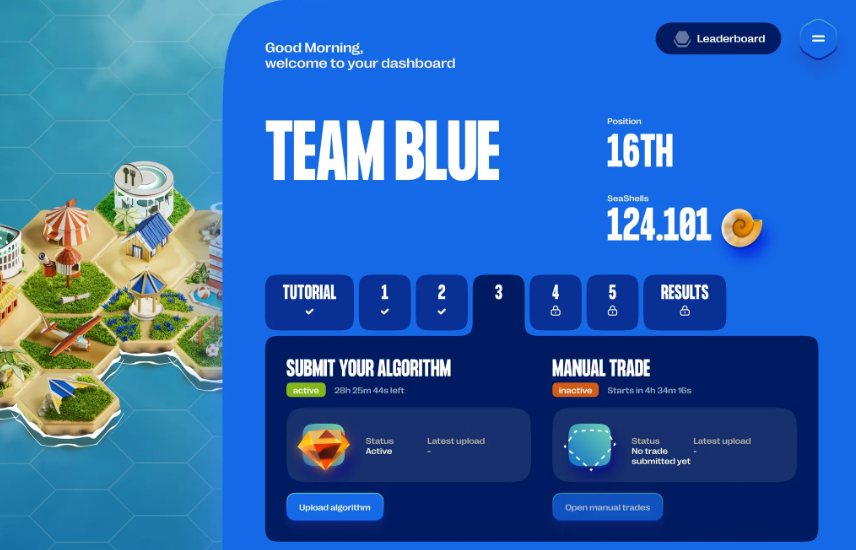
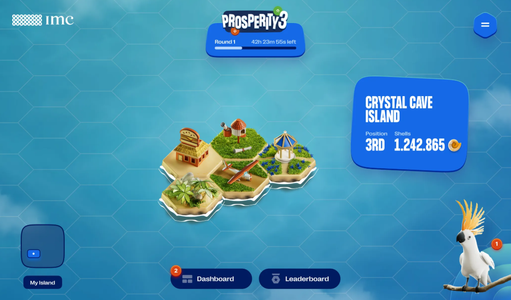
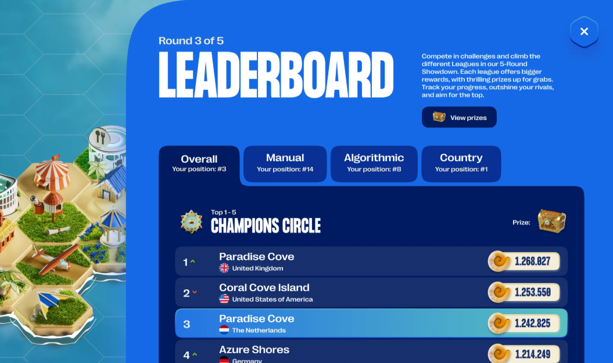
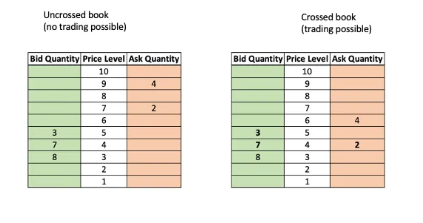
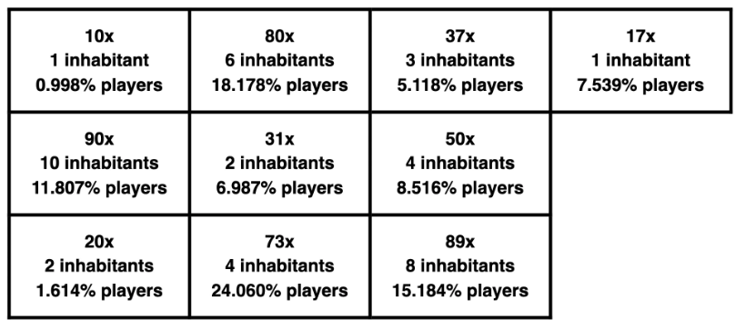

In this article, I will be sharing my experience of learning about the IMC prosperity challenge.

<!--more-->

## Who is IMC?

### Introduction

IMC was founded in 1989 by two traders working on the floor of the Amsterdam Equity Options Exchange.

While today’s industry is highly automated, back then trading was executed on the exchange floor by traders manually calculating the price to buy or sell. IMC was among the first to spot the importance of technology and innovation in the evolution of market making and invested early, helping shape the future of trading.

That entrepreneurial spirit and innovative culture still drives IMC, which stands for International Marketmaker’s Combination.

In 35 years we’ve grown internationally, trading primarily on the basis of data and algorithms, and using our execution platform to provide liquidity to financial markets globally.

>**Where cutting edge technology meets trading**

IMC is as much a technology firm as a trading house. We invest significant time and resources to ensure our traders have the best tools for the job. That means continually developing and innovating to improve productivity and performance for both traders and developers. By employing the best talent and providing an environment in which knowledge and skills can thrive, we bring value to the market.

### Locations

We have offices covering all time zones in Amsterdam, Chicago, Sydney, Mumbai, Hong Kong, Londen, Zug and Seoul.

### Careers

Please visit our website to check our open positions and apply via [www.imc.com](http://www.imc.com/).

## What is Prosperity?

Prosperity is a 15-day long trading challenge happening somewhere in a near - utopian - future. You’re in control of an island in an archipelago and your goal is to bring your island to prosperity. You do so by earning as many SeaShells as possible; the main currency in the archipelago. The more SeaShells you earn, the more your island will prosper.

During your 15 days on the island, your trading abilities will be tested through a variety of trading challenges. It’s up to you to develop a successful trading strategy. You will be working on a Python script to handle algorithmic trades on your behalf. Every round also presents a manual trading challenge; a one off challenge that is separate from your algorithmic trading and could yield some additional profits. Your success depends on both these algorithmic and manual trades.

Take a deep breath and smell the opportunities drifting by with the ocean breeze. It’s up to you to seize those opportunities and lead your island into prosperity. At times, it will be challenging. Hard even. But for those who know how to work the market to their favor, the reward will be bountiful.

## High-level storyline

Welcome to Prosperity! You’re in control of an island in an archipelago somewhere in a near (utopian) future. Your goal is as clear as day: bring your island to prosperity. You do so by earning as many SeaShells as possible; the main currency in the archipelago. The more SeaShells you earn, the more your island will grow and prosper.

The main character in the game is a cockatoo that lives in the archipelago. Besides a cockatoo he is also the news anchor for Tropical TV. Every round he’ll give you the latest headlines; all you need to know to progress in the game. The news broadcasts from Tropical TV will play an important role during our 15-day trading challenge. The cockatoo will give a short update on what happened in the previous round, before he’ll disclose this round’s assignment and tradable goods.

During the trading season, you’ll meet all kinds of interesting characters. Some from within our own archipelago and some that we consider our neighbours. All of them have their own unique story. You should definitely keep your ears peeled for those stories, because every real trading tycoon knows that within every story there is an opportunity to be found. You just have to know how to turn that compelling story into a profitable strategy.

## Tutorial

Before the actual trading challenge starts, a tutorial round will be open for you to explore the game. This is the time for you to discover all the different aspects of the game: the interface, the dashboard, the leaderboard and Tropical TV. You can even try uploading your first Python program to get familiar with it.

During this tutorial round, you can upload as many Python programs as you please, to get familiar with the controls and dynamics. All algorithms uploaded in the tutorial round will be processed and generate results, so you can experiment with different programs and strategies.

Take advantage of this pre-game playground and prepare yourself in the best way possible for when it really matters: when round 1 begins.

## Game mechanics overview

### Rounds

The 15 days of simulation of Prosperity are divided into 5 rounds. Each round lasts 72 hours. At the end of every round - before the timer runs out - all teams will have to submit their algorithmic and manual trades to be processed. The algorithms will then participate in a full day of trading against the Prosperity trading bots. Note that all algorithms are trading separately, there is no interaction between the algorithms of different players. When a new round starts, the results of the previous round will be disclosed and the leaderboard will be updated accordingly. During the game, you can always visit previous rounds in the dashboard, to review information and results. But once a round is closed, you can no longer change your submitted trades for that round. When round 5 ends, the final results will be processed and the winner of the Prosperity trading challenge will be announced.

### Algorithmic trading

Every round contains an algorithmic trading challenge. You will have 72 hours to submit your (final) Python program. When the round ends, the last successfully processed submission will be locked in and processed for results.
Participants were given historical data from previous days and, in certain rounds, additional external information. The challenge was to develop algorithms that could analyze the data, predict market movements, and execute trades efficiently.



Uploading your program is as simple as dragging it into the treasure chest

### Manual trading

All rounds contain a manual trading challenge. Just like the algorithmic challenge, manual trading challenges last 72 hours to submit your (final) trade. When the round ends, the last submission will be locked in and processed for results. During the tutorial round, manual trading is inactive. Note that manual trades have no effect on your algorithmic trade and can be seen as separate challenges to gain additional profits.
The manual trading component of the competition involved solving complex probability and mathematical problems using the provided data. The objective was to optimize strategies to maximize profits. This part required deep analytical thinking and quick decision-making to navigate the fluctuating market conditions and seize profitable opportunities.

### Round timings

The challenge will start on April 7th, 2025 at 13:00 PM **CET**. There are five rounds and each round lasts 72 hours.

- **Tutorial: February 24, 13:00 → April 7, 13:00**
- **Round 1: April 7, 13:00 → April 10, 13:00**
- **Round 2: April 10, 13:00 → April 13, 13:00**
- **Round 3: April 13, 13:00 → April 16, 13:00**
- **Round 4: April 16, 13:00 → April 19, 13:00**
- **Round 5: April 19, 13:00 → April 22, 13:00**

## Dashboard

### Algorithmic trading submissions

Submitting your algorithmic trading program (your Python script) is easily done through the dashboard, by clicking the “Upload algorithm” button. A window will open where you can drag & drop your file or search for it through a file browser. Here, you can also find all the previously uploaded programs with their respective status and who uploaded them. You can even download the debug logs. Handy!



Your team’s dashboard

You and your team can upload as many Python programs as you please, but only the one active algorithm will be processed and executed at the end of the round.

### Manual trading submissions

Submitting your manual trades is done through the dashboard, by clicking the “Open manual trades” button. A window will open where you will find the controls to input your trading strategy. Once you are satisfied with the parameters, you can submit your manual trade by clicking the “Submit manual trade” button.

You and your team can (re)submit strategies as many times as you please, but only the last submitted trade will be processed and executed at the end of the round.

### Tropical TV

Tropical TV is the archipelago’s daily news broadcast, hosted by a chatty cockatoo. The news broadcasts will keep you up to date with all developments around the archipelago. It contains all the information you need to navigate your way through the trading challenges that are thrown at you. It’s a great way to start your day!

Tropical TV episodes will be available at the beginning of every round. You will be notified as soon as a new Tropical TV episode becomes available.

### Archipelago

The archipelago is where you will find your island amidst the islands of all the other participating teams. The position of your island in the archipelago corresponds to your island’s performance throughout the game. The best-performing island will be at the dead center of the archipelago. The least performing islands will be at the outer rims of the archipelago. The current standing of an island - along with the island name and current amount of SeaShells - is also displayed in the small indicator above the island.



### Leaderboard

Next to the archipelago, a handy leaderboard is available as well. Simply click on the Leaderboard button and you will see the top performing teams and, of course, your own island’s position amongst your competitors. Handy, for if you quickly want to see how many more SeaShells you need to overtake the next team.



## Rules

### **Game Participation Rules**

To ensure a smooth experience during Prosperity, here are a few important guidelines regarding team participation and solo play:

- **Create an Account** → You can register and join the game anytime **until the end of Round 5**.
- **Join a New Team** → Team formation is open **until the end of Round 2**.
- **Switch Teams** → You can switch teams **until the end of Round 2**. Switching teams is done by receiving an invitation link from the new team’s admin. If you accept an invite to a new team, you will automatically resign from your current one.
- **Start a Solo Player Island** → Prefer to go solo? You can start your own island anytime **until the end of Round 5**.

Please note that the Prosperity organization / admin board will not accommodate manually moving players from one team to the other at any point during the duration of the game.

## Trading glossary

The aim of this page is to introduce players to real world trading concepts and jargon which they will also encounter in the world of prosperity.

### Exchange

A central marketplace where buyers and sellers meet to arrange trades in certain products. These products can be a wide range of things. Commodities, Stocks, Bonds, ETFs, Derivatives, Currencies, Cryptocurrencies. Modern exchanges are often heavily relying on digital infrastructure, and to a large extent match buyers and sellers using automated matching of BUY and SELL orders.

### Order

An order is a binding message sent by exchange participants to indicate a willingness to buy (sell) a certain amount of a specified product at any price up to (starting from) the price indicated in the order. Some general properties of an order:

- Owner: who sent the order
- Product: what product does the order sender wish to trade
- Quantity: up what quantity of the product would the order sender like to trade
- Price: what is the price associated with the order
- Validity: Until when is the order valid

Depending on the context there might be additional properties to an order, but the ones above are fundamentally shared between all orders. The type of orders that we are concerned with in Prosperity (and at market makers like IMC) are the type of orders sent to central marketplaces called Exchanges. If orders sent by other entities “match” with the original order, meaning that a trade can be arranged where both the conditions of the sell as well as the buy order are met, the trade is “executed” (more about order matching below)

### Bid Order

A bid order, is financial jargon for a BUY order. The price of such a bid order is typically referred to as the “bid” or the “bid price”. If traders refer to the “best bid”, they typically refer to the price corresponding to the highest active buy order for a certain product, which is the highest price another market participant can decide to sell the product at.

### Ask Order/Offer

Similar to “Bid Orders”, but referring to SELL orders.

### Order Matching

How order execution works on the island exchange (and on most real-world exchanges): a BUY order will be immediately executed if there is an active SELL order in the market with an associated price equal to or lower than the price associated with the BUY order (the lower the sell price the better it is for the buyer). In that case the buyer will buy an amount equal to the minimum of the two order quantities, at the price of the SELL order. If the SELL order quantity was lower than the BUY order, that means only part of the BUY order gets executed, and a resting order (equal to the BUY order quantity minus the SELL order quantity) remains in the market. If there is no SELL order with a price equal or lower than the price of the BUY order, the full order remains in the market. If an order remains in the market, the bots might decide to send crossing sell orders at a later point, which would then mean that at that point the order still trades.

By symmetry, SELL orders will trade immediately against any BUY orders with a price equal or higher than the price associated with the SELL order (the higher the buy price the better it is for the seller). Beside from that SELL orders behave in the exact same way as BUY orders.

### Order Book

Orders for a certain product are collected in something called an Order Book. While there are multiple ways to visualize an Order Book, a common representation is shown below. The middle of the book shows the different price levels. The left side, or bid side, shows the combined quantity of all the BUY orders which have that price associated with them. On the right side, or ask side, the combined quantity of all the sell orders per price level is represented. As described above, once there are buy and sell orders at the same price level, or even buy orders at a price level above the price level of the lowest sell order, orders are matched and trading takes place. We would call an order book with no bid orders at or above the level of the lowest ask order “uncrossed”. No trading is then possible. If there are buy orders above the lowest price level with ask orders, we would call the book “crossed” and trading is possible.



### Priority

Sometimes an incoming order could be matched to several existing orders. In that case the priority rules of the exchange determine at which the order will be executed. The most common priority rule, also enforced on the island exchange, is “price-time priority”. This means that the incoming order is first matched against the existing order with the most attractive price (from the perspective of the incoming order) at the price level of the existing order. For an incoming buy order, the most attractive price is the lowest sell price (cheapest price to buy). For an incoming sell order, the most attractive price is the highest buy price (highest price to sell for). When a match occurs, the trade is executed at the price of the existing order in the order book, not the price of the incoming order (if they differ). If there are multiple orders at that price level, the oldest order is executed first. If we take the right most order book in the figure above as an example and assume that the sell order with a quantity of 2 at price level 4 was the last order to be entered in the book, we see that this order could be matched either against the buy orders at price level 4 or the buy orders at price level 5. Selling at a price of 5 is more attractive from the perspective of the incoming order so the order will match with buy orders on that level. If the aggregate quantity of 3 on the bid side at price level 5 consists of multiple orders, the ask order will first be executed against the oldest order at that level. If any quantity of the incoming order remains after that trade it is executed against the second oldest order at that price level.

**For example**, consider the order book for "wasabi roots" with sell orders: Order A (100 units at \$10.00, placed at 10:00 AM), Order B (50 units at \$10.00, 10:01 AM), and Order C (200 units at \$10.50, 10:02 AM). An incoming buy order for 120 units at \$10.50 or lower seeks the cheapest price, so it targets the \$10.00 orders (A and B) over the \$10.50 order (C). Since Order A was placed before Order B, the buy order matches fully with Order A (100 units at \$10.00) and then takes 20 units from Order B at the same price. This leaves 30 units in Order B and Order C untouched. The trade executes at $10.00 per unit, reflecting the existing orders’ price, ensuring the buyer gets the best deal while respecting the time priority of orders.

### Market Making

Market making is a trading strategy where a trader facilitates transactions by simultaneously offering to buy and sell a product, without necessarily predicting whether its price will rise or fall. The goal is to profit from the difference between the buy and sell prices, known as the bid-ask spread, while providing liquidity to the market. This strategy is central to financial exchanges, including the virtual island exchange in the IMC Prosperity challenge, as it ensures that buyers and sellers can trade efficiently.

**How Market Making Works**
A market maker posts two prices in the order book:

**Bid Price**: The price at which they are willing to buy the asset.
**Ask Price**: The price at which they are willing to sell the asset.
The difference between these prices (the **spread**) is the market maker’s potential profit. By continuously offering to buy and sell, market makers enable smooth trading for others, earning small profits on each transaction as long as they balance their buys and sells. A wider spread increases profit per trade but may deter matches, while a narrower spread attracts more trades but reduces profit per unit. This strategy thrives in markets with frequent trading activity, as it relies on volume rather than large price movements.

In the context of **IMC Prosperity**, market making is particularly relevant because participants trade virtual assets (e.g., wasabi roots, ukuleles) on an exchange governed by rules like price-time priority. A successful market maker in Prosperity would place strategic bid and ask orders to capture the spread while managing inventory to avoid holding too much or too little of an asset.

**Real-World Example:** Currency Exchange
Imagine a currency exchange booth at an airport. The booth operator doesn’t speculate on whether the euro will strengthen or weaken against the dollar. Instead, they offer to:

Buy dollars from travelers at €0.95 per dollar (bid price) & Sell dollars to travelers at €1.05 per dollar (ask price). The €0.10 difference is the spread, which is their profit margin. If a traveler sells $100 to the booth, they receive €95. If another traveler buys \$100, they pay €105. If the booth buys and sells roughly equal amounts of dollars, they pocket the €0.10 spread per dollar traded without needing the exchange rate to change. This benefits travelers by providing immediate access to the currency they need, while the booth earns a steady profit by facilitating these trades.

**IMC Prosperity Example**
In the IMC Prosperity challenge, suppose you’re trading a virtual asset like "mayberries" on the island exchange. You act as a market maker by placing orders in the order book:

Bid: Buy 50 mayberries at \$10.00 each.
Ask: Sell 50 mayberries at \$10.20 each. The order book might look like this:
Sell Orders: Your ask at \$10.20 (50 units, placed at 9:00 AM).
Buy Orders: Your bid at \$10.00 (50 units, placed at 9:00 AM).
An incoming buy order for 30 mayberries at \$10.20 or lower matches with your ask, so you sell 30 units at \$10.20, earning \$306. Later, an incoming sell order for 30 mayberries at $10.00 or higher matches with your bid, so you buy 30 units at \$10.00, spending \$300. Your profit is \$306 - \$300 = \$6, thanks to the \$0.20 spread per unit. By maintaining balanced orders, you continue to profit as long as trades occur, regardless of whether mayberry prices rise or fall. Holding too many assets (long position) or too few (short position) can lead to losses if prices move unexpectedly, so market makers aim for balanced inventory.

---

## technology stack

algorithmic trading - tutorial (python basics + oop (advanced)) + examples + implementation of basic trading strategies
manual trading - mathematical problem solving like optimization

## learning outcomes

The IMC Prosperity competition was structured uniquely, with each of its five rounds demanding distinct skills — from arbitrage and statistical prediction to pairs trading. Each round concluded with a ‘Manual trade’ in the form of a mathematical optimisation problem where teams bid in complex probabilistic scenarios. These rounds were intellectually demanding and required deep understanding and innovative approaches to trading algorithms.

>A cornerstone of our strategy for algorithmic trading was our structure of development, backtesting, discussion and refining of various trading strategies. These included **market-making, sophisticated statistical predictions, cross-exchange arbitrage, and options arbitrage leveraging the Black-Scholes model.** In particular, a **custom fair pricing model** that we developed became crucial to our strategy and was integral to our performance in every round.

### **Algorithmic Trading Strategy:**

Market-Making and Order Taking: For stable goods like "Rainforest Resin," place buy orders below fair value (e.g., 999) and sell orders above (e.g., 1001), taking mispriced orders first. For volatile "Kelp," calculate true value dynamically, using the average of popular buy and sell prices, and widen spreads (e.g., 2) to manage risk, as seen in benbates30’s repository.

Position Management: Adhere to position limits (50 for both products), adjusting order quantities based on current position to avoid exceeding limits, a practice evident in aniruddha-saha’s repository.

State Persistence: Use traderData to store state, such as moving averages for "Kelp," serialized as JSON strings, ensuring compliance with the string requirement, as highlighted in the error analysis from the user’s log.

Historical Data and Predictions: Analyze past trades to predict price movements, a strategy in pe049395’s repository, enhancing dynamic pricing for volatile goods.

- Mean Reversion: This strategy is based on the concept that prices will revert to their mean over time. I learned how to identify overbought and oversold conditions and make trades based on these signals. While it worked in some scenarios, its effectiveness was limited by the volatility of the market.
- Momentum Trading: By capitalizing on the momentum of price movements, this strategy aims to ride the trend until it shows signs of reversal. I discovered the importance of timing and the risks associated with sudden market shifts.
- Pair Trading: This market-neutral strategy involves trading two correlated assets. When one asset is underperforming and the other is overperforming, the idea is to short the overperforming asset and long the underperforming one. This strategy taught me the intricacies of correlation and the need for continuous monitoring.
- Statistical Arbitrage: Leveraging statistical models to find price discrepancies, I learned how to create and test models that could predict future price movements. This was particularly challenging but rewarding when the models worked as expected.

### **Manual Trading Strategy:**

Optimization Techniques: For problems like bid pricing, use calculus to find maxima, or simulate with different values to understand the profit curve. For instance, if first bid is 933 and second is 966, calculate profit as (1000 - 933) x 0.33 + (1000 - 966) x 0.33, adjusting for total fish, as discussed in the user’s initial query.

Quick Decision-Making: Practice under time pressure, testing strategies like splitting the range (e.g., 925 and 975) to balance quantity and margin, a common approach in optimization contests.

### **Technical Considerations and Limitations**

The competition has a 900ms time limit per iteration, requiring efficient code using supported libraries. Errors, like the user’s log showing "Trader data are not serialized to string," must be avoided by ensuring run returns (result, conversions, traderData) with traderData as a string, as corrected in the analysis. Limitations include reliance on real-time data, where incomplete order books might default to conservative strategies, and the need for robust error handling to prevent submission halts.

---

## Writing an Algorithm in Python

The explanation below assumes familiarity with the basics of Object-Oriented Programming in Python. To refresh this knowledge you can have a look at the source provided on the [Programming resources](https://www.notion.so/Programming-resources-17be8453a0938135a7c5ef6acedb0ab5?pvs=21).

### The Challenge

For the algorithmic trading challenge, you will be writing and uploading a trading algorithm class in Python, which will then be set loose on the island exchange. On this exchange, the algorithm will trade against a number of bots, with the aim of earning as many SeaShells (the currency of the archipelago) as possible. The algorithmic trading challenge consists of several rounds, that take place on different days of the challenge. At the beginning of each round, it is disclosed which new products will be available for trading on that day. Sample data for these products is provided that players can use to get a better understanding of the price dynamics of these products, and consequently build a better algorithm for trading them. While most days will feature new products, the old products will also still be tradable in the rounds after which they are introduced. This means that based on the result of the previous rounds, players also have the opportunity to analyse and optimise their trading strategies for these “old” products.

The format for the trading algorithm will be a predefined `Trader` class, which has a single method called `run` which contains all the trading logic coded up by the trader. Once the algorithm is uploaded it will be run in the simulation environment. The simulation consists of a large number of iterations. During each iteration the run method will be called and provided with a `TradingState` object. This object contains an overview of all the trades that have happened since the last iteration, both the algorithms own trades as well as trades that happened between other market participants. Even more importantly, the `TradingState` will contain a per product overview of all the outstanding buy and sell orders (also called “quotes”) originating from the bots. Based on the logic in the `run` method the algorithm can then decide to either send orders that will fully or partially match with the existing orders, e.g. sending a buy (sell) order with a price equal to or higher (lower) than one of the outstanding bot quotes, which will result in a trade. If the algorithm sends a buy (sell) order with an associated quantity that is larger than the bot sell (buy) quote that it is matched to, the remaining quantity will be left as an outstanding buy (sell) quote with which the trading bots will then potentially trade. When the next iteration begins, the `TradingState` will then reveal whether any of the bots decided to “trade on” the player’s outstanding quote. If none of the bots trade on an outstanding player quote, the quote is automatically cancelled at the end of the iteration.

Every trade done by the algorithm in a certain product changes the “position” of the algorithm in that product. E.g. if the initial position in product X was 2 and the algorithm buys an additional quantity of 3, the position in product X is then 5. If the algorithm then subsequently sells a quantity of 7, the position in product X will be -2, called “short 2”. Like in the real world, the algorithms are restricted by per product position limits, which define the absolute position (long or short) that the algorithm is not allowed to exceed. If the aggregated quantity of all the buy (sell) orders an algorithm sends during a certain iteration would, if all fully matched, result in the algorithm obtaining a long (short) position exceeding the position limit, all the orders are cancelled by the exchange.

In the first section, the general outline of the `Trader` class that the player will be creating is outlined.

### Overview of the `Trader` class

Below an abstract representation of what the trader class should look like is shown. The class only requires a single method called `run`, which is called by the simulation every time a new `TraderState` is available. The logic within this `run` method is written by the player and determines the behaviour of the algorithm. The output of the method is a dictionary named `result`, which contains all the orders that the algorithm decides to send based on this logic.

**Example implementation above presents placing order idea as well.**

```python
from datamodel import OrderDepth, UserId, TradingState, Order
from typing import List
import string

class Trader:
    
    def run(self, state: TradingState):
        print("traderData: " + state.traderData)
        print("Observations: " + str(state.observations))

        # Orders to be placed on exchange matching engine
        result = {}
        for product in state.order_depths:
            order_depth: OrderDepth = state.order_depths[product]
            orders: List[Order] = []
            acceptable_price = 10  # Participant should calculate this value
            print("Acceptable price : " + str(acceptable_price))
            print("Buy Order depth : " + str(len(order_depth.buy_orders)) + ", Sell order depth : " + str(len(order_depth.sell_orders)))
    
            if len(order_depth.sell_orders) != 0:
                best_ask, best_ask_amount = list(order_depth.sell_orders.items())[0]
                if int(best_ask) < acceptable_price:
                    print("BUY", str(-best_ask_amount) + "x", best_ask)
                    orders.append(Order(product, best_ask, -best_ask_amount))
    
            if len(order_depth.buy_orders) != 0:
                best_bid, best_bid_amount = list(order_depth.buy_orders.items())[0]
                if int(best_bid) > acceptable_price:
                    print("SELL", str(best_bid_amount) + "x", best_bid)
                    orders.append(Order(product, best_bid, -best_bid_amount))
            
            result[product] = orders
    
      # String value holding Trader state data required. 
    # It will be delivered as TradingState.traderData on next execution.
        traderData = "SAMPLE" 
        
    # Sample conversion request. Check more details below. 
        conversions = 1
        return result, conversions, traderData
```

When you send the Trader implementation there is always submission identifier generated. It’s UUID value similar to “59f81e67-f6c6-4254-b61e-39661eac6141”. Should any questions arise on the results, feel free to communicate on Discord channels. Identifier is absolutely essential to answer questions. Please put it in the message.

Technical implementation for the trading container is based on Amazon Web Services Lambda function. Based on the fact that Lambda is stateless AWS can not guarantee any class or global variables will stay in place on subsequent calls. We provide possibility of defining a traderData string value as an opportunity to keep the state details. Any Python variable could be serialised into string with jsonpickle library and deserialised on the next call based on TradingState.traderData property. Container will not interfere with the content.

To get a better feel for what this `TradingState` object is exactly and how players can use it, a description of the class is provided below.

### Overview of the `TradingState` class

The `TradingState` class holds all the important market information that an algorithm needs to make decisions about which orders to send. Below the definition is provided for the `TradingState` class:

```python
Time = int
Symbol = str
Product = str
Position = int

class TradingState(object):
   def __init__(self,
                 traderData: str,
                 timestamp: Time,
                 listings: Dict[Symbol, Listing],
                 order_depths: Dict[Symbol, OrderDepth],
                 own_trades: Dict[Symbol, List[Trade]],
                 market_trades: Dict[Symbol, List[Trade]],
                 position: Dict[Product, Position],
                 observations: Observation):
        self.traderData = traderData
        self.timestamp = timestamp
        self.listings = listings
        self.order_depths = order_depths
        self.own_trades = own_trades
        self.market_trades = market_trades
        self.position = position
        self.observations = observations
        
    def toJSON(self):
        return json.dumps(self, default=lambda o: o.__dict__, sort_keys=True)
```

The most important properties

- own_trades: the trades the algorithm itself has done since the last `TradingState` came in. This property is a dictionary of `Trade` objects with key being a product name. The definition of the `Trade` class is provided in the subsections below.
- market_trades: the trades that other market participants have done since the last `TradingState` came in. This property is also a dictionary of `Trade` objects with key being a product name.
- position: the long or short position that the player holds in every tradable product. This property is a dictionary with the product as the key for which the value is a signed integer denoting the position.
- order_depths: all the buy and sell orders per product that other market participants have sent and that the algorithm is able to trade with. This property is a dict where the keys are the products and the corresponding values are instances of the `OrderDepth` class. This `OrderDepth` class then contains all the buy and sell orders. An overview of the `OrderDepth` class is also provided in the subsections below.

### `Trade` class

Both the own_trades property and the market_trades property provide the traders with a list of trades per products. Every individual trade in each of these lists is an instance of the `Trade` class.

```python
Symbol = str
UserId = str

class Trade:
    def __init__(self, symbol: Symbol, price: int, quantity: int, buyer: UserId = None, seller: UserId = None, timestamp: int = 0) -> None:
        self.symbol = symbol
        self.price: int = price
        self.quantity: int = quantity
        self.buyer = buyer
        self.seller = seller
        self.timestamp = timestamp

    def __str__(self) -> str:
        return "(" + self.symbol + ", " + self.buyer + " << " + self.seller + ", " + str(self.price) + ", " + str(self.quantity) + ", " + str(self.timestamp) + ")"

    def __repr__(self) -> str:
        return "(" + self.symbol + ", " + self.buyer + " << " + self.seller + ", " + str(self.price) + ", " + str(self.quantity) + ", " + str(self.timestamp) + ")" + self.symbol + ", " + self.buyer + " << " + self.seller + ", " + str(self.price) + ", " + str(self.quantity) + ")"
```

These trades have five distinct properties:

1. The symbol/product that the trade corresponds to (i.e. are we exchanging apples or oranges)
2. The price at which the product was exchanged
3. The quantity that was exchanged
4. The identity of the buyer in the transaction
5. The identity of the seller in this transaction

On the island exchange, like on most real-world exchanges, counterparty information is typically not disclosed. Therefore properties 4 and 5 will only be non-empty strings if the algorithm itself is the buyer (4 will be “SUBMISSION”) or the seller (5 will be “SUBMISSION”).

### `OrderDepth` class

Provided by the `TradingState` class is also the `OrderDepth` per symbol. This object contains the collection of all outstanding buy and sell orders, or “quotes” that were sent by the trading bots, for a certain symbol.

```python
class OrderDepth:
    def __init__(self):
        self.buy_orders: Dict[int, int] = {}
        self.sell_orders: Dict[int, int] = {}
```

All the orders on a single side (buy or sell) are aggregated in a dict, where the keys indicate the price associated with the order, and the corresponding keys indicate the total volume on that price level. For example, if the buy_orders property would look like this for a certain product `{9: 5, 10: 4}` That would mean that there is a total buy order quantity of 5 at the price level of 9, and a total buy order quantity of 4 at a price level of 10. Players should note that in the sell_orders property, the quantities specified will be negative. E.g., `{12: -3, 11: -2}` would mean that the aggregated sell order volume at price level 12 is 3, and 2 at price level 11.

Every price level at which there are buy orders should always be strictly lower than all the levels at which there are sell orders. If not, then there is a potential match between buy and sell orders, and a trade between the bots should have happened.

### `Observation` class

Observation details help to decide on eventual orders or conversion requests. There are two items delivered inside the TradingState instance:

1. Simple product to value dictionary inside plainValueObservations
2. Dictionary of complex **ConversionObservation** values for respective products. Used to place conversion requests from Trader class. Structure visible below.

```python
class ConversionObservation:

    def __init__(self, bidPrice: float, askPrice: float, transportFees: float, exportTariff: float, importTariff: float, sugarPrice: float, sunlightIndex: float):
        self.bidPrice = bidPrice
        self.askPrice = askPrice
        self.transportFees = transportFees
        self.exportTariff = exportTariff
        self.importTariff = importTariff
        self.sugarPrice = sugarPrice
        self.sunlightIndex = sunlightIndex
```

In case you decide to place conversion request on product listed integer number should be returned as “conversions” value from run() method. Based on logic defined inside Prosperity container it will convert positions acquired by submitted code. There is a number of conditions for conversion to  happen:

- You need to obtain either long or short position earlier.
- Conversion request cannot exceed the minimum of possessed items count and conversion limit.
- In case you have 10 items short (-10) and conversion limit is 5, you can only request from 1 to 5. Request for 6 or more will be fully ignored.
- While conversion happens you will need to cover transportation and import/export tariff.
- Conversion request is not mandatory. You can send 0 or None as value.

### How to send orders using the `Order` class

After performing logic on the incoming order state, the `run` method defined by the player should output a dictionary containing the orders that the algorithm wants to send. The keys of this dictionary should be all the products that the algorithm wishes to send orders for. These orders should be instances of the `Order` class. Each order has three important properties. These are:

1. The symbol of the product for which the order is sent.
2. The price of the order: the maximum price at which the algorithm wants to buy in case of a BUY order, or the minimum price at which the algorithm wants to sell in case of a SELL order.
3. The quantity of the order: the maximum quantity that the algorithm wishes to buy or sell. If the sign of the quantity is positive, the order is a buy order, if the sign of the quantity is negative it is a sell order.

```python
Symbol = str

class Order:
    def __init__(self, symbol: Symbol, price: int, quantity: int) -> None:
        self.symbol = symbol
        self.price = price
        self.quantity = quantity

    def __str__(self) -> str:
        return "(" + self.symbol + ", " + str(self.price) + ", " + str(self.quantity) + ")"

    def __repr__(self) -> str:
        return "(" + self.symbol + ", " + str(self.price) + ", " + str(self.quantity) + ")"
```

If there are active orders from counterparties for the same product against which the algorithms’ orders can be matched, the algorithms’ order will be (partially) executed right away. If no immediate or partial execution is possible, the remaining order quantity will be visible for the bots in the market, and it might be that one of them sees it as a good trading opportunity and will trade against it. If none of the bots decides to trade against the remaining order quantity, it is cancelled. Note that after cancellation of the algorithm’s orders but before the next `Tradingstate` comes in, bots might also trade with each other.

Note that on the island exchange players’ execution is infinitely fast, which means that all their orders arrive in the exchange matching engine without any delay. Therefore, all the orders that a player sends that can be immediately matched with an order from one of the bots, will be matched and result in a trade. In other words, none of the bots can send an order that is faster than the player’s order and get the opportunity instead.

See [Trading Glossary](https://www.notion.so/Trading-glossary-19ee8453a09381478d7ce4e322dcaff4?pvs=21) for a more elaborate explanation of order execution in financial markets.

### Position Limits

Just like in the real world of trading, there are position limits, i.e. limits to the size of the position that the algorithm can trade into in a single product. These position limits are defined on a per-product basis, and refer to the absolute allowable position size. So for a hypothetical position limit of 10, the position can neither be greater than 10 (long) nor less than -10 (short). On the Prosperity Island exchange, this position limit is enforced by the exchange. If at any iteration, the player’s algorithm tries to send buy (sell) orders for a product with an aggregated quantity that would cause the player to go over long (short) position limits if all orders would be fully executed, all orders will be rejected automatically. For example, the position limit in product X is 30 and the current position is -5, then any aggregated buy order volume exceeding 30 - (-5) = 35 would result in an order rejection.

For an overview of the per-product position limit players are referred to the ‘Rounds’ section on [Prosperity 3 Wiki](https://www.notion.so/Prosperity-3-Wiki-19ee8453a09380529731c4e6fb697ea4?pvs=21).

Below two example iterations are provided to give an idea what the simulation behaviour looks like.

### Example of Trading

For the following example we assume a situation with two products:

- PRODUCT1 with position limit 10
- PRODUCT2 with position limit 20

At the start of the first iteration the run method is called with the `TradingState` generated by the below code. Note: the [datamodel.py](http://datamodel.py) file from which the classes are imported is provided in Appendix B. The code can also be used to test algorithms locally.

```python
from datamodel import Listing, OrderDepth, Trade, TradingState

timestamp = 1000

listings = {
 "PRODUCT1": Listing(
  symbol="PRODUCT1", 
  product="PRODUCT1", 
  denomination= "SEASHELLS"
 ),
 "PRODUCT2": Listing(
  symbol="PRODUCT2", 
  product="PRODUCT2", 
  denomination= "SEASHELLS"
 ),
}

order_depths = {
 "PRODUCT1": OrderDepth(
  buy_orders={10: 7, 9: 5},
  sell_orders={11: -4, 12: -8}
 ),
 "PRODUCT2": OrderDepth(
  buy_orders={142: 3, 141: 5},
  sell_orders={144: -5, 145: -8}
 ), 
}

own_trades = {
 "PRODUCT1": [],
 "PRODUCT2": []
}

market_trades = {
 "PRODUCT1": [
  Trade(
   symbol="PRODUCT1",
   price=11,
   quantity=4,
   buyer="",
   seller="",
   timestamp=900
  )
 ],
 "PRODUCT2": []
}

position = {
 "PRODUCT1": 3,
 "PRODUCT2": -5
}

observations = {}
traderData = ""

state = TradingState(
 traderData,
 timestamp,
  listings,
 order_depths,
 own_trades,
 market_trades,
 position,
 observations
)
```

Let’s say that at this point in the simulation, the algorithm has the following convictions:

1. PRODUCT1 is worth 13
2. PRODUCT2 is worth 142

It could then potentially decide on the following

1. Since the sell orders in PRODUCT1 at price 11 (qty 4) and price 12 (qty 8) are both below the algorithms calculated fair value, it would like to send a buy order to trade with these sell orders. Given that the position in PRODUCT2 is already 3 long and the position limit is set at 10, sending one or more buy orders with an aggregated quantity of >7 would result in rejection of all buy orders, the algorithm sends a buy order with quantity 7 and a price of 12.
2. Versus the fair value of 142 neither the sell orders nor the buy orders look profitable. The algorithm therefore decides to see if any of the bots is willing to buy at 143, and sends a sell order of quantity 5 at that price level.

Based on the above the `run` method output would then be generated as shown below:

```python
result["PRODUCT1"] = [Order("PRODUCT1", 12, 7)]
result["PRODUCT2"] = [Order("PRODUCT2", 143, -5)]
```

An example of what the next `TradingState` will look like is generated by the code below.

```python
from datamodel import Listing, OrderDepth, Trade, TradingState

timestamp = 1100

listings = {
 "PRODUCT1": Listing(
  symbol="PRODUCT1", 
  product="PRODUCT1", 
  denomination: "SEASHELLS"
 ),
 "PRODUCT2": Listing(
  symbol="PRODUCT2", 
  product="PRODUCT2", 
  denomination: "SEASHELLS"
 ),
}

order_depths = {
 "PRODUCT1": OrderDepth(
  buy_orders={10: 7, 9: 5},
  sell_orders={12: -5, 13: -3}
 ),
 "PRODUCT2": OrderDepth(
  buy_orders={142: 3, 141: 5},
  sell_orders={144: -5, 145: -8}
 ), 
}

own_trades = {
 "PRODUCT1": [
  Trade(
   symbol="PRODUCT1",
   price=11,
   quantity=4,
   buyer="SUBMISSION",
   seller="",
   timestamp=1000
  ),
  Trade(
   symbol="PRODUCT1",
   price=12,
   quantity=3,
   buyer="SUBMISSION",
   seller="",
   timestamp=1000
  )
 ],
 "PRODUCT2": [
  Trade(
   symbol="PRODUCT2",
   price=143,
   quantity=2,
   buyer="",
   seller="SUBMISSION",
   timestamp=1000
  ),
 ]
}

market_trades = {
 "PRODUCT1": [],
 "PRODUCT2": []
}

position = {
 "PRODUCT1": 10,
 "PRODUCT2": -7
}

observations = {}
traderData = ""

state = TradingState(
 traderData,
 timestamp,
  listings,
 order_depths,
 own_trades,
 market_trades,
 position,
 observations
)
```

A few observations can be made from this `TradingState`'s properties:

1. The algorithm’s buy orders for “PRODUCT1” matched first with the full quantity of the sell order at price 11. As a result the order is now gone from the order_depths and a corresponding own_trade is created.
2. The remaining order quantity of 3 then matched with part of the order at price 12, resulting in a second trade at price 12. As can be seen in the order_depths the quantity of the corresponding sell order is now reduced by 3 as well.
3. For “PRODUCT2” a trade at price 143 with a quantity 2 can be observed, which indicates that one of the bots decided to send a buy order of quantity 2 as a reaction to the player’s sell order at that price level. For the player’s initial order this means that a quantity of 3 of the 5 total remains unexecuted. None of the bots decides to trade against this order, and the full order quantity is automatically cancelled.

### Technical Notes

There are a few technicalities that players should take into account when writing an algorithms:

1. Only the libraries noted at the bottom of this page under “Supported Libraries” are allowed to be used by the algorithm. These are listed in Appendix C.
2. Each time the “run” method is called, it should generate a response in <900ms, otherwise the function call will time out. Players should make sure that their algorithms are sufficiently lightweight to make sure this requirement is met.

### Available Resources to Help Build the Algorithm

To aid players in building the algorithm several resources are made available:

1. For every new product introduced several days of sample data are provided. For each of these days two .csv’s are available, one containing a list of all the trades done on that day, and one showing the market orders at every time step. Examples of the file formats:
    1. .csv file with trade example
    2. .csv file with market orders example
2. When players upload their algorithms on the Prosperity platform, the algorithm is tested for 1000 iterations using data from a sample day (different than the actual day that will be used for the challenge). After the run a log file is provided which can aid players in debugging their algorithms. To aid debugging, the log file also contains the output of any print statements that players put within the `run` method of their trading class.

### Appendix A: `Trader` Class Example

Below an example of an implementation of the `Trader` class is provided. While very simple and likely not profitable, this example algorithm does include all the necessary logic to send orders for the first day’s “PEARLS” product (see the page that describes the first round).

```py
from typing import Dict, List
from datamodel import OrderDepth, TradingState, Order


class Trader:

    def run(self, state: TradingState) -> Dict[str, List[Order]]:
        """
        Only method required. It takes all buy and sell orders for all symbols as an input,
        and outputs a list of orders to be sent
        """
        # Initialize the method output dict as an empty dict
        result = {}

        # Iterate over all the keys (the available products) contained in the order dephts
        for product in state.order_depths.keys():

                # Retrieve the Order Depth containing all the market BUY and SELL orders
                order_depth: OrderDepth = state.order_depths[product]

                # Initialize the list of Orders to be sent as an empty list
                orders: list[Order] = []

                # Note that this value of 1 is just a dummy value, you should likely change it!
                acceptable_price = 10

                # If statement checks if there are any SELL orders in the market
                if len(order_depth.sell_orders) > 0:

                    # Sort all the available sell orders by their price,
                    # and select only the sell order with the lowest price
                    best_ask = min(order_depth.sell_orders.keys())
                    best_ask_volume = order_depth.sell_orders[best_ask]

                    # Check if the lowest ask (sell order) is lower than the above defined fair value
                    if best_ask < acceptable_price:

                        # In case the lowest ask is lower than our fair value,
                        # This presents an opportunity for us to buy cheaply
                        # The code below therefore sends a BUY order at the price level of the ask,
                        # with the same quantity
                        # We expect this order to trade with the sell order
                        print("BUY", str(-best_ask_volume) + "x", best_ask)
                        orders.append(Order(product, best_ask, -best_ask_volume))

                # The below code block is similar to the one above,
                # the difference is that it find the highest bid (buy order)
                # If the price of the order is higher than the fair value
                # This is an opportunity to sell at a premium
                if len(order_depth.buy_orders) != 0:
                    best_bid = max(order_depth.buy_orders.keys())
                    best_bid_volume = order_depth.buy_orders[best_bid]
                    if best_bid > acceptable_price:
                        print("SELL", str(best_bid_volume) + "x", best_bid)
                        orders.append(Order(product, best_bid, -best_bid_volume))

                # Add all the above the orders to the result dict
                result[product] = orders
                
        traderData = "SAMPLE" # String value holding Trader state data required. It will be delivered as TradingState.traderData on next execution.
        
        conversions = 1 

                # Return the dict of orders
                # These possibly contain buy or sell orders
                # Depending on the logic above
        
        return result, conversions, traderData
```

```python
from datamodel import OrderDepth, UserId, TradingState, Order
from typing import List
import string

class Trader:
    
    def run(self, state: TradingState):
        # Only method required. It takes all buy and sell orders for all symbols as an input, and outputs a list of orders to be sent
        print("traderData: " + state.traderData)
        print("Observations: " + str(state.observations))
        result = {}
        for product in state.order_depths:
            order_depth: OrderDepth = state.order_depths[product]
            orders: List[Order] = []
            acceptable_price = 10;  # Participant should calculate this value
            print("Acceptable price : " + str(acceptable_price))
            print("Buy Order depth : " + str(len(order_depth.buy_orders)) + ", Sell order depth : " + str(len(order_depth.sell_orders)))
    
            if len(order_depth.sell_orders) != 0:
                best_ask, best_ask_amount = list(order_depth.sell_orders.items())[0]
                if int(best_ask) < acceptable_price:
                    print("BUY", str(-best_ask_amount) + "x", best_ask)
                    orders.append(Order(product, best_ask, -best_ask_amount))
    
            if len(order_depth.buy_orders) != 0:
                best_bid, best_bid_amount = list(order_depth.buy_orders.items())[0]
                if int(best_bid) > acceptable_price:
                    print("SELL", str(best_bid_amount) + "x", best_bid)
                    orders.append(Order(product, best_bid, -best_bid_amount))
            
            result[product] = orders
    
    
        traderData = "SAMPLE" # String value holding Trader state data required. It will be delivered as TradingState.traderData on next execution.
        
        conversions = 1
        return result, conversions, traderData

```

### Appendix B: [datamodel.py](http://datamodel.py) file

```python
import json
from typing import Dict, List
from json import JSONEncoder
import jsonpickle

Time = int
Symbol = str
Product = str
Position = int
UserId = str
ObservationValue = int

class Listing:

    def __init__(self, symbol: Symbol, product: Product, denomination: Product):
        self.symbol = symbol
        self.product = product
        self.denomination = denomination
        
                 
class ConversionObservation:

    def __init__(self, bidPrice: float, askPrice: float, transportFees: float, exportTariff: float, importTariff: float, sugarPrice: float, sunlightIndex: float):
        self.bidPrice = bidPrice
        self.askPrice = askPrice
        self.transportFees = transportFees
        self.exportTariff = exportTariff
        self.importTariff = importTariff
        self.sugarPrice = sugarPrice
        self.sunlightIndex = sunlightIndex
        

class Observation:

    def __init__(self, plainValueObservations: Dict[Product, ObservationValue], conversionObservations: Dict[Product, ConversionObservation]) -> None:
        self.plainValueObservations = plainValueObservations
        self.conversionObservations = conversionObservations
        
    def __str__(self) -> str:
        return "(plainValueObservations: " + jsonpickle.encode(self.plainValueObservations) + ", conversionObservations: " + jsonpickle.encode(self.conversionObservations) + ")"
     

class Order:

    def __init__(self, symbol: Symbol, price: int, quantity: int) -> None:
        self.symbol = symbol
        self.price = price
        self.quantity = quantity

    def __str__(self) -> str:
        return "(" + self.symbol + ", " + str(self.price) + ", " + str(self.quantity) + ")"

    def __repr__(self) -> str:
        return "(" + self.symbol + ", " + str(self.price) + ", " + str(self.quantity) + ")"
    

class OrderDepth:

    def __init__(self):
        self.buy_orders: Dict[int, int] = {}
        self.sell_orders: Dict[int, int] = {}

class Trade:

    def __init__(self, symbol: Symbol, price: int, quantity: int, buyer: UserId=None, seller: UserId=None, timestamp: int=0) -> None:
        self.symbol = symbol
        self.price: int = price
        self.quantity: int = quantity
        self.buyer = buyer
        self.seller = seller
        self.timestamp = timestamp

    def __str__(self) -> str:
        return "(" + self.symbol + ", " + self.buyer + " << " + self.seller + ", " + str(self.price) + ", " + str(self.quantity) + ", " + str(self.timestamp) + ")"

    def __repr__(self) -> str:
        return "(" + self.symbol + ", " + self.buyer + " << " + self.seller + ", " + str(self.price) + ", " + str(self.quantity) + ", " + str(self.timestamp) + ")"

class TradingState(object):

    def __init__(self,
                 traderData: str,
                 timestamp: Time,
                 listings: Dict[Symbol, Listing],
                 order_depths: Dict[Symbol, OrderDepth],
                 own_trades: Dict[Symbol, List[Trade]],
                 market_trades: Dict[Symbol, List[Trade]],
                 position: Dict[Product, Position],
                 observations: Observation):
        self.traderData = traderData
        self.timestamp = timestamp
        self.listings = listings
        self.order_depths = order_depths
        self.own_trades = own_trades
        self.market_trades = market_trades
        self.position = position
        self.observations = observations
        
    def toJSON(self):
        return json.dumps(self, default=lambda o: o.__dict__, sort_keys=True)

    
class ProsperityEncoder(JSONEncoder):

        def default(self, o):
            return o.__dict__
```

### Appendix C: Supported libraries

The following libraries are supported in the simulation. Importing other external libraries is not supported.

- [pandas](https://pandas.pydata.org/)

- [NumPy](https://numpy.org/)

- [statistics](https://docs.python.org/3.9/library/statistics.html)

- [math](https://docs.python.org/3.9/library/math.html)

- [typing](https://docs.python.org/3.9/library/typing.html)

- [jsonpickle](https://pypi.org/project/jsonpickle/)

## Conclusion

### Understanding the Challenge

The IMC Prosperity challenge involves writing a Python algorithm to trade virtual products on a simulated exchange, aiming to earn SeaShells. You’ll compete in multiple rounds, with new products introduced each day, and can optimize strategies using sample data. Your algorithm runs against bots, and success depends on analyzing market data and placing orders strategically.

### Background on IMC Prosperity

IMC Prosperity is a global trading challenge hosted by IMC Trading, aimed at engaging STEM university students by simulating real-world financial markets. Launched in March 2023 with Prosperity 1, it has evolved to 15-day challenges in later editions, with Prosperity 3 being the most recent as of June 22, 2025. The competition involves both algorithmic and manual trading, with participants using Python skills to trade virtual assets like wasabi roots, ukuleles, and mayberries, and maximize profits in SeaShells, the archipelago's currency ([IMC - Prosperity](https://prosperity.imc.com/)). The algorithmic trading component, where your `Trader` class is evaluated, contributes significantly to your score, with winners like Team Heisenberg in 2025 outperforming 12,620 teams ([IMC - Prosperity](https://prosperity.imc.com/)).

### What You Need to Build and Submit

You submit **one Python file** containing only the `Trader` class with a `run` method in a single Python file (e.g., `trader.py`). The `run` method processes a `TradingState` object, which provides market data like order books and your position, and returns orders, conversion requests, and state data. Other classes (`TradingState`, `Order`, etc.) are predefined in `datamodel.py`, provided by the system, so you don’t submit them. No need for multiple `.py` files or to include other classes. The simulation environment already has `datamodel.py` and runs your `Trader` class within it. Your file is executed as a standalone script in an AWS Lambda container.

### How to Submit

1. Write your `Trader` class in a `.py` file (e.g., `trader.py`).
2. Upload it via the Prosperity platform.
3. Receive a submission UUID and test logs (1000 iterations on sample data).
4. Debug using logs and resubmit as needed.

### Writing an Algorithm in Python for IMC Prosperity

- **Algorithm Format**: Participants must write a `Trader` class in Python with a single `run` method containing all trading logic. This is confirmed by repositories like [amogh18t/IMC-Prosperity]([invalid url, do not cite]), which describe writing a trading algorithm class for the island exchange.

- **Environment**: The algorithm trades on the "island exchange" against bots, aiming to earn SeaShells. It runs in iterations, with the `run` method called each iteration, receiving a `TradingState` object ([GitHub - amogh18t/IMC-Prosperity]([invalid url, do not cite])).

- **Trading Mechanics**: The `TradingState` object includes:
  - `timestamp`: Current time.
  - `listings`: Product information.
  - `order_depths`: Current buy and sell orders (order book).
  - `own_trades`: Your recent trades.
  - `market_trades`: Market trades since last iteration.
  - `position`: Your current position for each product.
  - `observations`: Additional market data, possibly for specific products.

  This is detailed in [imc_prosperity_simulator/datamodel.py]([invalid url, do not cite]), which defines the `TradingState` class, indicating its role in providing market context.

- **Order Placement**: Participants can send buy/sell orders to match bot quotes, with prices needing to be ≥ bot sell for buys and ≤ bot buy for sells. If not fully matched, remaining quantities become outstanding quotes, affecting future iterations ([GitHub - amogh18t/IMC-Prosperity]([invalid url, do not cite])).

- **Position Management**: Trades change positions, subject to limits; exceeding limits cancels all orders in that iteration, a critical aspect for strategy design ([GitHub - pe049395/IMC-Prosperity-2024]([invalid url, do not cite])).

- **Rounds and Products**: The challenge has multiple rounds, with new products introduced each round, and sample data provided for analysis, allowing strategy optimization ([Corporate News - Prosperity 3]([invalid url, do not cite])).

Given the user’s beginner status, the page likely includes examples or templates, but for a comprehensive understanding, additional steps are needed.

**Submission Requirements**: You submit **one Python file** containing only the `Trader` class. No need for multiple `.py` files or to include other classes. The simulation environment already has `datamodel.py` and runs your `Trader` class within it. Your file is executed as a standalone script in an AWS Lambda container, which is stateless, so use `traderData` to persist state across calls using `jsonpickle`.

### Explanation of classes and objects

#### 1. `Trader` Class

- **Role**: This is the core of your submission. It contains your trading logic, deciding what orders to place based on market data from `TradingState`. The `run` method is called each iteration of the simulation.
- **Do You Implement It?**: Yes, you must write this class from scratch, tailoring the `run` method to your strategy.
- **Key Method**: `run(self, state: TradingState)` returns:
  - `result`: A dictionary of product names to lists of `Order` objects (e.g., `{ "PEARLS": [Order(...)] }`).
  - `conversions`: An integer for conversion requests (optional).
  - `traderData`: A string to persist state across iterations (e.g., serialized data using `jsonpickle`).

#### 2. `TradingState` Class

- **Role**: Provides a snapshot of the market each iteration, including your position, trades, and order books. It’s your input for decision-making.
- **Do You Implement It?**: No, it’s provided by the system in `datamodel.py`. You use its attributes but don’t modify or submit it.
- **Attributes**:
  - `traderData`: Your persisted state from the previous iteration.
  - `timestamp`: Current simulation time.
  - `listings`: Product details (e.g., symbol, denomination).
  - `order_depths`: Buy/sell orders per product (via `OrderDepth`).
  - `own_trades`: Your trades since the last iteration.
  - `market_trades`: Other participants’ trades.
  - `position`: Your current holdings (e.g., `{ "PEARLS": 5 }`).
  - `observations`: Additional market data (e.g., `ConversionObservation`).

#### 3. `Order` Class

- **Role**: Represents a buy or sell order you submit. Positive quantity = buy, negative = sell.
- **Do You Implement It?**: No, it’s predefined in `datamodel.py`. You instantiate it in your `Trader` class (e.g., `Order("PEARLS", 9998, 10)`).
- **Attributes**: `symbol` (product), `price`, `quantity`.

#### 4. `OrderDepth` Class

- **Role**: Part of `TradingState`, it shows current market orders (e.g., buy_orders: `{ 9998: 10 }`, sell_orders: `{ 10002: -5 }`).
- **Do You Implement It?**: No, it’s provided. You read it to analyze the market.
- **Attributes**: `buy_orders` (dict of price: quantity), `sell_orders` (dict of price: -quantity).

#### 5. `Trade` Class

- **Role**: Represents executed trades, used in `own_trades` and `market_trades` to track activity.
- **Do You Implement It?**: No, it’s provided. You analyze it but don’t create it.
- **Attributes**: `symbol`, `price`, `quantity`, `buyer`, `seller`, `timestamp`.

#### 6. `Observation` and `ConversionObservation` Classes

- **Role**: Provide extra market data (e.g., bid/ask prices, tariffs) for specific products, used for conversion requests.
- **Do You Implement It?**: No, they’re provided in `TradingState.observations`.
- **Use**: Inform strategies like arbitrage or conversions (e.g., converting a short position).

#### 7. `Listing` Class

- **Role**: Defines product metadata in `TradingState.listings`.
- **Do You Implement It?**: No, it’s provided.

### Detailed Explanation for Beginners

For a beginner in Python and OOP, understanding and implementing the algorithm requires breaking down the process:

1. **Learn Basic Python and OOP**:
   - Start with Python basics: variables, data types, loops, conditionals, and functions. Online tutorials like those on [Python.org](https://www.python.org/) are helpful.
   - Understand OOP: A class is like a blueprint for creating objects. For example, `Trader` is a class, and an instance of it is your trading bot. Methods, like `run`, are functions inside the class, with `self` referring to the instance.
   - Example: `class Trader: def run(self, state): print("Trading!")` creates a simple class with a method.

2. **Understand the `Trader` Class Structure**:
   - The `Trader` class must have a `run` method that takes a `TradingState` object. This method is called repeatedly during the simulation.
   - You can add instance variables in `__init__` to store state, like previous prices: `def __init__(self): self.previous_price = {}`.
   - Example structure:

     ```python
     class Trader:
         def __init__(self):
             self.previous_price = {}

         def run(self, state):
             orders = {}
             for product in state.listings:
                 # Your trading logic here
                 orders[product] = []
             return orders
     ```

   - This stores previous prices and initializes orders for each product.

3. **Interpret the `TradingState` Object**:
   - The `TradingState` object is like a report card of the market. For example, `state.order_depths['AMETHYSTS']` shows buy and sell orders for Amethysts.
   - Use it to check current prices, your position (`state.position`), and recent trades to make decisions.
   - Example: To see the best bid (highest buy price), use `state.order_depths['AMETHYSTS'].buy_orders.max_price()` (assuming such a method exists).

4. **Create and Place Orders**:
   - Orders are likely objects with attributes like price, quantity, and product. For buys, quantity is positive; for sells, negative, or use a side attribute.
   - Example: `Order(product='AMETHYSTS', price=9998, quantity=10)` buys 10 units at 9998.
   - Return a dictionary where keys are product names, and values are lists of orders: `{ 'AMETHYSTS': [Order(...), Order(...)] }`.

5. **Develop Simple Strategies**:
   - Start with market-making: Place buy orders at a lower price and sell orders at a higher price. For example, buy Amethysts at 9998, sell at 10002, if stable at 10,000.
   - Use sample data to analyze product behavior. For volatile products, consider trend-following (buy if price is rising, sell if falling).
   - Example strategy in `run`:

     ```python
     def run(self, state):
         orders = {}
         for product in state.listings:
             if product == 'AMETHYSTS':
                 buy_order = Order(product, 9998, 10)
                 sell_order = Order(product, 10002, -10)
                 orders[product] = [buy_order, sell_order]
         return orders
     ```

6. **Test and Optimize**:
   - Use simulators like those in [MichalOkon/imc_prosperity]([invalid url, do not cite]), which allow testing without official access. Command: `python -m simulator.simulator_test trader datasets/island-data-bottle-round-4/prices_round_4_day_1.csv datasets/island-data-bottle-round-4/trades_round_4_day_1_nn.csv`.
   - Adjust strategies based on backtesting results, like those in [pe049395/IMC-Prosperity-2024]([invalid url, do not cite]), which used gridsearch for parameters.

### Example Submission File

```python
from datamodel import OrderDepth, TradingState, Order
from typing import List

class Trader:
    def run(self, state: TradingState):
        result = {}
        for product in state.order_depths:
            order_depth = state.order_depths[product]
            orders = []
            if product == "PEARLS":
                # Simple strategy: Buy low, sell high
                if order_depth.sell_orders and min(order_depth.sell_orders.keys()) < 10000:
                    best_ask = min(order_depth.sell_orders.keys())
                    orders.append(Order(product, best_ask, -order_depth.sell_orders[best_ask]))
                if order_depth.buy_orders and max(order_depth.buy_orders.keys()) > 10000:
                    best_bid = max(order_depth.buy_orders.keys())
                    orders.append(Order(product, best_bid, -order_depth.buy_orders[best_bid]))
            result[product] = orders
        return result, 0, "SAMPLE"
```

---

### Role of `datamodel.py` in the Competition

- **Purpose**: Defines the structure of all classes (except `Trader`) used in the simulation. It’s a blueprint for the environment, ensuring your `Trader` class interacts correctly with system-provided objects.
- **Provided Resource**: You get `datamodel.py` (as in Appendix B) to test locally or understand the classes, but you don’t submit it.
- **Local Testing**: Use it with sample data or simulators (e.g., [MichalOkon/imc_prosperity_simulator](https://github.com/MichalOkon/imc_prosperity_simulator)) to debug your algorithm before submission.

---

### Practical Example from Previous Submissions

Let’s look at a real example from GitHub to see what you build and submit.

**Example: [amogh18t/IMC-Prosperity](https://github.com/amogh18t/IMC-Prosperity)**

- **File**: `main.py`
- **Content**: A single `Trader` class with a `run` method implementing a market-making strategy for AMETHYSTS and STARFRUIT.
- **Snippet** (simplified):

```python
from datamodel import OrderDepth, TradingState, Order
from typing import List

class Trader:
    def __init__(self):
        self.prev_prices = {}

    def run(self, state: TradingState):
        result = {}
        for product in state.order_depths:
            order_depth = state.order_depths[product]
            orders = []
            if product == "AMETHYSTS":
                # Market-make around 10,000
                pos = state.position.get(product, 0)
                if pos < 10 and order_depth.sell_orders:
                    best_ask = min(order_depth.sell_orders.keys())
                    if best_ask < 10000:
                        qty = min(-order_depth.sell_orders[best_ask], 10 - pos)
                        orders.append(Order(product, best_ask, qty))
                if pos > -10 and order_depth.buy_orders:
                    best_bid = max(order_depth.buy_orders.keys())
                    if best_bid > 10000:
                        qty = min(order_depth.buy_orders[best_bid], 10 + pos)
                        orders.append(Order(product, best_bid, -qty))
            result[product] = orders
        return result, 0, ""
```

---

### Prerequisites to Succeed

To build and submit a competitive algorithm, you’ll need:

### 1. Python Knowledge

- **Basics**: Variables, loops, conditionals, functions, dictionaries, lists.
- **Libraries**: Use supported ones (e.g., `pandas`, `numpy`) for data analysis or calculations (see Appendix C).

### 2. OOP Concepts

- **Classes and Objects**: Define `Trader` with methods and instance variables (e.g., `__init__` for state).
- **Methods**: Implement `run` to process `TradingState` and return orders.

### 3. Basic Algorithmic Trading Strategies

- **Market-Making**: Place buy orders below a fair value, sell above (e.g., AMETHYSTS at 10,000).
- **Arbitrage**: Exploit price differences (e.g., ORCHIDS between markets).
- **Trend-Following**: Buy if prices rise, sell if they fall (e.g., STARFRUIT with moving averages).

### 4. Data Analysis

- **Sample Data**: Analyze provided `.csv` files (trades and orders) to identify patterns.
- **Tools**: Use `pandas` to process data locally and refine strategies.

---

### Template for Your Python File

Based on past submissions, here’s a reusable template:

```python
from datamodel import OrderDepth, TradingState, Order
from typing import List

class Trader:
    def __init__(self):
        # Initialize state variables (persisted via traderData if needed)
        self.prev_prices = {}
        self.position_limits = {"PEARLS": 20}  # Adjust per product

    def run(self, state: TradingState):
        result = {}
        for product in state.order_depths:
            order_depth = state.order_depths[product]
            orders = []
            current_pos = state.position.get(product, 0)
            limit = self.position_limits.get(product, 20)

            # Strategy logic (customize per product)
            if product == "PEARLS":
                fair_value = 10000
                if order_depth.sell_orders:
                    best_ask = min(order_depth.sell_orders.keys())
                    if best_ask < fair_value and current_pos < limit:
                        qty = min(-order_depth.sell_orders[best_ask], limit - current_pos)
                        orders.append(Order(product, best_ask, qty))
                if order_depth.buy_orders:
                    best_bid = max(order_depth.buy_orders.keys())
                    if best_bid > fair_value and current_pos > -limit:
                        qty = min(order_depth.buy_orders[best_bid], limit + current_pos)
                        orders.append(Order(product, best_bid, -qty))

            result[product] = orders

        # Persist state (optional)
        traderData = ""  # Use jsonpickle if needed
        conversions = 0  # For conversion requests
        return result, conversions, traderData
```

### What Stays Similar

- **Structure**: Imports, `Trader` class, `run` method, and return format (`result`, `conversions`, `traderData`).
- **Position Checks**: Always respect limits to avoid order rejection.

### What Changes

- **Strategy Logic**: Inside the `run` method, adapt for each product (e.g., market-making for PEARLS, arbitrage for ORCHIDS).
- **State Variables**: Add variables in `__init__` (e.g., moving averages for STARFRUIT).
- **Product Handling**: Update `position_limits` and logic as new products are introduced.

## Prosperity 1

We have very less information available online about the first Prosperity, we were just able to find algorithmic challenges.

### Round 1

#### Algorithmic Challenge

Participants have worked with two assets, namely PEARLS, whose price remains relatively constant over time at a value of 10k seashells, and BANANAS, an asset whose price is highly volatile, fluctuating frequently.

**Solution 1:**


### Round 2

#### Algorithmic Challenge

Participants have been provided with data on COCONUTS and PINA_COLADAS. Although the price of COCONUTS and PINA_COLADAS are related, as coconuts are required for the production of pina coladas, the converse is not true.

**Solution 1:**


### Round 3

#### Algorithmic Challenge

Two additional assets were introduced, BERRIES and DIVING_GEAR. The price of BERRIES is seasonal, while that of DIVING_GEAR is influenced by DOLPHIN_SIGHTINGS, another data set provided by IMC. The latter may serve as a feature for predicting the price of DIVING_GEAR.

**Solution 1:**

### Round 4

#### Algorithmic Challenge

Participants have worked with four assets, namely PICNIC_BASKET, UKULELE, DIP, and BAGUETTE. We have been informed that one PICNIC_BASKET consists of one UKULELE, two BAGUETTEs, and four DIPs. However, the price of PICNIC_BASKET is not equivalent to the sum of the prices of its individual components.

**Solution 1:**


### Round 5

#### Algorithmic Challenge

During this round, participants were granted access to IMC trader bots trading history and were given the opportunity to replicate, or take profit from the strategy of the most experienced bots.

**Solution 1:**


## Prosperity 2

### Tutorial Round

In the tutorial round there are two tradable goods: `AMETHYSTS` and `STARFRUIT`. While the value of the AMETHYSTS has been stable throughout the history of the archipelago, the value of `STARFRUIT` has been going up and down over time. All algorithms uploaded in the tutorial round will be processed and generate results instantly, so you can experiment with different programs and strategies.

Position limits for the newly introduced products:

- `AMETHYSTS`: 20
- `STARFRUIT`: 20

**Solution 1:**


### Round 1

#### Algorithmic Challenge

The first two tradable products are introduced: `STARFRUIT` and `AMETHYSTS`. While the value of the `AMETHYSTS` has been stable throughout the history of the archipelago, the value of `STARFRUIT` has been going up and down over time. Develop your initial trading strategy and write your first Python program to get off to a good start in this world of trading and market making. Even if the price of a product moves very little or in a very unpredictable way, there might still be clever ways to profit if you both buy and sell.

Position limits for the newly introduced products:

- `STARFRUIT`: 20
- `AMETHYSTS`: 20

**Solution 1:**


#### Manual Challenge

With a large school of goldfish visiting, an opportunity arises to acquire some top grade `SCUBA_GEAR`. You only have two chances to offer a good price. Each one of the goldfish will accept the lowest bid that is over their reserve price. You know there’s a constant desire for scuba gear on the archipelago. So, at the end of the round, you’ll be able to sell them for 1000 SeaShells a piece.

Whilst not every goldfish has the same reserve price, you know the distribution of their reserve prices. The reserve price will be no lower than 900 and no higher than 1000. The probability scales linearly from 0 at 900 to most likely at 1000.

You only trade with the goldfish. Bids of other participants will not affect your results.

Think hard about how you want to set your two bids in order to walk away with some serious SeaShell profit.

**Solution 1:**


### Round 2

#### Algorithmic Challenge

During this second round of the Prosperity challenge, you again get the chance to trade the same products as in round 1. In addition, a new product is introduced: `ORCHIDS`. `ORCHIDS` are very delicate and their value is dependent on all sorts of observable factors like hours of sun light, humidity, shipping costs, in- & export tariffs and suitable storage space. Can you find the right connections to optimize your program?

Position limits for the newly introduced products:

- `ORCHIDS`: 100

**Solution 1:**


#### Manual Challenge

You get the chance to do a series of trades in some foreign island currencies. The first trade is a conversion of your SeaShells into a foreign currency, the last trade is a conversion from a foreign currency into SeaShells. Everything in between is up to you. Give some thought to what series of trades you would like to do, as there might be an opportunity to walk away with more shells than you arrived with.

**Solution 1:**


### Round 3

#### Algorithmic Challenge

Cupid has landed in our archipelago and infected almost every inhabitant. Next to the products from the previous two rounds, the `GIFT_BASKET` is now available as a tradable good. This lovely basket contains three things:

1. Four `CHOCOLATE` bars
2. Six `STRAWBERRIES`
3. A single `ROSES`

All four of the above products can now also be traded on the island exchange. Are the gift baskets a bit expensive for your taste? Then perhaps see if you can get the contents directly.

Position limits for the newly introduced products:

- `CHOCOLATE`: 250
- `STRAWBERRIES`: 350
- `ROSES`: 60
- `GIFT_BASKET`: 60

**Solution 1:**


#### Manual Challenge

A mysterious treasure map and accompanying note has everyone acting like heroic adventurers. You get to go on a maximum of three expeditions to search for treasure. Your first expedition is free, but the second and third one will come at a cost. Keep in mind that you are not the only one searching and you’ll have to split the spoils with all the others that search in the same spot. Plan your expeditions carefully and you might return with the biggest loot of all.

Here's a breakdown of how your profit from an expedition will be computed:
Every spot has its **treasure multiplier** (up to 100) and the number of **hunters** (up to 8). The spot's total treasure is the product of the **base treasure** (7500, same for all spots) and the spot's specific treasure multiplier. However, the resulting amount is then divided by the sum of the hunters and the percentage of all the expeditions (from other players) that took place there. For example, if a field has 5 hunters, and 10% of all the expeditions (from all the other players) are also going there, the prize you get from that field will be divided by 15. After the division, **expedition costs** apply (if there are any), and profit is what remains.

Second and third expeditions are optional: you are not required to do all 3. Fee for embarking upon a second expedition is 25 000, and for third it's 75 000. Order of submitted expeditions does not matter for grading.

**Solution 1:**


### Round 4

Our inhabitants are crazy about coconuts. So crazy even, that they invented a new tradable good, `COCONUT_COUPON`. The coupons will give you the right to buy `COCONUT` at a certain price by the end of the round and can be traded as a separate good. Of course you will have to pay a premium for these coupons, but if you play your coconuts right, SeaShells spoils will be waiting for you on the horizon.

Coconut Coupons give the right to buy Coconut at a certain price at some time in future. Certain price = 10000 and some time in future = 250 trading days, each round is 1 trading day.

Position limits for the newly introduced products:

- `COCONUT`: 300
- `COCONUT_COUPON`: 600

**Solution 1:**


#### Algorithmic Challenge

#### Manual Challenge

The goldfish are back with more `SCUBA_GEAR`. Each of the goldfish will have new reserve prices, but they still follow the same distribution as in Round 1.

Your trade options are similar to before. You’ll have two chances to offer a good price. Each one of the goldfish will accept the lowest bid that is over their reserve price. But this time, for your second bid, they also take into account the average of the second bids by other traders in the archipelago. They’ll trade with you when your offer is above the average of all second bids. But if you end up under the average, the probability of a deal decreases rapidly.

To simulate this probability, the PNL obtained from trading with a fish for which your second bid is under the average of all second bids will be scaled by a factor *p*:

$$
p = (1000 – \text{average bid}) / (1000 – \text{your bid})
$$

What can you learn from the available data and how will you anticipate on this new dynamic? Place your feet firmly in the sand and brace yourself, because this could get messy.

**Solution 1:**


### Round 5

#### Algorithmic Challenge

The final round of the challenge is already here! And surprise, no new products are introduced for a change. Dull? Probably not, as you do get another treat. The island exchange now discloses to you who the counterparty is you have traded against. This means that the `counter_party` property of the `OwnTrade` object is now populated. Perhaps interesting to see if you can leverage this information to make your algorithm even more profitable?

```python
class OwnTrade:
    def __init__(self, symbol: Symbol, price: int, quantity: int, counter_party: UserId = None) -> None:
        self.symbol = symbol
        self.price: int = price
        self.quantity: int = quantity
        self.counter_party = counter_party
```

**Solution 1:**


#### Manual Challenge

You’ve been invited to trade on the exchange of the north archipelago for one day only. An exclusive event and perfect opportunity to make some big final profits before the champion is crowned. The penguins have granted you access to their trusted news source: Iceberg. You’ll find all the information you need right there. Be aware that trading these foreign goods comes at a price. The more you trade in one good, the more expensive it will get. This is the final stretch. Make it count!

**Solution 1:**


## Prosperity 3

### Tutorial Round

In the tutorial round there are two tradable goods: `Rainforest Resin` and `Kelp`. While the value of the `Rainforest Resin` has been stable throughout the history of the archipelago, the value of `Kelp` has been going up and down over time.

Position limits for the newly introduced products:

- `RAINFOREST_RESIN`: 50
- `KELP`: 50

⚠️ All algorithms uploaded in the tutorial round will be processed and generate results instantly, so you can experiment with different programs and strategies.

**Solution 1:**


### Round 1

#### Algorithmic Challenge

The first three tradable products are introduced: : `Rainforest Resin` , `Kelp`, and `Squid Ink`. The value of the `Rainforest Resin` has been stable throughout the history of the archipelago, the value of `Kelp` has been going up and down over time, and the value of `Squid Ink` can also swing a bit, but some say there is a pattern to be discovered in its prize progression. All algorithms uploaded in the tutorial round will be processed and generate results instantly, so you can experiment with different programs and strategies.

Position limits for the newly introduced products:

- `RAINFOREST_RESIN`: 50
- `KELP`: 50
- `SQUID_INK`: 50

**Hint:**

Squid Ink can be a very volatile product with price having large swings. Making a two-sided market or carrying position can be risky for such an instrument. However, with large swings comes large reversion. Squid Ink prices show more tendency to revert short term swings in price.

A metric to keep track of the size of deviation/swing from recent average could help in trading profitable positions.

**Solution 1:**


#### Manual Challenge

You get the chance to do a series of trades in some foreign island currencies. The first trade is a conversion of your SeaShells into a foreign currency, the last trade is a conversion from a foreign currency into SeaShells. Everything in between is up to you. Give some thought to what series of trades you would like to do, as there might be an opportunity to walk away with more shells than you arrived with.

**Solution 1:**


### Round 2

#### Algorithmic Challenge

In this second round, you’ll find that everybody on the archipelago loves to picnic. Therefore, in addition to the products from round one, two Picnic Baskets are now available as a tradable good.

`PICNIC_BASKET1` contains three products:

1. Six (6) `CROISSANTS`
2. Three (3) `JAMS`
3. One (1) `DJEMBES`

`PICNIC_BASKET2` contains just two products:

1. Four (4) `CROISSANTS`
2. Two (2) `JAMS`

Aside from the Picnic Baskets, you can now also trade the three products individually on the island exchange.

Position limits for the newly introduced products:

- `CROISSANTS`: 250
- `JAMS`: 350
- `DJEMBES`: 60
- `PICNIC_BASKET1`: 60
- `PICNIC_BASKET2`: 100

**Solution 1:**


#### Manual Challenge

Some shipping containers with valuables inside washed ashore. You get to choose a maximum of two containers to open and receive the valuable contents from. The first container you open is free of charge, but for the second one you will have to pay some SeaShells. Keep in mind that you are not the only one choosing containers and making a claim on its contents. You will have to split the spoils with all others that choose the same container. So, choose carefully.

Here's a breakdown of how your profit from a container will be computed:
Every container has its **treasure multiplier** (up to 90) and number of **inhabitants** (up to 10) that will be choosing that particular container. The container’s total treasure is the product of the **base treasure** (10 000, same for all containers) and the container’s specific treasure multiplier. However, the resulting amount is then divided by the sum of the inhabitants that choose the same container and the percentage of opening this specific container of the total number of times a container has been opened (by all players).

For example, if **5 inhabitants** choose a container, and **this container was chosen** **10% of the total number of times a container has been opened** (by all players), the prize you get from that container will be divided by 15. After the division, **costs for opening a container** apply (if there are any), and profit is what remains.

**Solution 1:**


### Round 3

#### Algorithmic Challenge

Our inhabitants really like volcanic rock. So much even, that they invented a new tradable good, `VOLCANIC ROCK VOUCHERS`. The vouchers will give you the right but not obligation to buy `VOLCANIC ROCK` at a certain price (strike price) at voucher expiry timestamp. These vouchers can be traded as a separate item on the island’s exchange. Of course you will have to pay a premium for these vouchers, but if your strategy is solid as a rock, SeaShells spoils will be waiting for you on the horizon.

There are five Volcanic Rock Vouchers, each with their own **strike price** and **premium.**

**At beginning of Round 1, all the Vouchers have 7 trading days to expire. By end of Round 5, vouchers will have 2 trading days left to expire.**

Position limits for the newly introduced products:

- `VOLCANIC_ROCK`: 400

`VOLCANIC_ROCK_VOUCHER_9500` :

- Position Limit: 200
- Strike Price: 9,500 SeaShells
- Expiration deadline: 7 days (1 round = 1 day) starting from round 1

`VOLCANIC_ROCK_VOUCHER_9750` :

- Position Limit: 200
- Strike Price: 9,750 SeaShells
- Expiration deadline: 7 days (1 round = 1 day) starting from round 1

`VOLCANIC_ROCK_VOUCHER_10000` :

- Position Limit: 200
- Strike Price: 10,000 SeaShells
- Expiration deadline: 7 days (1 round = 1 day) starting from round 1

`VOLCANIC_ROCK_VOUCHER_10250` :

- Position Limit: 200
- Strike Price: 10,250 SeaShells
- Expiration deadline: 7 days (1 round = 1 day) starting from round 1

`VOLCANIC_ROCK_VOUCHER_10500` :

- Position Limit: 200
- Strike Price: 10,500 SeaShells
- Expiration deadline: 7 days (1 round = 1 day) starting from round 1

**Hint for Algorithmic Challenge:**

Hello everyone, hope you're enjoying the VOLCANIC_ROCK vouchers and a variety of trading strategies these new products introduce. While digging for the rock, Archipelago residents found some ancient mathematics sharing insights into VOLCANIC_ROCK voucher trading. Here's what the message with obscure and advanced mathematics read,

Message begins,

I have discovered a strategy which will make ArchiCapital the biggest trading company ever. Here's how my thesis goes,

t: Timestamp
St: Voucher Underlying Price at t
K: Strike
TTE: Remaining Time till expiry at t
Vt: Voucher price of strike K at t

Compute,

m_t = log(K/St)/ sqrt(TTE)
v_t = BlackScholes ImpliedVol(St, Vt, K, TTE)

for each t, plot v_t vs m_t and fit a parabolic curve to filter random noise.

This fitted v_t(m_t) allows me to evaluate opportunities between different strikes. I also call fitted v_t(m_t=0) the base IV and I have identified interesting patterns in timeseries of base IV.

Message ends.

**Solution 1:**


#### Manual Challenge

A big group of Sea Turtles is visiting our shores, bringing with them an opportunity to acquire some top grade `FLIPPERS`. You only have two chances to offer a good price. Each one of the Sea Turtles will accept the lowest bid that is over their reserve price.

The distribution of reserve prices is uniform between 160–200 and 250–320, but none of the Sea Turtles will trade between 200 and 250 due to some ancient superstition.

For your second bid, they also take into account the average of the second bids by other traders in the archipelago. They’ll trade with you when your offer is above the average of all second bids. But if you end up under the average, the probability of a deal decreases rapidly.

To simulate this probability, the PNL obtained from trading with a fish for which your second bid is under the average of all second bids will be scaled by a factor *p*:

$$
p = (\frac{320 – \text{average bid}}{320 – \text{your bid}})^3
$$

You know there’s a constant desire for Flippers on the archipelago. So, at the end of the round, you’ll be able to sell them for 320 SeaShells ****a piece.

Think hard about how you want to set your two bids, place your feet firmly in the sand and brace yourself, because this could get messy.

**Solution 1:**


### Round 4

#### Algorithmic Challenge

In this fourth round of Prosperity a new luxury product is introduced: `MAGNIFICENT MACARONS`. `MAGNIFICENT MACARONS` are a delicacy and their value is dependent on all sorts of observable factors like hours of sun light, sugar prices, shipping costs, in- & export tariffs and suitable storage space. Can you find the right connections to optimize your program?

Position limits for the newly introduced products:

- `MAGNIFICENT_MACARONS`: 75
- Conversion Limit for `MAGNIFICENT_MACARONS` = 10

**Hint - Algo**

It was well understood lore in Archipelago that low sunlight index can impact sugar and MACARON production negatively causing prices to rise due to panic among residents. However, ArchiResearchers have identified existence of a CriticalSunlightIndex (CSI).

If sunlightIndex goes below this CSI with an anticipation to remain under this critical level for a long period of time, sugar and MACARON prices can increase by substantial amount with a strong correlation.

When sunlightIndex is above this CSI, Sugar and MACARON prices tend to trade around their respective fair values and demonstrates market supply-demand dynamics.

Can you find this CSI and use it to trade better than ever and make your island prosper? All the best!

**Solution 1:**


#### Manual Challenge

You’re participating in a brand new game show and have the opportunity to open up a maximum of three suitcases with great prizes in them. The whole archipelago is participating, so you’ll have to share the spoils with everyone choosing the same suitcase. Opening one suitcase is free, but for the second and third one you’ll need to pay to get inside.

Here's a breakdown of how your profit from a suitcase will be computed:
Every suitcase has its **prize multiplier** (up to 100) and number of **inhabitants** (up to 15) that will be choosing that particular suitcase. The suitcase’s total treasure is the product of the **base treasure** (10 000, same for all suitcases) and the suitcase’s specific treasure multiplier. However, the resulting amount is then divided by the sum of the inhabitants that choose the same suitcase and the percentage of opening this specific suitcase of the total number of times a suitcase has been opened (by all players).

For example, if **5 inhabitants** choose a suitcase, and **this suitcase was chosen** **10% of the total number of times a suitcase has been opened** (by all players), the prize you get from that suitcase will be divided by 15. After the division, **costs for opening a suitcase** apply (if there are any), and profit is what remains.

To help you with your decision making, here's the distribution of player's choices from **Round 2** Manual:



**Additional trading microstructure information:**

1. ConversionObservation (detailed in “[Writing an Algorithm in Python](https://www.notion.so/Writing-an-Algorithm-in-Python-17be8453a09381988c6ed45b1b597049?pvs=21)” under E-learning center) shows quotes of `MAGNIFICENT_MACARONS` offered by the chefs from Pristine Cuisine
2. To purchase 1 unit of `MAGNIFICENT_MACARONS` from Pristine Cuisine, you will purchase at askPrice, pay `TRANSPORT_FEES` and `IMPORT_TARIFF`
3. To sell 1 unit of `MAGNIFICENT_MACARONS` to Pristine Cuisine, you will sell at bidPrice, pay `TRANSPORT_FEES` and `EXPORT_TARIFF`
4. You can ONLY trade with Pristine Cuisine via the conversion request with applicable conditions as mentioned in the wiki
5. For every 1 unit of `MAGNIFICENT_MACARONS` net long position, storage cost of 0.1 Seashells per timestamp will be applied for the duration that position is held. No storage cost applicable to net short position

**Solution 1:**


### Round 5

#### Algorithmic Challenge

The final round of the challenge is already here! And surprise, no new products are introduced for a change. Dull? Probably not, as you do get another treat. The island exchange now discloses to you who the counterparty is you have traded against. This means that the counter_party property of the OwnTrade object is now populated. Perhaps interesting to see if you can leverage this information to make your algorithm even more profitable?

```python
class OwnTrade:
    def __init__(self, symbol: Symbol, price: int, quantity: int, counter_party: UserId = None) -> None:
        self.symbol = symbol
        self.price: int = price
        self.quantity: int = quantity
        self.counter_party = counter_party
```

**Solution 1:**


#### Manual Challenge

You’ve been invited to trade on the exchange of the West Archipelago for one day only. An exclusive event and perfect opportunity to make some big final profits before the champion is crowned. Benny the Bull has granted you access to his most trusted news source: Goldberg. You’ll find all the information you need right there. Be aware that trading these foreign goods comes at a price. The more you trade in one good, the more expensive it will get. This is the final stretch. Make it count!

**Solution 1:**


## ways of thinking

https://medium.com/@td.timodiehm/how-to-almost-win-against-thousands-of-other-teams-in-competitive-environments-bc31387e4b26

### 1. Question Your Assumptions — Or Better Yet, Start with None

In any competitive or analytical environment, it’s natural to start with assumptions about how things are supposed to work. In finance, for instance, many participants immediately assume that the goal is to forecast returns — and that their strategies must revolve around making directional bets on price.

But assumptions can be limiting. They quietly define the questions you ask, the metrics you optimize, and even the possibilities you allow yourself to see.

Wrong assumptions don’t just slow you down — **they trap you inside invisible frameworks far away from optimal solutions**, leading you to solve problems that were never the real challenge. You can spend hours building a solution to the wrong task, without realizing it.

In our first major competition — Optiver’s Ready Trader Go — the challenge was framed as “making markets” on a synthetic asset. Naturally, most teams focused on quoting tight bid-ask spreads, managing inventory, and optimizing their market-making models. But stepping back, we realized that the true objective was much simpler: **maximize profits, however possible**. By freeing ourselves from the framing of “being a market maker,” we discovered a completely different path to consistently outperform: one that had very little to do with traditional market making at all.

Similarly, in another competition — IMC’s Prosperity — it would have been easy to assume that the goal was to forecast price movements. But after examining the environment carefully, we realized that in some products, price changes were generated almost randomly — meaning forecasting efforts would be fundamentally pointless. Instead, success came from understanding liquidity dynamics and optimizing fills, not from trying to predict the unpredictable.

These experiences taught us a lasting lesson: Before trying to solve a problem, always ask what the problem truly is. What are you being asked to optimize? What is actually under your control? And most importantly: **which assumptions are being made without solid evidence?**

First-principles thinking — starting from what can be verified and reasoning forward — consistently opened opportunities that others overlooked. In competitive environments where thousands of participants apply standard thinking, stepping outside the assumed frame can make all the difference.

### 2. Understand the Problem at a Deeper Level Than Anyone Else

Questioning assumptions is only the first step. Once you let go of default ways of thinking, the next critical task is to **build a deep, accurate understanding of the system you are operating in.**

In competitive environments, many teams move quickly from assumption to action: applying standard techniques, optimizing strategies, backtesting models. But without truly understanding how the system behaves — what drives outcomes, what is random, what is deterministic — even the best technical tools are just guesses.

This principle is directly tied to questioning assumptions: after freeing yourself from false constraints, you must **replace assumption with understanding**. Not by theorizing endlessly, but by methodically exploring the environment until its structure becomes clear.

In our experience, the most decisive advantages often came not from better algorithms, but from **better models of reality**.

In Ready Trader Go, discovering a fundamentally different way to make money was only possible because we went far beyond surface descriptions. We studied the **source code of the simulation** in detail, parsed every specific rule about how the market operated, and built a precise mental model of the environment. Only once we understood exactly how orders were matched, how delays were processed, and how other teams would likely behave, could we find a strategy that outperformed traditional market making entirely.

Similarly, in IMC’s Prosperity, we didn’t simply build strategies and hope they worked. Instead, we designed numerous controlled algorithm tests — not to optimize trading performance, but to **test the behavior of the environment itself.**

We asked:

- How were prices generated?
- How does order matching really work?
- Are certain bots behaving predictably?

We built custom dashboards and analysis tools — not just for convenience, but to deepen our understanding of the underlying mechanisms. The better we understood the task, the more straightforward good strategies became.

>There is a qoute (we still remember from one of our professors):
>“*Once you truly understand a problem, the solution becomes trivial.*”

In our experience, this is more than just a saying — it is consistently true. Many competitors try to skip directly to solutions. But time invested in deeply understanding the problem usually pays off many times over.

In the end, real edges rarely come from being more clever. They come from seeing more clearly.

### 3. Go the Extra Mile

Recognizing the right principles is essential. But applying them consistently requires something just as important: **effort and discipline over time.**

Building a deep understanding of a system — questioning assumptions, designing experiments, seeing structures others miss — does not happen by accident. It only becomes possible when you are willing to **put in the time and work that most others won’t.**

In every competition, our preparation started weeks — sometimes months — before the official beginning. We built custom dashboards, backtesting engines, and visualization tools long before seeing the first real market data. We studied historical competitions, read through old GitHub repositories, analyzed patterns in public datasets — even when there was no guarantee that it would pay off.

Sometimes the insights we prepared became critical advantages. Other times they turned out irrelevant. But the accumulated readiness meant that when new challenges arrived, we were operating from a place of much greater understanding and flexibility than teams who only started preparing once the competition was live.

In environments where thousands compete, **early preparation creates an edge** that cannot be recovered later. Once the race has started, no amount of sprinting can fully make up for a slow start.

Another essential part of going the extra mile was **teamwork**. Our team was built on a foundation of strong friendship and mutual respect. Working closely together — sharing ideas openly, questioning each other’s assumptions without conflict, dividing tasks intelligently — made it possible to sustain high levels of preparation and problem-solving under pressure. Good strategies often emerged not from a single insight, but from collaboration: seeing problems from multiple perspectives, refining ideas iteratively, pushing each other toward better solutions.

When deadlines approached, we sometimes worked **12-hour+ days**, or stayed up through the night until 7 AM, pushing to refine strategies, fix last-minute issues, and give ourselves the best possible chance. These efforts were never easy, but they were critical when it mattered most.

Talent and intelligence matter. But in the end, the willingness to work harder — and to work better together — often proves decisive.

### Final Thoughts

The principles we’ve described are simple:

1. Question your assumptions.
2. Understand the problem at a deeper level than anyone else.
3. Go the extra mile.

They apply naturally to competitions — where the goal is to outperform thousands of other motivated, talented participants under time pressure.
But their relevance extends far beyond competitive environments.

In fields like **quantitative trading, scientific research, startup building, and high-stakes engineering**, the underlying realities are similar:

- Assumptions are everywhere, often invisible, often wrong.
- Truly understanding complex systems requires deliberate, disciplined work.
- Success compounds from preparation, persistence, and resilience long before results are visible.

While we cannot share concrete real-world examples, we can confidently say that these principles have proven essential well beyond competitions. In professional environments where small advantages matter enormously, the same mindset — questioning defaults, understanding deeply, working relentlessly — often marks the difference between average outcomes and exceptional ones.

These are not tricks, techniques, or shortcuts. They are **foundations**: the ground from which all meaningful success can grow. Mastering them does not guarantee victory. But ignoring them almost certainly guarantees mediocrity.

We chose to share them openly because knowing them is only the first step. Applying them — with consistency, patience, and honesty — is the real challenge. And that challenge, we believe, is worth taking on — in competitions, and far beyond.
