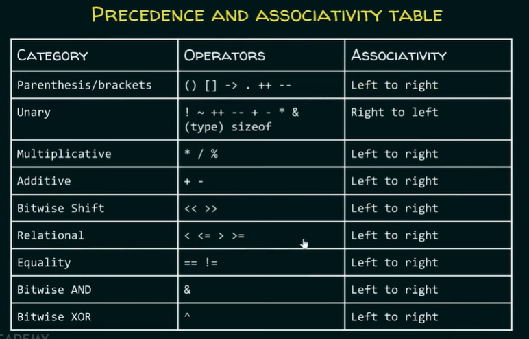
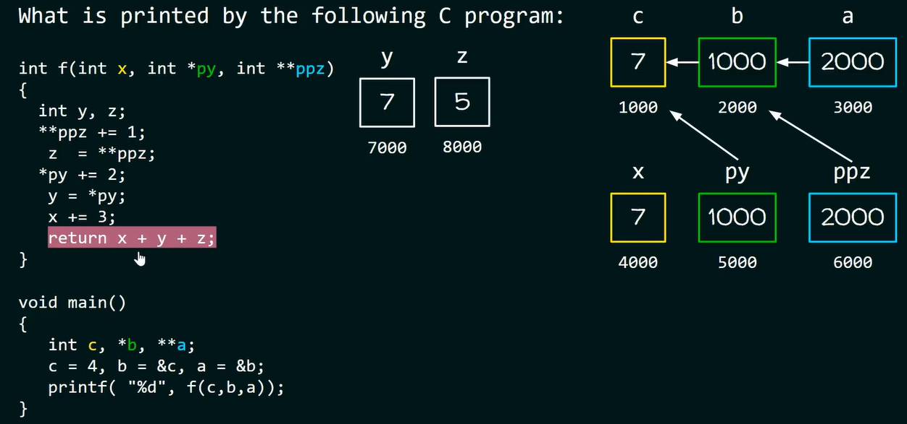
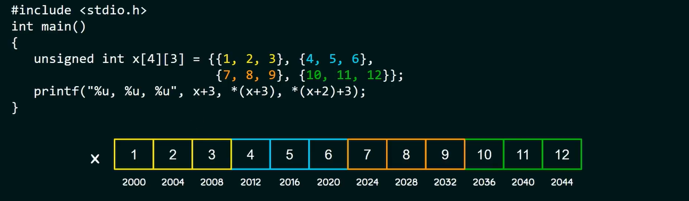
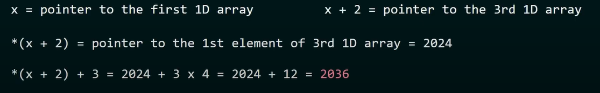

# C cheat sheet / Notes

This is a C cheat sheet or notes, created while learning C through geekforgeeks blog on C programming.

## Sample C Code

```c
#include <stdio.h> 
// preprocessor command, tells compiler to include stdio.h from standard library in this program.

int main() {    
    // function from where compiler starts reading the program, since int main so the return value should be of int datatype

    int number1, number2, sum, value; // integer data type
    double a = 5;

    printf("Enter two integers: ");
    // print function

    scanf("%d %d", &number1, &number2); // The scanf will write the value input by the user into the integer variables number1 and number2.
    // scanf is a function that stands for Scan Formatted String. It is used to read data from stdin (standard input stream i.e. usually keyboard) and then writes the result into the given arguments.

    // calculation
    sum = number1 + number2;   
    value = sum * 5;

    printf("(%d + %d) * %a = %d\n", number1, number2, value);
    // \n is an escape character in C

    return 0;
    // return value of the main function
}
```

## Explanation of Topics

### Comments

- **Single line comment**:

```c
// This is a single line comment
```

- **Multi-line comment**:

```c
/* This is a
Multiline comment */
```

### Compilation Commands

- To save an executable file:
  
```shell
gcc file_name.c
```

This command generates an executable file named `a.exe` which can be used to run the code.

- To create an executable file with a specific name:
  
```shell
gcc file_name.c -o new_file_name
```

This command creates the executable file `new_file_name.exe`.

### Preprocessor Directive

- The `#include <stdio.h>` line tells the compiler to include the standard input-output library `stdio.h` in the program. This library is necessary for using functions like `printf` and `scanf`.

### Main Function

- The `main` function is where the compiler starts reading the program. Since `main` is of type `int`, it should return a value of `int` datatype.

### Variables Declaration

- Declaring integer variables:
  
```c
int number1, number2, sum, value;
```

- Declaring and initializing a double variable:
  
```c
double a = 5;
```

### printf Function

- The `printf` function is used to output text to the console. It is part of the C standard library `<stdio.h>`.
- %s is used to print "string of characters."
- Printf not only prints the content on the screen. It also returns the number of characters that it successfully prints on the screen.
**example:**
int main(){printf("%d", printf("%s", "Hello World!"))
return 0;
}
output: Hello World!12

#### Return Value

- `printf()` returns the number of characters printed after successful execution. If an error occurs, a negative value is returned.

#### Formatting in `printf`

- **Format Specifier Syntax**:
  
```c
%[flags][width][.precision][length]specifier
```

- **Common Specifiers**:
  - `%d`: for printing integers
  - `%f`: for printing floating-point numbers
  - `%c`: for printing characters
  - `%s`: for printing strings
  - `%p`: for printing memory addresses
  - `%x`: for printing hexadecimal values (`%X` will print hexadecimal in capitals)
example 1:
printf("%s\n", "Hello");
printf("%10s", "Hello");

```bash
 Hello
      Hello
```

example 2:
int main (){
int var = 052; // octal value
printf("%d", var); //  output 42
printf("%o", var); // output 52
return 0;
}

- **Width**:
  Specifies the minimum number of characters to be printed.

  ```c
  printf("%25s", some_string);
  printf("%*s", 25, some_string);
  ```

- **Precision**:
  Specifies the number of digits for various data types.

  ```c
  printf("%.10d", some_integer);
  printf("%.3f", some_float);
  printf("%.25s", some_string);
  ```

- **Length**:
  Specifies the length of the data type in memory.

  ```c
  printf("%lf", double_variable);
  ```

### scanf Function

- The `scanf` function reads formatted input from the standard input stream (usually the keyboard) and writes the result into the given arguments.
  
  ```c
  scanf("%d %d", &number1, &number2);
  ```

#### Format Specifiers

- `%d` to accept input of integers.
- `%ld` to accept input of long integers
- `%lld` to accept input of long long integers
- `%f` to accept input of real numbers.
- `%c` to accept input of character types.
- `%s` to accept input of a string.

#### Return Values

- **>0**: Number of values converted and assigned successfully.
- **0**: No value was assigned.
- **<0**: Read error encountered or end-of-file (EOF) reached before any assignment was made.

### Address-of Operator

- `&` is used to get the memory address of a variable.
  
  ```c
  // For example, &var is the address of var.
  ```

### Calculations

- Performing basic arithmetic operations:
  
  ```c
  sum = number1 + number2;   
  value = sum * 5;
  ```

### Escape Characters

- Escape characters in C:
  
  ```c
  printf("(%d + %d) * %a = %d\n", number1, number2, value);
  ```

  - `\n`: New Line
  - `\b`: Backspace
  - `\f`: Form Feed
  - `\r`: Carriage Return
  - `\t`: Horizontal Tab
  - `\v`: Vertical Tab
  - `\\`: Backslash
  - `\'`: Single Quote
  - `\"`: Double Quote
  - `\?`: Question Mark
  - `\ooo`: Octal Number
  - `\xhh`: Hexadecimal Number
  - `\0`: NULL

### Return Statement

- The `main` function should return an integer value. Returning `0` typically signifies that the program has executed successfully.
  
  ```c
  return 0;
  ```

### Garbage value

A **garbage value** refers to an uninitialized variable containing whatever data happens to be in memory at that location when the program is run. Since the variable has not been explicitly initialized, it can hold any random value left over from previous operations.

In your code:

```c
#include <stdio.h>

int var = 5;

int main() {
    int var = var;  // Local variable `var` is uninitialized
    printf("%d", var);  // Prints the uninitialized `var`
    return 0;
}
```

- The local `var` is declared as `int var = var;`. Since the local `var` is not initialized with a valid value (it's not using the global `var` due to scope shadowing), the compiler doesn't assign any specific value to it.
- When `printf("%d", var);` is called, the value printed is whatever was in that memory location, which is considered **garbage** because it is not predictable or meaningful.

Thus, the output will be a **garbage value**, as the local `var` is uninitialized.

## Variables in C

A variable in C is a memory location with some name that helps store some form of data and retrieves it when required. We can store different types of data in the variable and reuse the same variable for storing some other data any number of times.

### Variable Declaration

```c
data_type variable_name = value;    // defining single variable
data_type variable_name1, variable_name2;    // defining multiple variables
```

**Example :**

```c
#include <stdio.h> 

int main() { 
    int harryName;   // This is variable declaration. 
                     // Most modern C compilers declare and define the variable in a single step.
    harryName = 76;  // This is variable initialization
    
    char five = '5'; // This is variable declaration and initialization/definition
    
    return 0;
}
```

### Rules for Naming Variables in C

1. A variable name must only contain alphabets, digits, and underscore.
2. A variable name must start with an alphabet or an underscore only. It cannot start with a digit.
3. No white space is allowed within the variable name.
4. A variable name must not be any reserved word or keyword.

### C Variable Types

#### Local Variables

A local variable is declared inside a function. A local variable is visible only inside their function; only statements inside a function can access that local variable. Local variables are declared when the function execution starts and get destroyed when the control exits from the function.

**Example:**

```c
#include <stdio.h>

void test();
void main() {
  int p = 22, q = 44;
  test();
  printf("Values in main() function p = %d and q = %d\n", p, q);
}

void test() {
  int p = 50, q = 80;
  printf("Values in test() function p = %d and q = %d\n", p, q);
}
```

**Output:**

```bash
Values in test() function p = 50 and q = 80
Values in main() function p = 22 and q = 44
```

Operating System calls the main() function at the time of execution. The local variables within the main() are created when the main() starts execution. When a call is made to the test() function, the control is transferred from main() to test(), and the local variables within the test() are created and available only within the test() function. After completion of execution of the test() function, the local variables are destroyed and the control is transferred back to the main() function.

#### Global Variables

Global variables are declared outside of any function. A global variable is visible to every function and can be used by any piece of code. Unlike local variables, global variables retain their values between function calls and throughout the program execution.

**Example:**

```c
#include <stdio.h>

int a = 20; // Global declaration

void test();
void main() {
  printf("In main() function a = %d\n", a); // Prints 20
  test();
  a = a + 15; // Uses global variable
  printf("In main() function a = %d\n", a); // Prints 55
}

void test() {
  a = a + 20; // Uses global variable
  printf("In test() function a = %d\n", a); // Prints 40
}
```

**Output:**

```bash
In main() function a = 20
In test() function a = 40
In main() function a = 55
```

In the above code, the global variable `a` is declared outside of all the functions. So, the variable `a` can be accessed in every function. The variable `a` has no local declaration in `main()` and `test()` functions, so they access the global variable `a`. The global variables are destroyed only after the completion of the execution of the entire program.

#### Static Variables

A static variable in C is a variable that is defined using the `static` keyword. It can be defined only once in a C program and its scope depends upon the region where it is declared (can be global or local). The default value of static variables is zero.
Stastic functions are restricted to the files where they are declared.

**Syntax:**

```c
static data_type variable_name = initial_value;
```

As its lifetime is till the end of the program, it can retain its value for multiple function calls.

**Example:**

```c
#include <stdio.h>

void function() {
    int x = 20;         // Local variable
    static int y = 30;  // Static variable
    x = x + 10;
    y = y + 10;
    printf("\tLocal: %d\n\tStatic: %d\n", x, y);
}

int main() {
    printf("First Call\n");
    function();
    printf("Second Call\n");
    function();
    printf("Third Call\n");
    function();
    return 0;
}
```

**Output:**

```bash
First Call
    Local: 30
    Static: 40
Second Call
    Local: 30
    Static: 50
Third Call
    Local: 30
    Static: 60
```

#### Automatic Variables

All the local variables are automatic variables by default. They are also known as auto variables. Their scope is local and their lifetime is till the end of the block. If needed, we can use the `auto` keyword to define the auto variables. The default value of the auto variables is a garbage value.

**Syntax:**

```c
auto data_type variable_name;
```

**Example:**

```c
#include <stdio.h>

void function() {
    int x = 10;       // Local variable (also automatic)
    auto int y = 20;  // Automatic variable
    printf("Auto Variable: %d", y);
}

int main() {
    function();
    return 0;
}
```

**Output:**

```bash
Auto Variable: 20
```

#### External Variables

External variables in C can be shared between multiple C files. We can declare an external variable using the `extern` keyword. Their scope is global and they exist between multiple C files.

**Syntax:**

```c
extern data_type variable_name;
```

**Example:**

```c
// myfile.h
extern int x = 10;  // External variable (also global)
```

```c
// program1.c
#include "myfile.h"
#include <stdio.h>

void printValue() {
    printf("Global variable: %d", x);
}
```

#### Register Variables

Register variables in C are stored in the CPU register instead of the conventional storage place like RAM. Their scope is local and exists till the end of the block or a function. These variables are declared using the `register` keyword. The default value of register variables is a garbage value.

**Syntax:**

```c
register data_type variable_name = initial_value;
```

**Example:**

```c
#include <stdio.h>

int main() {
    // Register variable
    register int var = 22;
    printf("Value of Register Variable: %d\n", var);
    return 0;
}
```

**Output:**

```bash
Value of Register Variable: 22
```

**Note:** We cannot get the address of the register variable using the address-of `&` operator because they are stored in the CPU register. The compiler will throw an error if we try to get the address of the register variable.

## Data Types in C

Data types in C are used to specify the type of data that a variable can hold. Each data type has a specific range and size, which determines the amount of memory required to store variables of that type. If out of range values given, error given with wrong output. x byte storage can store 2^(x*8) numbers divided half between positive and negative including 0.

### Integer Data Type

Integer data types are used to store whole numbers, both positive and negative, without any decimal part.

**Example:**

```c
int main() { 
    int var_name;
    return 0;
}
```

- **Range:** -2,147,483,648 to 2,147,483,647
- **Size:** 4 bytes
- **Format Specifier:** `%d`

**Variants:**

- `unsigned int`: Stores values from 0 to positive numbers, cannot store negative values.
- `short int`: Smaller than `int`, stores values from -32,768 to 32,767.
- `long int`: Larger than `int`, can store larger values.
- `unsigned short int`: Similar to `short int` but only stores positive values.

**Note:** The size of an integer data type is compiler-dependent. Use the `sizeof` operator to check the actual size.

**example 1:**
int main() {
    unsigned i = 1;
    int j = -4;
    printf("%u", i + j);  // Output: 4294967293
    return 0;
}
The answer is `4294967293` because adding `1` (unsigned) and `-4` (signed) results in `-3`. When `-3` is interpreted as an **unsigned int**, it wraps around, becoming `4294967293` due to the unsigned integer representation in 32-bit systems.
2^32 + (−3) = 4294967296 − 3 = 4294967293

**example 2:**
int main(){
unsigned int i = 500;
while(i++ != 0);
printf("⅘d", i);
return 0;
}
The **range of `unsigned int`** (4 bytes) is from `0` to `4294967295`.

- When the value of `i` reaches `4294967295`, adding any number (such as `i + 1`) will cause an overflow.
- Due to the nature of **unsigned integers**, the value will wrap around and become `0`.
- Since the condition in the `while` loop likely checks for a non-zero value (e.g., `while (i != 0)`), once `i` becomes `0`, the condition becomes false, and we exit the loop.

However, due to the use of the **post-increment operator** (`i++`), after the loop exits, the value of `i` is incremented **after** the check, meaning it will be `1` when the loop terminates, **not 0**.

### Floating-Point Data Type

Floating-point data types are used to store decimal and exponential values with single precision.

**Example:**

```c
int main() { 
    float var_name;
    return 0;
}
```

- **Range:** 1.2E-38 to 3.4E+38
- **Size:** 4 bytes
- **Format Specifier:** `%f`

### Character Data Type

Character data types are used to store single characters.

**Example:**

```c
int main() { 
    char var_name = 'x';
    return 0;
}
```

- **Range:** (-128 to 127) or (0 to 255)
- **Size:** 1 byte , only single character allowed in single inverted comma
- **Format Specifier:** `%c`

example:
int main() {
    char c = 255;
    c = c + 10;
    printf("%d", c);
    return 0;
}
output: 9
The answer is `9` because:

1. The `char` type is typically 8 bits, and the value `255` overflows in a signed `char`, wrapping around to `-1`.
2. Adding `10` to `-1` results in `9`.
3. The `printf("%d", c);` prints the value of `c`, which is now `9`.

### Double Data Type

Double data types are used to store decimal numbers with double precision.

**Example:**

```c
int main() { 
    double var_name;
    return 0;
}
```

- **Range:** 1.7E-308 to 1.7E+308
- **Size:** 8 bytes
- **Format Specifier:** `%lf`

### Size of Data Types

The size of data types in C depends on the architecture of the system. To check the size of data types, use the `sizeof` operator.

**Example:**

```c
int main() {
    int size_of_int = sizeof(int);
    int size_of_char = sizeof(char);
    int size_of_float = sizeof(float);
    int size_of_double = sizeof(double);
 
    printf("The size of int data type: %d\n", size_of_int);
    printf("The size of char data type: %d\n", size_of_char);
    printf("The size of float data type: %d\n", size_of_float);
    printf("The size of double data type: %d\n", size_of_double);
 
    return 0;
}
```

**Output:**

```bash
The size of int data type: 4
The size of char data type: 1
The size of float data type: 4
The size of double data type: 8
```

### Typecasting in C

Typecasting in C is the process of converting one data type to another data type by the programmer using the casting operator during program design. There are two types of typecasting:

1. **Implicit Typecasting:** Automatically performed by the compiler when a lower data type is converted to a higher data type. No data value is altered during this conversion.
2. **Explicit Typecasting:** Used when the programmer explicitly converts one data type to another. It is necessary when the default typecasting would result in incorrect output.

**Syntax for Explicit Typecasting:**

```c
int x;
float y;
y = (float)x;
```

**Example:**

```c
#include <stdio.h> 
  
// Driver Code 
int main() 
{ 
    // Given a & b 
    int a = 15, b = 2; 
    float div; 
  
    // Division of a and b 
    div = a / b; 
    // int / int = int, float / int = float
  
    printf("The result is %f\n", div); 
  
    return 0; 
}
```

**Output:**

```bash
The result is 7.000000
```

**Required Output:**

```bash
7.500000
```

**Corrected Example with Explicit Typecasting:**

```c
#include <stdio.h> 
  
// Driver Code 
int main() 
{ 
    // Given a & b 
    int a = 15, b = 2; 
    char x = 'a'; 
    double div; 
  
    // Explicit Typecasting to double 
    div = (double)a / b; 
  
    // Implicitly converting x to a+3 i.e., 'd' 
    x = x + 3; 
  
    printf("The result of Implicit typecasting is %c\n", x); 
    printf("The result of Explicit typecasting is %f", div); 
  
    return 0; 
}
```

**Output:**

```bash
The result of Implicit typecasting is d
The result of Explicit typecasting is 7.500000
```

### ASCII Values

A = 65
B = 66 and so on Z = 90
similarly,
a = 97
b = 98 and so on z = 122

```c
#include <stdio.h>
int main(){
    char ch = 'a';
    printf("%d", ch); // prints 97
    return 0;
}
```

#### Conversion Functions in C

C provides several functions to convert data types:

- `atof()`: Converts a string to a float.
- `atol()`: Converts a string to a long.
- `itoa()`: Converts an int to a string.
- `itob()`: Converts an int to a binary string.
- `atoi()`: Converts a string to an int.

These functions are useful for handling data conversions in various scenarios, ensuring the correct data type is used for computations and storage.

### Constants in C

Constants in C are read-only variables whose values cannot be modified once they are declared. They can be of various types, such as integer constants, floating point constants, string constants, or character constants. The `const` keyword is used to define constants in C.

**Example:**

```c
int main() {
    const int var_name = 10;
    return 0;
}
```

**Properties of Constants in C:**

1. **Initialization with Declaration:**
   - Constants must be initialized at the time of declaration.
   - If not initialized, they will store garbage values.

2. **Immutability:**
   - Constants cannot be modified after initialization.
   - They can only be assigned a value once.

### Constants vs. Literals

- **Constants:**
  - Variables that cannot be modified once declared.
  - Defined using the `const` keyword.
  - Store literal values.
  - Address can be determined.
  - They are lvalues (can appear on the left side of assignment).

- **Literals:**
  - Fixed values that define themselves.
  - Cannot be modified.
  - Address cannot be determined (except string literals).
  - They are rvalues (can appear on the right side of assignment).

**Example of Constant:**

```c
const int c = 20;
```

**Example of Literals:**

```c
24, 15.5, 'a', "Geeks"
```

### Defining Constants Using `#define`

The `#define` directive is used to define constants. Unlike `const`, it does not create a variable but replaces all occurrences of the defined name with the value.

**Example:**

```c
#include <stdio.h>
#define pi 3.14
 
int main() {
    printf("The value of pi: %.2f", pi);
    return 0;
}
```

## Operators in C

Operators in C are symbols that perform operations on variables and values. The various types of operators in C include:

1. **Arithmetic Operators**
2. **Relational Operators**
3. **Logical Operators**
4. **Bitwise Operators**
5. **Assignment Operators**
6. **Misc Operators**

### **Arithmetic Operators:**

```c
int main() {
    int a = 60, b = 7;
    printf("The sum of a and b is %d\n", a + b);
    printf("The difference of a and b is %d\n", a - b);
    printf("The multiplication result of a and b is %d\n", a * b);
    printf("The division result of a and b is %d\n", a / b);
    printf("The modulo result of a and b is %d\n", a % b);
    printf("The increment result of a is %d\n", ++a); // pre increament
    printf("The decrement result of b is %d\n", --b); // pre decreament
    printf("The increment result of a is %d\n", a++); // post increament
    printf("The decrement result of b is %d\n", b--); // post decreament
    return 0;
}
```

**Post increment/decrement in context of equation:**
First use the value in the equation and then increment the value.
**Pre increment/decrement in context of equation:**
First increment the value and then use in the equation after completion of the equation.
**Example:**
a = 4, b = 3
a+++b = 7
a + ++ b = 8

**Short circuiting :**

int a = 1;
int b = 1;
int c = ++a || b++;
int d = b-- && --a;

printf("%d %d %d %d", d, c, b, a);
output : 1 1 1 1

**Short-circuiting** is a behavior in logical expressions where the evaluation of the expression stops as soon as the result is determined. It occurs with the logical `AND` (`&&`) and logical `OR` (`||`) operators in C and many other programming languages.

### How It Works

- **Logical OR (`||`)**:
  - If the first operand evaluates to `true` (non-zero), the second operand is not evaluated because the result of the entire expression is already known to be `true`.
  
- **Logical AND (`&&`)**:
  - If the first operand evaluates to `false` (zero), the second operand is not evaluated because the result of the entire expression is already known to be `false`.

### Examples

#### 1. **OR Short-Circuiting (`||`)**

```c
int a = 1;
int b = 0;
int result = a || b++;
```

- **`a || b++`**:
  - `a` is `1` (true).
  - Because `a` is true, the second part (`b++`) is not evaluated (short-circuited). So, `b` remains `0`.
  - `result` becomes `1`.

#### 2. **AND Short-Circuiting (`&&`)**

```c
int a = 0;
int b = 1;
int result = a && b++;
```

- **`a && b++`**:
  - `a` is `0` (false).
  - Since `a` is false, the second part (`b++`) is not evaluated (short-circuited). So, `b` remains `1`.
  - `result` becomes `0`.

### Key Point

Short-circuiting improves efficiency by skipping unnecessary computations and can also prevent errors, especially when working with conditions that might cause issues if fully evaluated (e.g., dividing by zero or dereferencing null pointers).

### **Relational Operators:**

```c
int main() {
    int harry = 9, rohan = 45;
    printf("%d\n", harry == rohan);
    printf("%d\n", harry != rohan);
    printf("%d\n", harry > rohan);
    printf("%d\n", harry < rohan);
    return 0;
}
```

### **Logical Operators:**

```c
int main() {
    int h = 0, j = 1;
    printf("The logical operator returned %d\n", h && j);
    printf("The logical operator returned %d\n", h || j);
    printf("The logical operator returned %d\n", !j);
    printf("The logical operator returned %d\n", !h);
    return 0;
}
```

### **Bitwise Operators:**

```c
int main() {
    int A = 60, B = 14;
    printf("Bitwise and operator returned %d\n", A & B);
    printf("Bitwise or operator returned %d\n", A | B);
    printf("Bitwise xor operator returned %d\n", A ^ B);
    printf("Bitwise ones complement operator returned %d\n", ~B);
    printf("Bitwise left shift operator returned %d\n", A << B);
    printf("Bitwise right shift operator returned %d\n", A >> B);
    return 0;
}
```

### **Assignment Operators:**

```c
int main() {
    int ha = 9;
    ha += 9;
    printf("ha is %d\n", ha);
    return 0;
}
```

### **Misc Operators:**

- Address-of (`&`)
- Pointer (`*`)
- Conditional (`?:`)

**Example of Taking Input from User:**

```c
#include <stdio.h>

int main() {
    int harryInput;
    printf("\n Please enter the value of harryInput: ");
    scanf("%d", &harryInput);
    printf("\n You Entered %f as harryInput", (float) harryInput);
    return 0;
}
```



In C, the hierarchy of operators (also known as operator precedence) defines the order in which operators are evaluated in expressions. Operators with higher precedence are evaluated before those with lower precedence. When operators have the same precedence, associativity determines the order of evaluation.

Here’s a summary of the hierarchy of operators in C, from highest to lowest precedence:

1. **Parentheses**: `()`  
   - Grouping expressions
   - Function calls

2. **Unary operators**: `++`, `--`, `+`, `-`, `!`, `~`, `(type)`, `sizeof`, `&` (address), `*` (dereference)
   - Associativity: right to left

3. **Multiplication, Division, Modulus**: `*`, `/`, `%`  
   - Associativity: left to right

4. **Addition, Subtraction**: `+`, `-`  
   - Associativity: left to right

5. **Shift operators**: `<<`, `>>`  
   - Associativity: left to right

6. **Relational operators**: `<`, `>`, `<=`, `>=`  
   - Associativity: left to right

7. **Equality operators**: `==`, `!=`  
   - Associativity: left to right

8. **Bitwise AND**: `&`  
   - Associativity: left to right

9. **Bitwise XOR**: `^`  
   - Associativity: left to right

10. **Bitwise OR**: `|`  
    - Associativity: left to right

11. **Logical AND**: `&&`  
    - Associativity: left to right

12. **Logical OR**: `||`  
    - Associativity: left to right

13. **Ternary operator**: `? :`  
    - Associativity: right to left

14. **Assignment operators**: `=`, `+=`, `-=`, `*=`, `/=`, `%=`, `&=`, `|=`, `^=`, `<<=`, `>>=`  
    - Associativity: right to left

15. **Comma operator**: `,`  
    - Associativity: left to right

This order determines how complex expressions are evaluated in C. Operators with the same precedence are evaluated from **left to right**.

## Conditional Statements in C

Conditional statements are used to perform different actions based on different conditions. They include `if-else`, `switch`, conditional operators, and jump statements.

### 1. `if-else-if-else`

The `if-else-if-else` statement allows you to test multiple conditions sequentially.

**Syntax:**

```c
if (condition) // condition can also be an expression or even an assignment or even a character, if it evaluates to 0 false, else true
{
    // Executes this block if condition is true
} else if (condition) {
    // Executes this block if the previous condition is false and this condition is true
} else {
    // Executes this block if all previous conditions are false
}
```

**Example:**

```c
#include <stdio.h>

int main() {
    int number = 10;

    if (number > 0) {
        printf("The number is positive.\n");
    } else if (number < 0) {
        printf("The number is negative.\n");
    } else {
        printf("The number is zero.\n");
    }

    return 0;
}
```

### 2. Nested `if-else`

Nested `if-else` statements are `if-else` statements within another `if` or `else`.

**Syntax:**

```c
if (condition1) {
    if (condition2) {
        // Executes when condition1 and condition2 are true
    } else {
        // Executes when condition1 is true and condition2 is false
    }
} else {
    if (condition3) {
        // Executes when condition1 is false and condition3 is true
    } else {
        // Executes when condition1 and condition3 are false
    }
}
```

Nested if can be used as && operator too, example wap to check a number if divisible by 3 and 5 both without using && operator.

**Example:**

```c
#include <stdio.h>

int main() {
    int number = 15;

    if (number > 0) {
        if (number % 2 == 0) {
            printf("The number is positive and even.\n");
        } else {
            printf("The number is positive and odd.\n");
        }
    } else {
        if (number < 0) {
            printf("The number is negative.\n");
        } else {
            printf("The number is zero.\n");
        }
    }

    return 0;
}
```

### 3. `switch` Statement

The `switch` statement is used as an alternative to multiple `if-else` statements, typically when checking the value of a variable against a series of constants.

**Syntax:**

```c
switch (expression) {
    case value1:
        // Executes when expression matches value1
        break; // if braek is not specified then next case if also evaluated
    case value2:
        // Executes when expression matches value2
        break;
    // Additional cases
    default:
        // Executes when none of the above cases match
}
```

**Example:**

```c
#include <stdio.h>

int main() {
    int day = 3;

    switch (day) {
        case 1:
            printf("Monday\n");
            break;
        case 2:
            printf("Tuesday\n");
            break;
        case 3:
            printf("Wednesday\n");
            break;
        default:
            printf("Invalid day\n");
            break;
    }

    return 0;
}
```

### 4. Conditional Operator (`? :`)

Also known as ternary operator.
The conditional operator is a shorthand for `if-else` statements, used to return a value based on a condition.

**Syntax:**

```c
condition ? true_statements : false_statements;
```

**Example:**

```c
#include <stdio.h>

int main() {
    int age = 20;
    int i4 = age > 3 ? 100 : 200;

    printf("The value of i4 is %d\n", i4);

    return 0;
}
```

### 5. Jump Statements

Jump statements are used to alter the flow of control in a program.

- **`break`**: Terminates the nearest enclosing loop or `switch` statement.

**Example:**

```c
#include <stdio.h>

int main() {
    for (int i = 0; i < 10; i++) {
        if (i == 5) {
            break; // Exit the loop when i equals 5
        }
        printf("%d ", i);
    }

    return 0;
}
```

- **`continue`**: Skips the current iteration of the nearest enclosing loop and proceeds with the next iteration.
- As per C standard, "continue" can only be used in loop body and not in switch case statements.

**Example:**

```c
#include <stdio.h>

int main() {
    for (int i = 0; i < 10; i++) {
        if (i % 2 == 0) {
            continue; // Skip even numbers
        }
        printf("%d ", i);
    }

    return 0;
}
```

- **`goto`**: Jumps to a labeled statement within the same function. It is generally discouraged as it can make code harder to read and maintain.

**Example:**

```c
#include <stdio.h>

void printNumbers() {
    int n = 1;
label:
    printf("%d ", n);
    n++;
    if (n <= 10)
        goto label;
}

int main() {
    printNumbers();
    return 0;
}
```

## Loops in C

Loops in C are used to execute a block of code repeatedly based on a condition. There are mainly two types of loops: entry-controlled loops and exit-controlled loops.

### 1. **For Loop** (Entry Controlled)

The `for` loop is used when the number of iterations is known beforehand. It initializes a variable, checks a condition, and updates the variable after each iteration.

**Syntax:**

```c
for (initialization_expression; test_expression; update_expression) {
    // body of the for loop
}
```

- **initial expression** : initialization condition or assigment
- **test expression** : condition to be true for loop to run
- **update expression** : updation to be happen after completition of each iteration of the body of loop

**Example:**

```c
#include <stdio.h>

int main() {
    int i;

    for (i = 1; i <= 10; i++) {
        printf("Hello World\n");
    }

    return 0;
}
```

### 2. **While Loop** (Entry Controlled)

The `while` loop is used when the number of iterations is not known beforehand and depends on the condition. The condition is checked before entering the loop body.

**Syntax:**

```c
initialization_expression;
while (test_expression) {
    // body of the while loop
    update_expression;
}
```

**Example:**

```c
#include <stdio.h>

int main() {
    int i = 2;

    while (i < 10) {
        printf("Hello World\n");
        i++;
    }

    return 0;
}
```

### 3. **Do-While Loop** (Exit Controlled)

The `do-while` loop is similar to the `while` loop, but the condition is checked after the loop body has executed. Therefore, the loop body is executed at least once.

**Syntax:**

```c
initialization_expression;
do {
    // body of the do-while loop
    update_expression;
} while (test_expression);
```

**Example:**

```c
#include <stdio.h>

int main() {
    int i = 2;

    do {
        printf("Hello World\n");
        i++;
    } while (i < 1); // Loop condition is false, but loop body will execute at least once

    return 0;
}
```

## Functions in C

A function in C is a set of statements that perform a specific task when called. Functions provide modularity and code reusability.

**Note:** A function must be declared globally before it is called.

### Syntax of Functions in C

The syntax of a function can be divided into three aspects:

1. **Function Declaration:** Declares the function with its return type and parameters.
2. **Function Definition:** Contains the actual statements to be executed when the function is called.
3. **Function Call:** Executes the function and returns the result.

### Function Declaration

Function declaration tells the compiler that there is a function with the given name defined elsewhere.

**Syntax:**

```c
return_type function_name(parameter_1_type, parameter_2_type);
```

**Example:**

```c
int sum(int a, int b);  // Function declaration with parameter names
int sum(int, int);      // Function declaration without parameter names
```

### Function Definition

The function definition includes the actual code to be executed.

**Syntax:**

```c
return_type function_name(parameter_1_type parameter_1_name, parameter_2_type parameter_2_name) {
    // body of the function;
    return;
}
```

Return Statement (optional): If the function is supposed to return a value, it uses the return keyword to send a value back to the caller.

**Example:**

```c
#include <stdio.h>

int sum(int a, int b) {
    return a + b;
}

int main() {
    int add = sum(10, 30); // Calling sum function
    printf("Sum is: %d", add);
    return 0;
}
```

### Function Return Type

The return type specifies the type of value returned by the function. Use `void` if no value is returned.

**Example:**

```c
int func(parameter_1, parameter_2); // Returns an integer
void func(); // Does not return a value, function can be called with any number of parameters of any type
```

**Note:** Only one value can be returned. To return multiple values, use pointers or structures.

### Function Arguments

Arguments (or parameters) are the data passed to a function.

**Example:**

```c
int function_name(int var1, int var2);
```

### The `main` Function

In C, the **`main` function** is the entry point of any C program. It is the first function the C runtime executes when the program starts. Without a `main` function, the program has no starting point, and the compiler will throw an error.

**Example of `main`**

```c
int main() {
    // code starts executing here
    printf("Hello, World!\n");
    return 0;  // Indicating successful program completion
}
```

#### Key Points about `main`

- The `main` function can have **parameters** such as `int argc, char *argv[]` for handling command-line arguments, but it’s optional.
- The **return type** of `main` is usually `int`, meaning it returns an integer status code to the operating system when the program finishes.
  - Returning `0` means the program ended successfully.
  - Returning non-zero values (like `return 1;`) indicates an error.

### The `return` Keyword

The **`return` keyword** is used to exit a function and send a value back to the calling function (or the operating system in the case of `main`).

- **In user-defined functions**: If the function has a non-`void` return type (e.g., `int`), the `return` statement provides a value back to the caller.
  
  ```c
  int add(int a, int b) {
      return a + b;  // Returns the sum of a and b
  }
  ```

- **In the `main` function**: The `return` keyword typically sends a status code back to the operating system.
  
  ```c
  int main() {
      return 0;  // Indicates that the program terminated successfully
  }
  ```

  If you omit the `return 0;` in modern C (C99 and later), it’s implied that `main` will return `0` by default, meaning the program ended without errors.

### How the Compiler Handles the `return` Statement

When the compiler sees a `return` statement:

1. It evaluates the expression after `return` (if any).
2. It places the result in a special register to send it back to the calling function.
3. For the `main` function, it sends the return value to the operating system to signal how the program ended.

### Types of Functions

1. **Library Functions:** Built-in functions provided by the compiler package.

**Example:**
In C, the **`math.h`** header file contains declarations for mathematical functions and macros. These functions allow performing various mathematical operations such as trigonometry, logarithms, exponentiation, and more.

### Key Elements in `math.h`

1. **Mathematical Functions**:
   - These functions perform operations like square roots, power calculations, trigonometric functions, etc.

2. **Macros**:
   - Some constants, such as `M_PI` for the value of π, are defined in `math.h` (though not always in all compilers; some compilers may require additional macros to be defined).

### Common Functions in `math.h`

Here are some frequently used functions and their descriptions:

| Function               | Description                                                   | Example Usage |
|------------------------|---------------------------------------------------------------|---------------|
| `double sqrt(double x)` | Returns the square root of `x`.                               | `sqrt(16)` -> `4.0` |
| `double pow(double x, double y)` | Returns `x` raised to the power of `y`.            | `pow(2, 3)` -> `8.0` |
| `double sin(double x)`  | Returns the sine of `x` (in radians).                         | `sin(M_PI/2)` -> `1.0` |
| `double cos(double x)`  | Returns the cosine of `x` (in radians).                       | `cos(0)` -> `1.0` |
| `double tan(double x)`  | Returns the tangent of `x` (in radians).                      | `tan(M_PI/4)` -> `1.0` |
| `double log(double x)`  | Returns the natural logarithm (base `e`) of `x`.              | `log(2.718)` -> `1.0` |
| `double log10(double x)`| Returns the base-10 logarithm of `x`.                         | `log10(100)` -> `2.0` |
| `double exp(double x)`  | Returns `e` raised to the power of `x` (i.e., `e^x`).         | `exp(1)` -> `2.718` |
| `double fabs(double x)` | Returns the absolute value of `x`.                            | `fabs(-5.5)` -> `5.5` |
| `double ceil(double x)` | Returns the smallest integer value greater than or equal to `x`. | `ceil(2.3)` -> `3.0` |
| `double floor(double x)`| Returns the largest integer value less than or equal to `x`.   | `floor(2.7)` -> `2.0` |
| `double fmod(double x, double y)` | Returns the remainder of `x/y` as `x mod y`.       | `fmod(5.3, 2)` -> `1.3` |

### Example Usage of `math.h`

```c
#include <stdio.h>
#include <math.h>

int main() {
    double num1 = 16.0;
    double num2 = 2.718;

    printf("Square root of %.2f is %.2f\n", num1, sqrt(num1));    // 4.0
    printf("Natural log of %.3f is %.2f\n", num2, log(num2));     // 1.0
    printf("2 raised to the power 3 is %.2f\n", pow(2, 3));       // 8.0
    printf("Sine of Pi/2 is %.2f\n", sin(M_PI / 2));              // 1.0
    printf("Ceiling of 2.3 is %.2f\n", ceil(2.3));                // 3.0

    return 0;
}
```

### Common Constants (Available on Some Systems)

- `M_PI`: Approximate value of π (`3.141592653589793`).
- `M_E`: Euler's number (`2.718281828459045`).

2. **User-Defined Functions:** Functions created by the programmer.

### Function Prototype

In C, a **function prototype** is a declaration of a function that specifies the function's name, its return type, and its parameters, but does not contain the function body (the actual code of the function). The prototype informs the compiler about the function's existence and how it should be called before its actual definition appears in the code.

#### Structure of a Function Prototype

A function prototype includes:

1. **Return type**: Specifies the type of value the function will return (e.g., `int`, `float`, `void`).
2. **Function name**: The name by which the function will be called.
3. **Parameters**: A list of input parameters (including their types) that the function accepts.

#### Syntax of a Function Prototype

```c
return_type function_name(parameter_type1, parameter_type2, ...);
```

#### Example

```c
// Function prototype
int add(int, int);
```

Here, `add` is a function that takes two `int` parameters and returns an `int`.

#### Purpose of Function Prototypes

1. **Forward Declaration**: A function prototype tells the compiler about the function before its actual implementation is encountered in the code.
2. **Type Checking**: It ensures that function calls are made with the correct number and types of arguments.
3. **Modularity**: It allows the function to be defined after the `main` function, maintaining better code organization.

#### Example of Function Prototype and Definition

```c
#include <stdio.h>

// Function prototype
int add(int, int);

int main() {
    int a = 5, b = 10;
    printf("Sum: %d\n", add(a, b));  // Function call
    return 0;
}

// Function definition
int add(int x, int y) {
    return x + y;
}
```

#### Explanation

- The **prototype** (`int add(int, int);`) tells the compiler that a function named `add` exists, which returns an integer and takes two integer arguments.
- Later, the function is **defined** with its body: `int add(int x, int y) { return x + y; }`.

#### Importance of Prototypes

Without a function prototype, if the function is called before it is defined, the compiler may not know how to handle the function properly, leading to warnings or errors. A prototype ensures that the compiler checks for:

- Correct number of arguments.
- Correct data types of arguments.

### Passing Parameters to Functions

Arguments can be passed in two ways:

1. **Pass by Value:** Copies the value into the function’s parameters. Changes inside the function do not affect the caller’s variables.

    **Example:**

    ```c
    #include <stdio.h>

    void swap(int var1, int var2) {
        int temp = var1;
        var1 = var2;
        var2 = temp;
    }

    int main() {
        int var1 = 3, var2 = 2;
        printf("Before swap: %d, %d\n", var1, var2);
        swap(var1, var2);
        printf("After swap: %d, %d\n", var1, var2);
        return 0;
    }
    ```

    **Output:**

    ```bash
    Before swap: 3, 2
    After swap: 3, 2
    ```

2. **Pass by Reference:** Uses pointers to refer to the actual parameters, so changes affect the caller’s variables. In C, parameters are always passed by value. Pass by reference is simulated by explicitly passing pointer values.

    **Example:**

    ```c
    #include <stdio.h>

    void swap(int *var1, int *var2) {
        int temp = *var1;
        *var1 = *var2;
        *var2 = temp;
    }

    int main() {
        int var1 = 3, var2 = 2;
        printf("Before swap: %d, %d\n", var1, var2);
        swap(&var1, &var2);
        printf("After swap: %d, %d\n", var1, var2);
        return 0;
    }
    ```

    **Output:**

    ```bash
    Before swap: 3, 2
    After swap: 2, 3
    ```

## Pointers in C

A pointer is a derived data type that stores the address of another variable or a memory location. Using pointers, you can access and manipulate data stored in that memory location. The size of pointers in C is independent of the type of data they point to and depends on the system architecture.

## Syntax of C Pointers

The syntax for declaring a pointer is similar to variable declaration but includes the dereferencing operator `*`:

```c
datatype *ptr;
```

### 1. Pointer Declaration

To declare a pointer, use the `*` operator before its name:

```c
int *ptr;
```

### 2. Pointer Initialization

Initialize a pointer by assigning it the address of a variable using the `&` (address-of) operator:

```c
int var = 10;
int *ptr;
ptr = &var;

// or declare and initialize in one step
int *ptr = &var;
```

**Note:** Pointers should be initialized before use to avoid errors.

> In C, * symbol has different meanings depending on the context in which it's used.
At the time of declaration, * symbol is not acting as an indirection operator. * symbol in the first statement tells the compiler that p is a pointer to an integer.
But, if we write *p = &i then it is wrong, because here * symbol indicates the indirection operator and we cannot assign the address to some integer variable.
Therefore, in the second statement, there is no need of * symbol in front of p. It simply means we are assigning the address to a pointer.

### 3. Pointer Dereferencing

Dereferencing a pointer accesses the value stored at the address it points to:

```c
int var = 10;
int *ptr = &var;
printf("Value at *ptr = %d\n", *ptr);
*ptr = 34; // can be used to change the value, var = 34
// NOTE : *ptr = *&var = 34
```

### Types of Pointers

1. **Integer Pointers**

Pointers to integer values:

```c
int *ptr;
```

```c
#include <stdio.h>

void f(int *p, int *q) {
    p = q;  // Make p point to the same location as q
    *p = 2; // Set the value pointed to by p (and q) to 2
}

int main() {
    int i = 0;
    int j = 1;

    f(&i, &j); // Pass the addresses of i and j to the function

    printf("%d %d\n", i, j); // Print the values of i and j i.e., 0 2

    return 0;
}
```

2. **Array Pointers**

Pointers to arrays:

```c
char *ptr = &array_name;
```

3. **Structure Pointers**

Pointers to structures:

```c
struct struct_name *ptr;
```

4. **Function Pointers**

Pointers to functions:

```c
int (*ptr)(int, char);
```

5. **Double Pointers**

Pointers to pointers:

```c
datatype **pointer_name;
```

example:-

```c
#include<stdio.h>

int main(){
    int a = 25;
    int* x = &a;       // Pointer to 'a'
    *x = 7;            // Dereferencing x to change the value of 'a' to 7
    int** y = &x;      // Pointer to pointer x

    printf("%d\n", a);    // Printing value of 'a'
    printf("%d\n", *x);   // Printing value pointed to by 'x' (which is 'a')
    printf("%d", *(&a))   // Printing value pointed to by address of a
    printf("%d\n", **y);  // Dereferencing 'y' twice to get the value of 'a'
    
    return 0;
}
```

6. **Constant Pointers**

Pointers with a constant memory address:

```c
data_type * const pointer_name;
```

7. **Pointer to Constant**

Pointers to constant values:

```c
const data_type *pointer_name;
```

### Size of Pointers

The size of pointers is determined by the operating system and CPU architecture:

- 8 bytes for a 64-bit system
- 4 bytes for a 32-bit system

**Example:**

```c
#include <stdio.h>

int main() {
    int *ptr_int;
    char *ptr_char;
    struct str *ptr_str;
    void (*ptr_func)(int, int);
    void *ptr_vn;

    printf("Size of Integer Pointer  \t: %lu bytes\n", sizeof(ptr_int));
    printf("Size of Character Pointer \t: %lu bytes\n", sizeof(ptr_char));
    printf("Size of Structure Pointer \t: %lu bytes\n", sizeof(ptr_str));
    printf("Size of Function Pointer \t: %lu bytes\n", sizeof(ptr_func));
    printf("Size of NULL Void Pointer \t: %lu bytes\n", sizeof(ptr_vn));

    return 0;
}
```

### C Pointer Arithmetic

#### Increment and Decrement

Pointers can be incremented or decremented, which changes the address by the size of the data type:

```c
int *ptr;
ptr = ptr + 1;  // Moves to next integer
ptr = ptr - 1;  // Moves to previous integer
```

#### Addition and Subtraction

Adding or subtracting integers from pointers:

```c
int N = 4;
int *ptr1 = &N;
ptr1 = ptr1 + 3; // Moves 3 integers ahead
ptr1 = ptr1 - 3; // Moves 3 integers back
```

#### Subtracting Two Pointers

Find the number of elements between two pointers:

```c
int x = 6, N = 4;
int *ptr1 = &N, *ptr2 = &x;
int diff = ptr1 - ptr2;  // Difference in terms of number of elements
```

#### Pointer Comparison

Compare pointers to check if they are equal or not:

```c
int arr[5];
int *ptr1 = arr;
int *ptr2 = &arr[0];

if (ptr1 == ptr2) {
    printf("Pointers are equal.\n");
} else {
    printf("Pointers are not equal.\n");
}
```

### Pointer Arithmetic on Arrays

Arrays and pointers are closely related. The array name acts as a pointer to its first element. You can use pointer arithmetic to traverse arrays:

```c
int arr[] = {1, 2, 3, 4, 5};
int *ptr = arr;

for (int i = 0; i < 5; i++) {
    printf("%d ", *(ptr + i));  // Access elements using pointer
}
```

#### Example: Traversing a 2D Array

```c
#include <stdio.h>

void traverseArr(int* arr, int N, int M) {
    for (int i = 0; i < N; i++) {
        for (int j = 0; j < M; j++) {
            printf("%d ", *((arr + i * M) + j));
        }
        printf("\n");
    }
}

int main() {
    int arr[][2] = {{1, 2}, {3, 4}, {5, 6}};
    traverseArr((int*)arr, 3, 2);
    return 0;
}
```


### Recursion in C

Recursion is a process where a function calls itself to solve a problem. A recursive function has two main components:

1. **Recursion Case:** Defines how the problem is divided into smaller subproblems.
2. **Base Condition:** Specifies when the recursion should terminate.

**Note:** Define the base condition to prevent infinite recursion.

#### Syntax of Recursive Functions

**Syntax:**

```c
type function_name(args) {
    // function statements
    // base condition
    // recursion case (recursive call)
}
```

**Example:**

```c
#include <stdio.h>

int nSum(int n) {
    if (n == 0) {
        return 0;
    }
    return n + nSum(n - 1);
}

int main() {
    int n = 5;
    int sum = nSum(n);
    printf("Sum of First %d Natural Numbers: %d", n, sum);
    return 0;
}
```

#### How Recursion Works

1. **nSum(5):** Calls `nSum(4)`
2. **nSum(4):** Calls `nSum(3)`
3. **nSum(3):** Calls `nSum(2)`
4. **nSum(2):** Calls `nSum(1)`
5. **nSum(1):** Calls `nSum(0)`
6. **nSum(0):** Returns 0

The final calculation:

```bash
nSum(5) = 5 + 4 + 3 + 2 + 1 + 0 = 15
```

#### Memory Allocation for Recursive Functions

1. A new stack frame is created for each recursive call.
2. The function’s local variables and state are stored in the stack frame.
3. Each stack frame is removed after the function returns a value.

**Steps:**

1. **Create Stack Frame:** For `nSum(5)`
2. **Recursive Calls:** New stack frames created for each call.
3. **Return Values:** Stack frames are removed as values are returned.

#### Stack Overflow

Occurs when the recursion depth exceeds the stack memory limit, causing program termination.

**Definition:** Stack overflow is an error when the call stack cannot store more data due to excessive recursion.

## Arrays in C

An array in C is a fixed-size collection of similar data items stored in contiguous memory locations. It can store primitive data types like `int`, `char`, `float`, etc., as well as derived and user-defined types like pointers and structures. Arrays in C are static, meaning memory is allocated at compile time.

### Characteristics of Arrays

1. **Fixed Size**: The size of the array must be known at compile time and cannot be changed once declared.
2. **Homogeneous Collection**: An array can store only one type of element. All elements must be of the same type.
3. **Indexing**: Array indices start at 0. The index of the first element is 0, and the last element is `N - 1` for an array of size `N`.
4. **Dimensions**: The number of dimensions refers to the number of indexes required to access an element.
5. **Contiguous Storage**: Elements are stored continuously in memory, allowing for random access.
6. **Random Access**: Elements can be accessed directly using their index in constant time.
7. **No Index Out of Bounds Checking**: C does not check for index out-of-bounds errors.

### Array Declaration

To declare an array, specify its name, type, and size.

**Syntax**:

```c
data_type array_name[size];
```

For multidimensional arrays:

```c
data_type array_name[size1][size2]...[sizeN];
```

### Array Initialization

Arrays can be initialized in several ways:

1. **With Declaration**:

   ```c
   data_type array_name[size] = {value1, value2, ..., valueN};
   ```

   ```c
   int size = 10, arr[size];
   ```

   ```c
    #include <stdio.h>
    int main(){
    int arr[10];
    for(int i=0; i<=9; i++){ // input
    scanf("%d", &arr[i]);
    }
    for(int i=0; i<=9;i++){ // output
    printf ("&d",  arr[i]);
    }
    return 0;
    }
    ```

2. **With Declaration (Size Deduction)**:

   ```c
   data_type array_name[] = {1, 2, 3, 4, 5}; // Size is automatically deduced
   ```

3. **After Declaration (Using Loops)**:

   ```c
   for (int i = 0; i < N; i++) {
       array_name[i] = valuei;
   }
   ```

### Accessing and Updating Array Elements

**Access an element**:

```c
array_name[index];
```

**Update an element**:

```c
array_name[index] = new_value;
```

### Array Traversal

Traversal involves visiting each element of the array. This is commonly done using loops.

**Example using a `for` loop**:

```c
for (int i = 0; i < N; i++) {
    // Process array_name[i]
}
```

### Length of array

```c
#include<stdio.h>

int main() {
    int arr[] = {3, 6, 2, 7, 1, 5, 1, 1, 9, 5, 6, 7, 8}; // array initialization

    int n = sizeof(arr)/sizeof(arr[0]); // sizeof calculation gives length of array
    printf("%d\n", n);
    for(int i = 0; i < n; i++) {
        printf("%d ", arr[i]);
    }
    return 0;
}

```

### Relationship Between Arrays and Pointers

Arrays and pointers are closely related. The array name is a constant pointer to the first element. Arrays decay to pointers when passed to functions.

**Example 1**:

```c
#include <stdio.h>

int main() {
    int arr[5] = {10, 20, 30, 40, 50};
    int* ptr = &arr[0];

    // Print addresses
    printf("Address Stored in Array name: %p\nAddress of 1st Array Element: %p\n", arr, &arr[0]);

    // Print array elements using pointers
    printf("Array elements using pointer: ");
    for (int i = 0; i < 5; i++) {
        printf("%d ", *ptr++);
    }
    return 0;
}
```

**Example 2**:

```c
#include<stdio.h>

// Function to change the array
void change(int x[], int n) {
    printf("%d\n", n); // Print size of the array
    x[2] = 90; // Change the third element
}

int main() {
    int arr[] = {5, 2, 7, 8, 3}; // Declare array
    int n = sizeof(arr)/sizeof(arr[0]); // Calculate size of the array
    printf("%d\n", n); // Print size of the array
    
    printf("%d\n", arr[2]); // Print element at index 2 before change
    change(arr, n); // Pass array to function
    printf("%d\n", arr[2]); // Print element at index 2 after change

    return 0; // Return 0 to indicate successful execution
}
```

**Example 3**:

```c
int main() {
    int i, j;
    char a[2][3] = { {'a', 'b', 'c'}, {'d', 'e', 'f'} }; // 2x3 array
    char b[3][2];  // 3x2 array
    char *p = *b;  // Pointer to the first element of b

    for (i = 0; i < 2; i++) {
        for (j = 0; j < 3; j++) {
            *(p + 2*j + i) = a[i][j];  // Fill array `b` using elements from `a`
        }
    }

    // To print the contents of array b at the end
    printf("Array b contents:\n");
    for (i = 0; i < 3; i++) {
        for (j = 0; j < 2; j++) {
            printf("%c ", b[i][j]);
        }
        printf("\n");
    }

    return 0;
}
```

Output:
a d
b e
c f

**Example 4**:

```c
#include <stdio.h>

int main() {
    int a[2][3] = { {1, 2, 3}, {4, 5, 6} };
    int (*ptr)[3] = a;  // ptr is a pointer to an array of 3 integers

    // Printing values of the first row (pointed by ptr)
    printf("%d %d ", (*ptr)[1], (*ptr)[2]);

    // Increment the pointer to point to the next row
    ++ptr;

    // Printing values of the second row (now pointed by ptr)
    printf("%d %d", (*ptr)[1], (*ptr)[2]);

    return 0;
}
```

### Explanation:

1. `int a[2][3] = { {1, 2, 3}, {4, 5, 6} };` — This declares a 2D array `a` with 2 rows and 3 columns.
2. `int (*ptr)[3] = a;` — This declares `ptr` as a pointer to an array of 3 integers. It points to the first row of `a`.
3. `(*ptr)[1]` — Dereferences `ptr` to access the first row of the array and prints the second element (`2`).
4. `(*ptr)[2]` — Accesses the third element (`3`) of the first row.
5. `++ptr;` — Moves `ptr` to the next row (second row).
6. `(*ptr)[1]` — Now, `ptr` points to the second row, and this accesses the second element (`5`).
7. `(*ptr)[2]` — Accesses the third element (`6`) of the second row.

### Output:

```bash
2 3 5 6
```

This demonstrates how a pointer to a 2D array works, where incrementing the pointer moves it to the next row in the array.

#### 1. **Pass-by-Value vs. Pass-by-Reference:**

- **Pass-by-Value (for variables):** When you pass a variable (like an integer) to a function by value, the function gets a copy of the variable. Changes made to the variable inside the function do not affect the original value in the calling function.

- **Pass-by-Reference (for arrays):** In C, when you pass an array to a function, the array is passed by reference. This means the function gets a reference (or pointer) to the original array, not a copy. Any changes made to the array inside the function affect the original array in the calling function.


Answer: 19

#### Example:

- **Passing a single variable by value:**
  
  ```c
  void change(int x) {
      x = 90;
  }

  int main() {
      int x = 6;
      change(x);
      printf("%d\n", x); // Still prints 6 because `x` was passed by value.
      return 0;
  }
  ```

### Array memory allocation

The question asks for the memory address of an element in a 2D array `a[100][100]` of type `char`, where each element is one byte, and the base address of the array is 0. The goal is to find the address of `a[40][50]`.

The formula to calculate the address of any element `a[i][j]` in a 2D array is:

```
Address of a[i][j] = Base Address + (i - lb1) * NC + (j - lb2) * C
```

where:

- `Base Address (BA)` = 0 (starting memory address),
- `i` and `j` are the row and column indices,
- `lb1` and `lb2` are the lower bounds of rows and columns (both 0 here),
- `NC` is the number of columns (100),
- `C` is the size of each element (1 byte for `char`).

Substituting the values for `a[40][50]`:

```bash
Address = 0 + (40 - 0) * 100 + (50 - 0) * 1
Address = 4000 + 50 = 4050
```

Thus, the address of `a[40][50]` is `4050`, and the correct option is B: `4050`.

This calculation is based on understanding that each row contains 100 elements, and each element occupies 1 byte in a byte-addressable memory. The formula works by computing how many elements must be traversed to reach the desired row and column, and multiplying by the size of each element.




### Passing Arrays to Functions

Arrays are passed to functions as pointers. The array decays to a pointer to its first element.

**Example**:

```c
#include <stdio.h>

void printArray(int arr[]) {
    printf("Size of Array in Functions: %d\n", sizeof(arr)/4); // This outputs 2 because arr decays to a pointer inside the function, and sizeof(arr) gives the size of that pointer i.e., 8 bytes
    printf("Array Elements: ");
    for (int i = 0; i < 5; i++) {
        printf("%d ", arr[i]);
    }
}

int main() {
    int arr[5] = {10, 20, 30, 40, 50};

    printf("Size of Array in main(): %d\n", sizeof(arr)/4); // This outputs 5 because the array has 5 elements (as you printed the result in terms of the number of elements, not bytes).
    printArray(arr);
    return 0;
}
```

**Fix:**
If you want to pass the actual array size to the function, you should pass the size of the array as an argument to the function:

```c
#include <stdio.h>

void printArray(int arr[], int size) {
    printf("Size of Array in Functions: %d\n", size);
    printf("Array Elements: ");
    for (int i = 0; i < size; i++) {
        printf("%d ", arr[i]);
    }
    printf("\n");
}

int main() {
    int arr[5] = {10, 20, 30, 40, 50};
    int size = sizeof(arr) / sizeof(arr[0]); // Calculate the number of elements

    printf("Size of Array in main(): %d\n", size); // Print size
    printArray(arr, size); // Pass array and its size
    return 0;
}
```

### Returning Arrays from Functions

C functions can only return a single value. To return an array, use a pointer.

**Example**:

```c
#include <stdio.h>

int* func() {
    static int arr[5] = {1, 2, 3, 4, 5};
    return arr;
}

int main() {
    int* ptr = func();
    printf("Array Elements: ");
    for (int i = 0; i < 5; i++) {
        printf("%d ", *ptr++);
    }
    return 0;
}
```

> *Note*: The array is declared `static` to ensure it persists after the function returns.

### 2D Arrays

A **2D array** is essentially an array of arrays, often used to represent data in rows and columns, much like a **matrix**. It's useful when you need to work with tabular data or grids.

In a 2D array:

- The first index represents the **row** number.
- The second index represents the **column** number.

### Declaration of a 2D Array

You declare a 2D array as:

```c
data_type array_name[rows][columns];
```

- `rows`: Number of rows in the array.
- `columns`: Number of columns in the array.

### Example Declaration

```c
int arr[4][2]; // A 2D array with 4 rows and 2 columns
// Much more like 4 1D arrays of length 2
```

### Initializing a 2D Array

You can initialize a 2D array in two ways:

1. **Using Nested Braces:**
   Each set of braces represents a row in the array.

   ```c
   int arr[4][2] = {
       {1234, 56},
       {1256, 43},
       {1434, 32},
       {1312, 96}
   };
   ```

2. **Without Nested Braces:**
   This is equivalent to the above, but the values are listed sequentially.

   ```c
   int arr[4][2] = {1234, 56, 1256, 43, 1434, 32, 1312, 96};
   ```

3. **Dynamic Initialization (Partial Size Declaration)**

In C, you can partially declare the size of a 2D array:

```c
int arr[][3] = { {12, 34, 56}, {78, 91, 23} }; // 2 rows, 3 columns
```

Here, the number of rows is automatically determined based on the number of elements, but the number of columns must be specified.

It can be visualized as:

```bash
1234  56
1256  43
1434  32
1312  96
```

### Accessing Elements in a 2D Array

To access elements in a 2D array, you use the row and column indices.

Example:

```c
int value = arr[1][0]; // Accesses the element at row 1, column 0
printf("%d\n", value); // Prints 1256
```

**Printing elements of a 2D array:**

**Method 1: 2 for loops**

```c
for (i=0; i<row; i++){
    for (j=0; j<col; j++){
        printf("%d", a[i][j]);
        }
    }
```

**Method 2: using pointers**

```c
for (p = &a[0][0]; p <= &a[row- 1][col-1]; p++){
printf("%d", *p) ;
}
```

### Example Usage of 2D Arrays

```c
#include <stdio.h>

int main() {
    // Initializing a 2D array
    int arr[2][3] = { {12, 34, 56}, {78, 91, 23} };

    // Accessing and printing elements
    printf("Element at arr[0][0]: %d\n", arr[0][0]); // Output: 12
    printf("Element at arr[1][2]: %d\n", arr[1][2]); // Output: 23

    // Printing the 2D array as a matrix
    for (int i = 0; i < 2; i++) {
        for (int j = 0; j < 3; j++) {
            printf("%d ", arr[i][j]);
        }
        printf("\n"); // Newline after each row
    }

    return 0;
}
```

### Output

```bash
Element at arr[0][0]: 12
Element at arr[1][2]: 23
12 34 56
78 91 23
```

### Important Notes

1. **Row-major order:** In C, 2D arrays are stored in memory in a row-major order, meaning all elements of a row are stored consecutively.
2. **Access time:** Accessing any element in a 2D array takes constant time because arrays have contiguous memory.

## Strings in C (array of char)

A string in C is a sequence of characters terminated by a null character (`\0`). In C, strings are stored as arrays of characters. Unlike a character array, a C string is explicitly terminated by a null character. Note that C does not provide an inbuilt data type for strings but uses the format specifier `%s` to print and read strings.

### String Declaration

Declaring a string is similar to declaring a one-dimensional array.

**Syntax**:

```c
char string_name[size];
```

### String Initialization

1. **Assigning a String Literal without Size**:

   ```c
   char str[] = "GeeksforGeeks";
   ```

2. **Assigning a String Literal with a Predefined Size**:

   Ensure to account for the null character.

   ```c
   char str[50] = "GeeksforGeeks";
   ```

3. **Assigning Character by Character with Size**:
   Manually set the null character.

   ```c
   char str[14] = { 'G','e','e','k','s','f','o','r','G','e','e','k','s','\0' };
   ```

4. **Assigning Character by Character without Size**:
   The size is determined by the compiler.

   ```c
   char str[] = { 'G','e','e','k','s','f','o','r','G','e','e','k','s','\0' };
   ```

> *Note*: When a string is enclosed in double quotation marks, a null character is automatically appended.

The length of the string is the number of characters excluding the null character. It can be determined using the `strlen()` function from the string.h library. Otherwise if you try to find length of "GeeksforGeeks" then you will get 14 instead of 13 because of ending \0. This is why while initialisation give the size atleast +1 as required.

> '\0' is NULL char with ASCII value 0.

**Example**:

```c
#include <stdio.h>
#include <string.h>

int main() {
    char str[] = "Geeks";
    printf("%s\n", str);
    int length = strlen(str);
    printf("Length of string str is %d", length);
    return 0;
}
```

5. **Using pointers**

```c
char *ptr = "Physics Wallah";

printf("%s", ptr); // Physics Wallah
printf("%p", ptr); // address of pointer
printf("%c", ptr[0]); // 'P'

ptr = "abracadabra" // works fine while initialising it without pointer would give error when we try to chnage the string as whole.
```

**Output**:

```bash
Geeks
Length of string str is 5
```

**Note:** Such direct initialisation using pointers results in a read-only memory allocation of character arrays and hence, causes undefined behaviour when we try to change the characters.
`ptr [0] = 'm';` -> Error!
Pointers change the address to which they point after initialising a new character array.
`ptr = "abracadabra"` -> Allowed!

### Traversing a string

```c
#include<stdio.h>
int main() {
    char arr[] = "Rag\0av";  // String with null terminator in the middle
    int n = sizeof(arr) / sizeof(arr[0]);  // Calculate size of array

    for (int i = 0; i < n; i++) {
        printf("%c", arr[i]);  // Print each character individually
    }
    printf("\n");
    printf("%d", n);  // Print the length of the array (size)
    
    return 0;
}
```

> OUTPUT:
> Ragav
> 7

```c
#include<stdio.h>
int main() {
    char arr[] = {'r', 'a', 'g', '\0', 'a', 'v'};  // Character array with manual null terminator
    // int n = sizeof(arr) / sizeof(arr[0]);
    int n = sizeof(arr) / sizeof(arr[0]);

    printf("%c", arr[0]);  // Print first character 'r'
    printf("%s", arr);     // Print the string from arr, up to the null terminator
    printf("%d", n);  // Print the length of the array (size)
    
    printf("\n");
    
    return 0;
}
```

> OUTPUT:
> r rag 6

### Reading a String Input from the User

In C, the name of an array (like str in your example) is treated as a pointer to the first element of the array.
So, when you pass str to scanf, it already points to the memory location where the string should be stored and you do not need to write `&str`.

**Example**:

```c
#include <stdio.h>

int main() {
    char str[50];
    scanf("%s", str);
    printf("%s", str);
    return 0;
}
```

**Input**:

```bash
GeeksforGeeks
```

**Output**:

```bash
GeeksforGeeks
```

Note: `scanf()` reads a string until the first whitespace. To handle strings with spaces, consider using `fgets()` or `scanf("%[^\n]s", str)`.

### Reading Strings with Whitespaces

1. **Using `fgets()`**:

   ```c
   #include <stdio.h>
   #define MAX 50

   int main() {
       char str[MAX];
       fgets(str, MAX, stdin);
       printf("String is: \n");
       puts(str);
       return 0;
   }
   ```

2. **Using Scanset in `scanf()`**:

   ```c
   #include <stdio.h>

   int main() {
       char str[20];
       scanf("%[^\n]s", str);
       printf("%s", str);
       return 0;
   }
   ```

### Passing Strings to Functions

**Example**:

```c
#include <stdio.h>

void printStr(char str[]) {
    printf("String is : %s", str);
}

int main() {
    char str[] = "GeeksforGeeks";
    printStr(str);
    return 0;
}
```

**Output**:

```bash
String is : GeeksforGeeks
```

### Strings and Pointers

Strings and pointers are closely related. A character pointer can point to the start of a string.

**Example**:

```c
#include <stdio.h>

int main() {
    char str[20] = "GeeksforGeeks";
    char* ptr = str;

    while (*ptr != '\0') {
        printf("%c", *ptr);
        ptr++;
    }
    return 0;
}
```

**Output**:

```bash
GeeksforGeeks
```

```c
#include <stdio.h>

int main() {
    char str[] = "raghav";  // Declare a character array and initialize it with "raghav"
    char *ptr = str;        // Shallow copy
    // Pointer ptr points to the first element of the str array

    printf("%s\n", str);    // Print the original string using str
    printf("%s\n", ptr);     // Print the string using the pointer ptr

    str[0] = 'm';            // Modify the first character of str to 'm'
    
    printf("%s\n", str);     // Print the modified string
    printf("%s\n", ptr);     // Print the string using the pointer ptr again

    return 0;                // Return success
}
```

**Output**:

```bash
raghav
raghav
maghav
maghav
```

**Deep copy:**

```c
#include <stdio.h>
#include <string.h> // Include the string.h header for strcpy

int main() {
    char str[] = "raghav";       // Original string
    char ptr[7];                 // Create a character array to hold the copied string

    strcpy(ptr, str);            // Copy str to ptr (deep copy)
    
    printf("%s\n", str);         // Print the original string
    printf("%s\n", ptr);         // Print the copied string
    
    str[0] = 'm';                 // Modify the first character of str
    printf("%s\n", str);         // Print the modified original string
    printf("%s\n", ptr);         // Print the copied string again

    return 0;                    // Return success
}
```

**Output**:

```bash
raghav
raghav
maghav
raghav
```

### example

```c
#include <stdio.h>

int main() {
    char c[] = "GATE2011";
    char *p = c;
    printf("%s", p + p[3] - p[1]);
    return 0;
}
```

#### Memory Allocation of Strings in C

- In C, strings are stored as arrays of characters in memory, with a null terminator (`\0`) marking the end of the string.
- For `char c[] = "GATE2011";`, the array `c` is allocated 9 bytes: 8 for the characters (`'G'`, `'A'`, `'T'`, `'E'`, `'2'`, `'0'`, `'1'`, `'1'`) and 1 for the null terminator (`'\0'`).

  **Memory Layout of `c[]`:**

  ```bash
  c[0] = 'G', c[1] = 'A', c[2] = 'T', c[3] = 'E', c[4] = '2', c[5] = '0', c[6] = '1', c[7] = '1', c[8] = '\0'
  ```

- `char *p = c;` assigns the pointer `p` to the start of the array, so `p` points to `'G'`.

#### Expression Breakdown (`p + p[3] - p[1]`)

- `p[3]` refers to `'E'` (ASCII 69) and `p[1]` refers to `'A'` (ASCII 65).
- The expression `p + p[3] - p[1]` calculates as `p + (69 - 65) = p + 4`, so `p` moves 4 positions forward, pointing to `'2'` (the 5th character).

#### Output

- `printf("%s", p + 4);` p**rints the string starting from `'2'`**, which results in `"2011"`.

### Summary

- **Memory Allocation**: Strings in C are stored as contiguous characters in memory with a null terminator.
- **Pointer Arithmetic**: `p + p[3] - p[1]` moves the pointer `p` forward, allowing access to different parts of the string.
  
#### Output of the program

```bash
2011
```

**example:**

```c
#include <stdio.h>
#include <string.h>

int main() {
    char *c = "GATECSIT2017";
    char *p = c;
    printf("%d", (int)strlen(c + (2[p] - 6[p] - 1)));
    return 0;
}
```

1. **String Setup**:
   - `char *c = "GATECSIT2017";` initializes a pointer `c` that points to the first character of the string literal `"GATECSIT2017"`.
   - `char *p = c;` sets `p` to point to the same string as `c`.

2. **Pointer Arithmetic in `strlen`**:
   - The expression `2[p]` is an unusual but valid way to access `*(p + 2)`. It gives the character at index 2 of the string, which is `'T'`.
   - Similarly, `6[p]` gives the character at index 6, which is `'I'`.

3. **ASCII Values of Characters**:
   - `2[p]` is `'T'`, and its ASCII value is 84.
   - `6[p]` is `'I'`, and its ASCII value is 73.

   Now the expression becomes:

   ```c
   c + (84 - 73 - 1) = c + 10
   ```

   - `c + 10` points to the character at index 10, which is `'1'`.

4. **`strlen(c + 10)`**:
   - `strlen(c + 10)` computes the length of the string starting from the character `'1'`.
   - The substring starting at index 10 is `"17"`.
   - The length of `"17"` is 2.

5. **Typecasting**:
   - The result of `strlen` is cast to an `int` to match the `%d` format specifier.

6. **Final Output**:
   - The program prints `2` because the length of the substring starting from `'1'` is 2.

**Output:**

```bash
2
``` 

### Standard C Library – `string.h` Functions

| Function Name | Description |
|---------------|-------------|
| `strlen(string_name)` | Returns the length of `string_name`. |
| `strcpy(s1, s2)` | Copies the contents of `s2` to `s1`. |
| `strcmp(str1, str2)` | Compares `str1` with `str2`. Returns 0 if equal. |
| `strcat(s1, s2)` | Concatenates `s2` to `s1`. |
| `strlwr()` | Converts string to lowercase. |
| `strupr()` | Converts string to uppercase. |
| `strstr(s1, s2)` | Finds the first occurrence of `s2` in `s1`. |

## Structures in C

The structure in C is a user-defined data type that can be used to group items of possibly different types into a single type. The `struct` keyword is used to define the structure in the C programming language. The items in the structure are called its members and they can be of any valid data type. Additionally, the values of a structure are stored in contiguous memory locations.

### C Structure Declaration

**Syntax:**

```c
struct structure_name {
    data_type member_name1;
    data_type member_name2;
    // ...
};
```

### C Structure Definition

1. **Structure Variable Declaration with Structure Template:**

```c
struct structure_name {
    data_type member_name1;
    data_type member_name2;
    // ...
} variable1, variable2, ...;
```

2. **Structure Variable Declaration after Structure Template:**

```c
// structure declared beforehand
struct structure_name variable1, variable2, .......;
```

### Access Structure Members

We can access structure members by using the ( `.` ) dot operator.

**Syntax:**

```c
structure_name.member1;
structure_name.member2;
```

In the case where we have a pointer to the structure, we can also use the arrow operator to access the members.

### Initialize Structure Members

Structure members cannot be initialized with the declaration.

```c
struct Point {
   int x = 0;  // COMPILER ERROR:  cannot initialize members here
   int y = 0;  // COMPILER ERROR:  cannot initialize members here
};
```

The reason for the above error is simple. When a datatype is declared, no memory is allocated for it. Memory is allocated only when variables are created.

**Default Initialization :**

By default, structure members are not automatically initialized to 0 or NULL. Uninitialized structure members will contain garbage values. However, when a structure variable is declared with an initializer, all members not explicitly initialized are zero-initialized.

```c
struct Point {    
     int x;    
     int y;
};

struct Point p = {0}; // Both x and y are initialized to 0
```

We can initialize structure members in 3 ways which are as follows:

1. **Using Assignment Operator:**

```c
struct structure_name str;
str.member1 = value1;
str.member2 = value2;
str.member3 = value3;
// ...
```

2. **Using Initializer List:**

```c
struct structure_name str = { value1, value2, value3 };
```

In this type of initialization, the values are assigned in sequential order as they are declared in the structure template.

3. **Using Designated Initializer List:**

Designated Initialization allows structure members to be initialized in any order. This feature has been added in the C99 standard.

```c
struct structure_name str = { .member1 = value1, .member2 = value2, .member3 = value3 };
```

### C Program to Illustrate the Use of Structures

```c
#include <stdio.h>

// Declaring structure with name str1
struct str1 {
    int i;
    char c;
    float f;
    char s[30];
};

// Declaring structure with name str2
struct str2 {
    int ii;
    char cc;
    float ff;
} var; // Variable declaration with structure template

// Driver code
int main()
{
    // Variable declaration after structure template
    // Initialization with initializer list and designated initializer list
    struct str1 var1 = { 1, 'A', 1.00, "GeeksforGeeks" },
                var2;
    struct str2 var3 = { .ff = 5.00, .ii = 5, .cc = 'a' };

    // Copying structure using assignment operator
    var2 = var1;

    printf("Struct 1:\n\ti = %d, c = %c, f = %f, s = %s\n",
           var1.i, var1.c, var1.f, var1.s);
    printf("Struct 2:\n\ti = %d, c = %c, f = %f, s = %s\n",
           var2.i, var2.c, var2.f, var2.s);
    printf("Struct 3\n\ti = %d, c = %c, f = %f\n", var3.ii,
           var3.cc, var3.ff);

    return 0;
}
```

**Output:**

```bash
Struct 1:
    i = 1, c = A, f = 1.000000, s = GeeksforGeeks
Struct 2:
    i = 1, c = A, f = 1.000000, s = GeeksforGeeks
Struct 3
    i = 5, c = a, f = 5.000000
```

### Typedef for Structures

The `typedef` keyword is used to define an alias for the already existing datatype. In structures, we have to use the `struct` keyword along with the structure name to define the variables. Sometimes, this increases the length and complexity of the code. We can use `typedef` to define some new shorter name for the structure.

**Example:**

```c
#include <stdio.h>

// Defining structure
typedef struct {
    int a;
} str1;

// Another way of using typedef with structures
typedef struct {
    int x;
} str2;

int main()
{
    // Creating structure variables using new names
    str1 var1 = { 20 };
    str2 var2 = { 314 };

    printf("var1.a = %d\n", var1.a);
    printf("var2.x = %d\n", var2.x);

    return 0;
}
```

**Output:**

```bash
var1.a = 20
var2.x = 314
```

### Array of Structures

An **array of structures** in C is a powerful way to manage collections of data where each element of the array is a structure. This allows you to group related data together, making it easier to manage and manipulate.

### Definition

An **array of structures** is defined as follows:

1. **Structure Definition**: First, you define a structure to hold related data.
2. **Array Declaration**: Then, you declare an array where each element is of the defined structure type.

### Example of Array of Structures

Let’s go through a detailed example step by step.

#### 1. Structure Definition

You first define a structure that represents the data you want to store. For instance, let's say you want to store student records:

```c
#include <stdio.h>

// Define a structure named 'student'
struct student {
    int rno;        // Roll number
    float percent;  // Percentage
    char grade;     // Grade
};
```

#### 2. Array Declaration

Once the structure is defined, you can declare an array of that structure type:

```c
struct student students[5]; // Array to hold 5 student records
```

#### 3. Initializing the Array of Structures

You can initialize each element of the array individually or use a loop:

```c
int main() {
    // Initializing the array of structures
    struct student students[3] = {
        {101, 85.5, 'A'},
        {102, 78.0, 'B'},
        {103, 92.5, 'A'}
    };

    // Alternatively, initializing one by one
    struct student students[5];
    students[0].rno = 101;
    students[0].percent = 85.5;
    students[0].grade = 'A';
    
    students[1].rno = 102;
    students[1].percent = 78.0;
    students[1].grade = 'B';
    
    students[2].rno = 103;
    students[2].percent = 92.5;
    students[2].grade = 'A';
}
```

#### 4. Accessing Array of Structures

You can access the members of each structure in the array using the dot operator (`.`) combined with the array index:

```c
for (int i = 0; i < 3; i++) {
    printf("Roll No: %d, Percentage: %.2f, Grade: %c\n", 
           students[i].rno, students[i].percent, students[i].grade);
}
```

**Example:**

Here is a complete example that includes structure definition, array declaration, initialization, and accessing elements:

```c
#include <stdio.h>

// Define the structure
struct student {
    int rno;
    float percent;
    char grade;
};

int main() {
    // Array of structures
    struct student students[3] = {
        {101, 85.5, 'A'},
        {102, 78.0, 'B'},
        {103, 92.5, 'A'}
    };

    // Print student details
    for (int i = 0; i < 3; i++) {
        printf("Roll No: %d, Percentage: %.2f, Grade: %c\n", 
               students[i].rno, students[i].percent, students[i].grade);
    }

    return 0; // Return success
}
```

**Output:**

```bash
Roll No: 101, Percentage: 85.50, Grade: A
Roll No: 102, Percentage: 78.00, Grade: B
Roll No: 103, Percentage: 92.50, Grade: A
```

### Key Points

1. **Organization**: Arrays of structures allow for organizing complex data in a structured manner. Each element can hold multiple data types, making it easy to represent real-world entities like students, books, etc.

2. **Flexibility**: You can easily manipulate, sort, or iterate through the data, making it suitable for various applications.

3. **Memory Management**: Structures and arrays allow for efficient use of memory, as they are stored in contiguous memory locations.

4. **Nested Structures**: You can also have structures within structures, allowing for more complex data representation.

### Use Cases

- Storing records of students, employees, or any other entities.
- Managing data where multiple attributes are related to a single entity.
- Used in data processing and organization in programming competitions and projects.

This structure gives you a solid foundation for dealing with collections of related data in C.

### Nested Structures

C language allows us to insert one structure into another as a member. This process is called nesting and such structures are called nested structures. There are two ways in which we can nest one structure into another:

1. **Embedded Structure Nesting**

In this method, the structure being nested is also declared inside the parent structure.

```c
struct parent {
    int member1;
    struct member_str {
        int member_str1;
        char member_str2;
        // ...
    } member2;
    // ...
};
```

2. **Separate Structure Nesting**

In this method, two structures are declared separately and then the member structure is nested inside the parent structure.

```c
struct member_str {
    int member_str1;
    char member_str2;
    // ...
};

struct parent {
    int member1;
    struct member_str member2;
    // ...
};
```

One thing to note here is that the declaration of the structure should always be present before its definition as a structure member. For example, the declaration below is invalid as the struct `mem` is not defined when it is declared inside the parent structure.

```c
struct parent {
    struct mem a;
};

struct mem {
    int var;
};
```

### Accessing Nested Members

We can access nested Members by using the same ( `.` ) dot operator two times as shown:

```c
str_parent.str_child.member;
```

**Example of Structure Nesting:**

```c
#include <stdio.h>

// Child structure declaration
struct child {
    int x;
    char c;
};

// Parent structure declaration
struct parent {
    int a;
    struct child b;
};

// Driver code
int main()
{
    struct parent var1 = { 25, 195, 'A' };

    // Accessing and printing nested members
    printf("var1.a = %d\n", var1.a);
    printf("var1.b.x = %d\n", var1.b.x);
    printf("var1.b.c = %c", var1.b.c);

    return 0;
}
```

**Output:**

```bash
var1.a = 25
var1.b.x = 195
var1.b.c = A
```

### Copying structure

```c
#include <stdio.h>

typedef struct student { // Define a structure named student
    int rno;           // Roll number
    float percent;     // Percentage
    char grade;        // Grade
} student; // Typedef allows us to use 'student' as an alias for 'struct student'

int main() {
    student s1 = {76, 70.7, 'B'}; // Initialize s1 with values
    student s2 = s1;              // Deep copy: s2 is initialized with the values of s1

    printf("%c\n", s1.grade);     // Print the grade of s1
    printf("%c\n", s2.grade);     // Print the grade of s2

    s2.grade = 'A';                // Change the grade of s2 to 'A'
    printf("%c\n", s1.grade);     // Print the grade of s1 again
    printf("%c\n", s2.grade);     // Print the grade of s2 again

    return 0;                     // Return success
}
```

**OUTPUT:**
B
B
B
A

### Structure Pointer in C

We can define a pointer that points to the structure like any other variable. Such pointers are generally called Structure Pointers. We can access the members of the structure pointed by the structure pointer using the ( `->` ) arrow operator. Structures are passed by value so we use pointers to pass by reference.

**Example of Structure Pointer:**

```c
#include <stdio.h>

// Structure declaration
struct Point {
    int x, y;
};

int main()
{
    struct Point str = { 1, 2 };

    // p2 is a pointer to structure p1
    struct Point* ptr = &str;

    // Accessing structure members using structure pointer
    printf("%d %d", ptr->x // OR (*ptr).x
    , ptr->y);

    return 0;
}
```

**Output:**

```bash
1 2
```

The provided C program contains a struct and uses pointer arithmetic to access its members. Let's go step by step to understand the code and determine the output.

### Code Breakdown:

```c
struct Ournode {
    char x, y, z;
};

int main() {
    struct Ournode p = {'1', '0', 'a' + 2}; // = 'c'` (since ASCII value)
    struct Ournode *q = &p; // This creates a pointer `q` that points to the struct `p`.
    printf("%c, %c", *((char*)q + 1), *((char*)q + 2));
    return 0;
}
```

**Pointer Arithmetic and Dereferencing**:

```c
printf("%c, %c", *((char*)q + 1), *((char*)q + 2));
```

- First, the pointer `q` (which is of type `struct Ournode*`) is cast to `char*`. This allows pointer arithmetic to operate on individual `char` values instead of `struct Ournode` elements.
- `*((char*)q + 1)` accesses the second byte of the struct, which corresponds to the member `y = '0'`.
- `*((char*)q + 2)` accesses the third byte of the struct, which corresponds to the member `z = 'c'`.

**Final Output:**

```bash
0, c
```

### Self-Referential Structures

The self-referential structures in C are those structures that contain references to the same type as themselves i.e., they contain a member of the type pointer pointing to the same structure type.

**Example of Self-Referential Structures:**

```c
#include <stdio.h>

// Structure template
typedef struct str {
    int mem1;
    int mem2;
    struct str* next;
} str;

// Driver code
int main()
{
    str var1 = { 1, 2, NULL };
    str var2 = { 10, 20, NULL };

    // Assigning the address of var2 to var1.next
    var1.next = &var2;

    // Pointer to var1
    str *ptr1 = &var1;

    // Access

ing var2 members using var1
    printf("var2.mem1: %d\nvar2.mem2: %d", ptr1->next->mem1,
           ptr1->next->mem2);

    return 0;
}
```

**Output:**

```bash
var2.mem1: 10
var2.mem2: 20
```

Such kinds of structures are used in different data structures such as to define the nodes of linked lists, trees, etc.

### C Structure Padding and Packing

Technically, the size of the structure in C should be the sum of the sizes of its members. But it may not be true for most cases. The reason for this is Structure Padding.

**Structure Padding** is the concept of adding multiple empty bytes in the structure to naturally align the data members in the memory. It is done to minimize the CPU read cycles to retrieve different data members in the structure.

There are some situations where we need to pack the structure tightly by removing the empty bytes. In such cases, we use **Structure Packing**. C language provides two ways for structure packing:

- Using `#pragma pack(1)`
- Using `__attribute((packed))`

**Example of Structure Padding and Packing:**

```c
#include <stdio.h>

// Structure with padding
struct str1 {
    char c;
    int i;
};

struct str2 {
    char c;
    int i;
} __attribute((packed)); // Using structure packing

// Driver code
int main()
{
    printf("Size of str1: %d\n", sizeof(struct str1));
    printf("Size of str2: %d\n", sizeof(struct str2));
    return 0;
}
```

**Output:**

```bash
Size of str1: 8
Size of str2: 5
```

As we can see, the size of the structure is varied when structure packing is performed.

To know more about structure padding and packing, refer to this article – Structure Member Alignment, Padding, and Data Packing.

### Bit Fields

Bit Fields are used to specify the length of the structure members in bits. When we know the maximum length of the member, we can use bit fields to specify the size and reduce memory consumption.

**Syntax of Bit Fields:**

```c
struct structure_name {
    data_type member_name: width_of_bit-field;
};
```

**Example of Bit Fields:**

```c
#include <stdio.h>

// Declaring structure for reference
struct str1 {
    int a;
    char c;
};

// Structure with bit fields
struct str2 {
    int a : 24; // Size of 'a' is 3 bytes = 24 bits
    char c;
};

// Driver code
int main()
{
    printf("Size of Str1: %d\nSize of Str2: %d",
           sizeof(struct str1), sizeof(struct str2));
    return 0;
}
```

**Output:**

```bash
Size of Str1: 8
Size of Str2: 4
```
