# Deep Learning Basics

## Neural Network

### Introduction

Our brains are exceptionally good at pattern recognition. For example, we can easily identify a poorly written or blurry number '3', even when it's very small or distorted. This kind of recognition feels effortless but is incredibly difficult to achieve using traditional programming techniques.

Suppose you wanted to write a program that takes a 28×28 grayscale image (that's 784 pixels in total) of a handwritten digit and correctly identifies the digit. Doing this manually would require specifying thousands of rules: “if a loop appears in the top half, and a vertical line on the right... maybe it’s a 9?” This is infeasible because handwriting varies widely. This is where **machine learning** and specifically **neural networks** become powerful tools.

A neural network is a mathematical model that **learns** from examples instead of being explicitly programmed with rules.

---

### What is a Neural Network?

A neural network is a computational model loosely inspired by the structure of the human brain. It consists of many simple units called **artificial neurons (ANNs)** or **perceptrons**, which are arranged in layers. These neurons are not intelligent by themselves, but collectively they can solve complex problems like recognizing digits, identifying faces, or translating languages.

In this section, we will explore the design and function of a **feedforward neural network** trained to recognize handwritten digits. This example—based on the well-known MNIST dataset—is a classic introduction to deep learning.

---

### The Structure of a Simple Neural Network

Let’s walk through the architecture of a basic neural network designed to classify digits from 0 to 9:

#### 1. **Input Layer**

* Each 28×28 image has 784 pixels.
* Each pixel is converted into a number between 0 (black) and 1 (white).
* These 784 numbers form the **input vector**.
* Each value becomes the **activation** of a neuron in the input layer.
* Mathematically, the input can be written as a vector:

  $$
  \mathbf{x} = \begin{bmatrix} x_1 \\ x_2 \\ \vdots \\ x_{784} \end{bmatrix}, \quad x_i \in [0,1]
  $$

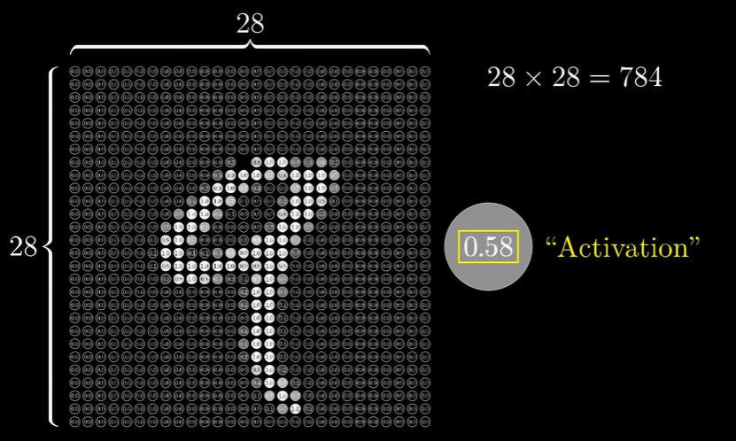

#### 2. **Hidden Layers**

* These are the “middle” layers between input and output.
* In our example, we use two hidden layers, each with 16 neurons.
* Each neuron receives input from **all** neurons in the previous layer.
* The activation of each hidden neuron is computed via a weighted sum, a bias, and an activation function (explained below).

#### 3. **Output Layer**

* Contains 10 neurons, each representing one of the digits 0 through 9.
* The neuron with the **highest activation value** is the network's predicted digit.
* These output activations can be interpreted as **probabilities** after normalization.

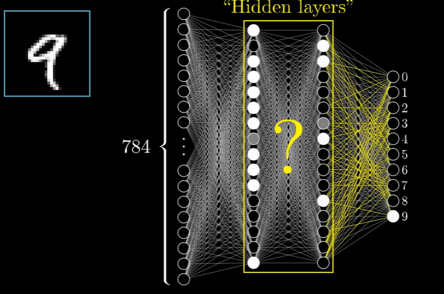

---

### How Layers Interact (Forward Propagation)

The key operation in a neural network is **forward propagation**, where the output of one layer becomes the input to the next. Here’s the idea:

For each neuron:

1. **Take inputs from the previous layer**.
2. **Multiply each input by a weight**.
3. **Add up the results** (weighted sum).
4. **Add a bias** (a number specific to the neuron).
5. **Apply an activation function**, such as the sigmoid, to produce the output (activation).

Mathematically, for a neuron $j$ in layer $l$, the activation is:

$$
a_j^{(l)} = \sigma\left(\sum_i w_{ji}^{(l)} a_i^{(l-1)} + b_j^{(l)}\right)
$$

Where:

* $a_i^{(l-1)}$: activation of neuron $i$ in the previous layer.
* $w_{ji}^{(l)}$: weight from neuron $i$ to neuron $j$.
* $b_j^{(l)}$: bias of neuron $j$.
* $\sigma$: activation function (e.g., sigmoid).

---

### The Role of Hidden Layers

Why do we need hidden layers?

Think about how humans recognize digits:

* We break them into **parts**: loops, lines, curves.
* A "9" is a loop with a downward tail.
* An "8" has two stacked loops.

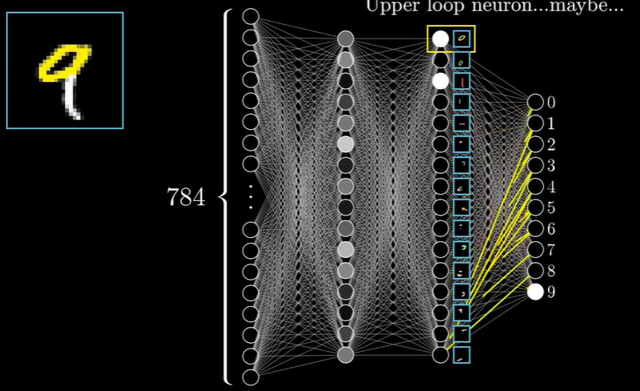

In a similar way:

* **Early hidden layers** may detect basic visual features like **edges** or **corners**.
* **Middle layers** might combine these into shapes like loops or lines.
* **Later layers** combine shapes to recognize whole digits.

This process is known as **hierarchical feature learning**. The network **builds up understanding** layer by layer.

---

### How a Neuron Computes Its Activation

Let’s go deeper into how a neuron calculates its output (activation):

1. **Weights**: Every connection from a previous-layer neuron has a **weight** $w$, which indicates how strongly that input influences the neuron.
2. **Weighted Sum**: Multiply each input by its weight and sum:

   $$
   z = w_1 x_1 + w_2 x_2 + \cdots + w_n x_n + b
   $$

   Or, more compactly:

   $$
   z = \mathbf{w} \cdot \mathbf{x} + b
   $$
3. **Bias**: The bias $b$ adjusts the threshold at which the neuron activates.
4. **Activation Function**: Apply a nonlinear function such as:

   * **Sigmoid**: $\sigma(z) = \frac{1}{1 + e^{-z}}$ — squashes values to between 0 and 1.
   * **ReLU** (in modern networks): $\max(0, z)$

This final output $a = \sigma(z)$ becomes the neuron’s activation, passed to the next layer.

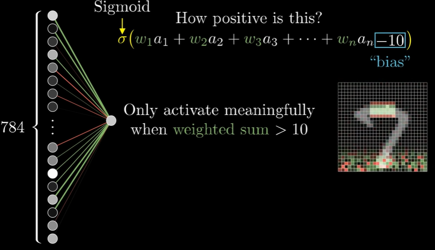

---

### Mathematical Notation Using Linear Algebra

When working with many neurons, we use matrix notation for efficiency and clarity.

Let:

* $\mathbf{a}^{(l)}$: vector of activations in layer $l$
* $\mathbf{W}^{(l)}$: matrix of weights from layer $l-1$ to layer $l$
* $\mathbf{b}^{(l)}$: vector of biases in layer $l$

Then:

$$
\mathbf{z}^{(l)} = \mathbf{W}^{(l)} \cdot \mathbf{a}^{(l-1)} + \mathbf{b}^{(l)}
$$

$$
\mathbf{a}^{(l)} = \sigma(\mathbf{z}^{(l)})
$$

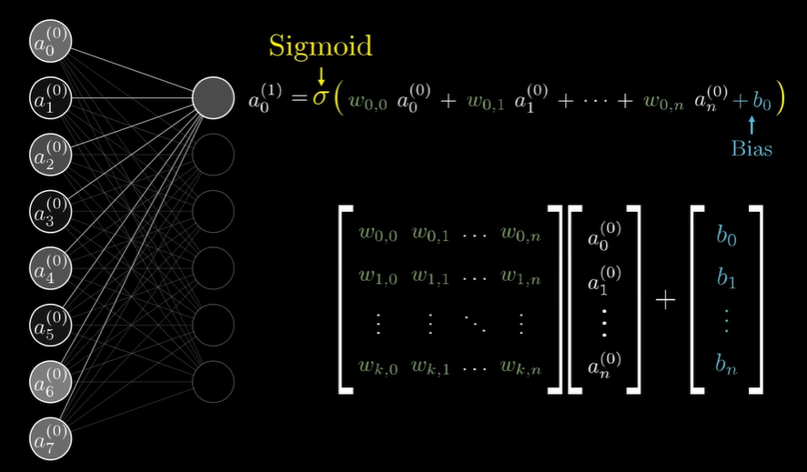

Each layer's output is computed by multiplying the previous layer's activations with the weight matrix, adding biases, and applying the activation function element-wise.

This makes it easy to compute multiple neurons in parallel and leads to **faster implementations** in code (e.g., using NumPy or PyTorch).

---

### The Neural Network as a Function

A trained neural network behaves like a function:

$$
f: \mathbb{R}^{784} \rightarrow \mathbb{R}^{10}
$$

It takes a 784-dimensional input vector (the image) and returns a 10-dimensional output vector (digit probabilities). The output vector might look like:

$$
f(\mathbf{x}) = \begin{bmatrix} 0.01 \\ 0.02 \\ \ldots \\ 0.85 \\ \ldots \\ 0.01 \end{bmatrix}
$$

This means the network thinks there's an 85% chance the digit is, say, an '8'.

The function $f$ is **parameterized** by the weights and biases of all neurons (13,002 parameters in this example). **Learning** means adjusting these parameters so that $f$ gives the correct output on many different images.

---

## How Neural Networks Learn: Gradient Descent Explained

### The Learning Process: Training Data and Cost Functions

Training a neural network means **adjusting its internal parameters**—namely, its weights and biases—so that it makes correct predictions on input data. In our digit-recognition example, we train the network using thousands of labeled images from the **MNIST dataset**, where each 28×28 grayscale image is associated with a correct digit label (0 through 9).

Each training image $\mathbf{x}^{(i)} \in \mathbb{R}^{784}$ is paired with a **target output** $\mathbf{y}^{(i)} \in \mathbb{R}^{10}$, which is typically a one-hot vector. For instance, if the true label is "3":

$$
\mathbf{y}^{(i)} = [0, 0, 0, 1, 0, 0, 0, 0, 0, 0]
$$

When the network processes an image, it produces an **output vector** $\mathbf{a}^{(L)}$ from the last layer, containing its "confidence" for each digit. The goal is to make this output as close as possible to the correct target vector.

To **measure how wrong** the network's predictions are, we define a **cost function** $C$, also known as a loss function. A common choice is the **Mean Squared Error (MSE)**:

$$
C = \frac{1}{n} \sum_{i=1}^{n} \left\| \mathbf{a}^{(L)}(\mathbf{x}^{(i)}) - \mathbf{y}^{(i)} \right\|^2
$$

Here:

* $n$ is the number of training examples.
* $\mathbf{a}^{(L)}(\mathbf{x}^{(i)})$: the network's output for the $i$-th input.
* $\| \cdot \|^2$: squared Euclidean norm (i.e., the sum of squared differences between predicted and actual outputs).

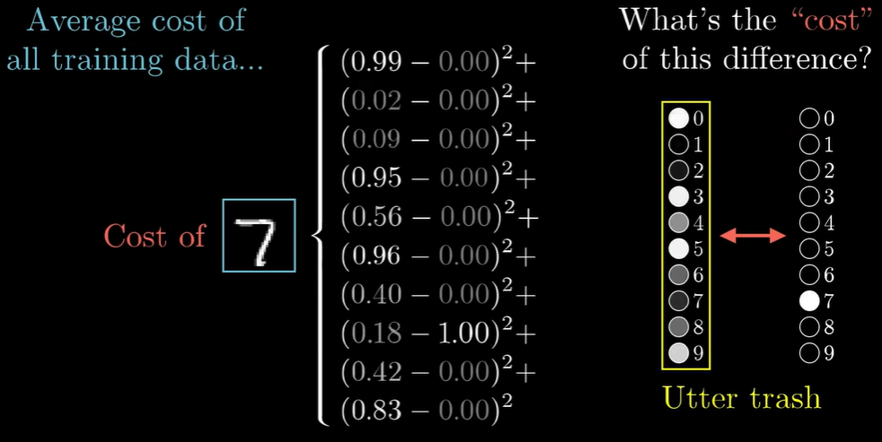

The cost function is a real-valued function:

$$
C(\mathbf{w}, \mathbf{b}) : \mathbb{R}^{13,000} \rightarrow \mathbb{R}
$$

It takes all 13,000 weights and biases as input and outputs a **single number** representing how bad the network is doing overall.

---

### Gradient Descent: Minimizing the Cost

Since we want the network to perform well, we need to **minimize** the cost function $C$. In simple mathematical terms, we want to solve:

$$
\min_{\mathbf{w}, \mathbf{b}} C(\mathbf{w}, \mathbf{b})
$$

But there's no simple formula for minimizing a function of 13,000 variables. Instead, we use an **iterative optimization algorithm** called **gradient descent**.

#### A 1D Analogy

Imagine a function $f(x)$ of a single variable $x$. To minimize it:

* Start at some initial guess $x_0$
* Compute the **derivative** $f'(x_0)$
* Move in the **opposite direction of the slope** (i.e., downhill):

  $$
  x_{\text{new}} = x_0 - \eta \cdot f'(x_0)
  $$
* Repeat until the value stabilizes.

Here, $\eta$ is the **learning rate**, a small constant that controls step size.

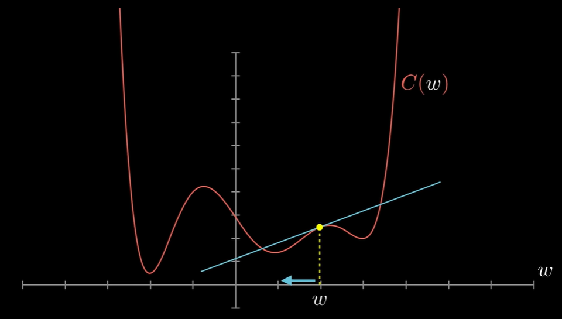

#### Extending to Multiple Variables

In a two-variable scenario, we can think of the cost function as a **surface** in 2D space.

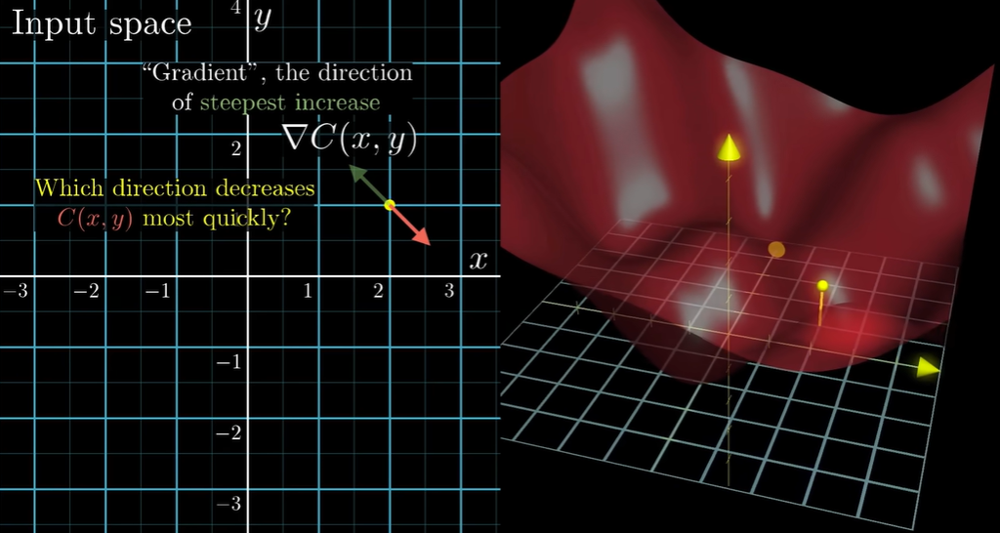

When the cost function depends on many variables (e.g., all the weights and biases), the **gradient** is the multi-variable version of the derivative. It’s a vector:

$$
\nabla C = \left[ \frac{\partial C}{\partial w_1}, \frac{\partial C}{\partial w_2}, \ldots, \frac{\partial C}{\partial b_{13,000}} \right]
$$

Each component tells us **how changing that specific parameter** affects the cost.

We update the parameters as:

$$
\mathbf{w}_{\text{new}} = \mathbf{w}_{\text{old}} - \eta \cdot \nabla_{\mathbf{w}} C
$$

$$
\mathbf{b}_{\text{new}} = \mathbf{b}_{\text{old}} - \eta \cdot \nabla_{\mathbf{b}} C
$$

This process is repeated over many training examples and iterations, gradually reducing the cost and improving accuracy.

---

### Backpropagation: Efficient Gradient Computation

While the **gradient tells us** how to adjust each weight, **calculating it directly** for all 13,000 parameters would be very inefficient. Fortunately, there’s a fast and elegant method: **Backpropagation**.

Backpropagation uses the **chain rule** from calculus to compute gradients **layer-by-layer**, starting from the output layer and moving backward through the network. It calculates the gradient of the cost function with respect to each parameter efficiently, making training feasible even for large networks.

> Think of backpropagation as a systematic way of “blaming” each neuron for its contribution to the final error, and adjusting its incoming weights accordingly.

Backpropagation works **only if** the cost function and activation functions are **smooth and differentiable**. That’s why we use continuous activation functions like the **sigmoid**, **tanh**, or **ReLU** instead of binary on/off switches.

---

### Interpretation of Gradient Descent

* The **negative gradient** points in the direction of **steepest descent**.
* Each component tells whether to **increase or decrease** a specific weight or bias.
* The **magnitude** of a component shows how sensitive the cost is to that parameter:

  * If changing a weight makes a big difference in the cost, it gets a larger update.
  * If it doesn’t affect the cost much, its update is small.

This provides both **direction** and **scale** for learning.

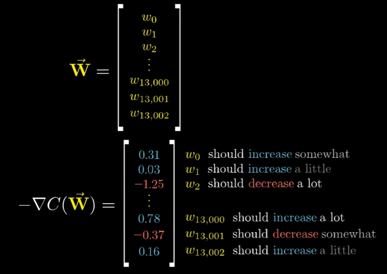

---

### Performance and Limitations

After training:

* A neural network with two hidden layers (each with 16 neurons) typically achieves **\~96% accuracy** on unseen digit images. 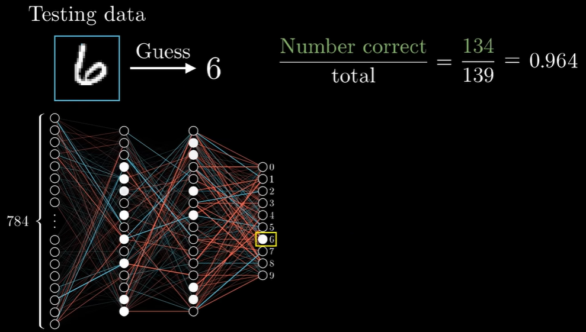
* With more advanced techniques (e.g., better initialization, regularization, and training algorithms), performance can reach **\~98% accuracy**.

However, neural networks often **don’t learn features in a human-interpretable way**:

* They may not develop obvious detectors for loops, lines, or edges.
* They may confidently misclassify random noise as digits.
* This exposes a weakness: the network has learned statistical correlations, not conceptual understanding. 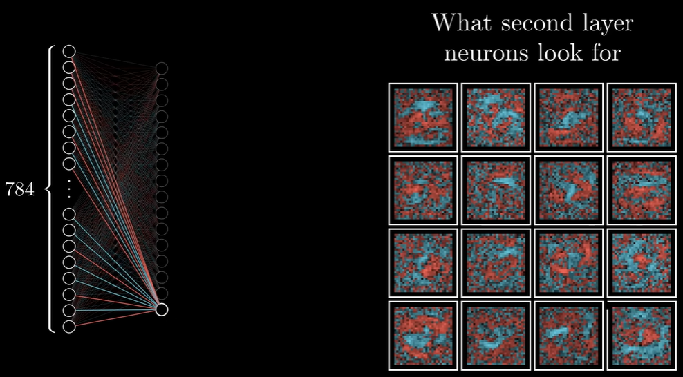

> Neural networks are powerful pattern recognizers but **don’t understand** the underlying meaning of the patterns.

---

## Backpropagation: Intuition

### What Is Backpropagation?

**Backpropagation** is the algorithm that lets neural networks learn by efficiently computing the gradient of the **cost function** with respect to all **weights** and **biases** in the network. In essence, it answers the question:

> “How should I change each weight and bias to make the network more accurate?”

It does this by working **backward** through the network—from the output layer to the input layer—applying the **chain rule** from calculus.

---

### How Gradient Calculation Works

Training a neural network means tweaking the weights and biases to reduce the cost. To know how to tweak them, we compute the **partial derivative** of the cost $C$ with respect to each parameter. For a given weight $w$, we want:

$$
\frac{\partial C}{\partial w}
$$

This derivative tells us how much a small change in $w$ will affect the cost. A large derivative means that weight has a **strong influence** on the network's error, and should be changed accordingly.

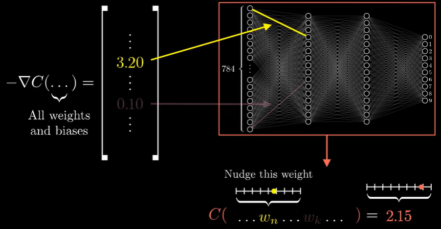

Backpropagation efficiently computes **all these derivatives** using the chain rule.

---

### Step-by-Step Intuition

1. **Start at the output layer**: If the network makes a wrong prediction, calculate how much each output neuron contributed to that error.
2. **Adjust final-layer weights**:

   * Weights linked to more active neurons (from the previous layer) have more influence.
   * These should be increased or decreased depending on whether their influence made the output too high or too low. 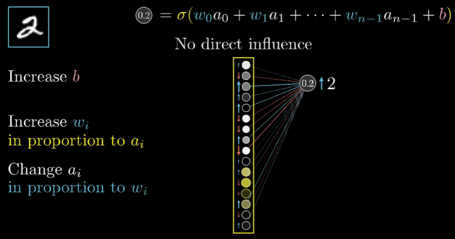
3. **Propagate backward**:

   * The effect of the output error ripples backward through the network.
   * Each earlier neuron receives a share of “blame” for the error.
4. **Repeat for each layer**, working back to the input. 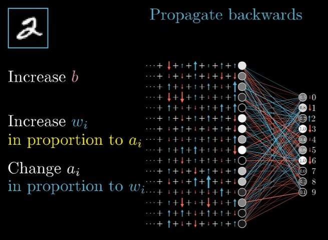

This results in a list of adjustments—one for each weight and bias—which is just the **negative gradient** of the cost function.

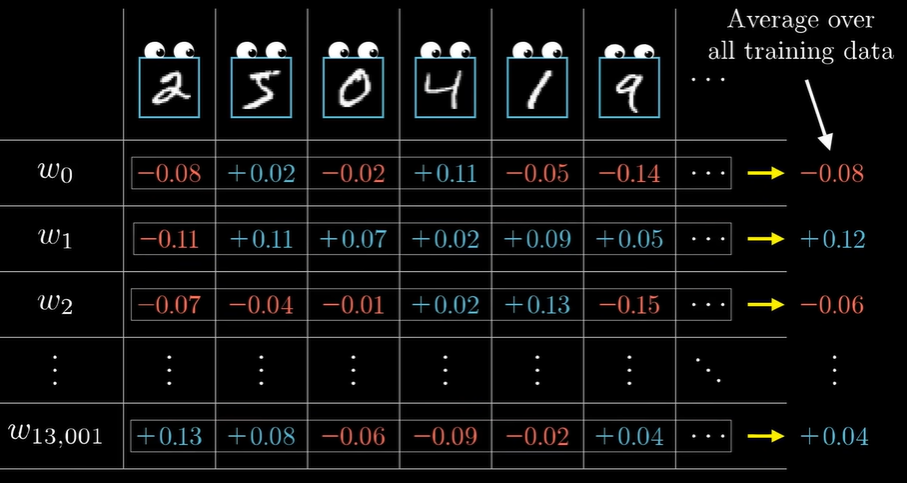

---

### Mini-Batches and Stochastic Gradient Descent (SGD)

Computing the gradient using all training examples (Batch Gradient Descent) is expensive. Instead, we use **mini-batch gradient descent**, which iterates over small, random subsets of the data (e.g., 32 or 64 examples), updating the parameters after each mini-batch.

The gradient is computed over just the **mini-batch**, giving a noisy but useful estimate of the true gradient. This method is sometimes loosely called **Stochastic Gradient Descent (SGD)** in practice, but strictly speaking:

* **Pure SGD** uses one example per step.
* **Mini-batch GD** uses small batches (common in deep learning; In libraries (e.g., PyTorch), `torch.optim.SGD` implements **mini-batch GD**).

Formally, let $m$ be the size of the mini-batch, $X$ be the design matrix of the mini-batch, and $y$ be the corresponding labels. Then, the gradient of the cost function with respect to the weights $w$ is:

$$
\nabla_{w} C = -\frac{1}{m} \sum_{i=1}^{m} (y_i - \sigma(X_i w)) \cdot X_i
$$

where $X_i$ is the $i$th row of $X$, and $\sigma$ is the sigmoid activation function.

The gradient is computed over just the mini-batch, giving a **noisy but useful estimate** of the true gradient. The update rule is:

$$
w \leftarrow w - \eta \cdot \nabla_{w} C
$$

where $\eta$ is the learning rate.

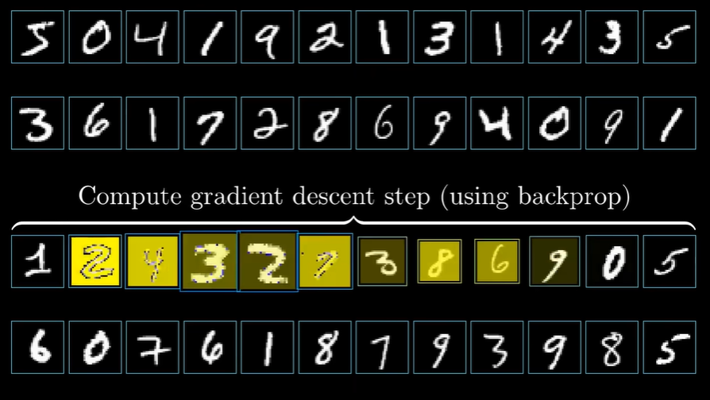

> Imagine someone stumbling down a hill while drunk. They may not always move perfectly downhill, but over time, they’ll still make progress toward the bottom. That's what SGD does. 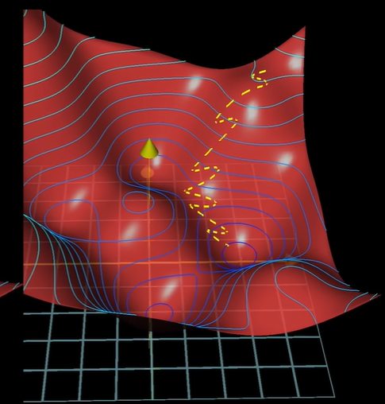

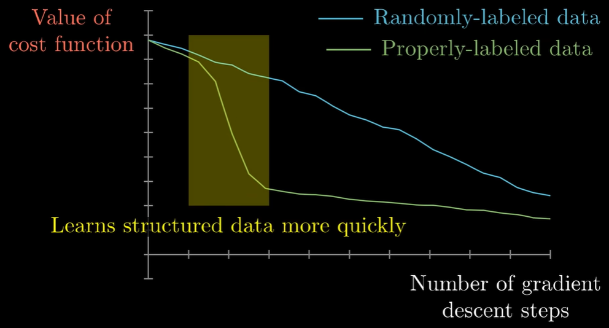

---

## Backpropagation Calculus: A Deeper Dive

Now let’s walk through how backpropagation works **mathematically**, starting with a very simple network and building up.

### Case 1: A 3-Parameter Network

Suppose we have a tiny network:

* One neuron per layer (input → hidden → hidden → output)
* Three weights: $w^{(1)}$, $w^{(2)}$, $w^{(3)}$
* Three biases: $b^{(1)}$, $b^{(2)}$, $b^{(3)}$

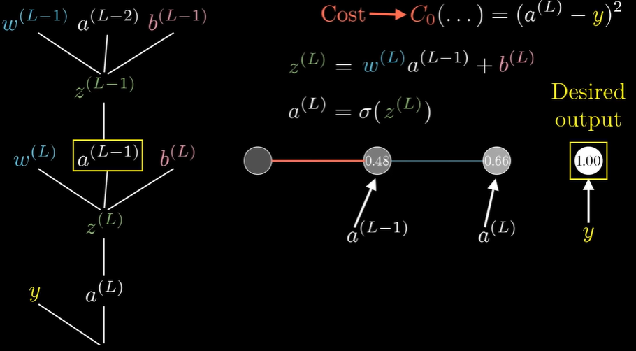

Let’s focus on the **final layer**:

* The activation from the previous layer is $a^{(L-1)}$
* The weighted input is $z^{(L)} = w^{(L)} a^{(L-1)} + b^{(L)}$
* The output activation is $a^{(L)} = \sigma(z^{(L)})$
* The cost for a single training example is:

  $$
  C = (a^{(L)} - y)^2
  $$

Using the **chain rule**, we find the derivative of the cost with respect to the weight $w^{(L)}$:

$$
\frac{\partial C}{\partial w^{(L)}} = \frac{\partial C}{\partial a^{(L)}} \cdot \frac{\partial a^{(L)}}{\partial z^{(L)}} \cdot \frac{\partial z^{(L)}}{\partial w^{(L)}}
$$

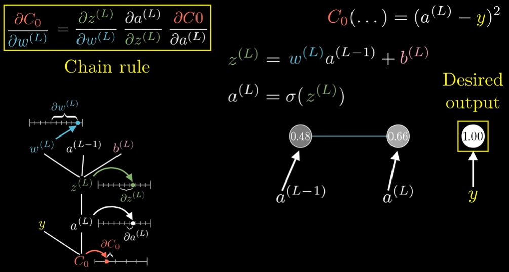

Breaking this down:

* $\frac{\partial C}{\partial a^{(L)}} = 2(a^{(L)} - y)$
* $\frac{\partial a^{(L)}}{\partial z^{(L)}} = \sigma'(z^{(L)})$
* $\frac{\partial z^{(L)}}{\partial w^{(L)}} = a^{(L-1)}$

So:

$$
\frac{\partial C}{\partial w^{(L)}} = 2(a^{(L)} - y) \cdot \sigma'(z^{(L)}) \cdot a^{(L-1)}
$$

Now, let’s calculate the **derivative with respect to the bias** $b^{(L)}$. The process is almost identical. The only difference is in the last term:

* Recall that the weighted input to the neuron is:

  $$
  z^{(L)} = w^{(L)} \cdot a^{(L-1)} + b^{(L)}
  $$
* So, the derivative $\frac{\partial z^{(L)}}{\partial b^{(L)}} = 1$ (since adding a bias just shifts the input).

Thus:

$$
\frac{\partial C}{\partial b^{(L)}} = \frac{\partial C}{\partial a^{(L)}} \cdot \frac{\partial a^{(L)}}{\partial z^{(L)}} \cdot \underbrace{\frac{\partial z^{(L)}}{\partial b^{(L)}}}_{= 1}
$$

Which simplifies to:

$$
\frac{\partial C}{\partial b^{(L)}} = \frac{\partial C}{\partial a^{(L)}} \cdot \frac{\partial a^{(L)}}{\partial z^{(L)}}
$$

$$
\frac{\partial z^{(L)}}{\partial b^{(L)}} = 1
\Rightarrow \frac{\partial C}{\partial b^{(L)}} = 2(a^{(L)} - y) \cdot \sigma'(z^{(L)})
$$

This tells us how the bias $b^{(L)}$ influences the cost. The process is exactly like computing the weight’s influence, but the “input” to the bias is always 1, because changing the bias directly shifts $z$.

#### Averaging Over Training Examples

So far, we’ve been computing the derivatives $\frac{\partial C}{\partial w}$ and $\frac{\partial C}{\partial b}$ for **one** training example.

But in practice, the total cost function $C$ is defined as the average over **all training examples**. So, to compute the overall gradient, we must **average these derivatives**:

$$
\frac{\partial C}{\partial w} = \frac{1}{n} \sum_{i=1}^{n} \frac{\partial C^{(i)}}{\partial w}
$$

This averaging gives a more stable and representative estimate of how each weight and bias affects the total cost, rather than just one example.

#### The Gradient Vector

Each partial derivative—whether with respect to a weight or a bias—is just **one component** of the **gradient vector**:

* If your network has 10,000 weights and 10,000 biases, then your gradient vector has **20,000 entries**.
* Each entry tells you: *“If I change this weight or bias slightly, how will the cost change?”*

Importantly, this vector points in the direction of **steepest increase** in the cost function. But since we want to **minimize** the cost, we update weights by moving in the **opposite direction**—the **negative gradient**.

#### Propagating the Error Backward

To keep backpropagation efficient, we don't recompute everything from scratch for each layer. Instead, we **reuse partial results** using the chain rule.

For instance, suppose we want to compute the effect of the previous activation $a^{(L-1)}$ on the cost. The relevant derivative is:

$$
\frac{\partial C}{\partial a^{(L-1)}} = \frac{\partial C}{\partial z^{(L)}} \cdot \frac{\partial z^{(L)}}{\partial a^{(L-1)}}
$$

From the equation $z^{(L)} = w^{(L)} \cdot a^{(L-1)} + b^{(L)}$, we know:

$$
\frac{\partial z^{(L)}}{\partial a^{(L-1)}} = w^{(L)}
$$

So:

$$
\frac{\partial C}{\partial a^{(L-1)}} = \delta^{(L)} \cdot w^{(L)}
$$

This gives us the **error signal** for the previous layer. We use it to compute new gradients for $w^{(L-1)}$, $b^{(L-1)}$, and so on. This **recursive** use of the chain rule moving backward through the network is what makes backpropagation so powerful—and efficient.

---

### Case 2: Multi-Neuron Layers

When you have layers with **multiple neurons**, the concepts stay the same, but you need **indexed notation**:

* Let $k$ index neurons in layer $L-1$
* Let $j$ index neurons in layer $L$

Then:

* $a^{(L)}_j$: activation of the $j$-th neuron in layer $L$
* $w^{(L)}_{jk}$: weight connecting neuron $k$ in layer $L-1$ to neuron $j$ in layer $L$

Note: This indexing matches matrix notation where the **rows are outputs** and **columns are inputs**.

The cost is:

$$
C = \sum_j (a_j^{(L)} - y_j)^2
$$

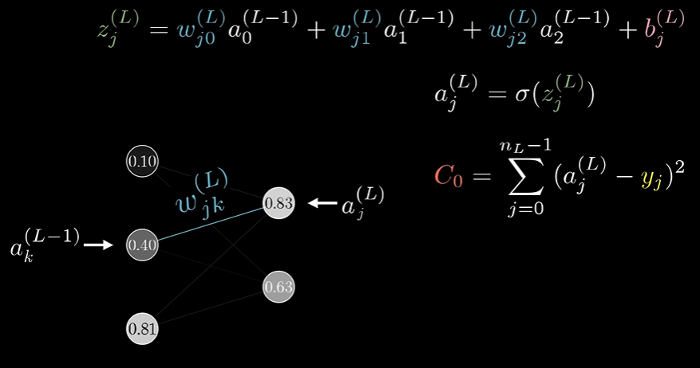

#### Multi-Neuron Networks: Derivative Calculation

To calculate $\frac{\partial C}{\partial w^{(L)}_{jk}}$, we use:

$$
\frac{\partial C}{\partial w^{(L)}_{jk}} = \delta^{(L)}_j \cdot a^{(L-1)}_k
$$

Where $\delta^{(L)}_j$ is the error at neuron $j$ in layer $L$, and $a^{(L-1)}_k$ is the activation from the previous layer.

And to compute the error for a neuron in the **previous layer**:

$$
\delta^{(L-1)}_k = \left( \sum_j w^{(L)}_{jk} \cdot \delta^{(L)}_j \right) \cdot \sigma'(z^{(L-1)}_k)
$$

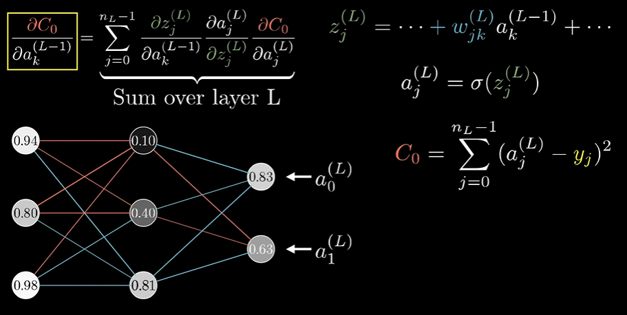

This summing process reflects the fact that **one neuron can influence multiple downstream neurons**, so its error must be the **sum** of all those influences.

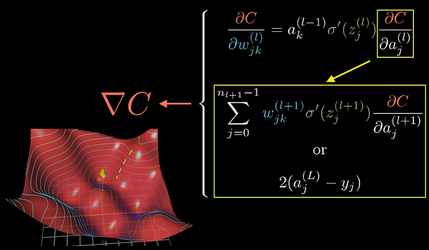

---

Absolutely! Here's a more narrative, paragraph-based version of your blog post, without emojis or bullet-point formatting. This version focuses on clarity and flow while retaining all key ideas.

---

## Understanding Convolutional Neural Networks (CNNs)

### Introduction to CNN

Convolutional Neural Networks, or CNNs, are specialized types of neural networks designed to help computers interpret and understand visual data, such as images. When we look at an image, we intuitively recognize objects based on patterns and spatial relationships. A computer, however, sees an image as a grid of numbers—each representing a pixel's intensity. For example, a grayscale image of the digit "9" might be represented as a matrix of pixel values. A slight change, like a shift or rotation, can completely alter this matrix, making it hard for traditional algorithms to recognize the digit as the same object. CNNs overcome this challenge by focusing on identifying local features and patterns within the image and building a hierarchical understanding, much like the human visual system does.

### Why Traditional Neural Networks Struggle with Images

Traditional neural networks, also known as artificial neural networks (ANNs), can technically process images, but they are not efficient or effective for this task. One issue is scale. A single image, especially a high-resolution one, contains thousands or even millions of pixels. Feeding all of these directly into a fully connected neural network would require a massive number of weights and computations, making training impractical. Another problem is that ANNs treat each pixel independently and equally, ignoring the spatial structure of images. A cat’s face in the top-left corner is treated no differently from the same face in the bottom-right, even though spatial relationships are crucial for understanding visual content. This lack of spatial awareness makes traditional ANNs ill-suited for image tasks.

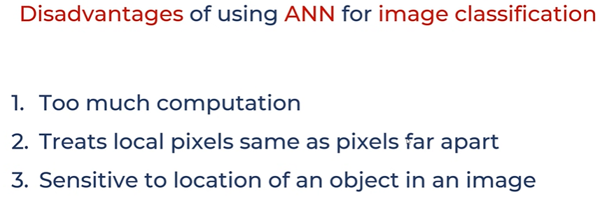

### How the Human Brain Inspires CNNs

The design of CNNs is inspired by the way the human brain processes visual information. In the brain, specific neurons respond to specific patterns, such as edges, shapes, or movements. These neurons are organized hierarchically—lower levels detect basic features like edges, while higher levels combine these into more complex representations like faces or objects. CNNs follow this principle. They begin by detecting simple features in the raw pixel data, and through layers of processing, build up more complex, abstract representations that are eventually used to classify or recognize the image.

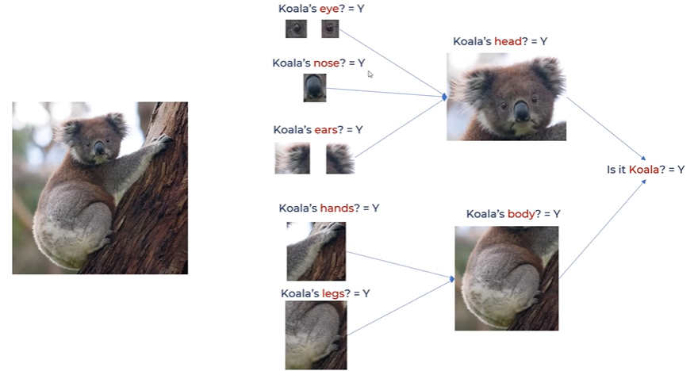

### Filters and the Convolution Operation

The core component of a CNN is the filter, or kernel—a small matrix of numbers that acts as a feature detector. A single filter might be designed (or learned) to detect vertical edges, horizontal lines, or curves.
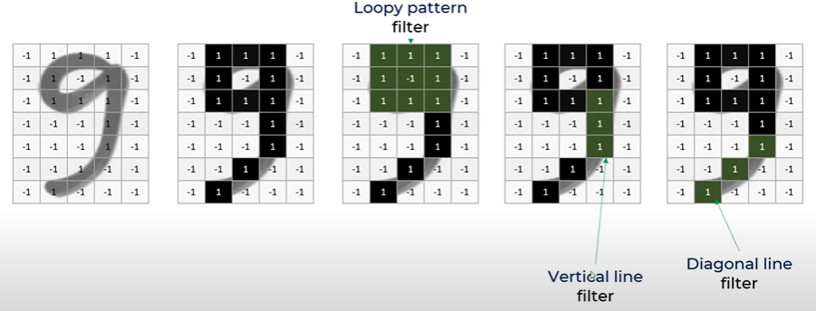
During the convolution operation, the filter slides over the image, one small region at a time. At each location, it multiplies its values with the corresponding pixel values and sums the result.
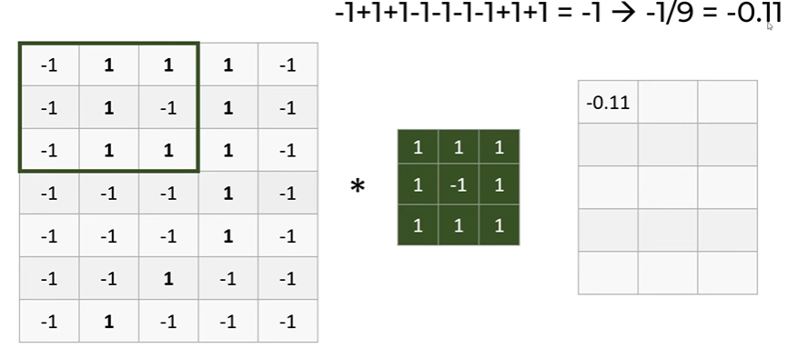
This single number becomes part of a new matrix called the feature map. The feature map highlights the regions of the original image where the filter’s target pattern is present.
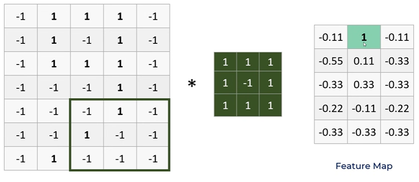
For instance, if the filter is looking for a curve, the feature map will show high values where curves appear.

### Multiple Filters and Deeper Understanding

In practice, CNNs use many filters at each layer to detect a wide variety of features. Each filter produces its own feature map, and these maps are stacked to form a deeper, more informative representation of the input. As we move deeper into the network, these feature maps are themselves treated like images, and more filters are applied to them. This process allows the network to identify higher-order features. For example, early layers might detect lines and corners, while later layers might recognize eyes, ears, or entire objects. This layered approach gives CNNs the ability to construct a rich, hierarchical understanding of the input image.

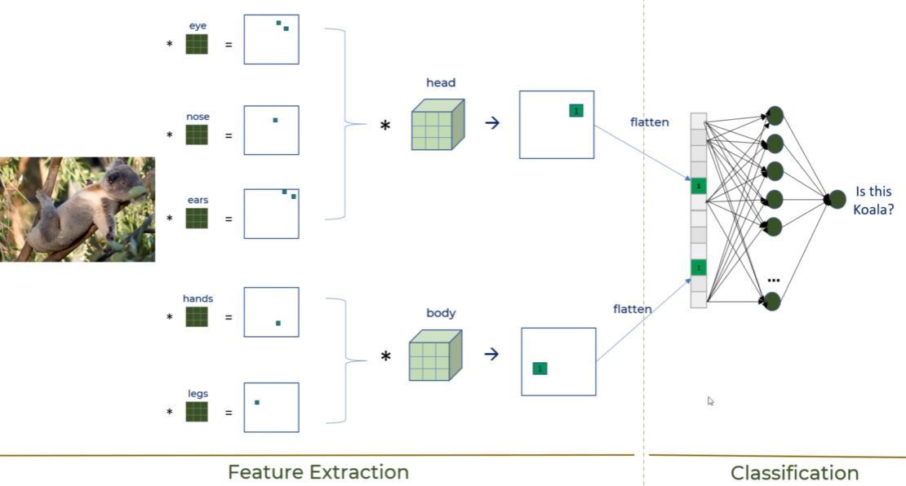

### Pooling and Dimensionality Reduction

As CNNs go deeper and create more feature maps, the amount of data can become overwhelming. Pooling is a technique used to reduce the spatial size of the feature maps while retaining the most important information. The most common form is max pooling, which divides the feature map into small regions (typically 2×2) and keeps only the highest value in each
region.
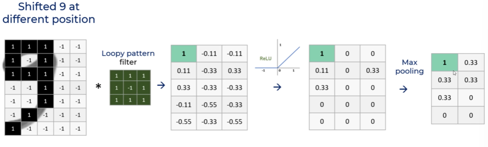
This operation not only reduces computation but also provides a degree of translation invariance. That is, even if the feature moves slightly in the image, the pooled representation will remain largely unchanged. Average pooling, which takes the mean value instead of the maximum, is another option, though it is used less frequently.
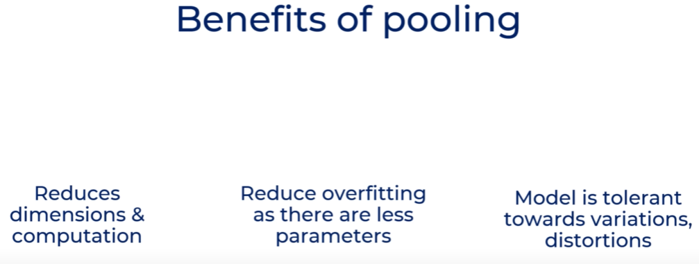

### Introducing Non-Linearity with ReLU

To allow CNNs to model complex, non-linear relationships in data, a non-linear activation function is applied after each convolution operation. The most commonly used is the Rectified Linear Unit (ReLU), which replaces all negative values in the feature map with zero, leaving positive values unchanged.
$$
ReLU(x) = max(0, x)
$$
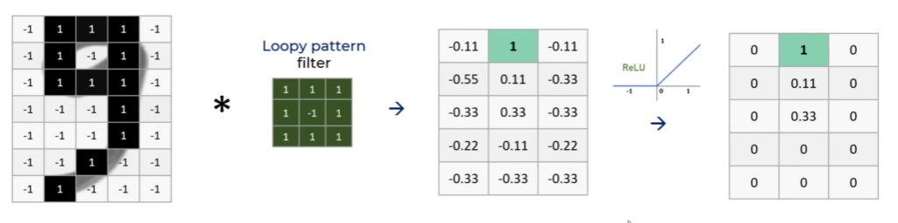
This simple operation introduces non-linearity into the network, allowing it to learn much more complex patterns than a purely linear model could. ReLU also helps with training by mitigating issues like the vanishing gradient problem and making the network more efficient.

### The Full CNN Architecture

A complete CNN architecture typically starts with one or more convolutional layers, each followed by a non-linear activation function like ReLU and a pooling layer. These three components—convolution, activation, and pooling—may be stacked several times to extract increasingly abstract features. After enough layers, the high-level feature maps are flattened into a one-dimensional vector and passed through one or more fully connected layers. These layers perform the final classification based on the features extracted by the earlier convolutional layers. The final output might be a single value (for binary classification) or a vector of probabilities (for multi-class problems).
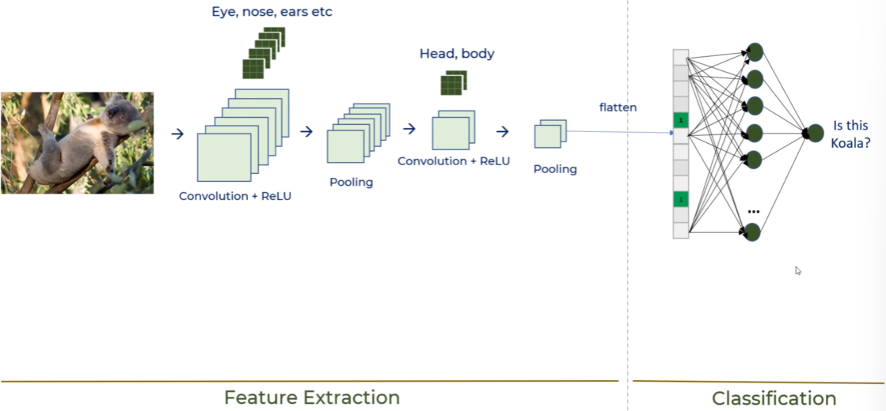

### Why CNNs Work So Well

CNNs offer several advantages over traditional neural networks for image-related tasks. First, they take advantage of local connections, meaning each neuron looks only at a small part of the image. This reduces the number of parameters and makes the network more efficient. Second, they use parameter sharing, where the same filter is applied across the entire image. This helps the network recognize features regardless of where they appear. Third, the use of pooling layers and the hierarchical structure makes CNNs more robust to variations such as translation, slight distortion, or changes in lighting and scale. Together, these properties make CNNs well-suited for handling the complex structure of visual data.

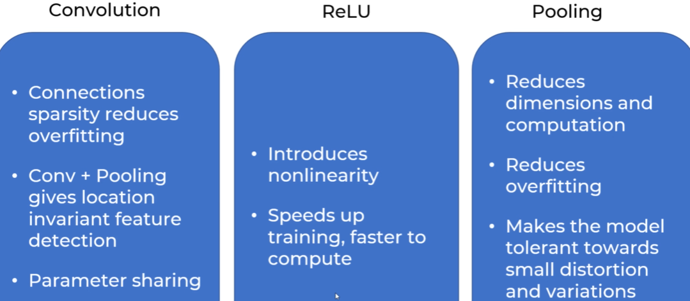

### How CNNs Learn Filters

One of the most powerful aspects of CNNs is that they learn the filters automatically. During training, the network uses a method called backpropagation to update the filter values in a way that minimizes the error between its predictions and the actual labels. You don't need to manually define what each filter should detect. Instead, the network figures out on its own which patterns are important for the task at hand—whether that’s edges, textures, or entire object parts. The only thing you typically define as a designer is how many filters to use and their size (e.g., 3×3 or 5×5).

### Limitations and the Role of Data Augmentation

While CNNs are highly effective, they do have some limitations. They are not naturally invariant to rotations, changes in object thickness, or extreme scaling. A rotated version of an object might be interpreted as something entirely different. To address this, practitioners often use a technique called data **augmentation**. This involves artificially expanding the training dataset by applying various transformations to the images—such as rotations, shifts, zooms, and changes in brightness or thickness. By exposing the CNN to a wider variety of examples, it becomes more robust and performs better on real-world data.

---
