# What are Jupyter Notebooks?

Welcome to this lesson on using Jupyter notebooks. The notebook is a web application that allows you to combine explanatory text, math equations, code, and visualizations all in one easily sharable document. For example, here's one of my favorite notebooks shared recently, binary black hole signals in LIGO open data detected by the LIGO experiment. You could download the data, run the code in the notebook, and repeat the analysis, in effect detecting the gravitational waves yourself! You can view a few more tutorial notebooks at Gravitational Wave Open Science Center homepage.

Notebooks have quickly become an essential tool when working with data. You'll find them being used for data cleaning and exploration, visualization, machine learning, and big data analysis. Here's an example notebook I made for my personal blog that shows off many of the features of notebooks. Typically you'd be doing this work in a terminal, either the normal Python shell or with IPython. Your visualizations would be in separate windows, any documentation would be in separate documents, along with various scripts for functions and classes. However, with notebooks, all of these are in one place and easily read together.

Notebooks are also rendered automatically on GitHub. It’s a great feature that lets you easily share your work. There is also <http://nbviewer.jupyter.org> that renders the notebooks from your GitHub repo or from notebooks stored elsewhere.

## Literate Programming

Notebooks are a form of literate programming proposed by Donald Knuth in 1984. With literate programming, the documentation is written as a narrative alongside the code instead of sitting off by its own. In Donald Knuth's words,

Instead of imagining that our main task is to instruct a computer what to do, let us concentrate rather on explaining to human beings what we want a computer to do.

After all, code is written for humans, not for computers. Notebooks provide exactly this capability. You are able to write documentation as narrative text, along with code. This is not only useful for the people reading your notebooks, but for your future self coming back to the analysis.

Just a small aside: recently, this idea of literate programming has been extended to a whole programming language, Eve.

## How Notebooks Work

Jupyter notebooks grew out of the IPython project started by Fernando Perez. IPython is an interactive shell, similar to the normal Python shell but with great features like syntax highlighting and code completion. Originally, notebooks worked by sending messages from the web app (the notebook you see in the browser) to an IPython kernel (an IPython application running in the background). The kernel executed the code, then sent it back to the notebook. The current architecture is similar, drawn out below.

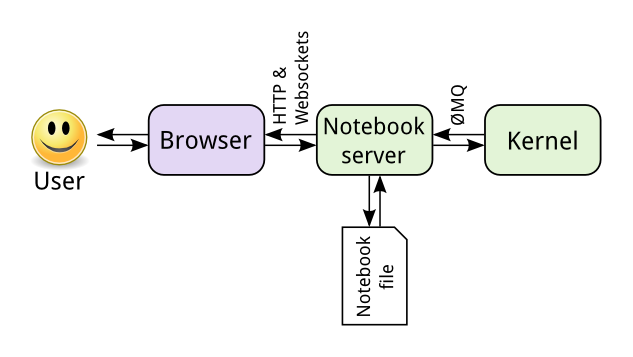

The central point is the notebook server. You connect to the server through your browser and the notebook is rendered as a web app. Code you write in the web app is sent through the server to the kernel. The kernel runs the code and sends it back to the server, then any output is rendered back in the browser. When you save the notebook, it is written to the server as a JSON file with a .ipynb file extension.

The great part of this architecture is that the kernel doesn't need to run Python. Since the notebook and the kernel are separate, code in any language can be sent between them. For example, two of the earlier non-Python kernels were for the R and Julia languages. With an R kernel, code written in R will be sent to the R kernel where it is executed, exactly the same as Python code running on a Python kernel. IPython notebooks were renamed because notebooks became language agnostic. The new name Jupyter comes from the combination of Julia, Python, and R. If you're interested, here's a list of available kernels.

Another benefit is that the server can be run anywhere and accessed via the internet. Typically you'll be running the server on your own machine where all your data and notebook files are stored. But, you could also set up a server on a remote machine or cloud instance like Amazon's EC2. Then, you can access the notebooks in your browser from anywhere in the world.

## Installing Jupyter Notebook

The Jupyter notebooks automatically get installed with the Anaconda distribution. You'll be able to use notebooks from the default environment.

If you are using Miniconda, there are multiple ways you can install the Jupyter notebook. You can install Jupyter notebooks in a conda environment using the following commands in your Terminal/Anaconda Prompt:

```cmd
# First, verify if you have Python and conda installed
# If the command below shows an error, try installing it first using `conda install python=3`
python --version
conda --version

# Use either of the commands below to install notebook
conda install jupyter notebook
conda install -c conda-forge notebook
```

If you are using pip, you can install Jupyter notebook with:

```cmd
# First, verify if you have pip installed. In recent versions of Python 3 >=3.4, pip comes preinstalled. 
# If the `pip` command below shows an error, try installing pip from https://pip.pypa.io/en/stable/installing/ 
python --version
pip --version

# Use either of the commands below to install notebook
pip install notebook
pip install jupyter notebook
```

To run the notebook, run the following command at the Terminal (Mac/Linux) or Command Prompt (Windows) / Anaconda Prompt (Windows):

>jupyter notebook

## Notebook Interface

You can create a new notebook by clicking “new” and then choosing a kernel, such as python3.

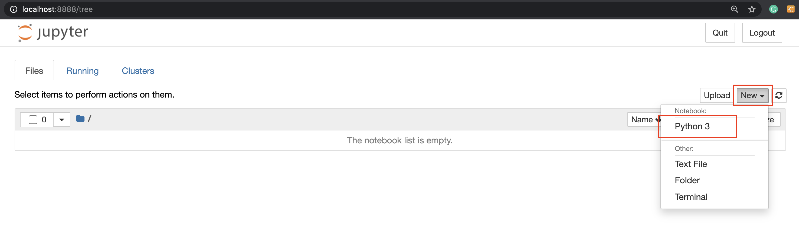

The command above will create a new notebook in a new browser tab, named Untitled.ipynb, as shown below:

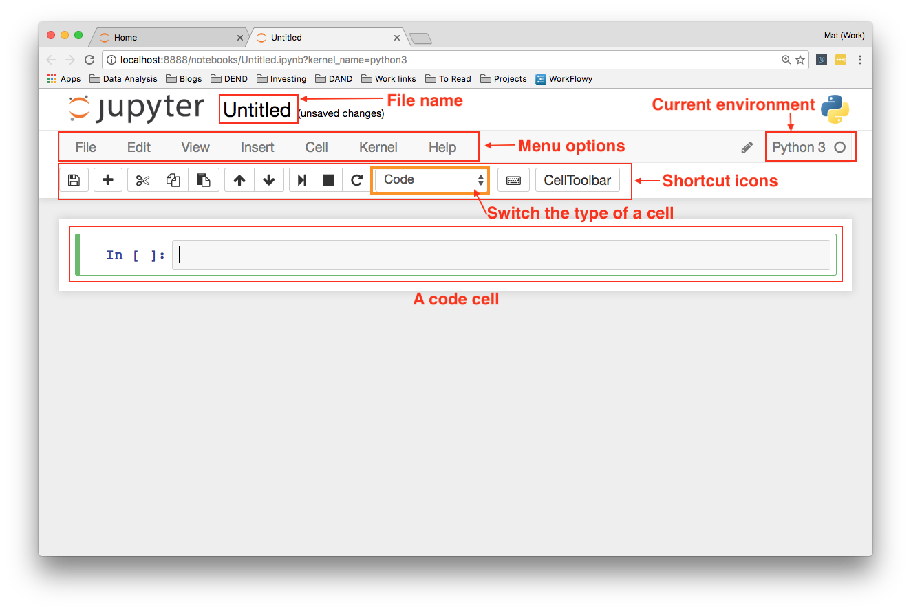

A new Untitled Notebook. It shows your current environment (Python 3) in the upper right, a first code cell at the bottom, as well as the type of cell in the menu bar.

Feel free to try this yourself and poke around a bit.

You’ll see a little box outlined in green. This is called a cell. Cells are where you write and run your code. You can also change it to render Markdown, a popular formatting syntax for writing web content. I'll cover Markdown in more detail later. In the toolbar, click “Code” to change it to Markdown and back. The little play button runs the cell, and the up and down arrows move cells up and down.

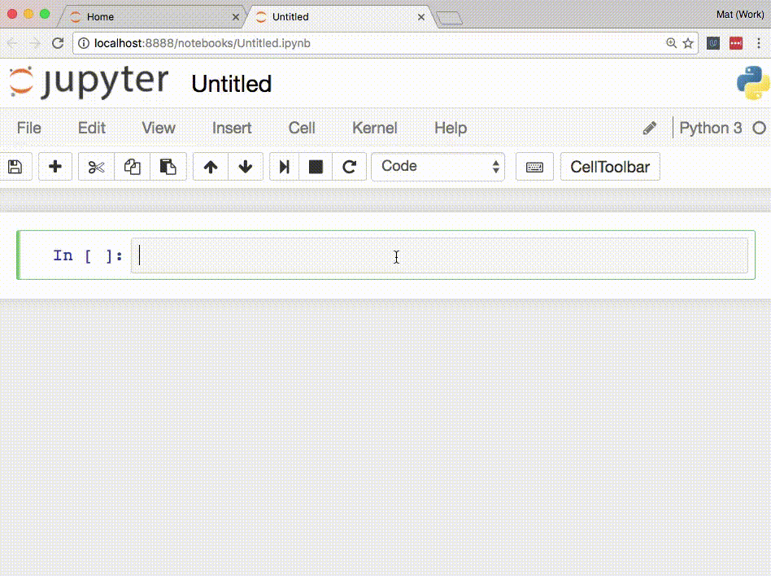

The Notebook Interface - switching a code cell to markdown from code, and moving up or down

When you run a code cell, the output is displayed below the cell. The cell also gets numbered, you see In [1]: on the left. This lets you know the code was run and the order if you run multiple cells. Running the cell in Markdown mode renders the Markdown as text.

## The Tool Bar

Elsewhere on the tool bar, starting from the left, you have:

- The anachronistic symbol for "save," the floppy disk. Saves the notebook!
- The + button creates a new cell
- Then, buttons to cut, copy, and paste cells
- Run, stop, and restart the kernel
- Cell type: code, Markdown, raw text, and header
- Command palette (see next)
- Cell toolbar, gives various options for cells such as using them as slides
- Command Palette
The little keyboard is the command palette. This will bring up a panel with a search bar where you can search for various commands. This is really helpful for speeding up your workflow as you don't need to search around in the menus with your mouse. Just open the command palette and type in what you want to do. For instance, if you want to merge two cells:

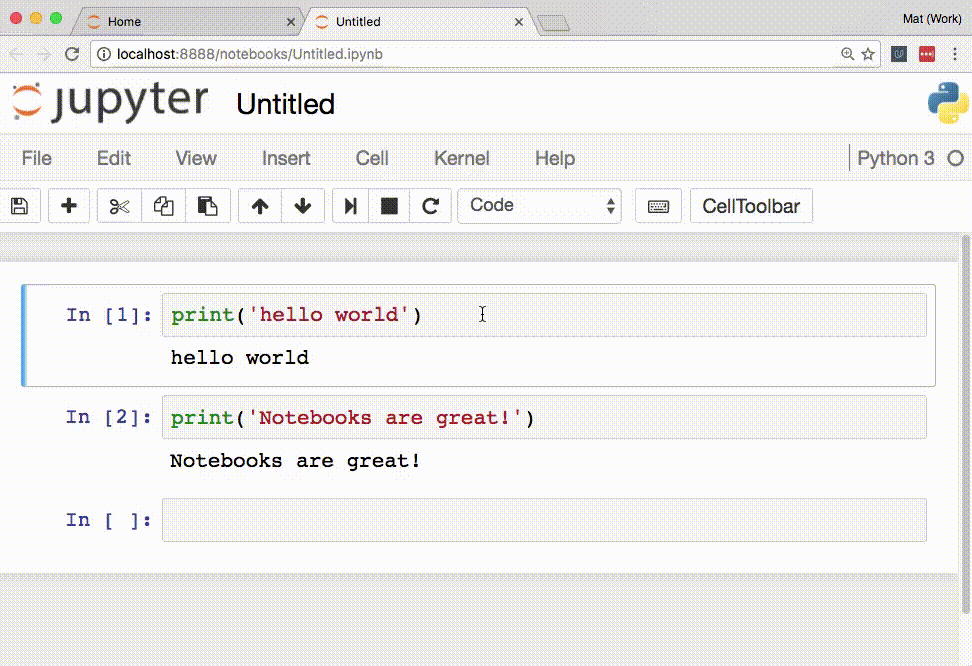

The Command Palette. A snapshot displays merging of cells.

### More Things

At the top, you see the title. Click on this to rename the notebook.

Over on the right is the kernel type (Python 3 in my case) and next to it, a little circle. When the kernel is running a cell, it'll fill in. For most operations which run quickly, it won't fill in. It's a little indicator to let you know longer running code is actually running.

Along with the save button in the toolbar, notebooks are automatically saved periodically. The most recent save is noted to the right of the title. You can save manually with the save button, or by pressing escape then s on your keyboard. The escape key changes to command mode and s is the shortcut for "save." I'll cover command mode and keyboard shortcuts later.

In the "File" menu, you can download the notebook in multiple formats. You'll often want to download it as an HTML file to share with others who aren't using Jupyter. Also, you can download the notebook as a normal Python file where all the code will run like normal. The Markdown and reST formats are great for using notebooks in blogs or documentation.

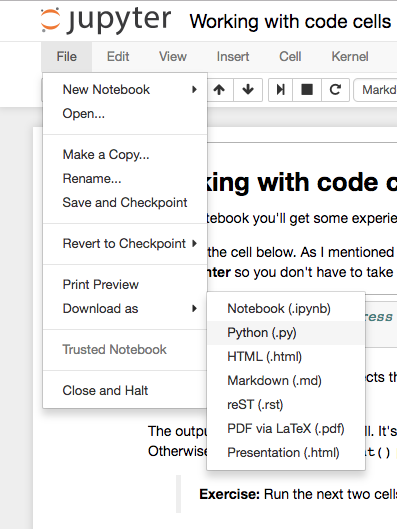

Downloading a Notebook as a Python file - File -> Download as -> Python (.py)

### Note on the Recent Version of Jupyter Notebook

You might encounter a different interface if you have installed Jupyter Notebook on your local environment. This is because the recent version of Jupyter Notebook adopts a new interface called JupyterLab. Despite its modern look, JupyterLab shares many common features with the classic Notebook interface described earlier, making it easy to use even if you're accustomed to the classic version. To explore JupyterLab and its features more, refer to the official documentation.

## Code Cells

Most of your work in notebooks will be done in code cells. This is where you write your code and it gets executed. In code cells, you can write any code, assign variables, define functions and classes, import packages, and more. Any code executed in one cell is available in all other cells.

To give you some practice, I created a notebook you can work through. Download the supporting material, ie. jupyter notebook ("Working With Code Cells"), below this page, then run it from your own notebook server. Your browser might try to open the notebook file without downloading it. If that happens, right-click on the link then choose "Save Link As...". There are two ways to open the downloaded notebook locally:

- In your terminal, change to the directory with the notebook file, then enter jupyter notebook.
- If you have a Notebook server already up and running, you can either put the newly-downloaded file into the current working directory or use the “Upload” option in the NOtebook server.

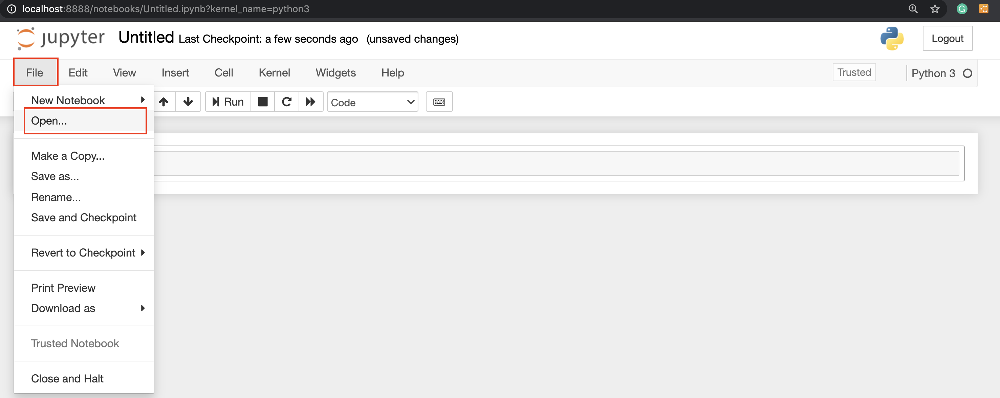
A screenshot displaying how to open a file using the "File" menu within a Jupyter Notebook.

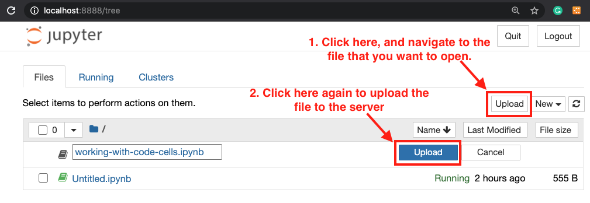
A screenshot displaying the steps to upload any file to the current running Notebook server. First, click on the Upload button and then select the file from the local machine.

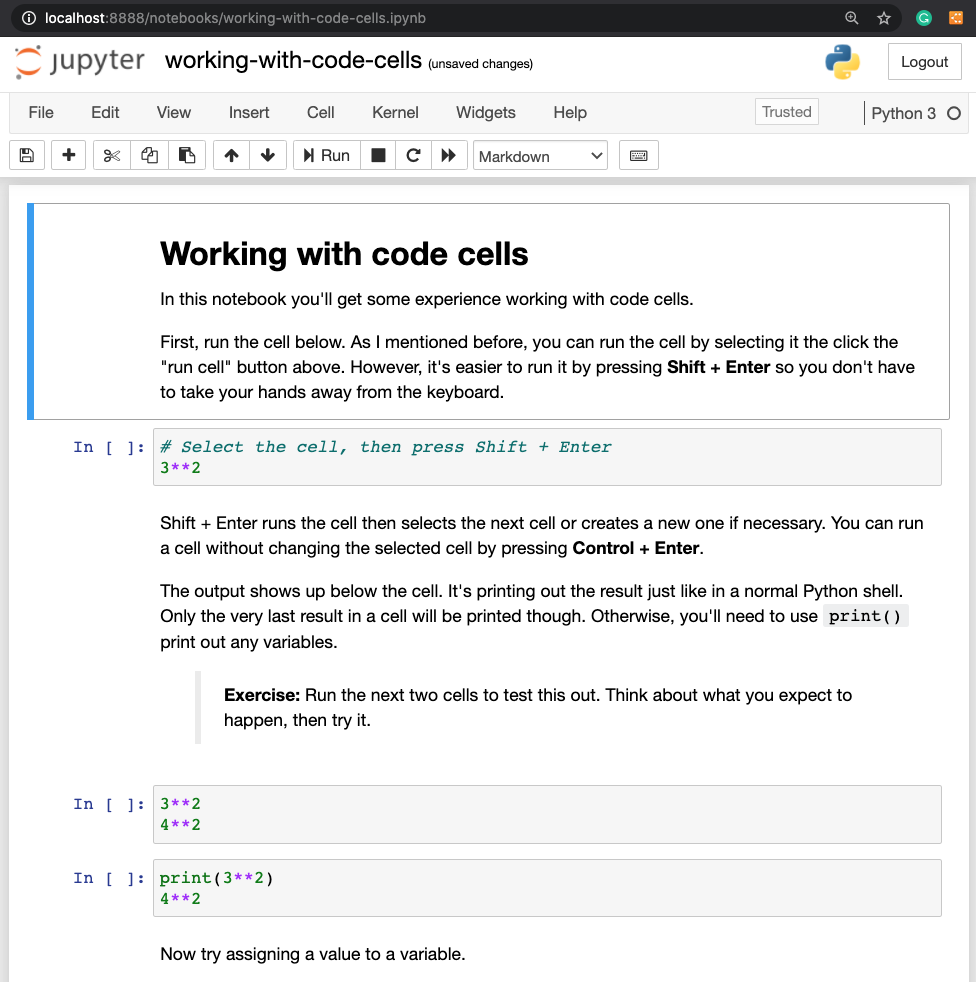
A screenshot displaying the a sample Notebook, the `working-with-code-cells.ipynb` file.

### Markdown Cells

As mentioned before, cells can also be used for text written in Markdown. Markdown is a formatting syntax that allows you to include links, style text as bold or italicized, and format code. As with code cells, you press Shift + Enter or Control + Enter to run the Markdown cell, where it will render the Markdown to formatted text. Including text allows you to write a narrative alongside your code, as well as documenting your code and the thoughts that went into it.

Below is a brief summary of markup concepts. At the bottom of this page, you'll find very good resources to learn and practice markup concepts:

### Headers

You can write headers using the pound/hash/octothorpe symbol # placed before the text. One # renders as an h1 header, two #s is an h2, and so on. Looks like this:

```md
# Header 1
## Header 2
### Header 3
```

### Links

Linking in Markdown is done by enclosing text in square brackets and the URL in parentheses, like this [Udacity's home page](https://www.udacity.com) for a link to Udacity's home page.

```md
[Udacity's home page](https://www.udacity.com)
```

### Emphasis

You can add emphasis through bold or italics with asterisks or underscores (`*` or `_`). For italics, wrap the text in one asterisk or underscore,`_gelato_` or `*gelato*`.

Bold text uses two symbols:

```md
**aardvark** or __aardvark__
```

Either asterisks or underscores are fine as long as you use the same symbol on both sides of the text.

### Code

There are two different ways to display code, inline with text and as a code block separated from the text. To format inline code, wrap the text in backticks. For example:

```md
`string.punctuation`
```

To create a code block, start a new line and wrap the text in three backticks

\`\`\`md
import requests
response = requests.get('https://www.udacity.com')
\`\`\`

or indent each line of the code block with four spaces.

```md
    import requests
    response = requests.get('https://www.udacity.com')
```

Note: You won't see the spaces here in the page for the above! Udacity's classroom is rendering the spaces directly as a code block.

### Math expressions

You can create math expressions in Markdown cells using LaTeX symbols. Notebooks use MathJax to render the LaTeX symbols as math symbols. To start math mode, wrap the LaTeX in dollar signs `$y = mx + b$` for inline math. For a math block, use double dollar signs,

```md
$$
y = \frac{a}{b+c}
$$
```

This is a really useful feature, so if you don't have experience with LaTeX, here is a tutorial on using it to create math expressions.

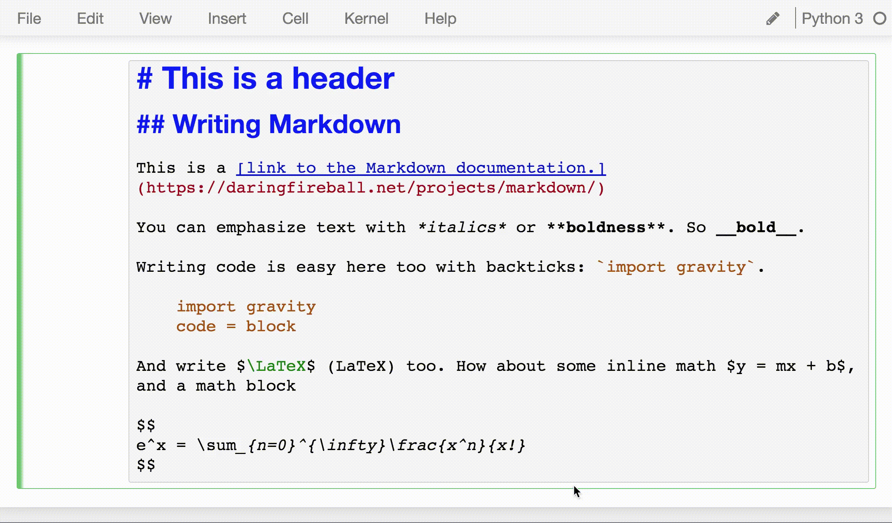
Using Markdown Cells in Jupyter - shows the examples from above of headers, links, styling, code, and LaTeX.

## Keyboard Shortcuts

Jupyter Notebook comes with a bunch of keyboard shortcuts that let you use your keyboard to interact with the cells, instead of using the mouse and toolbars. They take a bit of time to get used to, but when you're proficient with the shortcuts you'll be much faster at working in notebooks. To learn more about the shortcuts and get practice using them, download the notebook Keyboard Shortcuts below. Again, your browser might try to open it, but you should save it to your computer. Right-click on the link, then choose "Save Link As..."

A screenshot displaying the steps to upload a file to the current running Notebook server. First, click on the Upload button and then select the file from the local machine. 
Upload the file to the current running the Jupyter Notebook server.

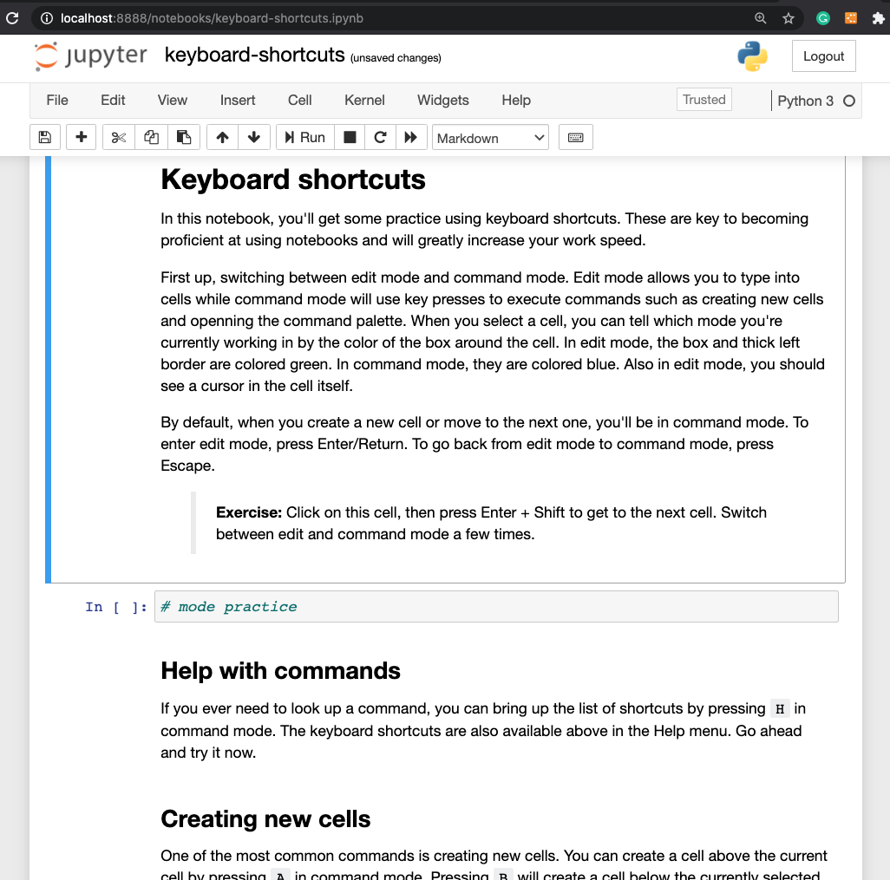
A screenshot displaying the a sample notebook, the `keyboard-shortcuts.ipynb` file.

**Note on the Recent Version of Jupyter Notebook**
If you are using JupyterLab on your local environment, keep in mind that some keyboard shortcuts may differ from those in the classic Jupyter Notebook interface. To view or customize the keyboard shortcuts in JupyterLab:

>Windows: Press Ctrl + Shift + H.
>Mac: Press Shift + Cmd + H.

## Magic Keywords

Magic keywords are special commands you can run in cells that let you control the notebook itself or perform system calls such as changing directories. For example, you can set up matplotlib to work interactively in the notebook with %matplotlib.

Magic commands are preceded with one or two percent signs (% or %%) for line magics and cell magics, respectively. Line magics apply only to the line the magic command is written on, while cell magics apply to the whole cell.

NOTE: These magic keywords are specific to the normal Python kernel. If you are using other kernels, these most likely won't work.

### Timing code

At some point, you'll probably spend some effort optimizing code to run faster. Timing how quickly your code runs is essential for this optimization. You can use the timeit magic command to time how long it takes for a function to run, like so:

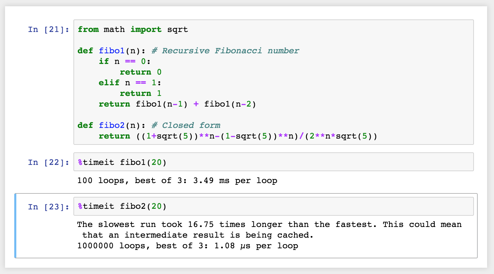
A screenshot displaying how to use the `timeit` for a single line. You must use the `%timeit` with a function call with a line of code. For instance, if you have a function `fibo(n)`, you would use `%timeit fibo(20)` to see how long it takes to run.

If you want to time how long it takes for a whole cell to run, you’d use %%timeit like so:

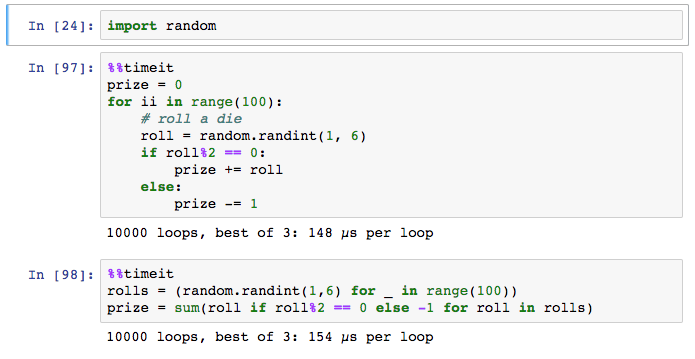
A screenshot displaying how to use the `%%timeit` for a whole cell - this can be included multiple code lines to get the time for the whole code cell

### Embedding visualizations in notebooks

As mentioned before, notebooks let you embed images along with text and code. This is most useful when you’re using matplotlib or other plotting packages to create visualizations. You can use %matplotlib to set up matplotlib for interactive use in the notebook. By default, figures will render in their own window. However, you can pass arguments to the command to select a specific "backend", the software that renders the image. To render figures directly in the notebook, you should use the inline backend with the command %matplotlib inline.

**Tip:** On higher resolution screens such as Retina displays, the default images in notebooks can look blurry. Use %config InlineBackend.figure_format = 'retina' after %matplotlib inline to render higher resolution images.

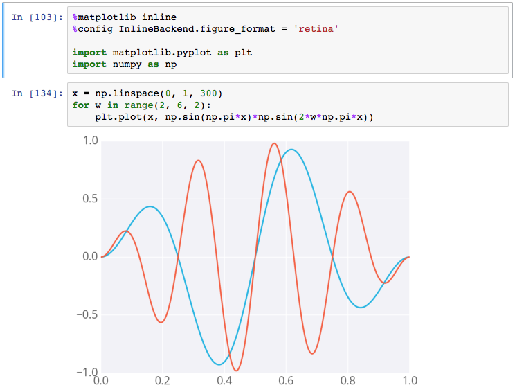
An example figure generated in a notebook, using the code from the text above with a basic plot.

### Debugging in the Notebook

With the Python kernel, you can turn on the interactive debugger using the magic command %pdb. When you cause an error, you'll be able to inspect the variables in the current namespace.

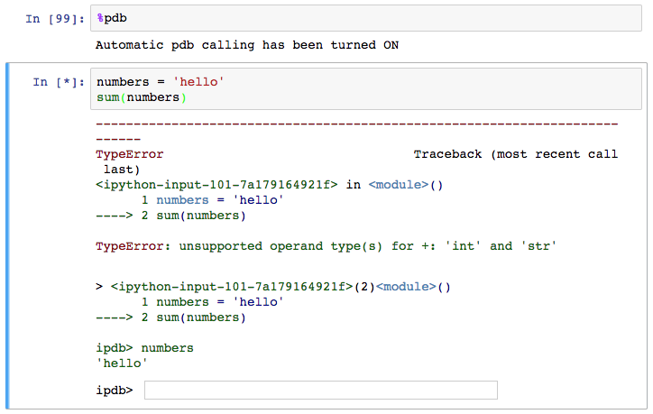
A screenshot displaying how to debug a notebook. You can use `%pdb` with some broken code to debug directly in the cell output.

Above you can see I tried to sum up a string which gives an error. The debugger raises the error and provides a prompt for inspecting your code.

Read more about pdb in the documentation. To quit the debugger, simply enter q in the prompt.

## Converting Notebooks

Notebooks are just big JSON files with the extension `.ipynb`.

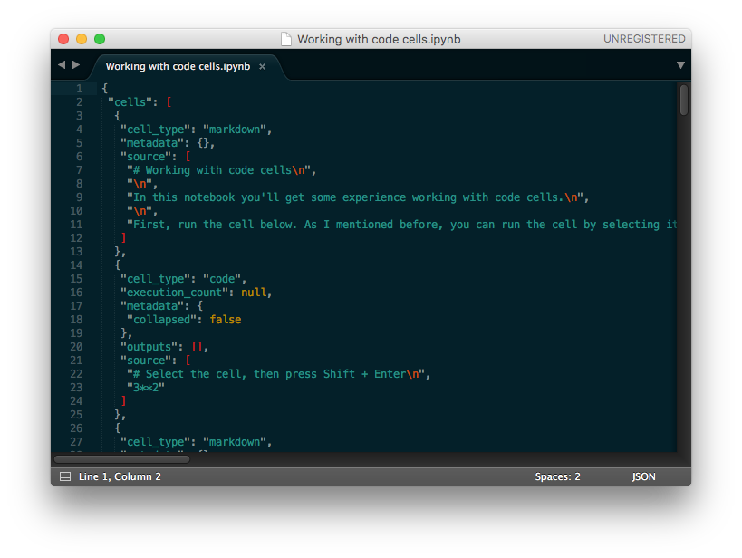
A screenshot displaying a Notebook file opened in a text editor. The Notebook file content will show as JSON data.

Since notebooks are JSON, it is simple to convert them to other formats. Jupyter comes with a utility called nbconvert for converting to HTML, Markdown, slideshows, etc. The general syntax to convert a given mynotebook.ipynb file to another FORMAT is:

> jupyter nbconvert --to FORMAT mynotebook.ipynb

The currently supported output FORMAT could be either of the following (ignore case): HTML, LaTeX, PDF, WebPDF, Reveal.js HTML slideshow, Markdown, Ascii, reStructuredText, executable script, notebook.
For example, to convert a notebook to an HTML file, in your terminal use

```cmd
# Install the package below, if not already
pip install nbconvert
jupyter nbconvert --to html mynotebook.ipynb
```

Note - If you wish to install any package in conda that is not available in Anaconda distribution, such as the Airbase package, use pip install airbase, instead of conda install airbase.

Converting to HTML is useful for sharing your notebooks with others who aren't using notebooks. Markdown is great for including a notebook in blogs and other text editors that accept Markdown formatting.

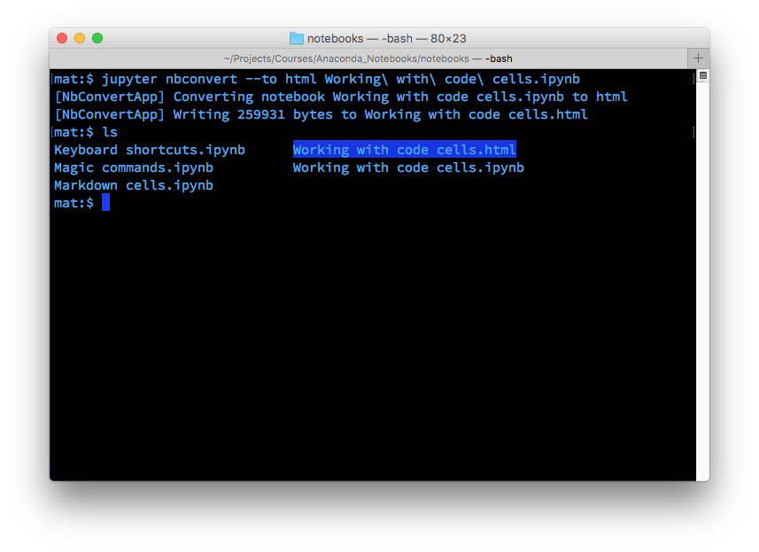
A screenshot displaying the command to convert Notebook (.ipynb) to HTML

## Creating a Slideshow

Creating slideshows from notebooks is one of my favorite features. The slides are created in notebooks like normal, but you'll need to designate which cells are slides and the type of slide the cell will be. In the menu bar, click View > Cell Toolbar > Slideshow to bring up the slide cell menu on each cell.

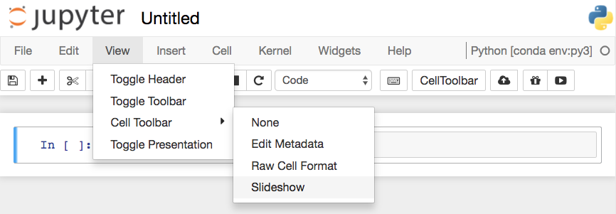
A screenshot displaying how to turn on the Slideshow toolbars for cells.

This will show a menu dropdown on each cell that lets you choose how the cell shows up in the slideshow.

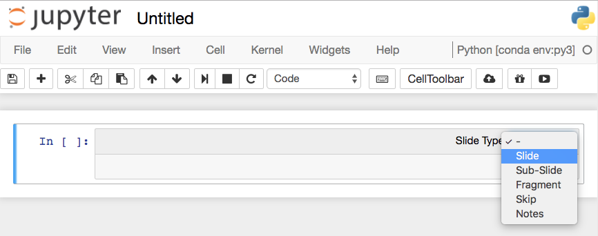
A screenshot displaying the slide type you must choose. For Slideshow, you must choose the Slide option.

Slides are full slides that you move through left to right. Sub-slides show up in the slideshow by pressing up or down. Fragments are hidden at first, then appear with a button press. You can skip cells in the slideshow with Skip and Notes leaves the cell as speaker notes.

### Running the slideshow

To create the slideshow from the notebook file, you'll need to use nbconvert:

> jupyter nbconvert notebook.ipynb --to slides

This just converts the notebook to the necessary files for the slideshow, but you need to serve it with an HTTP server to actually see the presentation.

To convert it and immediately see it, use

> jupyter nbconvert notebook.ipynb --to slides --post serve

This will open up the slideshow in your browser so you can present it.

## Jupyter Workspace - Overview

### Introduction to Jupyter Workspace

In this program, you will get Jupyter Workspaces in your classroom, so you don't need to install Jupyter or Anaconda on your local computer.

Each Workspace is a Linux container with sufficient computing resources. You will get the necessary Python environment and packages to execute the exercises and the project.

Workspaces are best supported on Google Chrome and might not load correctly on other browsers. Below is a screenshot of a Jupyter Workspace.

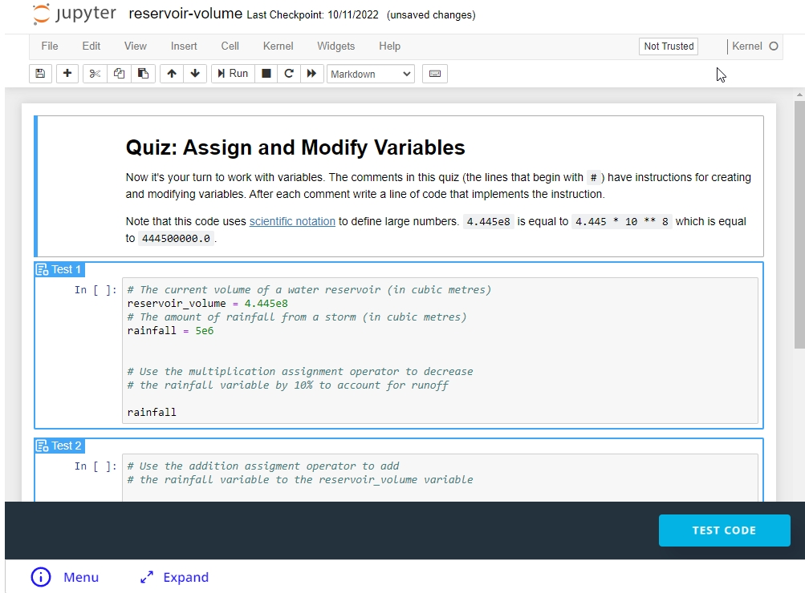
Screenshot of a Jupyter Workspace

### Working within the Workspace

- File Editing - You can work on the existing files or add new files as necessary for the exercise you are working on. Make sure to save your work periodically.
- Upload, Download, Delete files - You can upload, download, or delete files as necessary. If something goes wrong, you can restore a backup or reset the entire Workspace to its original state. For more about the options, see the Troubleshooting section below.
- Saving additional files - Store all your files in the /workspace directory so you can still access them after a Refresh. Any file stored outside of the /workspace directory will be deleted after rebooting!
- Saving large files - Do not store large files inside the /workspace directory. Otherwise, it will hang your Workspace the next time you visit. Keep the total contents of the /workspace directory to 3GiB or less, and do not store any individual files larger than 1.5GB. You can store logs or checkpoint files in /opt directory. However, /opt directory will also be deleted after you leave the workspace page.

### Troubleshoot - Restore, Reset, and Refresh

1. Refresh: If you have any difficulties with your Workspace, try Refresh Workspace from the bottom left Menu option. It will shut down the current workspace container, provision a new one, and copy all your workspace files to the new VM.

2. Reset / Get New Content: You can also reset your Workspace to its original state. You would want to choose this option if:

    - You want to reset everything in the Workspace back to the original state.
    - Udacity updates the starter files in the interim. Look for the little red indicator next to the Menu in the lower-left corner. A red dot will indicate new content available for you to download. You will lose your progress if you Reset the Workspace.
    - Sometimes, we share a workspace across multiple pages. In such a case, resetting will reset the Workspace on other pages within the same lesson.

    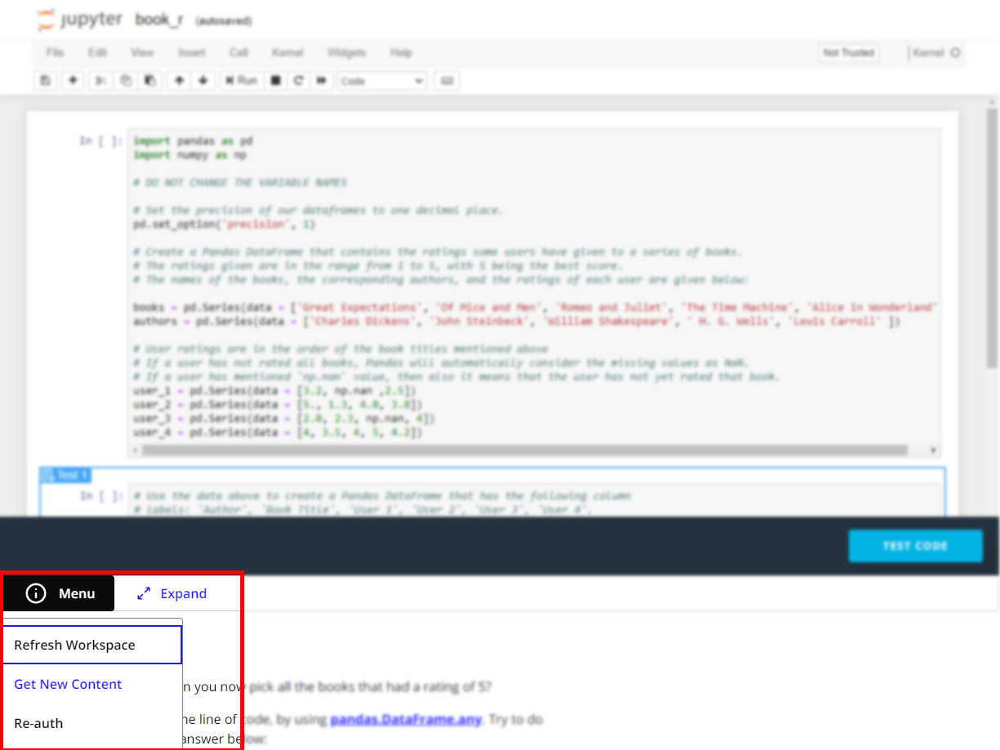
    Image that shows the Menu for the Jupyter notebook

3. Automated Backups: We shut down the VM behind the Workspace and instantiate a new VM on the following events:

   - Session expiry: The student leaves the Workspace for about half an hour and then re-visits the classroom page.
   - Explicit Refresh: Only the /workspace is preserved.
   - Reset: Resets everything back to the original state.
   - Toggle GPU: Students toggle the GPU button (if available).

   In all the events mentioned above, except the "Reset Workspace" event, we shut down the VM behind the Workspace and back up all the contents of the /workspace directory. This backup is restored automatically to the new VM for you. We do not create a new backup when the user selects "Reset Workspace", so the contents of the /workspace directory are lost, and a new machine is provisioned with only the original starter files.

4. Restore a Backup: We do not back up any directory other than the /workspace/. You can restore a backup manually, if needed, from the bottom left Menu. It will download the files to the /home/backups/ directory, where you can copy the desired files to the /workspace directory.

5. GPU Limits: You will get a fixed amount of GPU hours if your Workspace has a GPU feature. A Workspace will have a GPU feature only if the associated exercise/project requires it. Please be mindful of using GPU hours. Remember to turn off your GPU once you finish your exercise or the project since you will only get 100 hours of GPU time for the entire program. To disable the GPU, click Disable at the bottom of the Workspace. It will also show you the remaining hours.

Note that disabling the GPU will trigger a backup, then restore it to a new VM that doesn't have a GPU. The backup process will preserve the files in the /workspace directory only.
