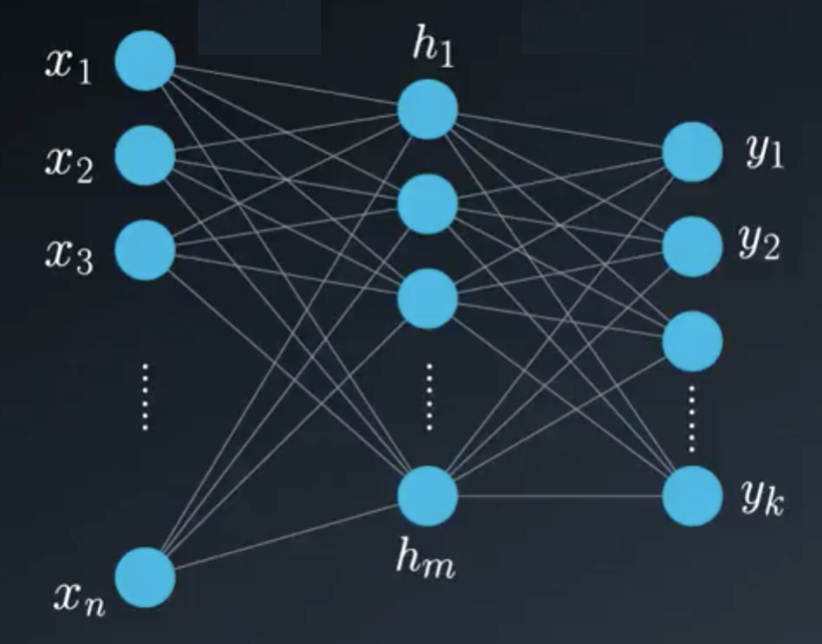

### Why Linear Algebra is the Engine of Neural Networks 🧠

Linear Algebra provides the mathematical foundation for machine learning. While its applications are vast, its role in **Neural Networks** is particularly fundamental. It's the framework used to define and compute the transformations that turn input data into meaningful predictions.

This guide details the specific linear algebra operations at the heart of a neural network's forward pass. We'll move from high-level matrix equations to the underlying summations and dot products to give you a complete picture.

### A Mathematical View of a Neural Network

An **Artificial Neural Network** is a computational graph designed to approximate complex functions. It's composed of layers of "neurons," which are mathematical functions that process numerical information.

Each layer can be represented as a **vector**, and the connections between layers are represented by a **weight matrix**.
* **Input Vector ($\vec{x}$):** A vector of size $1 \times n$, where $n$ is the number of input features.
    $$\vec{x} = \begin{bmatrix} x_1 & x_2 & \dots & x_n \end{bmatrix}$$
* **Hidden Layer Vector ($\vec{h}$):** A vector of size $1 \times m$, where $m$ is the number of neurons in the hidden layer.
* **Output Layer Vector ($\vec{y}$):** A vector of size $1 \times k$, where $k$ is the number of output classes or values.

The core task of the network is to compute a series of transformations that map the input vector $\vec{x}$ to the output vector $\vec{y}$.

---

### The Core Operation: The Affine Transformation

Moving data from one layer to the next involves an **affine transformation**. This is a two-step process for each neuron:

1.  **Linear Combination:** A weighted sum of all inputs from the previous layer is calculated. This is a **dot product**.
2.  **Offset Addition:** A **bias** term is added to this sum. This allows the network to shift the output up or down, increasing its flexibility.

This entire process for all neurons in a layer is calculated efficiently using a single matrix-vector multiplication followed by a vector addition. The result is then passed through a non-linear **activation function**.

The complete equation to get from a layer vector $\vec{v}_{in}$ to the next layer vector $\vec{v}_{out}$ is:
$$\vec{v}_{out} = \Phi(\vec{v}_{in}W + \vec{b})$$
Where:
* $W$ is the **weight matrix**.
* $\vec{b}$ is the **bias vector**.
* $\Phi$ is the element-wise **activation function**.

---

### The Feedforward Process: A Detailed Walkthrough

Let's break down the math for a network with one hidden layer.

#### Step 1: Input Layer ➡️ Hidden Layer

The hidden vector $\vec{h}$ is computed from the input vector $\vec{x}$, the first weight matrix $W^{(1)}$, and the first bias vector $\vec{b}^{(1)}$.

The high-level matrix equation is:
$$\vec{h} = \Phi(\vec{x}W^{(1)} + \vec{b}^{(1)})$$

Let's look at the calculation for a **single neuron**, $h_j$, in the hidden layer. Its value is the weighted sum of all $n$ inputs from $\vec{x}$, plus its specific bias $b_j$, all passed through the activation function.

This is a **linear combination**:
$$h_j = \Phi\left( (x_1w_{1j}^{(1)} + x_2w_{2j}^{(1)} + \dots + x_nw_{nj}^{(1)}) + b_j^{(1)} \right)$$

We can write this more compactly using summation notation:
$$h_j = \Phi\left( \left( \sum_{i=1}^{n} x_i w_{ij}^{(1)} \right) + b_j^{(1)} \right)$$

The matrix multiplication $\vec{x}W^{(1)}$ is simply an efficient way to compute the sum $\sum_{i=1}^{n} x_i w_{ij}^{(1)}$ for all hidden neurons $j=1, \dots, m$ simultaneously.

#### Step 2: Hidden Layer ➡️ Output Layer

The process repeats exactly to calculate the final output vector $\vec{y}$. The newly computed hidden vector $\vec{h}$ now serves as the input, which is multiplied by the second weight matrix $W^{(2)}$ and added to the second bias vector $\vec{b}^{(2)}$.

The matrix equation is:
$$\vec{y} = \Phi(\vec{h}W^{(2)} + \vec{b}^{(2)})$$

Again, let's break this down for a **single output neuron**, $y_k$. Its value is the weighted sum of all $m$ inputs from the hidden layer vector $\vec{h}$, plus its bias $b_k$.

$$y_k = \Phi\left( (h_1w_{1k}^{(2)} + h_2w_{2k}^{(2)} + \dots + h_mw_{mk}^{(2)}) + b_k^{(2)} \right)$$

In summation notation:
$$y_k = \Phi\left( \left( \sum_{j=1}^{m} h_j w_{jk}^{(2)} \right) + b_k^{(2)} \right)$$

### Conclusion: A Chain of Transformations

A neural network's feedforward pass is a sequence of affine transformations followed by non-linear activations. Each step is a direct application of core linear algebra concepts: vectors represent the state of each layer, and matrices represent the learned transformations between them. The process of **training** a network is simply the search for the optimal values in these weight matrices and bias vectors that best map inputs to desired outputs.
