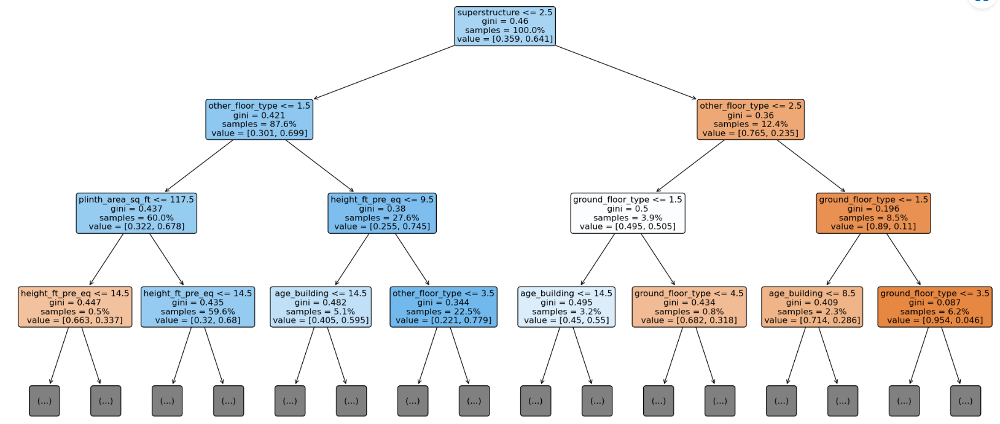
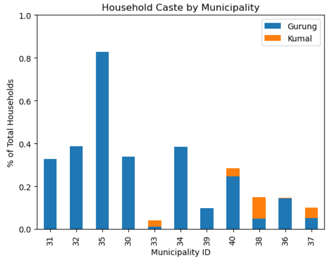

# Earthquakes in Nepal

## sqlite

```py
%load_ext sql # load ipython sql
%sql sqlite:////home/jovyan/nepal.sqlite # connect to database
```

```sql
SELECT *
FROM sqlite_schema
-- Select the name column from the sqlite_schema table, showing only rows where the type is "table".
SELECT name
FROM sqlite_schema
WHERE type = "table"
-- How is the data organized? What type of observation does each row represent? How do you think the household_id, building_id, vdcmun_id, and district_id columns are related to each other?
SELECT *
FROM id_map
LIMIT 5
-- How many observations are in the id_map table?
SELECT count(*)
FROM id_map
-- How many buildings are there in id_map table? Combine the count and distinct commands to calculate the number of unique values in building_id.
SELECT count(distinct(building_id))
FROM id_map
-- How many buildings in the id_map table are in Gorkha? Combine the count and distinct commands to calculate the number of unique values in building_id, considering only rows where the district_id is 4.
SELECT COUNT(distinct(building_id)) as count
FROM id_map
WHERE district_id = 4
-- How many building are there in the building_structure table?
SELECT count(*)
FROM building_structure
-- There are over 200,000 buildings in the building_structure table, but how can we retrieve only buildings that are in Gorkha? 
-- Use the JOIN command to join the id_map and building_structure tables, showing only buildings where district_id is 4 and limiting your results to the first five rows of the new table. 
-- Use the distinct command to create a column with all unique building IDs in the id_map table. 
-- JOIN this column with all the columns from the building_structure table, showing only buildings where district_id is 4 and limiting your results to the first five rows of the new table.
-- include the damage_grade column to your table by adding a second JOIN for the building_damage table. 
SELECT distinct(i.building_id),
    s.*,
    d.damage_grade
FROM id_map AS i
JOIN building_structure AS s ON i.building_id = s.building_id
JOIN building_damage AS d ON i.building_id = d.building_id
WHERE district_id = 4
-- Use the connect method from the sqlite3 library to connect to the database. Remember that the database is located at "/home/jovyan/nepal.sqlite".
conn = sqlite3.connect("/home/jovyan/nepal.sqlite")
```

## Predicting Damage with Logistic Regression

### Importing

```py
import sqlite3
import warnings

import matplotlib.pyplot as plt
import numpy as np
import pandas as pd
import seaborn as sns
from category_encoders import OneHotEncoder
from IPython.display import VimeoVideo
from sklearn.linear_model import LogisticRegression
from sklearn.metrics import accuracy_score
from sklearn.model_selection import train_test_split
from sklearn.pipeline import Pipeline, make_pipeline
from sklearn.utils.validation import check_is_fitted

warnings.simplefilter(action="ignore", category=FutureWarning)
```

### Wrangle and Explore

```py
def wrangle(db_path):
    # Connect to database
    conn = sqlite3.connect(db_path)

    # Construct query
    query = """
        SELECT distinct(i.building_id) AS b_id,
           s.*,
           d.damage_grade
        FROM id_map AS i
        JOIN building_structure AS s ON i.building_id = s.building_id
        JOIN building_damage AS d ON i.building_id = d.building_id
        WHERE district_id = 4
    """

    # Read query results into DataFrame
    df = pd.read_sql(query, conn, index_col="b_id")
    
    # Defining severe damage
    df["damage_grade"] = df["damage_grade"].str[-1].astype(int)
    df["severe_damage"] = (df["damage_grade"]>3).astype(int) # 0 for damage_grade 1, 2 and 3 & 1 for 4 and 5.
    
    # Drop Leaky features
    drop_cols = [col for col in df.columns if "post_eq" in col]
    drop_cols.append("damage_grade") # not needed now
    drop_cols.append("count_floors_pre_eq") # droppee due to multicollinearlity
    drop_cols.append("building_id") # high-cardinality / redundant column
    df.drop(columns=drop_cols, inplace = True)

    return df

df = wrangle("/home/jovyan/nepal.sqlite")
```

`print(df.info())`
Finding leaky features and drop them.

We want to build a binary classification model, but our current target "damage_grade" has more than two categories.

`print(df["severe_damage"].value_counts())`
Add to your wrangle function so that it creates a new target column "severe_damage". For buildings where the "damage_grade" is Grade 4 or above, "severe_damage" should be 1. For all other buildings, "severe_damage" should be 0. Don't forget to drop "damage_grade" to avoid leakage, and rerun all the cells above.

```py
# Create correlation matrix
correlation = df.select_dtypes("number").drop(columns="severe_damage").corr() # since it is good if there is a correlation with target that is severe_damage
# Plot heatmap of `correlation`
sns.heatmap(correlation)
```

`count_floor_pre_eq` and `height_ft_pre_eq` have **high correlation** so we need to drop one of them. To decide we check their correlation with our target and dropped the one which has **less correlation**.
Before we build our model, let's see if we can identify any obvious differences between houses that were severely damaged in the earthquake (`"severe_damage"==1`) those that were not (`"severe_damage"==0`). Let's start with a numerical feature.

```py
# Create boxplot
sns.boxplot(x="severe_damage", y = "height_ft_pre_eq", data=df)
# Label axes
plt.xlabel("Severe Damage")
plt.ylabel("Height Pre-earthquake [ft.]")
plt.title("Distribution of Building Height by Class");
```

Both type of building are showing similar distribution with outliers. It would be better if we see a significant change, but now we know how to compare categorical data.
Before we move on to the many categorical features in this dataset, it's a good idea to see the balance between our two classes. What percentage were severely damaged, what percentage were not?

```py
# Plot value counts of `"severe_damage"`
df["severe_damage"].value_counts(normalize=True).plot(
     kind = "bar", xlabel = "Class", ylabel = "Relative Frequency", title = "Class Balance"
)
```

1  ->  0.642597 % (positive class)
0  ->  0.357403 % (negative class)
it is ok and not too unbalanced. Notice here our positive class is the majority class.

```py
# Create two variables, majority_class_prop and minority_class_prop, to store the normalized value counts for the two classes in df["severe_damage"].
majority_class_prop, minority_class_prop = df["severe_damage"].value_counts(normalize=True) # unpacking
print(majority_class_prop, minority_class_prop)
# 0.6425969845841097    0.3574030154158902
```

Are buildings with certain foundation types more likely to suffer severe damage?

```py
# Create a pivot table of df where the index is "foundation_type" and the values come from the "severe_damage" column, aggregated by the mean.
# Create pivot table
foundation_pivot = pd.pivot_table(
    df, index="foundation_type", values="severe_damage", aggfunc=np.mean
).sort_values(by="severe_damage")
foundation_pivot
```

How do the proportions in foundation_pivot compare to the proportions for our majority and minority classes? Plot foundation_pivot as horizontal bar chart, adding vertical lines at the values for majority_class_prop and minority_class_prop.

```py
# Plot bar chart of `foundation_pivot`
foundation_pivot.plot(kind="barh", legend =None)
plt.axvline(
    majority_class_prop, linestyle="--", color="red", label="majority class"
)
plt.axvline(
    minority_class_prop, linestyle="--", color="green", label="minority class"
)
plt.legend(loc="lower right");
```

RC is the least probable `foundation_type` to face severe damage during an earthquake next is cement-Stone/Brick.

```py
# Check for high- and low-cardinality categorical features
df.select_dtypes("object").nunique()
```

no such feature found. but if you notice then the buiding_id is in itself a categorial variable though it is of integer data type so we need to drop it.

### Model

```py
target = "severe_damage"
X = df.drop(columns=target)
y = df[target]

X_train, X_test, y_train, y_test = train_test_split(
    X, y, test_size=0.2, random_state=42
)

acc_baseline = y_train.value_counts(normalize=True).max() 
# best guess would be the observation with the most number of observation
print("Baseline Accuracy:", round(acc_baseline, 2))
# Baseline Accuracy: 0.64

# Build model
model = make_pipeline(
    OneHotEncoder(use_cat_names= True),
    LogisticRegression(max_iter=1000) # ConvergenceWarning: TOTAL NO. of ITERATIONS REACHED LIMIT.
)
# Fit model to training data
model.fit(X_train,y_train)
```

### Evaluate

```py
acc_train = accuracy_score(y_train, model.predict(X_train)) # OR 
acc_test = model.score(X_test, y_test)
​
print("Training Accuracy:", round(acc_train, 2))
print("Test Accuracy:", round(acc_test, 2))
# Training Accuracy: 0.71
# Test Accuracy: 0.72
```

### Communicate

An **odds ratio (OR)** is a measure used in statistics to quantify the strength of the association between two events, typically in the context of binary outcomes. It compares the odds of an event occurring in one group to the odds of it occurring in another group.

- **Odds**: The odds of an event are the ratio of the probability of the event happening to the probability of it not happening. For example, if the probability of success is 0.75, the odds are 0.75 / (1 - 0.75) = 3.
  
- **Odds Ratio**: If you have two groups, say Group A and Group B, the odds ratio compares the odds of an event occurring in Group A to the odds of it occurring in Group B. It is calculated as:
  
  \[
  \text{Odds Ratio (OR)} = \frac{\text{Odds of Event in Group A}}{\text{Odds of Event in Group B}}
  \]

**Interpretation:**

- **OR > 1**: The event is more likely to occur in Group A than in Group B.
- **OR = 1**: The event is equally likely in both groups.
- **OR < 1**: The event is less likely to occur in Group A than in Group B.

**Example in Logistic Regression:**
In the context of logistic regression, which is often used for binary classification, the coefficients (or weights) associated with each feature represent the log of the odds. By exponentiating these coefficients (`np.exp(coefficient)`), you obtain the odds ratios for each feature.

- **Odds Ratio > 1**: The feature increases the odds of the positive outcome.
- **Odds Ratio < 1**: The feature decreases the odds of the positive outcome.
- **Odds Ratio = 1**: The feature has no effect on the odds of the outcome.

This makes the odds ratio a useful measure for understanding the impact of individual features on the probability of a particular outcome in models like logistic regression.

```py
y_train_pred_proba = model.predict_proba(X_train)
print(y_train_pred_proba[:5]) 
# prints probability estimates for the classes while model.predict(X_train would just give the predictions whichever probability is the highest)

features = model.named_steps["onehotencoder"].get_feature_names()
importances = model.named_steps["logisticregression"].coef_[0]
odds_ratios = pd.Series(np.exp(importances), index = features).sort_values() # calculating and sorting the odds ratios based on the feature importances in a logistic regression model
# applies the exponential function to each coefficient, transforming the log-odds into odds ratios.
odds_ratios.head()

# Horizontal bar chart, five largest coefficients
odds_ratios.tail().plot(kind="barh")
plt.xlabel("Odd Ratio");
```

What we can conclude is that, superstructure_Stone are the ones who are almost 4 times more proabable to get severely damage i.e., damage of grade 4 or 5 during an earthquake.

```py
# Horizontal bar chart, five smallest coefficients
odds_ratios.head().plot(kind="barh")
plt.xlabel("Odd Ratio");
```

we can see that RC (reinforced concrete) are the ones most likely to be less affected to severe damage, and having RC in different parts of building structure greatly reduce of likelihood to be severely damaged in an earthquake.

## Predicting Damage with Decision Trees

### Import

```py
import sqlite3
import warnings

import matplotlib.pyplot as plt
import pandas as pd
from category_encoders import OrdinalEncoder
from IPython.display import VimeoVideo
from sklearn.metrics import accuracy_score
from sklearn.model_selection import train_test_split
from sklearn.pipeline import Pipeline, make_pipeline
from sklearn.tree import DecisionTreeClassifier, plot_tree
from sklearn.utils.validation import check_is_fitted

warnings.simplefilter(action="ignore", category=FutureWarning)
```

### Prepare data

```py
def wrangle(db_path):
    # Connect to database
    conn = sqlite3.connect(db_path)

    # Construct query
    query = """
        SELECT distinct(i.building_id) AS b_id,
           s.*,
           d.damage_grade
        FROM id_map AS i
        JOIN building_structure AS s ON i.building_id = s.building_id
        JOIN building_damage AS d ON i.building_id = d.building_id
        WHERE district_id = 4
    """

    # Read query results into DataFrame
    df = pd.read_sql(query, conn, index_col="b_id")

    # Identify leaky columns
    drop_cols = [col for col in df.columns if "post_eq" in col]

    # Add high-cardinality / redundant column
    drop_cols.append("building_id")

    # Create binary target column
    df["damage_grade"] = df["damage_grade"].str[-1].astype(int)
    df["severe_damage"] = (df["damage_grade"] > 3).astype(int)

    # Drop old target
    drop_cols.append("damage_grade")

    # Drop multicollinearity column
    drop_cols.append("count_floors_pre_eq")

    # Drop columns
    df.drop(columns=drop_cols, inplace=True)

    return df

df = wrangle("/home/jovyan/nepal.sqlite")
```

### DT Model

```py
target = "severe_damage"
X = df.drop(columns=target)
y = df[target]

# Divide your data (X and y) into training and test sets using a randomized train-test split. Your test set should be 20% of your total data. And don't forget to set a random_state for reproducibility.
X_train, X_test, y_train, y_test = train_test_split(X, y, test_size=0.2,random_state=42)
# Divide your training data (X_train and y_train) into training and validation sets using a randomized train-test split. Your validation data should be 20% of the remaining data. Don't forget to set a random_state.
X_train, X_val, y_train, y_val = train_test_split(X_train, y_train, test_size=0.2,random_state=42)

# Baseline
acc_baseline = y_train.value_counts(normalize=True).max()
print("Baseline Accuracy:", round(acc_baseline, 2))
# Baseline Accuracy: 0.64

model = make_pipeline(
    OrdinalEncoder( ),
    DecisionTreeClassifier(max_depth=6, random_state=42)
)
# Fit model to training data
model.fit(X_train,y_train)

acc_train = accuracy_score(y_train, model.predict(X_train)) # OR 
acc_val = model.score(X_val, y_val)
​
print("Training Accuracy:", round(acc_train, 2))
print("Validation Accuracy:", round(acc_val, 2))
# Training Accuracy: 0.72
# Validation Accuracy: 0.72
```

model isn't generalising, training accuracy is good but validation accuracy is poor. We have to try some hyperparameter tuning.

`tree_depth = model.named_steps["decisiontreeclassifier"].get_depth()`
`print("Tree Depth:", tree_depth)`
>Tree Depth: 49

The depth of a decision tree is a crucial factor in determining the model's performance, particularly in relation to overfitting.

**Decision Tree Depth:**

- **Tree Depth** refers to the length of the longest path from the root node to a leaf node.
- A **shallow tree** has a small depth, which means fewer splits and simpler decision rules.
- A **deep tree** has a large depth, leading to more splits and more complex decision rules.

**Overfitting Problem:**

Overfitting occurs when a model learns not only the underlying patterns in the training data but also the noise and random fluctuations. This leads to a model that performs well on the training data but poorly on unseen test data.

**How Tree Depth Relates to Overfitting:**

- **Deep Trees:**
  - A deep decision tree can capture intricate patterns in the data, potentially leading to a model that fits the training data very well.
  - However, this also means the tree might learn the noise in the training data, making it less generalizable to new data.
  - **Result**: High variance, overfitting, poor performance on test data.

- **Shallow Trees:**
  - A shallow tree is less flexible and may not capture all the nuances of the training data.
  - This can lead to underfitting, where the model is too simple and does not capture the true underlying patterns.
  - **Result**: High bias, underfitting, poor performance on both training and test data.

**Finding the Optimal Depth:**

- **Cross-Validation**: One common technique to find the optimal tree depth is cross-validation. By evaluating the performance of trees with different depths on a validation set, you can select the depth that provides the best balance between bias and variance.
  
- **Pruning**: Another approach is to allow the tree to grow to its full depth and then prune it back. Pruning removes branches that have little importance and reduces the risk of overfitting.

**Best Practices:**

- **Set a Maximum Depth**: In practice, it's common to set a maximum depth for the tree to prevent it from growing too complex and overfitting the data.
- **Monitor Performance**: Regularly monitor the performance of your model on validation data as you adjust the depth, aiming for the depth that minimizes the error on unseen data.

```py
# Create a range of possible values for max_depth hyperparameter of your model's DecisionTreeClassifier.
depth_hyperparams = range(1,50,2)

# Create empty lists for training and validation accuracy scores
training_acc = []
validation_acc = []
​
for d in depth_hyperparams:
    # Create model with `max_depth` of `d`
    test_model = make_pipeline(
    OrdinalEncoder( ),
    DecisionTreeClassifier(max_depth = d, random_state=42)
)
    # Fit model to training data
    test_model.fit(X_train, y_train)
    # Calculate training accuracy score and append to `training_acc`
    training_acc.append(test_model.score(X_train,y_train))
    # Calculate validation accuracy score and append to `training_acc`
    validation_acc.append(test_model.score(X_val,y_val))
​
print("Training Accuracy Scores:", training_acc[:3])
print("Validation Accuracy Scores:", validation_acc[:3])
# Training Accuracy Scores: [0.7071072484228174, 0.7117395332421582, 0.7162394670666608]
# Validation Accuracy Scores: [0.7088406564319746, 0.7132521616375508, 0.7166049055937886]

# Create a visualization with two lines. The first line should plot the training_acc values as a function of depth_hyperparams, and the second should plot validation_acc as a function of depth_hyperparams.
# Plot `depth_hyperparams`, `training_acc`
plt.plot(depth_hyperparams, training_acc, label="training")
plt.plot(depth_hyperparams, validation_acc, label="validation")
plt.xlabel("Max Depth")
plt.ylabel("Accuracy Score")
plt.legend();
```


as max depth or flexibility increases the accuracy of model increases for training data, while for validation data it start degrading after increasing till 6.

Based on your visualization, choose the max_depth value that leads to the best validation accuracy score. Then retrain your original model with that max_depth value. Lastly, check how your tuned model performs on your test set by calculating the test accuracy score below.

`test_acc = model.score(X_test,y_test)`
`print("Test Accuracy:", round(test_acc, 2))`
> Test Accuracy: 0.72

### Communicate Results

```py
# plot_tree function from scikit-learn to visualize the decision logic of your model
# Create larger figure
fig, ax = plt.subplots(figsize=(25, 12))
# Plot tree
plot_tree(
    decision_tree=model.named_steps["decisiontreeclassifier"],
    feature_names=list(X_train.columns),
    filled=True,  # Color leaf with class
    rounded=True,  # Round leaf edges
    proportion=True,  # Display proportion of classes in leaf
    max_depth=3,  # Only display first 3 levels
    fontsize=12,  # Enlarge font
    ax=ax,  # Place in figure axis
);
```



```py
# Assign the feature names and importances of your model to the variables below. For the features, you can get them from the column names in your training set. For the importances, you access the feature_importances_ attribute of your model's DecisionTreeClassifier.
features = X_train.columns
importances = model.named_steps["decisiontreeclassifier"].feature_importances_
​
print("Features:", features[:3])
print("Importances:", importances[:3])
Features: Index(['age_building', 'plinth_area_sq_ft', 'height_ft_pre_eq'], dtype='object')
Importances: [0.03515085 0.04618639 0.08839161]

# Create a pandas Series named feat_imp, where the index is features and the values are your importances. The Series should be sorted from smallest to largest importance.
feat_imp = pd.Series(importances, index = features).sort_values()

# Create a horizontal bar chart with all the features in feat_imp.
# Create horizontal bar chart
feat_imp.plot(kind="barh")
plt.xlabel("Gini Importance")
plt.ylabel("Feature");
```

## Data Ethics

### Import and wrangle

```py
import sqlite3
import warnings

import matplotlib.pyplot as plt
import numpy as np
import pandas as pd
from category_encoders import OneHotEncoder
from IPython.display import VimeoVideo
from sklearn.linear_model import LogisticRegression
from sklearn.metrics import accuracy_score
from sklearn.model_selection import train_test_split
from sklearn.pipeline import Pipeline, make_pipeline
from sklearn.utils.validation import check_is_fitted

warnings.simplefilter(action="ignore", category=FutureWarning)
```

```py
def wrangle(db_path):
    # Connect to database
    conn = sqlite3.connect(db_path)

    # Construct query
    query = '''
    SELECT h.*,
        i.vdcmun_id,
        s.*,
        d.damage_grade
    FROM household_demographics AS h
    JOIN id_map AS i ON i.household_id = h.household_id
    JOIN building_structure AS s ON i.building_id = s.building_id
    JOIN building_damage AS d ON i.building_id = d.building_id
    WHERE district_id = 4
    '''

    # Read query results into DataFrame
    df = pd.read_sql(query, conn, index_col="household_id")

    # Identify leaky columns
    drop_cols = [col for col in df.columns if "post_eq" in col]

    # Add high-cardinality / redundant column
    drop_cols.append("building_id")

    # Create binary target column
    df["damage_grade"] = df["damage_grade"].str[-1].astype(int)
    df["severe_damage"] = (df["damage_grade"] > 3).astype(int)

    # Drop old target
    drop_cols.append("damage_grade")

    # Drop multicollinearity column
    drop_cols.append("count_floors_pre_eq")
    
    # Group Caste columns
    top_10 = df["caste_household"].value_counts().head(10).index
    df["caste_household"] = df["caste_household"].apply(lambda c: c if c in top_10 else "Other")
    
    # Drop columns
    df.drop(columns=drop_cols, inplace=True)

    return df

df = wrangle("/home/jovyan/nepal.sqlite")
```

Check for high- and low-cardinality categorical features
`df.select_dtypes("object").nunique()`
caste_household can be a candidate for data cleaning

`df["caste_household"].nunique()`
> 63

`df["caste_household"].value_counts().head(10)`
`df["caste_household"].value_counts().tail(20)`

We can create classify all these caste_households as others to simplify the model since they are present in very less amount

Add to your wrangle function so that the "caste_household" contains only the 10 largest caste groups. For the rows that are not in those groups, "caste_household" should be changed to "Other".

### MODEL

```py
target = "severe_damage"
X = df.drop(columns= [target, "vdcmun_id"]) # since "vdcmun_id" is also unique and hence not useful in our model but will be used in the communication phase
y = df[target]

X_train, X_test, y_train, y_test = train_test_split(X, y, test_size=0.2,random_state=42)

acc_baseline = y_train.value_counts(normalize=True).max()
print("Baseline Accuracy:", round(acc_baseline, 2))
# Baseline Accuracy: 0.63

model_lr = make_pipeline(
    OneHotEncoder(use_cat_names= True),
    LogisticRegression(max_iter=3000)
)
# Fit model to training data
model_lr.fit(X_train,y_train)

acc_train = accuracy_score(y_train, model_lr.predict(X_train)) # OR 
acc_test = model_lr.score(X_test, y_test)
​
print("LR Training Accuracy:", acc_train)
print("LR Validation Accuracy:", acc_test)
# LR Training Accuracy: 0.7178367871380095
# LR Validation Accuracy: 0.7229360216116492
```

### Communicate results

```py
features = model_lr.named_steps["onehotencoder"].get_feature_names()
importances = model_lr.named_steps["logisticregression"].coef_[0]
feat_imp = pd.Series(np.exp(importances), index = features).sort_values()

# Create a horizontal bar chart with the ten largest coefficients from feat_imp
feat_imp.tail(10).plot(kind="barh")
plt.xlabel("Odds Ratio");

# caste_gurung has somehow showing around 25% more chances of severe damage during earthquake

# Create a horizontal bar chart with the ten smallest coefficients from feat_imp.
feat_imp.head(10).plot(kind="barh")
plt.xlabel("Odd Ratio");

# caste_kumal has somehow around 50% reduction in severe damage during earthquake
```

Which municipalities saw the highest proportion of severely damaged buildings? Create a DataFrame damage_by_vdcmun by grouping df by "vdcmun_id" and then calculating the mean of the "severe_damage" column.

```py
damage_by_vdcmun = (
    df.groupby("vdcmun_id")["severe_damage"].mean().sort_values(ascending=False)
).to_frame()
```

Create a line plot of damage_by_vdcmun. Label your x-axis "Municipality ID", your y-axis "% of Total Households", and give your plot the title "Household Damage by Municipality".

```py
# Plot line
# damage_by_vdcmun.plot(kind="bar")
# OR
plt.plot(damage_by_vdcmun.values, color ="gray")
plt.xticks(range(len(damage_by_vdcmun)), labels=damage_by_vdcmun.index)
plt.yticks(np.arange(0,1.1,0.2))
plt.xlabel("Municipality ID")
plt.ylabel("% of Total Households")
plt.title("Severe Damage by Municipality");
```

Given the plot above, our next question is: How are the Gurung and Kumal populations distributed across these municipalities?

Create a new column in damage_by_vdcmun that contains the the proportion of Gurung households in each municipality.

```py
damage_by_vdcmun["Gurung"] = (
    df[df["caste_household"] == "Gurung"].groupby("vdcmun_id")["severe_damage"].count()
    / df.groupby("vdcmun_id")["severe_damage"].count()
)
damage_by_vdcmun["Kumal"] = (
    df[df["caste_household"] == "Kumal"].groupby("vdcmun_id")["severe_damage"].count()
    / df.groupby("vdcmun_id")["severe_damage"].count()
).fillna(0) # SINCE some values were NaN
print(damage_by_vdcmun)
```

**Conclusion, there are higher number of Gurung caste living in the severely damaged municipalities, while a less number of Kumal ones**.
Create a visualization that combines the line plot of severely damaged households you made above with a stacked bar chart showing the proportion of Gurung and Kumal households in each district. Label your x-axis "Municipality ID", your y-axis "% of Total Households".

```py
damage_by_vdcmun.drop(columns="severe_damage").plot(kind="bar", stacked = True)
plt.plot(damage_by_vdcmun["severe_damage"], color ="gray")
plt.xticks(range(len(damage_by_vdcmun)), labels=damage_by_vdcmun.index)
plt.yticks(np.arange(0,1.1,0.2))
plt.xlabel("Municipality ID")
plt.ylabel("% of Total Households")
plt.title("Household Caste by Municipality")
plt.legend();
```


We have to see such biases in our model and avoid and get rid of them.

In data science, the term **"Weapons of Math Destruction"** (a play on "Weapons of Mass Destruction") was popularized by Cathy O'Neil in her book of the same name. It refers to algorithms and models that, while appearing to be objective and efficient, can cause significant harm due to their opacity, scale, and potential to perpetuate bias.

**Key Characteristics:**

1. **Opacity**: These models are often complex, proprietary, and lack transparency. The people affected by these models usually have no insight into how decisions are made or the opportunity to appeal those decisions.

2. **Scale**: They are deployed on a large scale, affecting millions of people. Their impact can be widespread, influencing areas such as hiring practices, credit scoring, and law enforcement.

3. **Harmful Impact**: The decisions made by these models can reinforce social inequalities and lead to negative outcomes for certain groups, often disproportionately affecting marginalized communities.

**Examples:**

- **Predictive Policing**: Algorithms used to predict crime hotspots may reinforce existing biases by directing police attention to areas with higher arrest records, which are often already over-policed communities of color.
- **Credit Scoring**: Models that determine creditworthiness can unfairly penalize individuals based on factors like zip code or income, without accounting for the broader context of their financial situation.
- **Hiring Algorithms**: Automated hiring tools might perpetuate gender or racial biases if trained on historical data that reflects past discriminatory practices.

**The Ethical Concern:**
The central concern with "Weapons of Math Destruction" is that they can create feedback loops where the algorithmic decisions perpetuate and exacerbate the very issues they were meant to solve, all while being perceived as neutral and objective. This raises important ethical questions about fairness, accountability, and the social responsibility of data scientists.
