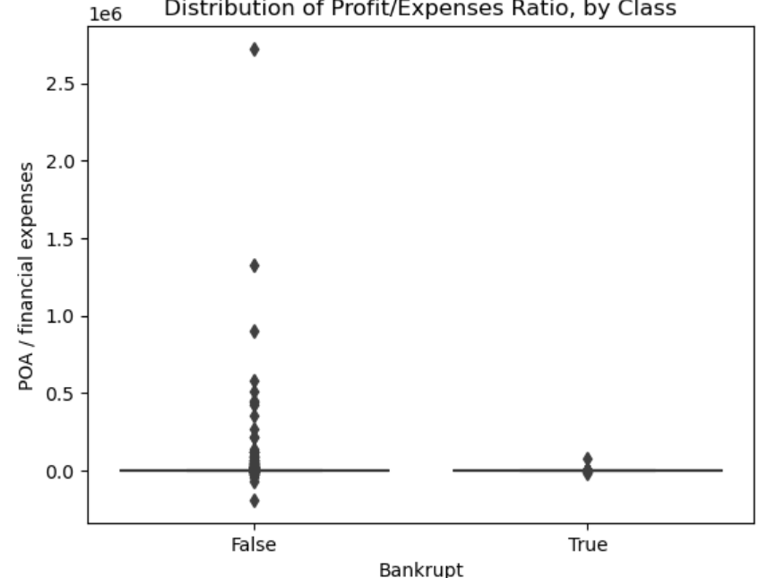
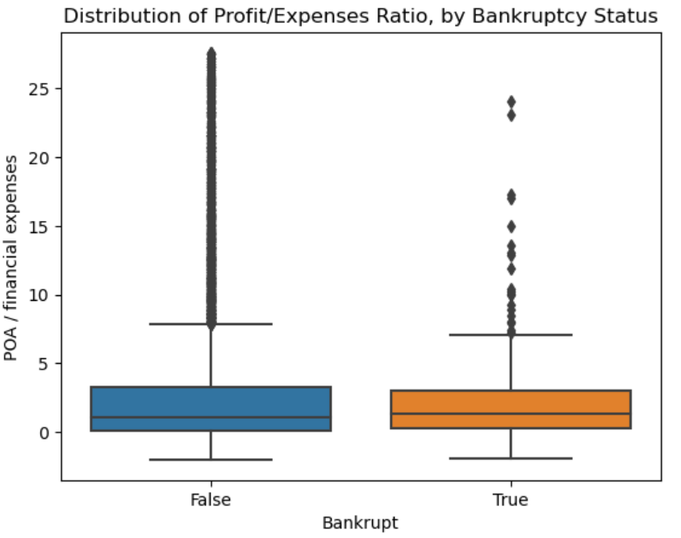

# Bankrupcy in Poland

## Working with JSON files

```py
import gzip
import json
import pandas as pd
```

As we've seen in our other projects, datasets can be large or small, messy or clean, and complex or easy to understand. Regardless of how the data looks, though, it needs to be saved in a file somewhere, and when that file gets too big, we need to compress it. Compressed files are easier to store because they take up less space. If you've ever come across a ZIP file, you've worked with compressed data.

The file we're using for this project is compressed, so we'll need to use a file utility called gzip to open it up.

```bash
gzip -dkf poland-bankruptcy-data-2009.json.gz
# d (decompress), k (keep original files), f (force overwrite of output file and compress file)

head poland-bankruptcy-data-2009.json

{
  "schema": {
    "fields": [
      {
        "name": "company_id",
        "type": "integer"
      },
      {
        "name": "feat_1",
        "type": "number"
```

Curly brackets? Key-value pairs? It looks similar to a Python dictionary. It's important to note that JSON is not exactly the same as a dictionary, but a lot of the same concepts apply. Let's try reading the file into a DataFrame and see what happens.
It is similar to a dictionary but not really. for e.g., " " is must, false (not False)

### Stack Overflow

```py
df = pd.read_json("data/poland-bankruptcy-data-2009.json")
```

<code style="background-color:#FEDDDE;"><span style="color:#E45E5C">ValueError</span>: Mixing dicts with non-Series may lead to ambiguous ordering.</code>

What should we do? That error sounds serious, but the world is big, and we can't possibly be the first people to encounter this problem. When you come across an error, copy the message into a search engine and see what comes back. You'll get lots of results. The web has lots of places to look for solutions to problems like this one, and [Stack Overflow](https://stackoverflow.com/) is one of the best. [Click here to check out a possible solution to our problem.](https://stackoverflow.com/questions/57018859/valueerror-mixing-dicts-with-non-series-may-lead-to-ambiguous-ordering)

There are three things to look for when you're browsing through solutions on Stack Overflow.

1. **Context:** A good question is specific; if you click through that link, you'll see that the person asks a **specific** question, gives some relevant information about their OS and hardware, and then offers the code that threw the error. That's important, because we need...
2. **Reproducible Code:** A good question also includes enough information for you to reproduce the problem yourself. After all, the only way to make sure the solution actually applies to your situation is to see if the code in the question throws the error you're having trouble with! In this case, the person included not only the code they used to get the error, but the actual error message itself. That would be useful on its own, but since you're looking for an actual solution to your problem, you're really looking for...
3. **An answer:** Not every question on Stack Overflow gets answered. Luckily for us, the one we've been looking at did. There's a big green check mark next to the first solution, which means that the person who asked the question thought that solution was the best one.

```py
# Open file and load JSON
with open("data/poland-bankruptcy-data-2009.json", "r") as read_file:
    poland_data = json.load(read_file)

print(type(poland_data))
# <class 'dict'>
```

## Explore

Okay! Now that we've successfully opened up our dataset, let's take a look and see what's there, starting with the keys. Remember, the keys in a dictionary are categories of things in a dataset

```py
# Print `poland_data` keys
print(poland_data.keys())
dict_keys(['schema', 'data', 'metadata'])
schema tells us how the data is structured, metadata tells us where the data comes from, and data is the data itself.
```

Now let's take a look at the values. Remember, the values in a dictionary are ways to describe the variable that belongs to a key.

```py
# Continue Exploring `poland_data`
poland_data["metadata"]
poland_data["schema"].keys()
poland_data["data"][0]
```

This dataset includes all the information we need to figure whether or not a Polish company went bankrupt in 2009. There's a bunch of features included in the dataset, each of which corresponds to some element of a company's balance sheet. You can explore the features by looking at the data dictionary. Most importantly, we also know whether or not the company went bankrupt. That's the last key-value pair.

Now that we know what data we have for each company, let's take a look at how many companies there are.

Python json automatically converted that false into False.

```py
# Calculate number of companies
len(poland_data["data"])
# 9977

# Calculate number of features
len(poland_data["data"][0])
# 66
```

Since we're dealing with data stored in a JSON file, which is common for semi-structured data, we can't assume that all companies have the same features. So let's check!

```py
# Iterate through companies
for i in range(len(poland_data["data"])):
    if len(poland_data["data"][i]) != 66:
        print("tmkc")

# Open compressed file and load contents
with gzip.open("data/poland-bankruptcy-data-2009.json.gz", "r") as read_file:
    poland_data_gz = json.load(read_file)
print(type(poland_data_gz))

# <class 'dict'>
```

Since we now have two versions of the dataset — one compressed and one uncompressed — we need to compare them to make sure they're the same.

```py
# Explore `poland_data_gz`
print(poland_data_gz.keys())
print(len(poland_data_gz["data"]))
print(len(poland_data_gz["data"][0]))
# dict_keys(['schema', 'data', 'metadata'])
# 9977
# 66
```

Create a DataFrame df that contains the all companies in the dataset, indexed by "company_id". Remember the principles of tidy data that you learned in Project 1, and make sure your DataFrame has shape (9977, 65).

Create a DataFrame from a dictionary in pandas.

```py
df = pd.DataFrame().from_dict(poland_data_gz["data"]).set_index("company_id")
print(df.shape)
# (9977, 65)
```

## Wrangle

```py
def wrangle(filename):
    with gzip.open(filename, "r") as f:
        poland_data_gz = json.load(f)
    df = pd.DataFrame().from_dict(poland_data_gz["data"]).set_index("company_id")
    return df

df = wrangle("data/poland-bankruptcy-data-2009.json.gz")
print(df.shape)
# (9977, 65)
df.head()
```

## Imbalanced Data

## Import

```py
import gzip
import json
import pickle

import matplotlib.pyplot as plt
import pandas as pd
import seaborn as sns
from imblearn.over_sampling import RandomOverSampler
from imblearn.under_sampling import RandomUnderSampler
from sklearn.impute import SimpleImputer
from sklearn.metrics import ConfusionMatrixDisplay
from sklearn.model_selection import train_test_split
from sklearn.pipeline import make_pipeline
from sklearn.tree import DecisionTreeClassifier
```

Let's take a moment to refresh our memory on what's in this dataset. In the last lesson, we noticed that the data was stored in a JSON file (similar to a Python dictionary), and we explored the key-value pairs. This time, we're going to look at what the values in those pairs actually are.

```py
# Inspect DataFrame
df.info()
```

That's solid information. We know all our features are numerical and that we have missing data. But, as always, it's a good idea to do some visualizations to see if there are any interesting trends or ideas we should keep in mind while we work. First, let's take a look at how many firms are bankrupt, and how many are not.

Create a bar chart of the value counts for the "bankrupt" column. You want to calculate the relative frequencies of the classes, not the raw count, so be sure to set the normalize argument to True.
Aggregate data in a Series using value_counts in pandas.

```py
# Plot class balance
df["bankrupt"].value_counts(normalize=True).plot(
    kind = "bar", 
    xlabel = "Bankrupt", 
    ylabel = "Frequency", 
    title = "Class Balance"
)
```

Since it looks like most of the companies in our dataset are doing all right for themselves, let's drill down a little farther. However, it also shows us that we have an imbalanced dataset, where our majority class is far bigger than our minority class.

In the last lesson, we saw that there were 64 features of each company, each of which had some kind of numerical value. It might be useful to understand where the values for one of these features cluster, so let's make a boxplot to see how the values in "feat_27" are distributed.

The positive class represents the outcome that is of primary interest or the event that you want to predict or detect. It is often the "1" in binary classification problems. The negative class represents the absence of the event of interest or the alternative outcome. It is often the "0" in binary classification problems.

Use seaborn to create a boxplot that shows the distributions of the "feat_27" column for both groups in the "bankrupt" column. Remember to label your axes.

```py
# Create boxplot
sns.boxplot(x="bankrupt",y="feat_27", data=df)
plt.xlabel("Bankrupt")
plt.ylabel("POA / financial expenses")
plt.title("Distribution of Profit/Expenses Ratio, by Class");
```


Remember that boxplots exist to help us see the quartiles in a dataset, and this one doesn't really do that. Let's check the distribution of "feat_27"to see if we can figure out what's going on here.

```py
# Summary statistics for `feat_27`
df["feat_27"].describe().apply("{0:,.0f}".format) 
# function in Pandas is often used to format numeric values in a DataFrame or Series.
# 0: The placeholder for the value you want to format.
# ,: Adds a comma as a thousand separator.
# .0f: Formats the number as a floating-point number with 0 decimal places, effectively rounding to the nearest whole number
```

>count        9,312
mean         1,206
std         35,477
min       -190,130
25%              0
50%              1
75%              5
max      2,723,000
Name: feat_27, dtype: object

Create a histogram of "feat_27". Make sure to label x-axis "POA / financial expenses", the y-axis "Count", and use the title "Distribution of Profit/Expenses Ratio".

```py
# Plot histogram of `feat_27`
df["feat_27"].hist()
plt.xlabel("POA / financial expenses")
plt.ylabel("Count"),
plt.title("Distribution of Profit/Expenses Ratio");
```

Aha! We saw it in the numbers and now we see it in the histogram. The data is very skewed. So, in order to create a helpful boxplot, we need to trim the data.

Recreate the boxplot that you made above, this time only using the values for "feat_27" that fall between the 0.1 and 0.9 quantiles for the column.

```py
q1,q9 = df["feat_27"].quantile([0.1,0.9])
mask = df["feat_27"].between(q1,q9)
# Create clipped boxplot
sns.boxplot(x="bankrupt",y="feat_27", data=df[mask])
plt.xlabel("Bankrupt")
plt.ylabel("POA / financial expenses")
plt.title("Distribution of Profit/Expenses Ratio, by Bankruptcy Status");
```


That makes a lot more sense. Let's take a look at some of the other features in the dataset to see what else is out there.

There data is lot skewed. Also we are still not able to much differentiate between both the classes

**More context on "feat_27":** Profit on operating activities is profit that a company makes through its "normal" operations. For instance, a car company profits from the sale of its cars. However, a company may have other forms of profit, such as financial investments. So a company's total profit may be positive even when its profit on operating activities is negative.

Financial expenses include things like interest due on loans, and does not include "normal" expenses (like the money that a car company spends on raw materials to manufacture cars).

Repeat the exploration you just did for "feat_27" on two other features in the dataset. Do they show the same skewed distribution? Are there large differences between bankrupt and solvent companies?

```py
# Explore another feature
q1,q9 = df["feat_55"].quantile([0.1,0.9])
mask = df["feat_55"].between(q1,q9)
# Create clipped boxplot
sns.boxplot(x="bankrupt",y="feat_55", data=df[mask])
plt.xlabel("Bankrupt")
plt.ylabel("POA / financial expenses")
plt.title("Distribution of Profit/Expenses Ratio, by Bankruptcy Status");
```

Looking at other features, we can see that they're skewed, too. This will be important to keep in mind when we decide what type of model we want to use.

Another important consideration for model selection is whether there are any issues with multicollinearity in our model. Let's check.

Plot a correlation heatmap of features in df. Since "bankrupt" will be your target, you don't need to include it in your heatmap.

```py
corr = df.drop(columns="bankrupt").corr()
sns.heatmap(corr)
```

So what did we learn from this EDA? First, our data is imbalanced. This is something we need to address in our data preparation. Second, many of our features have missing values that we'll need to impute. And since the features are highly skewed, the best imputation strategy is likely median, not mean. Finally, we have autocorrelation issues, which means that we should steer clear of linear models, and try a tree-based model instead.

### Split

So let's start building that model. If you need a refresher on how and why we split data in these situations, take a look back at the Time Series module.

Create your feature matrix X and target vector y. Your target is "bankrupt".

```py
target = "bankrupt"
X = df.drop(columns=target)
y = df[target]
​
print("X shape:", X.shape)
print("y shape:", y.shape)
# X shape: (9977, 64)
# y shape: (9977,)
```

In order to make sure that our model can generalize, we need to put aside a test set that we'll use to evaluate our model once it's trained.

Divide your data (X and y) into training and test sets using a randomized train-test split. Your validation set should be 20% of your total data. And don't forget to set a random_state for reproducibility.

```py
X_train, X_test, y_train, y_test = train_test_split(X, y, test_size=0.2, random_state=42)
​
print("X_train shape:", X_train.shape)
print("y_train shape:", y_train.shape)
print("X_test shape:", X_test.shape)
print("y_test shape:", y_test.shape)
# X_train shape: (7981, 64)
# y_train shape: (7981,)
# X_test shape: (1996, 64)
# y_test shape: (1996,)
```

Note that if we wanted to tune any hyperparameters for our model, we'd do another split here, further dividing the training set into training and validation sets. However, we're going to leave hyperparameters for the next lesson, so no need to do the extra split now.

### Resample

Now that we've split our data into training and validation sets, we can address the class imbalance we saw during our EDA. One strategy is to resample the training data. (This will be different than the resampling we did with time series data in Project 3.) There are many to do this, so let's start with under-sampling.

Create a new feature matrix X_train_under and target vector y_train_under by performing random under-sampling on your training data.

```py
under_sampler = RandomUnderSampler(random_state=42)
X_train_under, y_train_under = under_sampler.fit_resample(X_train,y_train)
print(X_train_under.shape)
# (768, 64)
X_train_under.head()
```

One disadvantage of undersampling is we have to let go of the potential information for better model building, also when data is small undersampling make it more smaller.

And then we'll over-sample.

Create a new feature matrix X_train_over and target vector y_train_over by performing random over-sampling on your training data.

```py
over_sampler = RandomOverSampler(random_state=42)
X_train_over, y_train_over = over_sampler.fit_resample(X_train,y_train)
print(X_train_over.shape)
X_train_over.head()
(15194, 64)
```

### Build Model

```py
# Baseline
acc_baseline = y_train.value_counts(normalize=True).max()
print("Baseline Accuracy:", round(acc_baseline, 4))
# Baseline Accuracy: 0.9519
```

Note here that, because our classes are imbalanced, the baseline accuracy is very high. We should keep this in mind because, even if our trained model gets a high validation accuracy score, that doesn't mean it's actually good.

### Iterate

Now that we have a baseline, let's build a model to see if we can beat it.

Create three identical models: model_reg, model_under and model_over. All of them should use a SimpleImputer followed by a DecisionTreeClassifier. Train model_reg using the unaltered training data. For model_under, use the undersampled data. For model_over, use the oversampled data.

```py
# Fit on `X_train`, `y_train`
model_reg = make_pipeline(
    SimpleImputer(strategy="median"), DecisionTreeClassifier(random_state=42)
)
model_reg.fit(X_train,y_train)
​
# Fit on `X_train_under`, `y_train_under`
model_under = make_pipeline(
    SimpleImputer(strategy="median"), DecisionTreeClassifier(random_state=42)
)
model_under.fit(X_train_under,y_train_under)
​
# Fit on `X_train_over`, `y_train_over`
model_over = make_pipeline(
    SimpleImputer(strategy="median"), DecisionTreeClassifier(random_state=42)
)
model_over.fit(X_train_over,y_train_over)
Pipeline(steps=[('simpleimputer', SimpleImputer(strategy='median')),
                ('decisiontreeclassifier',
                 DecisionTreeClassifier(random_state=42))])
```

Calculate training and test accuracy for your three models.

```py
for m in [model_reg, model_under, model_over]:
    acc_train = m.score(X_train, y_train)
    acc_test = m.score(X_test, y_test)
​
    print("Training Accuracy:", round(acc_train, 4))
    print("Test Accuracy:", round(acc_test, 4))
```

>Training Accuracy: 1.0
Test Accuracy: 0.9359
Training Accuracy: 0.7421
Test Accuracy: 0.7104
Training Accuracy: 1.0
Test Accuracy: 0.9344

As we mentioned earlier, "good" accuracy scores don't tell us much about the model's performance when dealing with imbalanced data. So instead of looking at what the model got right or wrong, let's see how its predictions differ for the two classes in the dataset.

Plot a confusion matrix that shows how your best model performs on your validation set.

```py
# Plot confusion matrix
ConfusionMatrixDisplay.from_estimator(model_reg, X_test, y_test)
```

In this lesson, we didn't do any hyperparameter tuning, but it will be helpful in the next lesson to know what the depth of the tree model_over.

### Confusion Matrix

A **confusion matrix** is a table used to evaluate the performance of a classification model by comparing the predicted labels with the actual labels. It provides a detailed breakdown of how well a model is performing, particularly in binary classification problems, though it can be extended to multiclass problems as well.

**Structure of a Confusion Matrix:**
For a binary classification problem, the confusion matrix typically looks like this:

|                     | **Predicted Positive** | **Predicted Negative** |
|---------------------|------------------------|------------------------|
| **Actual Positive** | True Positive (TP)     | False Negative (FN)    |
| **Actual Negative** | False Positive (FP)    | True Negative (TN)     |

#### **Terms in the Confusion Matrix:**

1. **True Positive (TP):**
   - **Definition**: The number of instances where the model correctly predicted the positive class.
   - **Example**: If the model correctly identifies a disease when the patient actually has it, that's a True Positive.

2. **False Negative (FN):**
   - **Definition**: The number of instances where the model incorrectly predicted the negative class when the actual class was positive.
   - **Example**: If the model fails to detect a disease in a patient who actually has it, that's a False Negative.

3. **False Positive (FP):**
   - **Definition**: The number of instances where the model incorrectly predicted the positive class when the actual class was negative.
   - **Example**: If the model incorrectly predicts a disease in a healthy patient, that's a False Positive. This is also known as a "Type I Error."

4. **True Negative (TN):**
   - **Definition**: The number of instances where the model correctly predicted the negative class.
   - **Example**: If the model correctly identifies that a healthy patient does not have a disease, that's a True Negative.

#### **Key Metrics Derived from the Confusion Matrix:**

1. **Accuracy**:
   - **Formula**: \(\text{Accuracy} = \frac{TP + TN}{TP + TN + FP + FN}\)
   - **Interpretation**: The proportion of correctly classified instances out of the total instances. It gives a general sense of how often the model is correct.

2. **Precision**:
   - **Formula**: \(\text{Precision} = \frac{TP}{TP + FP}\)
   - **Interpretation**: The proportion of positive predictions that are actually correct. It is important when the cost of false positives is high.

3. **Recall (Sensitivity or True Positive Rate)**:
   - **Formula**: \(\text{Recall} = \frac{TP}{TP + FN}\)
   - **Interpretation**: The proportion of actual positives that are correctly identified. It is crucial when the cost of false negatives is high.

4. **F1 Score**:
   - **Formula**: \(\text{F1 Score} = 2 \times \frac{\text{Precision} \times \text{Recall}}{\text{Precision} + \text{Recall}}\)
   - **Interpretation**: The harmonic mean of precision and recall, providing a single metric that balances both concerns.

5. **Specificity (True Negative Rate)**:
   - **Formula**: \(\text{Specificity} = \frac{TN}{TN + FP}\)
   - **Interpretation**: The proportion of actual negatives that are correctly identified.

#### **Why It's Important:**

The confusion matrix and its associated metrics are essential tools for understanding the strengths and weaknesses of a classification model, helping you identify whether the model is more prone to making false positives or false negatives and providing guidance on how to improve model performance based on the context and consequences of errors.

### Decision Tree

Determine the depth of the decision tree in model_over.

```py
depth = model_over.named_steps["decisiontreeclassifier"].get_depth()
print(depth)
# 33
```

### Communicate

Now that we have a reasonable model, let's graph the importance of each feature.

Create a horizontal bar chart with the 15 most important features for model_over. Be sure to label your x-axis "Gini Importance".

```py
# Get importances
importances = model_over.named_steps["decisiontreeclassifier"].feature_importances_
​
# Put importances into a Series
feat_imp = pd.Series(importances, index = X_train_over.columns).sort_values()
​
# Plot series
feat_imp.tail(15).plot(kind ="barh")
plt.xlabel("Gini Importance")
plt.ylabel("Feature")
plt.title("model_over Feature Importance");
```

There's our old friend "feat_27" near the top, along with features 34 and 26. It's time to share our findings.

### Pickle

Sometimes communication means sharing a visualization. Other times, it means sharing the actual model you've made so that colleagues can use it on new data or deploy your model into production. First step towards production: saving your model.

Using a context manager, save your best-performing model to a a file named "model-5-2.pkl".

```py
# Save your model as `"model-5-2.pkl"`
with open("model-5-2.pkl", "wb") as f:
    pickle.dump(model_over, f)

# Load `"model-5-2.pkl"`
with open("model-5-2.pkl", "rb") as f:
    loaded_model = pickle.load(f)
print(loaded_model)
Pipeline(steps=[('simpleimputer', SimpleImputer(strategy='median')),
                ('decisiontreeclassifier',
                 DecisionTreeClassifier(random_state=42))])
```

## Ensemble Models: Random Forest

we're going to expand our decision tree model into an entire forest (an example of something called an ensemble model); learn how to use a grid search to tune hyperparameters; and create a function that loads data and a pre-trained model, and uses that model to generate a Series of predictions.

```py
from sklearn.model_selection import GridSearchCV, cross_val_score, train_test_split
import gzip
import json
import pickle
​
import matplotlib.pyplot as plt
import pandas as pd
import wqet_grader
from imblearn.over_sampling import RandomOverSampler
from IPython.display import VimeoVideo
from sklearn.ensemble import RandomForestClassifier
from sklearn.impute import SimpleImputer
from sklearn.metrics import ConfusionMatrixDisplay
from sklearn.model_selection import GridSearchCV, cross_val_score, train_test_split
from sklearn.pipeline import make_pipeline
```

### wrangle

```py
def wrangle(filename):
    # Open compressed file, load into dictionary
    with gzip.open(filename, "r") as f:
        poland_data_gz = json.load(f)
    # Load dictionary into DataFrame, set index
    df = pd.DataFrame().from_dict(poland_data_gz["data"]).set_index("company_id")
    return df
df = wrangle("data/poland-bankruptcy-data-2009.json.gz")
print(df.shape)
df.head()
# (9977, 65)
```

### Split

```py
target = "bankrupt"
X = df.drop(columns=target)
y = df[target]
​
​
print("X shape:", X.shape)
print("y shape:", y.shape)
# X shape: (9977, 64)
# y shape: (9977,)

X_train, X_test, y_train, y_test = train_test_split(X, y, test_size=0.2, random_state=42)
​
print("X_train shape:", X_train.shape)
print("y_train shape:", y_train.shape)
print("X_test shape:", X_test.shape)
print("y_test shape:", y_test.shape)
# X_train shape: (7981, 64)
# y_train shape: (7981,)
# X_test shape: (1996, 64)
# y_test shape: (1996,)
```

You might have noticed that we didn't create a validation set, even though we're planning on tuning our model's hyperparameters in this lesson. That's because we're going to use cross-validation, which we'll talk about more later on.

### Resample

```py
over_sampler = RandomOverSampler(random_state=42)
X_train_over, y_train_over = over_sampler.fit_resample(X_train,y_train)
print("X_train_over shape:", X_train_over.shape)
X_train_over.head()
# X_train_over shape: (15194, 64)
```

### Build Model

```py
# Baseline
acc_baseline = y_train.value_counts(normalize=True).max()
print("Baseline Accuracy:", round(acc_baseline, 4))
# Baseline Accuracy: 0.9519
```

### Iterate

So far, we've built single models that predict a single outcome. That's definitely a useful way to predict the future, but what if the one model we built isn't the right one? If we could somehow use more than one model simultaneously, we'd have a more trustworthy prediction.

Ensemble models work by building multiple models on random subsets of the same data, and then comparing their predictions to make a final prediction. Since we used a decision tree in the last lesson, we're going to create an ensemble of trees here. This type of model is called a random forest.

```py
clf = make_pipeline(
    SimpleImputer(),
    RandomForestClassifier(random_state=42)
)
clf = make_pipeline(
    SimpleImputer(),
    RandomForestClassifier(random_state=42)
)
print(clf)
Pipeline(steps=[('simpleimputer', SimpleImputer()),
                ('randomforestclassifier',
                 RandomForestClassifier(random_state=42))])
```

By default, the number of trees in our forest (n_estimators) is set to 100. That means when we train this classifier, we'll be fitting 100 trees. While it will take longer to train, it will hopefully lead to better performance.

In order to get the best performance from our model, we need to tune its hyperparameter. But how can we do this if we haven't created a validation set? The answer is cross-validation. So, before we look at hyperparameters, let's see how cross-validation works with the classifier we just built.

Perform **cross-validation** with your classifier, using the over-sampled training data. We want five folds, so set cv to 5. We also want to speed up training, to set n_jobs to -1.

```py
cross_val_score(clf, X_train_over, y_train_over, cv =5, n_jobs = -1)
cv_acc_scores = cross_val_score(clf, X_train_over, y_train_over, cv =5, n_jobs = -1)
print(cv_acc_scores)
# [0.99670944 0.99835472 0.99769661 0.9970385  0.99901251]
```

That took kind of a long time, but we just trained 500 random forest classifiers (100 jobs x 5 folds). No wonder it takes so long!

**Pro tip:** even though cross_val_score is useful for getting an idea of how cross-validation works, you'll rarely use it. Instead, most people include a cv argument when they do a hyperparameter search.

Now that we have an idea of how cross-validation works, let's tune our model. The first step is creating a range of hyperparameters that we want to evaluate.

Create a dictionary with the range of hyperparameters that we want to evaluate for our classifier.

For the SimpleImputer, try both the "mean" and "median" strategies.
For the RandomForestClassifier, try max_depth settings between 10 and 50, by steps of 10.
Also for the RandomForestClassifier, try n_estimators settings between 25 and 100 by steps of 25.

<div class="alert alert-info" role="alert">
<p><b>Tip:</b> If the classifier you built is a predictor only (not a pipeline with multiple steps), you don't need to include the step name in the keys of your <code>params</code> dictionary. For example, if your classifier was only a random forest (not a pipeline containing a random forest), your would access the number of estimators using <code>"n_estimators"</code>, not <code>"randomforestclassifier__n_estimators"</code>.</p>
</div>

```py
params = {
    "simpleimputer__strategy": ["mean", "median"],
    "randomforestclassifier__n_estimators": range(25,100,25),
    "randomforestclassifier__max_depth": range(10,50,10)
}
```

Now that we have our hyperparameter grid, let's incorporate it into a grid search.

Create a GridSearchCV named model that includes your classifier and hyperparameter grid. Be sure to use the same arguments for cv and n_jobs that you used above, and set verbose to 1.

```py
GridSearchCV(
    clf,
    param_grid=params,
    cv=5,
    n_jobs=-1,
    verbose=1
)
model = GridSearchCV(
    clf,
    param_grid=params,
    cv=5,
    n_jobs=-1,
    verbose=1
)

# Train model
model.fit(X_train_over, y_train_over)
```

This will take some time to train, so let's take a moment to think about why. How many forests did we just test? 4 different max_depths times 3 n_estimators times 2 imputation strategies... that makes 24 forests. How many fits did we just do? 24 forests times 5 folds is 120. And remember that each forest is comprised of 25-75 trees, which works out to at least 3,000 trees. So it's computationally expensive!

Okay, now that we've tested all those models, let's take a look at the results.

Extract the cross-validation results from model and load them into a DataFrame named cv_results.

```py
pd.DataFrame(model.cv_results_)
cv_results = pd.DataFrame(model.cv_results_)
cv_results.head(10)
```

In addition to the accuracy scores for all the different models we tried during our grid search, we can see how long it took each model to train. Let's take a closer look at how different hyperparameter settings affect training time.

First, we'll look at n_estimators. Our grid search evaluated this hyperparameter for various max_depth settings, but let's only look at models where max_depth equals 10.

mean_test_score and mean_fit_time along with the parameters setting are the columns to be noted here.

Create a mask for cv_results for rows where "param_randomforestclassifier__max_depth" equals 10. Then plot "param_randomforestclassifier__n_estimators" on the x-axis and "mean_fit_time" on the y-axis. Don't forget to label your axes and include a title.

```py
# Create mask
mask = cv_results["param_randomforestclassifier__max_depth"]==10
# Plot fit time vs n_estimators
plt.plot(
    cv_results[mask]["param_randomforestclassifier__n_estimators"],
    cv_results[mask]["mean_fit_time"]
)
# Label axes
plt.xlabel("Number of Estimators")
plt.ylabel("Mean Fit Time [seconds]")
plt.title("Training Time vs Estimators (max_depth=10)");
```

Next, we'll look at max_depth. Here, we'll also limit our data to rows where n_estimators equals 25.

Create a mask for cv_results for rows where "param_randomforestclassifier__n_estimators" equals 25. Then plot "param_randomforestclassifier__max_depth" on the x-axis and "mean_fit_time" on the y-axis. Don't forget to label your axes and include a title.

```py
# Create mask
mask = cv_results["param_randomforestclassifier__n_estimators"]==25
# Plot fit time vs n_estimators
plt.plot(
    cv_results[mask]["param_randomforestclassifier__max_depth"],
    cv_results[mask]["mean_fit_time"]
)
# Label axes
plt.xlabel("Max Depth")
plt.ylabel("Mean Fit Time [seconds]")
plt.title("Training Time vs Max Depth (n_estimators=25)");
```

There's a general upwards trend, but we see a lot of up-and-down here. That's because for each max depth, grid search tries two different imputation strategies: mean and median. Median is a lot faster to calculate, so that speeds up training time.

Finally, let's look at the hyperparameters that led to the best performance.

```py
# Extract best hyperparameters
model.best_params_
'''{'randomforestclassifier__max_depth': 40,
 'randomforestclassifier__n_estimators': 50,
 'simpleimputer__strategy': 'median'}'''

model.best_score_
# 0.9978939791055105
model.best_estimator_

'''Pipeline(steps=[('simpleimputer', SimpleImputer(strategy='median')),
                ('randomforestclassifier',
                 RandomForestClassifier(max_depth=40, n_estimators=50,
                                        random_state=42))])'''
```

In a Jupyter environment, please rerun this cell to show the HTML representation or trust the notebook.
On GitHub, the HTML representation is unable to render, please try loading this page with nbviewer.org.
model.predict(X_train_over)
array([False, False, False, ...,  True,  True,  True])
Note that we don't need to build and train a new model with these settings. Now that the grid search is complete, when we use model.predict(), it will serve up predictions using the best model — something that we'll do at the end of this lesson.

### Evaluate

```py
acc_train = model.score(X_train, y_train)
acc_test = model.score(X_test, y_test)
​
print("Training Accuracy:", round(acc_train, 4))
print("Test Accuracy:", round(acc_test, 4))
# Training Accuracy: 1.0
# Test Accuracy: 0.9589
```

We beat the baseline! Just barely, but we beat it.

Next, we're going to use a confusion matrix to see how our model performs. To better understand the values we'll see in the matrix, let's first count how many observations in our test set belong to the positive and negative classes.

```py
y_test.value_counts()
# False    1913
# True       83
```

Plot a confusion matrix that shows how your best model performs on your test set.

```py
# Plot confusion matrix
ConfusionMatrixDisplay.from_estimator(model, X_test, y_test);
```

Notice the relationship between the numbers in this matrix with the count you did the previous task. If you sum the values in the bottom row, you get the total number of positive observations in y_test ( 72+11=83). And the top row sum to the number of negative observations ( 1903+10=1913).

### Communicate

```py
Create a horizontal bar chart with the 10 most important features for your model.

# Get feature names from training data
features = X_train_over.columns
# Extract importances from model
importances = model.best_estimator_.named_steps[
    "randomforestclassifier"
].feature_importances_
# Create a series with feature names and importances
feat_imp = pd.Series(importances, index = features).sort_values()
# Plot 10 most important features
feat_imp.tail(10).plot(kind = "barh")
plt.xlabel("Gini Importance")
plt.ylabel("Feature")
plt.title("Feature Importance");
```

The only thing left now is to save your model so that it can be reused.

Using a context manager, save your best-performing model to a a file named "model-5-3.pkl".

```py
# Save model
with open("model-5-3.pkl", "wb") as f:
    pickle.dump(model, f)
```

Create a function make_predictions. It should take two arguments: the path of a JSON file that contains test data and the path of a serialized model. The function should load and clean the data using the wrangle function you created, load the model, generate an array of predictions, and convert that array into a Series. (The Series should have the name "bankrupt" and the same index labels as the test data.) Finally, the function should return its predictions as a Series.

```py
def make_predictions(data_filepath, model_filepath):
    # Wrangle JSON file
    X_test = wrangle(data_filepath)
    # Load model
    with open(model_filepath, "rb") as f:
        model = pickle.load(f)
    # Generate predictions
    y_test_pred = model.predict(X_test)
    # Put predictions into Series with name "bankrupt", and same index as X_test
    y_test_pred = pd.Series(y_test_pred, index = X_test.index, name = "bankrupt")
    return y_test_pred
```

To check your make_predictions function. Once you're satisfied with the result, submit it to the grader.

```py
y_test_pred = make_predictions(
    data_filepath="data/poland-bankruptcy-data-2009-mvp-features.json.gz",
    model_filepath="model-5-3.pkl",
)
​
print("predictions shape:", y_test_pred.shape)
y_test_pred.head()
# predictions shape: (526,)
'''
company_id
4     False
32    False
34    False
36    False
40    False
Name: bankrupt, dtype: bool
'''
```

## Gradient Boosting Trees

```py
import gzip
import json
import pickle

import ipywidgets as widgets
import pandas as pd
import wqet_grader
from imblearn.over_sampling import RandomOverSampler
from IPython.display import VimeoVideo
from ipywidgets import interact
from sklearn.ensemble import GradientBoostingClassifier
from sklearn.impute import SimpleImputer
from sklearn.metrics import (
    ConfusionMatrixDisplay,
    classification_report,
    confusion_matrix,
)
from sklearn.model_selection import GridSearchCV, train_test_split
from sklearn.pipeline import make_pipeline
from teaching_tools.widgets import ConfusionMatrixWidget
```

```py
clf = make_pipeline(
    SimpleImputer(),
    GradientBoostingClassifier()
)
print(clf)
'''
Pipeline(steps=[('simpleimputer', SimpleImputer()),
                ('gradientboostingclassifier', GradientBoostingClassifier())])
'''
```

```py
params = {
    "simpleimputer__strategy": ["mean", "median"],
    "gradientboostingclassifier__n_estimators": range(25,31,5),
    "gradientboostingclassifier__max_depth": range(2,5)
}
```

```py
model = GridSearchCV(
    clf,
    param_grid=params,
    cv=5,
    n_jobs=-1,
    verbose=1
)

# Fit model to over-sampled training data
model.fit(X_train_over, y_train_over)

# Extract the cross-validation results from model and load them into a DataFrame named cv_results.
results = pd.DataFrame(model.cv_results_)
results.sort_values("rank_test_score").head(10)

# Extract best hyperparameters
model.best_params_
'''
{'gradientboostingclassifier__max_depth': 4,
 'gradientboostingclassifier__n_estimators': 30,
 'simpleimputer__strategy': 'mean'}
'''
```

### Evaluate

```py
acc_train = model.score(X_train, y_train)
acc_test = model.score(X_test, y_test)
​
print("Training Accuracy:", round(acc_train, 4))
print("Validation Accuracy:", round(acc_test, 4))
# Training Accuracy: 0.9029
# Validation Accuracy: 0.8803

# Plot confusion matrix
ConfusionMatrixDisplay.from_estimator(model, X_test, y_test);
```

This matrix is a great reminder of how imbalanced our data is, and of why accuracy isn't always the best metric for judging whether or not a model is giving us what we want. After all, if 95% of the companies in our dataset didn't go bankrupt, all the model has to do is always predict {"bankrupt": False}, and it'll be right 95% of the time. The accuracy score will be amazing, but it won't tell us what we really need to know.

Instead, we can evaluate our model using two new metrics: precision and recall. The precision score is important when we want our model to only predict that a company will go bankrupt if its very confident in its prediction. The recall score is important if we want to make sure to identify all the companies that will go bankrupt, even if that means being incorrect sometimes.

Let's start with a report you can create with scikit-learn to calculate both metrics.

```py
# Print classification report
# classification_report(y_test, model.predict(X_test))
print(classification_report(y_test, model.predict(X_test)))
'''
              precision    recall  f1-score   support

       False       0.99      0.89      0.93      1913
        True       0.22      0.76      0.35        83

    accuracy                           0.88      1996
   macro avg       0.61      0.82      0.64      1996
weighted avg       0.96      0.88      0.91      1996
'''
```

### Confusion matrix widget

```py
c = ConfusionMatrixWidget(model, X_test, y_test)
c.show()
```

If you move the probability threshold, you can see that there's a tradeoff between precision and recall. That is, as one gets better, the other suffers. As a data scientist, you'll often need to decide whether you want a model with better precision or better recall. What you choose will depend on how to intend to use your model.

Let's look at **two examples**, one where recall is the priority and one where precision is more important. **First**, let's say you work for a regulatory agency in the European Union that assists companies and investors navigate insolvency proceedings. You want to build a model to predict which companies could go bankrupt so that you can send debtors information about filing for legal protection before their company becomes insolvent. The administrative costs of sending information to a company is €500. The legal costs to the European court system if a company doesn't file for protection before bankruptcy is €50,000.

For a model like this, we want to focus on recall, because recall is all about quantity. A model that prioritizes recall will cast the widest possible net, which is the way to approach this problem. We want to send information to as many potentially-bankrupt companies as possible, because it costs a lot less to send information to a company that might not become insolvent than it does to skip a company that does.

Use the slider to change the probability threshold of your model. What relationship do you see between changes in the threshold and changes in wasted administrative and legal costs? In your opinion, which is more important for this model: high precision or high recall?

For the **second** example, let's say we work at a private equity firm that purchases distressed businesses, improve them, and then sells them for a profit. You want to build a model to predict which companies will go bankrupt so that you can purchase them ahead of your competitors. If the firm purchases a company that is indeed insolvent, it can make a profit of €100 million or more. But if it purchases a company that isn't insolvent and can't be resold at a profit, the firm will lose €250 million.

For a model like this, we want to focus on precision. If we're trying to maximize our profit, the quality of our predictions is much more important than the quantity of our predictions. It's not a big deal if we don't catch every single insolvent company, but it's definitely a big deal if the companies we catch don't end up becoming insolvent.

Create an **interactive dashboard** that shows how company profit and losses change in relationship to your model's probability threshold. Start with the make_cnf_matrix function, which should calculate and print profit/losses, and display a confusion matrix. Then create a FloatSlider thresh_widget that ranges from 0 to 1. Finally combine your function and slider in the interact function.

```py
def make_cnf_matrix(threshold):
    y_pred_proba= model.predict_proba(X_test)[:, -1]
    y_pred = y_pred_proba > threshold
    conf_matrix= confusion_matrix(y_test, y_pred)
    th, fp, fn, tp = conf_matrix.ravel()
    print(f"Profit: €{tp * 100_000_000}")
    print(f"Losses: €{fp * 250_000_000}")
    ConfusionMatrixDisplay.from_predictions(y_test, y_pred, colorbar= False)
thresh_widget = widgets.FloatSlider(min = 0, max = 1, value = 0.5, step = 0.05)
​
interact(make_cnf_matrix, threshold=thresh_widget);
```

### Communicate

```py
# Save model
with open("model-5-4.pkl", "wb") as f:
    pickle.dump(model, f)
```

Open the file my_predictor_lesson.py, add the wrangle and make_predictions functions from the last lesson, and add all the necessary import statements to the top of the file. Once you're done, save the file. You can check that the contents are correct by running the cell below.

```bash
%%bash​
cat my_predictor_lesson.py
# Import libraries
import gzip
import json
import pickle

import pandas as pd


# Add wrangle function from lesson 5.4
def wrangle(filename):
    with gzip.open(filename, "r") as f:
        poland_data_gz = json.load(f)
    df = pd.DataFrame().from_dict(poland_data_gz["data"]).set_index("company_id")
    return df


# Add make_predictions function from lesson 5.3
def make_predictions(data_filepath, model_filepath):
    # Wrangle JSON file
    X_test = wrangle(data_filepath)
    # Load model
    with open(model_filepath, "rb") as f:
        model = pickle.load(f)
    # Generate predictions
    y_test_pred = model.predict(X_test)
    # Put predictions into Series with name "bankrupt", and same index as X_test
    y_test_pred = pd.Series(y_test_pred, index = X_test.index, name = "bankrupt")
    return y_test_pred
```

```py
# Import your module
from my_predictor_lesson import make_predictions
​
# Generate predictions
y_test_pred = make_predictions(
    data_filepath="data/poland-bankruptcy-data-2009-mvp-features.json.gz",
    model_filepath="model-5-4.pkl",
)
​
print("predictions shape:", y_test_pred.shape)
y_test_pred.head()
# predictions shape: (526,)
```
