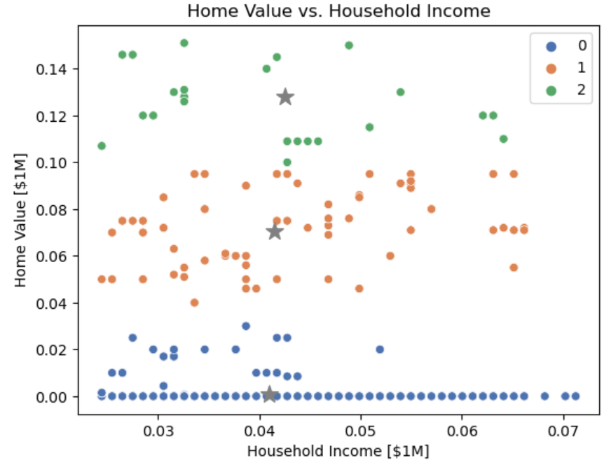
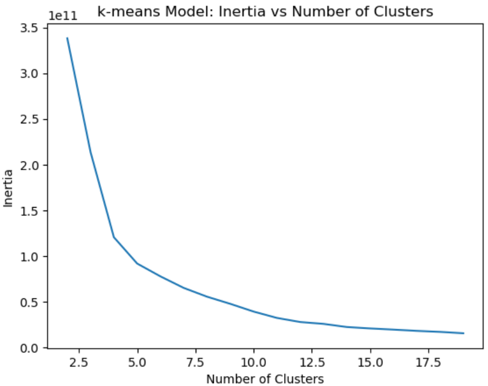
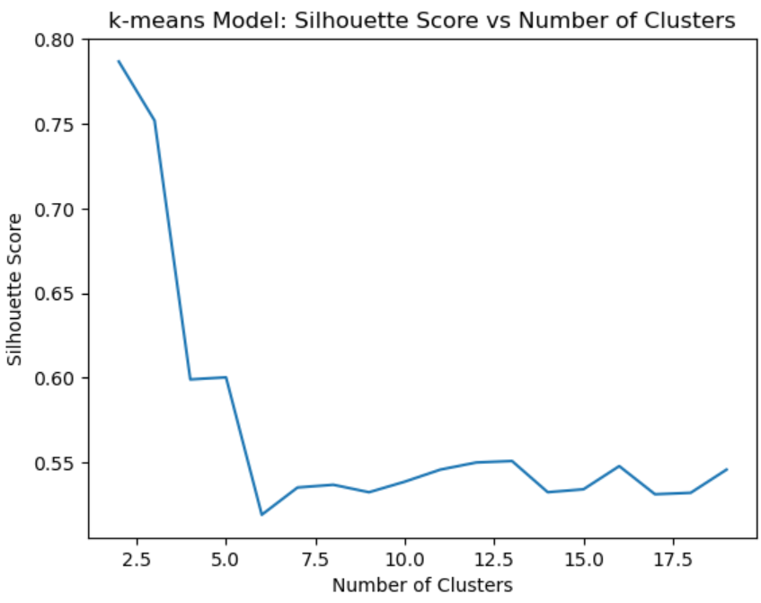
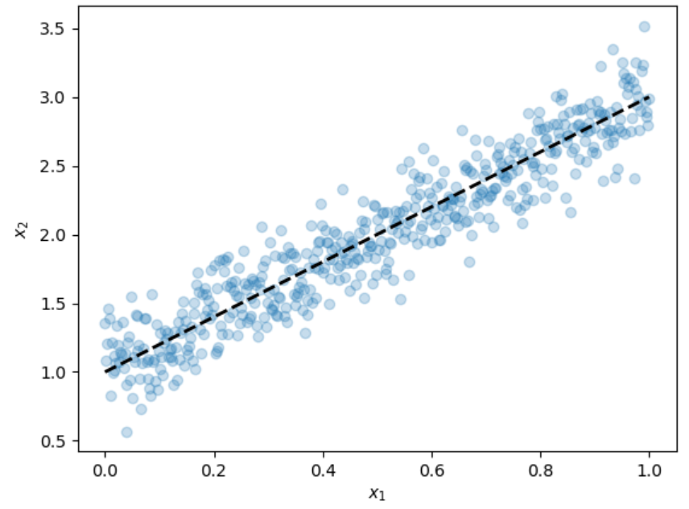
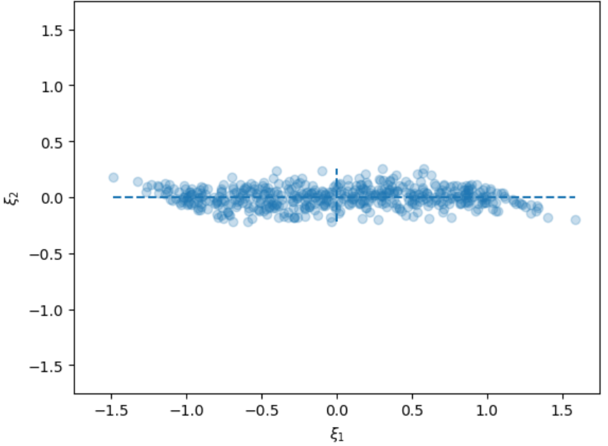
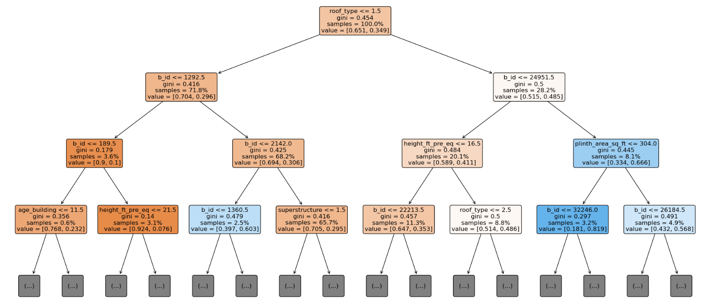

# Machine Learning

## Basics

### Model Types

**Linear regression** is a way to predict the value of some a target variable by fitting a line that best describes the relationship between **Big X** and **little y** for the values we already have. If you remember `y = mx + b` from Algebra, it's the same thing; the `y` is the intercept, and the `b` is the beta coefficient. The beta coefficient tells us what change we can expect to see in `X` for every one-unit increase in `y`.

### Statistical Concepts

#### Cost Functions

When we train a model, we're solving an optimization problem. We provide training data to an algorithm and tell it to find the model or model parameters that best fit the data.
​
A **cost function** (sometimes also called a loss or error function) is a mathematical formula that provides the score by which the algorithm will determine the best fit. Generally, the the goal is to minimize the cost function and get the lowest score. For linear models, these functions measure distance, and the model tries to to get the closest fit to the data. For tree-based models, they measure impurity, and the model tries to get the most terminal nodes.

#### Residuals

When we perform any type of regression analysis, we end up with a **line of best fit**. Because our data comes from the real world, it tends to be a little bit messy, so the data points usually don’t fall *exactly* on this line. Most of the time, they’re are scattered around it, and a **residual** is the vertical distance between each individual data point and the regression line. Each data point has only one residual which can be positive if it’s above the regression line, negative if it’s below the regression line, or zero if the line passes directly through the point. Think of it like this: the model describes theoretical line. That line doesn't really exist outside the model. The residuals, however, are true values; they represent the actual data that came from real observations.

#### Performance Metrics

In statistics, an *error* is the difference between a measurement and reality. There may not be any difference at all, but there's usually *something* not quite right, and we need to account for that in our model. To do that, we need to figure out the **mean absolute error (MAE)**. Absolute error is the error in a single measurement, and mean absolute error is the average error over the course of several measurements.
​
Imagine that you're buying some bananas. The store charges for fruit based on weight, so you put your bananas on a scale before you head off to pay for them. The scale says they weigh 1.2 kilos, but your innate sense of weight tells you that they actually weight 0.9 kilos. The absolute error in that measurement would be 0.3 kilos. It can go the other way too: maybe you know the bananas weight 1.2 kilos, but the scale says they were 0.9 kilos. In that case, the absolute error would *still* be 0.3 kilos, because even though the numerical difference is -0.3, absolute values are always positive; all you have to do is disregard the `-` sign.
​
Let's keep going: you're sure the bananas don't weight 1.2 kilos, so you weigh them again. This time, the scale says 1.0 kilos. That's still wrong, so you weigh the bananas a third time, and now the scale says 2.3 kilos. Since the actual weight of your bananas hasn't changed, you now have a set of three absolute errors: 0.3, 0.1, and 1.4. If we average those errors together, we get 0.6, which is the *mean absolute error* for your banana data.

### Data Concepts

#### Leakage

**Leakage** is the use of data in training your model that would not be typically be available when making predictions. For example, suppose we want to predict property prices in USD but include property prices in Mexican Pesos in our model. If we assume a fixed exchange rate or a nearly constant exchange rate, then our model will have a low error on the training data, but this will not be reflective of its performance on real world data.

#### Imputation (missing entries)

Datasets are often incomplete or missing entries. If the dataset is large and the missing entries are few, then the missing entries aren't all that important. But sometimes, it might be useful to include data with missing entries by finding a way to **impute** the missing entries in a row or column of a DataFrame. For example, you might use extrapolation when the data points have a pattern, or you might approximate the missing values by mean values.

#### Generalization

Notice that we tested the model with a dataset that's *different* from the one we used to train the model. Machine learning models are useful if they allow you to make predictions about data other than what you used to train your model. We call this concept **generalization**.  By testing your model with different data than you used to train it, you're checking to see if your model can generalize.  Most machine learning models do not generalize to all possible types of input data, so they should be used with care. On the other hand, machine learning models that don't generalize to make predictions for at least a restricted set of data aren't very useful.

### Model Concepts

#### Hyperparameters

When we instantiate an estimator, we can pass keyword arguments that will dictate its structure. These arguments are called **hyperparameters**. For example, in a decision tree estimator, we chose how many layers the tree would have using the `max_depth` keyword. This is in contrast to **parameters**, which are the numbers that our model uses to make predictions based on features. Parameters are optimized during the training process based on data and input features. They keep changing during training to fit the data and only the best performed ones were selected.  Hyperparameters values are set before training begins and will not be changed during the training process. Pretty much all models have hyperparameters. Even a simple linear regressor has a hyperparameter: `fit_intercept`. Here are some common examples for Hyperparameters:

* The imputation strategy used for missing data.
* The number of trees in a random forest model.
* The number of jobs to run in parallel when fitting and predicting.

## Data Preprocessing and Production

`scikit-learn` is a Python library that contains implementations of many common machine learning algorithms and uses common interfaces for these that enables experimentation.

### Standardization

**Standardization** is a widely used scaling technique to transform features before fitting into models. Feature scaling changes all a dataset's continuous features to give us a more consistent range of values. Specifically, we subtract the mean from each data point and then divide by the standard deviation:
​
$$ \hat{X} = \frac{X-\mu}{\sigma}, $$
​
The goal of standardization is to improve model performance having all continuous features be on the same scale. It's useful in at least two circumstances:

1. For machine leaning algorithms that use Euclidean distance (k-means and k-nearest neighbors), different scales can distort the calculation of distance and hurt model performance.
2. For dimensionality reduction (principal component analysis), it can improve the model's ability to finds combinations of features that have the most variance.

```py
import pandas as pd
​
# Read CSV into DataFrame
df = pd.read_csv("./data/mexico-city-test-features.csv").dropna()

print("Maximum before standardization is:", df["surface_covered_in_m2"].max()) # 280.0
print("Minimum before standardization is:", df["surface_covered_in_m2"].min()) # 50.0
```

We can perform the transformation by first instantiating the scaler and assigning the feature to a variable name. Then we fit the scaler and transform the data:

```py
from sklearn.preprocessing import StandardScaler
​
# Name the scaler and targeted features
scaler = StandardScaler()
X_train = df[["surface_covered_in_m2"]]
# Fit the scaler to feature
scaler.fit(X_train)

# Pass the scaler to feature to transform data
X_transformed = scaler.transform(X_train)

# OR ; We can also combine the fit and transform process together into one step:

X_transformed = scaler.fit_transform(X_train)
'''
X_transformed
array([[ 1.62304525e-01],
       [-1.11902808e+00],
       [ 6.24863439e+00],
       ...,
       [ 2.13794980e-03],
       [-3.18195201e-01],
       [ 2.13794980e-03]])
'''
# Now you can see the transformed data range is much smaller after standardization:

print("Maximum after standardization is:", X_transformed.max()) # 6.248634385593622
print("Minimum after standardization is:", X_transformed.min()) # -1.1190280771385155
'''
X_transformed
array([[ 1.62304525e-01],
       [-1.11902808e+00],
       [ 6.24863439e+00],
       ...,
       [ 2.13794980e-03],
       [-3.18195201e-01],
       [ 2.13794980e-03]])
'''
```

### One-Hot Encoding

(0 and 1 based on category variables)
A property's district is categorical data, or data which can be divided into groups. For many machine learning algorithms, it's common to create a column in a DataFrame to indicate if the feature is present or absent, instead of using the category's name. First you select a column for each district names then, for each observation, you put a 1 or a 0 to indicate if the property is located in each neighborhood or not.

```py
import pandas as pd
​
# Read CSV into DataFrame
df = pd.read_csv("./data/mexico-city-test-features.csv").dropna()

# pandas get_dummies function. Can automatically handle multiple categorical columns and create dummy variables for each of them.
df_ohe = pd.get_dummies(df) # returns One-Hot Encoded dataframe, the columns on which One-Hot Encoding is done are deleted

# using the Category Encoders library since it allows us to integrate the one hot encoder as a transformer in a scikit-learn Pipeline.

from category_encoders import OneHotEncoder
​
# Instantiate transformer
ohe = OneHotEncoder(use_cat_names=True)
​
# Fit transformer to data
ohe.fit(df)
​
# Transform data
df_ohe = ohe.transform(df)​ # returns the df dataframe with new One-Hot Encoded columns, the columns on which One-Hot Encoding is done are deleted

# Automatically identifies categorical variables based on their data types (e.g., object type columns). You need to specify the columns if you want to limit which ones are encoded. You can specify multiple categorical columns explicitly in the cols parameter. If no columns are specified, it will attempt to encode all columns.

df_ohe.head()
'''
 property_type_apartment property_type_house property_type_store
0 1 0 0
1 1 0 0
2 1 0 0
3 1 0 0
4 1 0 0
'''
```

### Ordinal Encoding

(ordinal numbering based on categories of categorical variables)
For many machine learning algorithms, it's common to use one-hot encoding. This works well if there are a few categories, but as the number of features grows, the number of additional columns also grows.
​
Having a large number of columns (and consequently a large number of features in your model) can lead to a number of issues often referred to as the **curse of dimensionality**. Two primary issues that can arise are **computational complexity** (operations performed on larger datasets may take longer) and **overfitting** (the model may not generalize to new data). In these scenarios, ordinal encoding is a popular choice for encoding the categorical variable. Instead of creating new columns, ordinal encoding simply replaces the categories in a categorical variable with integers.
​
One potential risk of ordinal encoding is that some machine learning algorithms assume the integer values imply an ordering in the variables. This is important in logistic regression, where a relationship is defined between increases or decreases in the features and the target. Techniques like decision trees are okay to use ordinal encoding, because they generate splits. Rather than assuming any ordering between the numeric values, the splits will occur between the numeric values and effectively separate them. You can use the `OrdinalEncoder` transformer to perform ordinal encoding:

```py
from category_encoders import OrdinalEncoder
​
# Instantiate transformer
oe = OrdinalEncoder()
​
# Fit transformer to data
oe.fit(df)
​
# Transform data
X_train_oe = oe.transform(df)
​
X_train_oe.head()
'''
 surface_covered_in_m2 lat lon neighborhood
0 90.0 19.367931 -99.170262 1
1 50.0 19.363542 -99.224084 2
2 280.0 19.457982 -99.192690 3
3 55.0 19.334270 -99.083374 4
4 80.0 19.416881 -99.109781 5
'''
```

### Imputation

Let's take a look at `mexico-city-real-estate-1.csv` and impute some of the missing values. First, we'll load the dataset, limiting ourselves to the `"surface_covered_in_m2"` and `"price_aprox_usd"` columns.

```py
columns = ["surface_covered_in_m2", "price_aprox_usd"]
mexico_city1 = pd.read_csv("./data/mexico-city-real-estate-1.csv", usecols=columns)
mexico_city1.info()
# Data columns (total 2 columns):
 #   Column                 Non-Null Count  Dtype  
# ---  ------                 --------------  -----  
#  0   price_aprox_usd        3758 non-null   float64
#  1   surface_covered_in_m2  3662 non-null   float64

from sklearn.impute import SimpleImputer​
imputer = SimpleImputer()

# Next, we train the imputer using the data. At this step it will calculate the mean value for each column.
imputer.fit(mexico_city1)

# Last, we transform the data using the imputer.
mexico_city1_imputed = imputer.transform(mexico_city1)

# Sice the imputer doesn't return a DataFrame, let's transform it into one.
mexico_city1_imputed = pd.DataFrame(mexico_city1_imputed, columns=columns)
mexico_city1_imputed.info() 
 #   Column                 Non-Null Count  Dtype  
# ---  ------                 --------------  -----  
#  0   surface_covered_in_m2  3791 non-null   float64
#  1   price_aprox_usd        3791 non-null   float64
# Now there are no missing values!
```

### Data Leakage

Let's consider the mexico-city-real-estate-1.csv dataset and fit a regression model using surface_covered_in_m2 and price_aprox_local_currency to estimate price_aprox_usd.

```py
import pandas as pd
from sklearn.linear_model import LinearRegression
from sklearn.metrics import mean_absolute_error
​
# Import data
columns = [
    "price",
    "price_aprox_local_currency",
    "price_aprox_usd",
    "surface_total_in_m2",
    "surface_covered_in_m2",
    "price_per_m2",
]
​
mexico_city1 = pd.read_csv("./data/mexico-city-real-estate-1.csv", usecols=columns)
​
# Drop rows with missing values
mexico_city1.dropna(inplace=True)
​
lr = LinearRegression()
lr.fit(
    mexico_city1[["surface_covered_in_m2", "price_aprox_local_currency"]],
    mexico_city1["price_aprox_usd"],
)

# Now let's calculate the mean absolute error in our training data.

price_pred = lr.predict(
    mexico_city1[["surface_covered_in_m2", "price_aprox_local_currency"]]
)
mean_absolute_error(price_pred, mexico_city1["price_aprox_usd"])
# 0.0001406440124825279
# When you see a mean absolute error that's so close to zero (especially when the mean apartment price is so much larger), chances are there is leakage in your model!
```

### Imbalanced Data

When dealing with classification problems, we would ideally expect the training data to be evenly spread across different classes for better model performance. When the numbers of observations are uneven in different classes, we have imbalanced data. The class that represents the majority of observations is called the majority class, while the class with limited observation is called the minority class. Imbalanced data limits training data available for certain classes. In addition, when the one class takes the majority of the data, the model will keep predicting the majority class to achieve high accuracy result. Thus, prior to training a model, it is essential to balance the data either through under-sampling the majority classes, or over-sampling the minority classes, or use other evaluation metrics like recall or precision.

#### Under-sampling

When data is imbalanced in different classes, one way we can balance it is reducing the number of observations in the majority class. This is called under-sampling. We can under-sample by randomly deleting some observations in the majority class. The open source imbalanced-learn (imported as imblearn) is an open-source library that works with scikit-learn and provides tools when dealing with imbalanced classes. Here's an example of randomly deleting observations from the majority class using Poland bankruptcy data from 2008.

```py
import gzip
import json
​
with gzip.open("data/poland-bankruptcy-data-2008.json.gz", "r") as f:
    poland_data_gz = json.load(f)
​
df = pd.DataFrame().from_dict(poland_data_gz["data"])
​
df["bankrupt"].value_counts()
# False    9280
# True      384

# The data is clearly imbalanced as there are many more observations in non-bankruptcy compared to bankruptcy.

from imblearn.under_sampling import RandomUnderSampler
​
X, y = RandomUnderSampler().fit_resample(df[["company_id"]], df[["bankrupt"]])
y["bankrupt"].value_counts()
# False    384
# True     384

# Now we have reduced the non-bankruptcy class to the same size as the bankruptcy class.
```

#### Over-sampling

Over-sampling is the opposite of under-sampling. Instead of reducing the majority class, over-sampling increases the number of observations in the minority class by randomly making copies of the existing observations. Here is an example of making random copies from the minority class using the Poland bankruptcy data and imblearn.

```py
from imblearn.over_sampling import RandomOverSampler
​
X, y = RandomOverSampler().fit_resample(df[["company_id"]], df[["bankrupt"]])
y["bankrupt"].value_counts()
# False    9280
# True     9280

# Now we have increased the bankruptcy class to the size of the non-bankruptcy class.
```

### Creating a Pipeline in scikit-learn

Many machine learning applications will require you to run the same steps many times, usually with new or updated data. scikit-learn allows you to define a set of steps to process data for machine learning in a reproducible manner using a pipeline.
First, we create a pipeline to do linear regression on the transformed data set.

```py
import pandas as pd
from sklearn import linear_model
from sklearn.pipeline import Pipeline
​
# construct pipeline
lin_reg = linear_model.LinearRegression()
​
pipe = Pipeline([("regressor", lin_reg)])
We can check the steps in the pipeline, but right now, there's only 1.

pipe.named_steps
# {'regressor': LinearRegression()}
# Then we fit a linear regression model to our data.

# fit/train model and predict labels
mexico_city1 = pd.read_csv("./data/mexico-city-real-estate-1.csv")
mexico_city1 = mexico_city1.drop(
    [
        "floor",
        "price_usd_per_m2",
        "expenses",
        "rooms",
        "price_per_m2",
        "price",
        "surface_total_in_m2",
    ],
    axis=1,
)
mexico_city1 = mexico_city1.dropna(axis=0)
mexico_city1["surface_covered_in_m2"] = mexico_city1["surface_covered_in_m2"].astype(
    float
)
​
y = mexico_city1["price_aprox_usd"]
X = mexico_city1.surface_covered_in_m2.values.reshape(-1, 1)
pipe.fit(X, y)
y_pred = pd.DataFrame(pipe.predict(X))
print(y_pred.head())
'''
               0
0  223070.383027
1  310489.084802
2  228289.409999
3  234813.193714
4  594926.054754
'''
```

```py
# Let's use the make_pipeline function to create a pipeline to fit a linear regression model for the mexico-city-real-estate-1.csv dataset.

from sklearn.pipeline import make_pipeline
​
y = mexico_city1["price_aprox_usd"]
X = mexico_city1.surface_covered_in_m2.values.reshape(-1, 1)
model_lr = make_pipeline(linear_model.LinearRegression())
model_lr.fit(X, y)

# Let's try to predict price_aprox_usd in the mexico-city-test-features.csv dataset.

mexico_city_features = pd.read_csv("./data/mexico-city-test-features.csv")
mexico_city_labels = pd.read_csv("./data/mexico-city-test-labels.csv")
X = mexico_city_features.surface_covered_in_m2.values.reshape(-1, 1)
model_lr.predict(X)
'''
array([260908.32857155, 208718.0588556 , 508812.10972231, ...,
       254384.54485706, 254384.54485706, 245251.24765677])
'''

# Accessing an Object in a Pipeline
pipe.named_steps["regressor"].coef_ # regression coefficients
pipe.named_steps["regressor"].intercept_ # Now obtain the intercept
```

## Linear Regression

In machine learning, a **regression** problem is when you need to build a model that's going to predict a continuous, numerical value, like the sale price of an apartment. One of the models that you can use for regression problems is called **linear regression**. In it's simplest form, we fit a model that will predict a single output variable (called a **target vector**) as a linear function of a single input variable (called a **feature matrix**).
​
Speaking mathematically, if we have input data points $x$ and corresponding measured output $y$, then we find parameters $m$ and $b$ such that $y \approx m\times x + b$ for our measured data points.  We then use the fitted values of $m$ and $b$ to predict values of $y$ for new values of $x$.

### Fitting a Model to Training Data

```py
import pandas as pd
from sklearn.linear_model import LinearRegression
​
# Import data
columns = ["surface_covered_in_m2", "price_aprox_usd"]
mexico_city1 = pd.read_csv("./data/mexico-city-real-estate-1.csv", usecols=columns)
​
# Drop rows with missing values
# (or you could use an imputer ☝️)
mexico_city1.dropna(inplace=True)
​
# Split data into feature matrix
X = mexico_city1[["surface_covered_in_m2"]]
y = mexico_city1["price_aprox_usd"]
​
# Instantiate predictor
lr = LinearRegression()
​
# Fit predictor to data
lr.fit(X, y)
```

### Generating Predictions Using a Trained Model

After fitting the model, we want to use it to make predictions. In most applications, you'll want to predict an unknown quantity from data that's different from the data you've fitted our model on. To test the accuracy of your fitted model, you'll typically use a different set of data with an outcome you already know. Here, we'll use the dataset from `mexico-city-test-features.csv` and `mexico-city-test-labels.csv`.  It's also helpful to plot the data and predicted data to see if there are any patterns that suggest fitting a different model.

```py
# Import data
mexico_city_features = pd.read_csv(
    "./data/mexico-city-test-features.csv", usecols=["surface_covered_in_m2"]
)
mexico_city_labels = pd.read_csv("./data/mexico-city-test-labels.csv")
​
# Drop missing values
mexico_city_features.dropna(inplace=True)
​
# Generate predictions
price_pred_example = lr.predict(mexico_city_features)
​
# Print predictions
price_pred_example[:5]
'''
array([297480.38495229, 247200.28431885, 536310.86296108, 253485.29689803,
       284910.35979393])
'''
```

### Ridge Regression

Sometimes,the values for coefficients and the intercept - both positive and negative - are very large. When you see this in a linear model — especially a high-dimensional model — what's happening is that the model is **overfitting** to the training data and then can't generalize to the test data. Some people call this the **curse of dimensionality**.
​
The way to solve this problem is to use **regularization**, a group of techniques that prevent overfitting. In this case, we'll change the predictor from `LinearRegression` to `Ridge`, which is a linear regressor with an added tool for keeping model coefficients from getting too big.

### Generalization (MAE)

Notice that we tested the model with a dataset that's *different* from the one we used to train the model. Machine learning models are useful if they allow you to make predictions about data other than what you used to train your model. We call this concept **generalization**.  By testing your model with different data than you used to train it, you're checking to see if your model can generalize.  Most machine learning models do not generalize to all possible types of input data, so they should be used with care. On the other hand, machine learning models that don't generalize to make predictions for at least a restricted set of data aren't very useful.

**Calculating the Mean Absolute Error for a List of Predictions**
Plots are great for displaying information, but a value that tells you the typical error in a prediction is helpful too. This value is called the **mean absolute error**, and it's defined as the average value of the magnitude of the error in the predictions. The closer the MAE is to `0`, the better our model fits the data. scikit-learn will do this for you if you pass it the price predictions from your regression model and the actual prices from the test data set.

```py
from sklearn.metrics import mean_absolute_error
​
mean_absolute_error(price_pred_example, mexico_city_labels)
# 207543.72027196715

# Access an Attribute of a Trained Model

print(lr.coef_)
# [1257.00251584]
print(lr.intercept_)
# 184350.15852706687
```

### Multicollinearity

When you're creating a linear model that uses many features to make predictions, some of those features can be highly correlated with each other. This isn't a problem that's going to break your model; it will still make predictions and it might have good performance metrics. But it is an issue if you want to interpret the coefficients for your model because it becomes hard to tell which features are truly important.

```py
import pandas as pd
from sklearn.linear_model import LinearRegression
# Import data
columns = [
    "price",
    "price_aprox_local_currency",
    "price_aprox_usd",
    "surface_total_in_m2",
    "surface_covered_in_m2",
    "price_per_m2",
]
mexico_city1 = pd.read_csv("./data/mexico-city-real-estate-1.csv", usecols=columns)
​
# Drop missing values
mexico_city1.dropna(inplace=True)

# Let's see what happens when we fit a linear regression model for `surface_covered_in_m2` as a function of `price_aprox_usd` and `price_aprox_local_currency`.

lr = LinearRegression()
lr.fit(
    mexico_city1[["price_aprox_usd", "price_aprox_local_currency"]],
    mexico_city1["surface_covered_in_m2"],
)
print(lr.coef_)
# [6593.61513754 -350.56569568]
'''Ask yourself: Does it make sense that increasing the price of a property by one US dollar would translate to a 6593 m<sup>2</sup> increase in size? Perhaps, though it seems unlikely. And does it make sense that increasing the price by one Mexican peso would translate to a 350 m<sup>2</sup> *decrease* in size? Definitely not. So while this model may perform well when we evaluate it using metrics like mean absolute error, we can't use it to determine which features actually our target.'''
```

## Unsupervised Learning

Machine Learning falls into two classes, **supervised** learning and **unsupervised** learning. In supervised learning, we're trying to learn a predictive relationship between **features** of our data and some sort of  **target**. In unsupervised learning, we want to find trends in our features without using any target.
​
A human example of supervised learning would be borrowing books from a library on mathematics and geography. By reading different books belonging to each topic, we learn what symbols, images, and words are associated with math, and which are associated with geography. A similar unsupervised task would be to borrow many books without knowing their subject. We can see some books contain similar images (maps) and some books contain similar symbols (e.g. the Greek letters $\Sigma$ and $\pi$). We say the books containing maps are similar and that they are different from the books containing Greek letters. Crucially, *we do not know what the books are about, only that they are similar or different*.

### Clustering

Clustering is a branch of unsupervised machine learning where the goal is to identify groups or clusters in your data set without the use of labels. Clustering should not be considered the same as classification. We are not trying make predictions on observations from a set of pre-defined classes. In clustering, you are identifying a set of similar data points and calling the resulting set a cluster.
​
Let's consider an example of clustering. You may have a data set characterizing your customers like demographic information and personal preferences. A supervised machine learning task would be to predict which class a person belongs to: customers who will purchase your product and customers who won't. In contrast, an *unsupervised* machine learning task would be to identify several groups or types of customers. With these groups identified, you can analyze the groups and build profiles describing the groups. For example, one group tends to include people from the ages 20 to 25 who like the outdoors. With these profiles, you can pass that information and analysis to the marketing team to create different advertisements to best attract each group.

### k-means Clustering

The k-means algorithms seeks to find $K$ clusters within a data set. The clusters are chosen to reduce the distance of the data points within each cluster. The objective function is
​
$$ \min_{C_k} \sum_{k} \sum_{X_j \in  C_k} \| X_j  - \mu_k \|^2. $$
​
where $\mu_k$ is defined as the **centroid** of a cluster. Each cluster has a unique $\mu_k$, which equals to the *mean* of each feature/components of all points assigned to the cluster. We use the following equation to calculate $\mu_k$:
​
$$ \mu_k = \frac{1}{|C_k|} \sum_{X_j \in C_k} X_j, $$
​
here $|C_k|$ is the number of points in cluster $k$. The training algorithm for k-means is iterative. First, we assign $k$ random starting locations as each cluster's centroid, then we:

1. Assign each point to a cluster based on which cluster centroid it's closest to
1. Calculate a new centroid for each cluster based its the datapoints
1. Repeat the above steps until convergence is met

```py
import matplotlib.pyplot as plt
import pandas as pd
import seaborn as sns
from sklearn.cluster import KMeans
from sklearn.metrics import silhouette_score
​
​
def wrangle(filepath):
    df = pd.read_csv(filepath)
    mask = df["TURNFEAR"] == 1
    df = df[mask] # filters the DataFrame, keeping only the rows where TURNFEAR equals 1.
    return df
​
​
# Read Data into DataFrame
df = wrangle("data/SCFP2019-textbook.csv.gz")
print(df.shape)
# (1128, 14)

# In the following example, we'll use "INCOME" and "HOUSES" to demonstrate the k-means clustering algorithm. First, we select the two features from our DataFrame as training set.

X = df[["INCOME", "HOUSES"]]
print(X.shape)
# (1128, 2)
'''
Next, we apply the k-means clustering algorithm from `sklearn`. We can choose the number of clusters to by defining `n_clusters`. In this example, we will show the results with 3 clusters. Note the algorithm starts with randomly assigned initial centroid positions, so defining a `random_state` will make sure the randomly assigned positions stay the same for repetitive runs. '''

model = KMeans(n_clusters=3, random_state=42)
# Fit model to data
model.fit(X)

# After fitting the data, the model will assign each data point a label, indicating which cluster this data point belongs to.

labels = model.labels_
labels[:10]
# array([0, 0, 0, 0, 0, 0, 0, 0, 0, 0], dtype=int32)

# To visualize the clustering results, we can quickly draw a scatter plot showing the two features. We can use different colors for different clusters. As mentioned in describing the k-means algorithm, **centroid** plays a very important role in deciding the clustering results. We can extract the final locations of centroid from each cluster, and plot them in the scatter plot.

centroids = model.cluster_centers_
'''centroids
array([[ 41008.9676637 ,    912.95116773],
       [ 41537.63190662,  70697.6744186 ],
       [ 42475.16438463, 127842.10526316]])'''

sns.scatterplot(
    x=df["INCOME"] / 1e6, y=df["HOUSES"] / 1e6, hue=model.labels_, palette="deep"
)
plt.scatter(
    centroids[:, 0] / 1e6, centroids[:, 1] / 1e6, color="gray", marker="*", s=150
)
​
plt.xlabel("Household Income [$1M]")
plt.ylabel("Home Value [$1M]")
plt.title("Home Value vs. Household Income")
```


From the scatter plot, we can see the k-means algorithm divides data points mostly based on the `HOUSE` feature. The lower home value data points are assigned to cluster 0, higher home value data points are assigned to cluster 1, while cluster 2 shows data points with home value in the middle.

### Clustering Metrics

To see whether our clustering algorithm performs well, we need more than a scatter plot. The two common metrics we used are **inertia** and **silhouette score**. These metrics will also be helpful in determining the number of clusters to use.

#### **Inertia**

**Inertia** is the within-cluster sum of square distance, which is used in k-means algorithm's objective function. Mathematically, inertia is equal to
​
$$ \sum_{k} \sum_{X_j \in  C_k} \| X_j  - \mu_k \|^2, $$
​
where $\mu_k$ is the centroid of cluster $k$ and $C_k$ is the set of points assigned to cluster $k$. Basically, the inertia is the sum of the distance of each point to the centroid or center of its assigned cluster. A lower inertia means the points assigned to the clusters are closer to the centroid.

```py
inertia = model.inertia_
print("Inertia (3 clusters):", inertia)
# Inertia (3 clusters): 213568429223.46463
```

#### **Silhouette Score**

**Silhouette Coefficient** is a measure of how dense and separated are the clusters. The silhouette coefficient is a property assigned to each data point. It's equal to
​
$$ \frac{b - a}{\max(a, b)}, $$
​
where $a$ is the distance between a point and centroid of its assigned cluster; $b$  is the distance between the point and the centroid of the nearest neighboring cluster (i.e. the closest cluster the point is not assigned to).
​
The silhouette coefficient ranges from -1 to 1. If a point is really close to the centroid of its assigned cluster, then $a \ll b$ and the silhouette coefficient will be approximately equal to 1. If the reverse is true, $a \gg b$, then the coefficient will be -1. If the point could have been assigned to either cluster, its coefficient will be 0.
​
Higher silhouette coefficient means higher density and highly separated clusters. This is because we want to have lower $a$ (close to assigned cluster's centroid) and higher $b$ (far away from unassigned cluster's centroid). A lower $a$ value combined with higher $b$ value will produce a higher silhouette score.

```py
ss = silhouette_score(X, model.labels_)
print("Silhouette Score (3 clusters):", ss)
# Silhouette Score (3 clusters): 0.7519665901248906
```

### Optimizing the Number of Clusters

We can choose the optimal number of clusters by examining how number of cluster affect inertia and silhouette score. Let's check the following plots showing how inertia and silhouette scores change with respect to number of clusters ranging from 2 to 20.

```py
n_clusters = range(2, 20)
inertia_errors = []
silhouette_scores = []
​
for n in n_clusters:
    model = KMeans(n_clusters=n, random_state=42)
    model.fit(X)
    inertia_errors.append(model.inertia_)
    silhouette_scores.append(silhouette_score(X, model.labels_))
```

```py
Now we have saved the metrics, we can plot them.

plt.plot(n_clusters, inertia_errors)
plt.xlabel("Number of Clusters")
plt.ylabel("Inertia")
plt.title("k-means Model: Inertia vs Number of Clusters")

plt.plot(n_clusters, silhouette_scores)
plt.xlabel("Number of Clusters")
plt.ylabel("Silhouette Score")
plt.title("k-means Model: Silhouette Score vs Number of Clusters")
```



Note that inertia will decrease whenever the number of cluster increases. In fact, inertia will go to zero if the number of clusters equals number of data points, because each data point would be its own cluster. But that wouldn't make any practical sense, so we're not looking for the minimum point on the graph. Instead,we want the point where increasing numbers of clusters will not decrease inertia that much anymore. We usually refer to the point that indicating this change of inertia decreasing speed as the **elbow point**. In the example here, the elbow point is at 4-5.

From the graph, we can see the silhouette score dropped a lot from 2 to 4, and from 5 to 6. Note that a higher silhouette score means denser and more clearly separated clusters, which is what we want. Combining both the inertia plot and the silhouette score plot, we can see the optimal number of cluster should be at 5.

### Principal Component Analysis

Principal component analysis (PCA) is a dimension reduction technique that takes a data set characterized by a set of possibly correlated features and generates a new set of features that are uncorrelated. It is used as a dimension reduction technique because the new set of uncorrelated features are chosen to be efficient in terms of capturing the variance in the data set.

Let's examine a case where we have a data set of only two dimensions. In practice, PCA is rarely used when the dimension of the data set is already low. However, it is easier to illustrate the method when we have two or three dimensions.

```py
import numpy as np
​
np.random.seed(0)
x1 = np.linspace(0, 1, 500)
x2 = 2 *x1 + 1 + 0.2* np.random.randn(500)
X = np.vstack((x1, x2)).T
​
plt.scatter(*X.T, alpha=0.25)
plt.plot(x1, 2* x1 + 1, "--k", linewidth=2)
plt.xlabel("$x_1$")
plt.ylabel("$x_2$")
```



The data plotted is characterized by two dimensions, but most of the variation does not occur in either of the two dimensions. Most of the points "follow" along the direction plotted in the dashed line. The variables $x_1$ and $x_2$ are highly correlated; as $x_1$ increases, in general, so does $x_2$ and vice versa.
​
Instead of using the original two features, $x_1$ and $x_2$, perhaps we can use a different set of features, $\xi_1$ and $\xi_2$. The first chosen feature $\xi_1$ should be aligned in the direction of greatest variation while the second will be *orthogonal* to the first. The new axes/dimensions are referred to as *principal components*. Let's visualize the data set but using the principal components $\xi_1$ and $\xi_2$ rather than the original features.

```py
from sklearn.decomposition import PCA
​
pca = PCA(n_components=2)
Xt = pca.fit_transform(X)
​
xi_1_max, xi_2_max = Xt.max(axis=0)
xi_1_min, xi_2_min = Xt.min(axis=0)
​
plt.hlines(0, xi_1_min, xi_1_max, linestyles="--")
plt.vlines(0, xi_2_min, xi_2_max, linestyles="--")
​
plt.scatter(*Xt.T, alpha=0.25)
plt.xlim([-1.75, 1.75])
plt.ylim([-1.75, 1.75])
plt.xlabel("$\\xi _1$")
plt.ylabel("$\\xi _2$")
```



In the figure, we can clearly observe that $\xi_1$ is the dimension with the largest variation. In the PCA algorithm, $\xi_1$ is chosen to capture as much of the variation as possible, with $\xi_2$ picking up the rest of remaining variation. Now, if we want to use one dimension to describe our data, we would keep $\xi_1$ and drop $\xi_2$, ensuring we keep as much of the information in our data set using just one dimension. Further, notice how the new dimensions are not correlated. As we move from lower to higher values of $\xi_1$, $\xi_2$ does not predictability increase or decrease.

#### PCA in `scikit-learn`

In `scikit-learn`, dimension reduction algorithms are transformers. The choice of having these algorithms as transformers makes sense since they apply a transformation on the data set. Let's illustrate the syntax for the PCA algorithm in `scikit-learn`. For most of these algorithms, the data needs to be centered and scaled to work properly. `PCA` automatically centers the data but **does not** scale it. `StandardScaler` is often used for preprocessing the data prior to applying PCA.

```py
from sklearn.decomposition import PCA
from sklearn.preprocessing import StandardScaler

# Define trained data
df = wrangle("data/SCFP2019-textbook.csv.gz")
X = df[["INCOME", "HOUSES", "DEBT", "NETWORTH", "NFIN", "ASSET"]]
​
# Scaling data
scaler = StandardScaler()
X_scaled = scaler.fit_transform(X)

# Define the model
pca = PCA(n_components=2)

# Fit and transform data
Xt = pca.fit_transform(X_scaled)
​
print("Number of dimension before reduction:", X_scaled.shape[-1]) # 6
print("Number of dimension after reduction:", Xt.shape[-1]) # 2
```

## Classification

```py
import sqlite3
import warnings
​
import matplotlib.pyplot as plt
import numpy as np
import pandas as pd
from category_encoders import OneHotEncoder, OrdinalEncoder
from IPython.display import YouTubeVideo
from sklearn.linear_model import LogisticRegression
from sklearn.metrics import accuracy_score
from sklearn.model_selection import train_test_split
from sklearn.pipeline import make_pipeline
from sklearn.tree import DecisionTreeClassifier, plot_tree
​
warnings.simplefilter(action="ignore", category=FutureWarning)
```

### Data Preprocessing

```py
def wrangle(db_path):
    # Connect to database
    conn = sqlite3.connect(db_path)

    # Construct query
    query = """
        SELECT distinct(i.building_id) AS b_id,
           s.*,
           d.damage_grade
        FROM id_map AS i
        JOIN building_structure AS s ON i.building_id = s.building_id
        JOIN building_damage AS d ON i.building_id = d.building_id
        WHERE district_id = 1
    """

    # Read query results into DataFrame
    df = pd.read_sql(query, conn, index_col="building_id")

    # Create binary target column
    df["damage_grade"] = df["damage_grade"].str[-1]
    df["damage_grade"] = pd.to_numeric(df["damage_grade"], errors="coerce")
    df["severe_damage"] = (df["damage_grade"] > 3).astype(int)

    # Identify leaky columns
    drop_cols = [col for col in df.columns if "post_eq" in col]

    # Add high-cardinality / redundant column
    

    # Drop old target
    drop_cols.append("damage_grade")

    # Drop multicollinearity column
    drop_cols.append("count_floors_pre_eq")

    # Drop columns
    df.drop(columns=drop_cols, inplace=True)

    return df

df = wrangle("/home/jovyan/nepal.sqlite")
df.head()
```

### Data Segregation

#### Training Sets

**Randomized Train-Test split**
**Splitting a dataset** into different sets is an important part of the model development process. The initial dataset is typically split into **two** (**training** and **testing**) or **three** (**training**, **validation**, and **testing**) datasets. This helps ensure that the model can generalize. Usually, more data is used for training than for validation or testing. If splitting into two datasets, a good rule of thumb is to split your data randomly into a ratio of **80:20** training:testing. If splitting into three datasets, splitting the data into a ratio of **70:20:10** (training:validation:testing) is commonly used.
​
Validation datasets are usually used to tune model hyperparameters. A hyperparameter is a model setting that can't be learned during model training and must be explicitly set. In contrast, a model parameter can be learned. An example of a hyperparameter is the depth of a decision tree . An example of a model parameter includes a coefficient of a variable from linear regression.
​
In order to split our data, we'll be using the `train_test_split` function from scikit-learn. We'll begin by splitting our data into a training and testing set. Next, we'll apply the `train_test_split` function to our testing set to generate our validation dataset and new testing dataset.

```py
# We will create a feature matrix X and target vector y. The target is "severe_damage".
target = "severe_damage"

# Drop the target from the DataFrame and save the results into a X. Save the target column into y.
X = df.drop(columns=target)
y = df[target]

# Finally, we will split our dataset into a training and test set using the train_test_split function from scikit-learn.

train_test_split(
    X, y, test_size=0.2, random_state=42
)

# Validation Set
# The validation data will be 20% of the previously constructed training data. Don't forget to set a random_state.

X_train, X_val, y_train, y_val = train_test_split(
    X_train, y_train, test_size=0.2, random_state=40
)
```

#### Key Concepts

**Majority and Minority Classes**
The majority class refers to whatever category in a binary target occurs most frequently, and the minority class refers to whatever category in a binary target occurs less frequently. Let's use the value_counts method to plot the relative frequency of the two plots with a bar chart.

```py
y_train.value_counts(normalize=True).plot(
    kind="bar", xlabel="Group", ylabel="Relative Frequency"
)
```

**Positive and Negative Classes**
**Positive class** and **negative class** are the two possible labels for binary classification problems. For example, if we are classifying whether an email is spam or not, we can designate "spam" as the positive class and "not spam" as the negative class. For the example in the project, we have "bankrupt" as the positive class and "not bankrupt" as the negative class. Conventionally, we use `0` or `False` to represent negative class, and `1` or `True` to represent positive class.

### Classification with Logistic Regression

The logistic regression model is the classifier version of linear regression. It will predict probability values that can be used to assign class labels. The model works by taking the output of a linear regression model and feeding it into a sigmoid or logistic function.

Why transform a linear model this way? Linear regression models are great for regression problems because they can give you predictions that range from negative infinity to positive infinity. However, the sigmoid function bounds predictions between 0 and 1, which we then treat as a probability. This allows us to use the model for classification problems.

```py
# An example of the sigmoid function is shown below.
x = np.linspace(-10, 10, 100)
y = 1 / (1 + np.exp(-x))

# You can add the logistic regression as a named step in a model pipeline like below:

model = make_pipeline(OneHotEncoder(), LogisticRegression(max_iter=1000))
model.fit(X_train, y_train)
```

**High-cardinality Features**
Cardinality refers to the number of unique values in a categorical variable. High cardinality means the categorical features have a large number of unique values. These features often don't work well with either one hot encoding or ordinal encoding. There is no exact number of unique values that makes a feature high-cardinality, but if the value of the categorical feature is unique for almost all observations, it can usually be dropped. You can see the number of unique values in a variable by using the value_counts method. For example:
`df["roof_type"].value_counts()`

### Classification with Tree-based Models

Decision trees are a general class of machine learning models that are used for both classification and regression. The model resemble a tree, complete with branches and leaves. The model is essentially a series of questions with "yes" or "no" answers. The decision tree starts by checking whatever condition does the best job at correctly separating the data into the two classes in the binary target. It then progressively checks more conditions until it can predict an observation's label. They are popular because they are more flexible than linear models and intuitive in a way that makes them easy to explain to stakeholders who are not familiar with data science.

Decision trees pros and cons:
​
| Pros | Cons |
| --- | --- |
| can be used for classification and regression | generalization: they are prone to overfitting |
| handles both numerical and categorical data | robustness: small variations in data can result in a different tree |
| models nonlinear relationships between the features and target | class imbalance: if one class is much larger than the other, the tree may be unbalanced |

```py
# We will fit a decision tree to the training data, using an ordinal encoder to encode the categorical features:

model = make_pipeline(
    OrdinalEncoder(), DecisionTreeClassifier(max_depth=6, random_state=42)
)
​
model.fit(X_train, y_train)
```

#### Plotting a Decision Tree

The plot_tree function can be used to a plot a decision tree. The visualization is fit to the size of the axis set with matplotlib. Use the figsize argument of plt.subplots to control the size of the tree.

We'll demonstrate how to use the plot_tree function to graphically display a decision tree:

```py
# Create larger figure
fig, ax = plt.subplots(figsize=(25, 12))
​
plot_tree(
    decision_tree=model.named_steps['decisiontreeclassifier'],  # Access the trained DecisionTreeClassifier
    feature_names=X.columns.tolist(),  # Use the feature names from the DataFrame
    filled=True,  # Color leaf with class
    rounded=True,  # Round leaf edges
    proportion=True,  # Display proportion of classes in leaf
    max_depth=3,  # Only display first 3 levels
    fontsize=12,  # Enlarge font
    ax=ax,  # Place in figure axis
)
```


The feature names and importance of features can be extracted from the column names in your training set. For the importances, you can access the `feature_importances_` attribute of your model's `DecisionTreeClassifier`.

```py
features = X_train.columns
importances = model.named_steps["decisiontreeclassifier"].feature_importances_
​
print("Features:", features[:3])
print("Importances:", importances[:3])
# Features: Index(['b_id', 'age_building', 'plinth_area_sq_ft'], dtype='object')
# Importances: [0.57963389 0.00420237 0.0509224 ]
```

The importance of a feature is based on how well the feature correctly classifies observations. In a decision tree, this is on average how much a feature reduces the impurity metric. The tree determines how to split based on an impurity function. The impurity function calculates how homogeneous observations are at a particular leaf node. Conditions that do a better job minimizing impurity are used to split first. The sklearn.tree algorithm uses the Gini impurity by default. The Gini impurity measures the probability of an incorrect classification in the model for each branch. It ranges from 0 to 1.

Let's create a bar chart to plot each feature with its corresponding importance. To build this bar chart, we'll create a pandas Series named feat_imp, where the index is features and the values are your importances. The Series should be sorted from smallest to largest importance so that the bar chart is also in order.

```py
feat_imp = pd.Series(importances, index=features).sort_values()
# Next, we'll use the series to build a bar chart:

feat_imp.plot(kind="barh")
plt.xlabel("Gini Importance")
```

### Classification with Ensemble Models¶

Ensemble models are machine learning models that use more than one predictor to arrive at a prediction. A group of predictors form an *ensemble*. In general, ensemble models perform better than using a single predictor. There are three types of ensemble models: **bagging**, **boosting**, and **blending**. Of the three, decision trees are commonly used to construct bagging and boosting models.

#### Random Forest

The performance of a single decision tree will be limited. Instead of relying on one tree, a better approach is to aggregate the predictions of multiple trees. On average, aggregation will perform better than a single predictor. You can envision the aggregation as mimicking the idea of "wisdom of the crowd." We call a tree based model that aggregates the predictions of multiple trees a **random forest**.
​
In order for a random forest to be effective, the model needs a diverse collection of trees. There should be variations in the chosen thresholds for splitting and the number of nodes and branches. There is no point in aggregating the predicted results if all the trees are nearly identical and produce the same result. There is no "wisdom of the crowd" if everyone thinks alike. To achieve a diverse set of trees, we need to:
​

1. Train each tree in the forest using a different subset of the training set.
2. Only consider a subset of features when deciding how to split the nodes.
​

On the first point, we would ideally generate a new training set for each tree. However, oftentimes it's too difficult or expensive to collect more data, so we have to make do with what we have. Bootstrapping is a general statistical technique to generate "new" data sets with a single set by random sampling with *replacement*. Sampling with replacement allows for a data point to be sampled more than once.
​
Typically, when training the standard decision tree model, the algorithm will consider all features in deciding the node split. Considering only a subset of your features ensures that your trees do not resemble each other. If the algorithm had considered all features, a dominant feature would be continuously chosen for node splits.
​
The hyperparameters available for random forests include those of decision tress with some additions.

| Hyperparameter   | Description                                                                                                  |
|------------------|--------------------------------------------------------------------------------------------------------------|
| `n_estimators`   | The number of trees in the forest                                                                            |
| `max_samples`    | If bootstrap is True, the number of samples to draw from X to train each base estimator                      |
| `max_features`   | The number of features to consider when looking for the best split                                           |
| `n_jobs`         | The number of jobs to run in parallel when fitting and predicting                                            |
| `warm_start`     | If set to `True`, reuse the trained tree from a prior fitting and just train the additional trees            |

​
Since the random forest is based on idea of bootstrapping and aggregating the results, it is referred to as a **bagging** ensemble model.

#### Gradient Boosting Trees

Gradient boosting trees is another ensemble model. It uses a collection of tree models arranged in a sequence. Here, the model is built stage-wise; each additional tree aims to correct the previous tree's incorrect.
​
Where does the name *gradient* in gradient boosting trees come from? Gradient descent is a minimization algorithm that updates/improves the current answer by taking a step in the direction of minimizing the loss function. This is the same as the gradient boosting trees algorithm as it adds trees to minimize loss/improve model performance. The term **boosting** refers to the algorithm's ability to combine multiple weak models in sequence to form a stronger model.
Gradient boosting trees have a similar set of hyperparameters as random forests but with some key additions.
​
| Hyperparameter    | Description                                                                       |
|-------------------|-----------------------------------------------------------------------------------|
| `learning_rate`   | Multiplicative factor of the tree's contribution to the model.                    |
| `subsample`       | Fraction of the training data to use when fitting the trees.                      |

The learning rate determines how much each tree affect the final outcome and is very important in model convergence. Thus it should be considered during hyperparameter tuning to improve model performance.

### Prediction

**Probability Estimates**
Sometimes a model makes the same prediction for the target of two observations, but is more certain about one prediction. This is the difference between the prediction and the prediction's associated probability.
​
The `predict` method predicts the target of an unlabeled observation. The `predict_proba` outputs the probability that an unlabeled observation belongs to one of two classes in the target. Both methods work similarly. They each are run on the fitted model and take a set of features as their input.

```py
# to see the associated predictions if we used the `X_train` as an input
model.predict(X_train)
# array([0, 0, 0, ..., 0, 0, 0])

# And if we wanted to see the associated probabilities for these predictions:

model.predict_proba(X_train)
'''
array([[0.72533861, 0.27466139],
       [0.68295905, 0.31704095],
       [0.70377821, 0.29622179],
       ...,
       [0.68048096, 0.31951904],
       [0.56797242, 0.43202758],
       [0.6464212 , 0.3535788 ]])'''
```

Note that there are two probability estimates for each observation, one for the likelihood of each class in the target. The second probability is the likelihood that the unknown observation belongs to the class equal to 1 and the first probability is the likelihood that the unknown observation belongs to the class equal to 0. Whichever class's probability is higher is the predicted class from `predict`.

### Evaluation

#### Calculating Accuracy Score

A natural choice for a metric for classification is accuracy. Accuracy is equal to the number of observations you correctly classified over all observations. For example, if your model properly identified 77 out of 100 images, you have an accuracy of 77%. Accuracy is an easy metric to both understand and calculate. Mathematically, it is simply
​
$$ \frac{\text{number of correct observations}}{\text{number of observations}}.$$
​
Model accuracy can be calculated using the `accuracy_score` function. The function requires two arguments, the true labels and the predicted labels.

```py
acc_train = accuracy_score(y_train, model.predict(X_train))
print("Training Accuracy:", round(acc_train, 2))
# Training Accuracy: 0.7
```

### Baseline Accuracy Score

How do you know whether or not the accuracy score you calculated for your model is good? A baseline accuracy score for the model can be used to compare your model accuracy results against. A common baseline is to use the percentage that the majority class shows up in the training data. This would be your accuracy if you simply predicted the majority class for all observations. If the model is not beating this baseline, that suggests that the features are not adding any valuable information to classify your observations.

```py
acc_baseline = y_train.value_counts(normalize=True).max()
print("Baseline Accuracy:", round(acc_baseline, 2))
# Baseline Accuracy: 0.65
```

#### Confusion Matrix

Accuracy score may not provide enough information to assess how a model is performing because it only gives us an overall score. Also, imbalanced data can lead to a high accuracy score even when a model isn't particularly useful. If we want to know what fraction of all positive predictions were correct and what fraction of positive observations did we identify, we can use a **confusion matrix**.
​
A confusion matrix is a table summarizing the performance of the model by enumerating true and false positives and the true and false negatives.
​
|                     | Positive Observation     | Negative Observation    |
|---------------------|:------------------------:|:-----------------------:|
| **Positive Prediction** |     True Positive (`TP`)   | False Positive (`FP`)     |
| **Negative Prediction** | False Negative (`FN`)      |     True Negative (`TN`)  |

```py
from sklearn.metrics import confusion_matrix
​
cm = confusion_matrix(y_train, model.predict(X_train))
'''
array([[13828,   876],
       [ 5904,  1974]])'''

# You can also use the heatmap to better visualize confusion matrix using ConfusionMatrixDisplay:

import matplotlib.pyplot as plt
from sklearn.metrics import ConfusionMatrixDisplay
​
disp = ConfusionMatrixDisplay(confusion_matrix=cm, display_labels=model.classes_)
disp.plot()
plt.show()
```

#### Precision Score

Depending on the context of the problem, instead of knowing model performances in both classes, sometimes we are more interested in the results in positive class. That's when we use **precision**. Precision is the fraction of true positives over all positive predictions. It is a measure of how "precise" our model is with regard to labeling observations as positive.
​
For example in Project 3, we try to predict whether a company will go bankrupt, with `"bankrupt"` as the positive class. Out of all positive predictions made by the model, some companies actually went bankrupt (True Positive `TP`), while others didn't (False Positive `FP`). Precision measures how many times model predicted positives (`TP`+`FP`) correctly (`TP`). The equation for precision is:
​
$$ \text{precision} = \frac{\text{TP}}{TP + FP}$$

```py
from sklearn.metrics import precision_score
​
precision = precision_score(y_train, model.predict(X_train))
​
print(f"Training Set Precision is {round(precision,2)}")
# Training Set Precision is 0.69
```

#### Recall Score

What if we care more about the model performance in the negative class? In this case, we need to calculate **recall**. Recall the fraction of true positives over all positive observations. It is a measure of our model's ability to "catch" and properly label observations that are positive.
​
Let's return to the Poland bankruptcy example. Of all the companies that actually went bankrupt (`TP`+`FN`), how many companies did out model predict as going bankrupt (`TP`)? That's what recall measures. The equation to calculate recall is:
​
$$ \text{Recall} = \frac{\text{TP}}{\text{TP} + \text{FN}}. $$

```py
from sklearn.metrics import recall_score
​
recall = recall_score(y_train, model.predict(X_train))
​
print(f"Training Set Recall is {round(recall, 2)}")
Training Set Recall is 0.25
```

#### Classification Report

We can also use a **classification report** to look at the whole picture of the classification model performances. A classification report includes precision, recall, **F1 score** and **support**.

​```py
from sklearn.metrics import classification_report
print(classification_report(y_train, model.predict(X_train)))```

|              | Precision | Recall | F1-Score | Support |
|--------------|-----------|--------|----------|---------|
| **Class 0**  | 0.70      | 0.94   | 0.80     | 14704   |
| **Class 1**  | 0.69      | 0.25   | 0.37     | 7878    |
| **Accuracy** |           |        | 0.70     | 22582   |
| **Macro Avg**| 0.70      | 0.60   | 0.59     | 22582   |
| **Weighted Avg** | 0.70  | 0.70   | 0.65     | 22582   |

We already know the first two, but F1 score is the harmonic mean of precision and recall, it equation is:
​
$$ \text{F1} = 2 \left( \frac{\text{precision} \cdot \text{recall}}{\text{precision} + \text{recall}} \right)$$
​
Support number of observations for each class, thus it is useful to understand whether the data is imbalanced or not.

Note in the last two rows, we have the macro and the weighted average,. Macro average is the arithmetic average of a metric between the two classes:
​
$$ \text{0.65} = \frac{0.70+0.60}{2} $$
​
The weighted average is calculated as:
​
$$ \frac{\sum(\text{metric of interest} \cdot \text{weight})}{\sum(\text{weights})} $$
​
Here the weights are the number of observation for each class.
Here you may notice there are two rows of metrics. If you refer back to what we calculated previous on precision and recall, the second row actually align with what we found. That's because we usually define class one as the positive class, thus we are referring class 1's metric performance as the true precision and recall value.

### Hyperparameter Tuning

When we defined our decision tree estimator, we chose how many layers the tree would have using the `max_depth` argument. More generally, when we instantiate any estimator, we can pass keyword arguments that will dictate its structure. The decision tree regressor accepts [12 different keyword arguments](http://scikit-learn.org/stable/modules/generated/sklearn.tree.DecisionTreeRegressor.html#sklearn.tree.DecisionTreeRegressor). These arguments are called **hyperparameters**. This is in contrast to **parameters**, which are the numbers that our model uses to predict labels based on features. Hyperparameters are decided before training and dictate the model's structure. Parameters are optimized during training. Basically all models have hyperparameters. Even a simple linear regressor has a hyperparameter: `fit_intercept`.
​
Since changing a hyperparameters will change the structure of the model, we should think of choosing hyperparameters as part of the model building process. We can usually use **cross validation** combined with **grid search** when looking for the best model with the right hyperparameters. This process is called **hyperparameter tuning**.

#### Cross-Validation

When trying out different hyperparameter settings for estimators (such as the `max_depth` for a random forest), there's a risk in using the test set to evaluate these settings. What happens is that your knowledge about the test set can “leak” into the model, and performance metrics no longer reflect the model's ability to generalize.
​
The generalization problem can be solved adding an extra set called **validation set**. In this case, we train the model with the training set, then evaluate different hyperparameters using the validation set. If the model is performing well in both sets, finally we will evaluate the model on the test set.
​
But there's a drawback to this strategy. The potential issue we may face dividing data into three sets is that we will reduce the number of samples available to fit and train the model. In addition, the model results will change with respect to difference choices of training and validation portions.
​
The solution here is to use **cross validation** (CV for short). In this case, we will still use a test set, but a validation set is no longer needed. **k-fold CV** is the most used cross validation method(<http://scikit-learn.org/stable/modules/cross_validation.html#k-fold>). The algorithm divides the training set into $k$ small folds. For each fold $k$, we:

1. Train the model using all the folds but one (i.e. $k-1$ folds) as training data;
​
2. Validate the model using the remaining fold as if it were test data, and store the performance metric;
​
This approach makes the best use of all the data we are given, so it's particularly useful when the sample size is small.
Here is the code for conducting a 5-fold cross-validation and reporting the accuracy score for each fold.

```py
from sklearn.model_selection import cross_val_score
​
clf = make_pipeline(OneHotEncoder(), DecisionTreeClassifier())
scores = cross_val_score(clf, X_train, y_train, cv=5)
# array([0.72193934, 0.71441222, 0.71147033, 0.72010629, 0.71147033])
print(
    f"{round(scores.mean(),2)} accuracy with a standard deviation of {round(scores.std(),2)}"
)
# 0.72 accuracy with a standard deviation of 0.0
```

#### Grid Search

Another a useful tool for comparing different hyperparameter values is `GridSearchCV`. There are two ideas behind `GridSearchCV`: first we split the data using k-fold cross-validation, and then we train and evaluate models with different hyperparameter settings selected from a grid of possible combinations.
First, we need to define the hyperparameters we want to tune, and tuning in what range. Here we are using an example of searching the best value for the `max_depth` in decision tree model. Since we will be building a pipeline including a transformer and estimator, we need to specify `max_depth` comes from the estimator `decisiontreeclassifier`.

```py
from sklearn.model_selection import GridSearchCV
params = {"decisiontreeclassifier__max_depth": range(1, 15)}
The we define the pipeline and the model with GridSearchCV.

clf = make_pipeline(OneHotEncoder(), DecisionTreeClassifier())
model = GridSearchCV(clf, param_grid=params, cv=5)

# Lastly fit the model:
model.fit(X_train, y_train)

# We can check the best parameters once the fitting process finished:
model.best_params_
# {'decisiontreeclassifier__max_depth': 14}
```
