# Time Series

## Model Types

### Autoregression Models

Autoregression (AR) is a time series model that uses observations from previous time steps as input to a regression equation to predict the value at the next time step. AR works in a similar way to **autocorrelation**: in both cases, we're taking data from one part of a set and comparing it to another part. An AR model regresses itself.

### ARMA Models

**ARMA** stands for Auto Regressive Moving Average, and it's a special kind of **time-series** analysis. So far, we've used autoregression (AR) to build our time-series models, and you might recall that AR models rely on values that remain relatively stable over time. That is, they can predict the future very well, as long as the future looks roughly the same as the past. The trouble with predicting the future is that things can suddenly change, and as a result, the future doesn't look much like the past anymore. These sudden changes — economists call them *endogenous shocks* — can be as big as a hurricane destroying a city or an unexpected increase in the minimum wage, and they can be as small as a new restaurant opening in a neighborhood or a single person losing their job. In our data, the air quality might be changed if there was a nearby forest fire, or if a building collapsed near one of the sensors and raised a giant cloud of dust.

## Plots

### ACF Plot

When we've worked with autocorrelations in the past, we've treated them like static relationships, but that's not always how they work. Sometimes, we want to actually see how those autocorrelations change over time, which means we need to think of them as *functions*. When we create a visual representation of an autocorrelation function (ACF), we're making an **ACF plot**.

### PACF Plot

Autocorrelations take into account two types of observations. **Direct observations** are the ones that happen exactly at our chosen time-step interval; we might have readings at one-hour intervals starting at 1:00. **Indirect observations** are the ones that happen between our chosen time-step intervals, at time-steps like 1:38, 2:10, 3:04, etc. Those indirect observations *might* be helpful, but we can't be sure about that, so it's a good idea to strip them out and see what our graph looks like when it's only showing us direct observations.
​
An autocorrelation that only includes the direct observations is called a **partial autocorrelation**, and when we view that partial autocorrelation as a function, we call it a **PACF**.
​
**PACF plots** represent those things visually. We want to compare our ACF and PACF plots to see which model best describes our time series. If the ACF data drops off slowly, then that's going to be a better description; if the PACF falls off slowly, then that's going to be a better description.

## Statistical Concepts

### Walk-Forward Validation

Our predictions lose power over time because the model gets farther and farther away from its beginning. But what if we could move that beginning forward with the model? That's what **walk-forward validation** is. In a walk-forward validation, we re-train the model at for each new observation in the dataset, dropping the data that's the farthest in the past. Let's say that our prediction for what's going to happen at 12:00 is based on what happened at 11:00, 10:00, and 9:00. When we move forward an hour to predict what's going to happen at 1:00, we only use data from 10:00, 11:00, and 12:00, dropping the data from 9:00 because it's now too far in the past.

### Parameters

Parameters are the parts of the model that are **learned** from the training data.

### Hyperparameters

We've already seen that **parameters** are elements that a machine learning model learns from the training data. **Hyperparameters**, on the other hand, are elements of the model that come from somewhere else. Data scientists choose hyperparameters either by examining the data themselves, or by creating some kind of automated testing of different options to see how they perform. Hyperparameters are set before the model is trained, which means that they significantly impact how the model is trained, and how it subsequently performs. One way of thinking about the difference between the two is that parameters come from *inside* the model, and hyperparameters come from *outside* the model.
​
When we think about hyperparameters, we think in terms of `p` values and `q` values. `p` values represent the number of lagged observations included in the model, and the `q` is the size of the moving average window. These values count as hyperparameters because we get to decide what they are. How many lagged observations do we want to include? How big should our window of moving averages be?

### Rolling Averages

A **rolling average** is the mean value of multiple subsets of numbers in a dataset. For example, I might have data relating to the daily income for a shop I own, and as long as the shop stays open, I can calculate a rolling average. On Friday, I might calculate the average income from Monday-Thursday. The next Monday, I might calculate the average income from Tuesday-Friday, and the next day, I might calculate the average income from Wednesday to Monday, and so on. These averages *roll*, giving me a sense for how the data is changing in relation to any kind of static construct. In this case, and in many data science applications, that construct is time. Calculating rolling averages is helpful for making accurate forecasts about the ways data will change in the future.

```py
# Plot the rolling average of the "P2" readings in df. window size 168 (the number of hours in a week).
fig, ax = plt.subplots(figsize=(15, 6))
df["P2"].rolling(168).mean().plot(ax=ax, ylabel = "PM2.5", title = "Weekly Rolling Average")
```

## Statistical Models

### Autoregression

Autoregression (AR) is a time series model that uses observations from previous time steps as input to a regression equation to predict the value at the next time step. AR works similarly to autocorrelation: in both cases, we're taking data from one part of a set and comparing it to another part. An AR model regresses itself.

**Cleaning the Data**
Just like with linear regression, we'll start by bringing in some tools to help us along the way.

```py
import warnings
​
import matplotlib.pyplot as plt
import pandas as pd
import plotly.express as px
from arch import arch_model
from IPython.display import YouTubeVideo
from pymongo import MongoClient
from sklearn.metrics import mean_absolute_error
from statsmodels.graphics.tsaplots import plot_acf, plot_pacf
from statsmodels.tsa.ar_model import AutoReg
warnings.simplefilter(action="ignore", category=FutureWarning)

# Since we'll be working with the "air-quality" data again, we need to connect to the server, start our client, and grab the data we need.

client = MongoClient(host="localhost", port=27017)
db = client["air-quality"]
lagos = db["lagos"]
```

In order to get our data into a form we can use to build our model, we're going to need to transform it in several key ways. The first thing we need to do is to get the data we need, and save the results in a DataFrame. Since we're interested in predicting the changes in air quality over time, let's set the DataFrame's index to "timestamp":

```py
results = lagos.find(
    # Note that the `3` refers to Site 3.
    {"metadata.site": 3, "metadata.measurement": "P2"},
    projection={"P2": 1, "timestamp": 1, "_id": 0},
)
df = pd.DataFrame(list(results)).set_index("timestamp")
```

**Localizing the Timezone**
Because MongoDB stores all timestamps in UTC, we need to figure out a way to localize it. Having timestamps in UTC might be useful if we were trying to predict some kind of global trend, but since we're only interested in what's happening with the air in Lagos, we need to change the data from UTC to Africa/Lagos. Happily, pandas has a pair of tools to help us out: tz_localize and tz_convert. We use those methods to transform our data like this:

```py
df.index = df.index.tz_localize("UTC").tz_convert("Africa/Lagos")
```

**Resampling Data**
The most important kind of data in our time-series model is the data that deals with time. Our "timestamp" data tells us when each reading was taken, but in order to create a good predictive model, we need the readings to happen at regular intervals. Our data doesn't do that, so we need to figure out a way to change it so that it does. The resample method does that for us.

Let's resample our data to create 1-hour reading intervals by aggregating using the mean:

```python
# `"1H"` represents our one-hour window
df = df["P2"].resample("1H").mean().fillna(method="ffill").to_frame()
# resamples the "P2" column of the DataFrame to hourly intervals, calculates the mean for each hour, fills any resulting NaN values by carrying the last valid observation forward, and finally converts the resulting Series back into a DataFrame.
```

Notice the second half of the code:

```python
fillna(method="ffill").to_frame()
```

That tells the model to **forward-fill** any empty cells with **imputed** data. Forward-filling means that the model should start imputing data based on the closest cell that actually has data in it. This helps to keep the imputed data in line with the rest of the dataset.
​
**Adding a Lag**
We've spent some time elsewhere thinking about how two sets of data — apartment price and location, for example — compare to *each other*, but we haven't had any reason to consider how a dataset might compare to *itself*. If we're predicting the future, we want to know how good our prediction will be, so it might be useful to build some of that accountability into our model. To do that, we need to add a **lag**.
​
Lagging data means that we're adding a delay. In this case, we're going to allow the model to test itself out by comparing its predictions with what actually happened an hour before. If the prediction and the reality are close, then it's a good model; if they aren't, then the model isn't a very good one.

\( y_t = \beta_0 + \beta_1 \cdot y_{t-1} \)

```py
# So, let's add a one-hour lag to our dataset:

# In `shift(1), the `1` is the lagged interval.
df["P2.L1"] = df["P2"].shift(1)

# Finally, let's drop our null values:
df.dropna(inplace=True)
y = df["P2"].resample("1H").mean().fillna(method="ffill")
```

#### Explore

**Creating an ACF Plot**
Let's make an ACF plot using our y Series.

```py
fig1, ax = plt.subplots(figsize=(15, 6))
# This is where to include your Series
plot_acf(y, ax=ax)
plt.xlabel("Lag [hours]")
plt.ylabel("Correlation Coefficient")
```

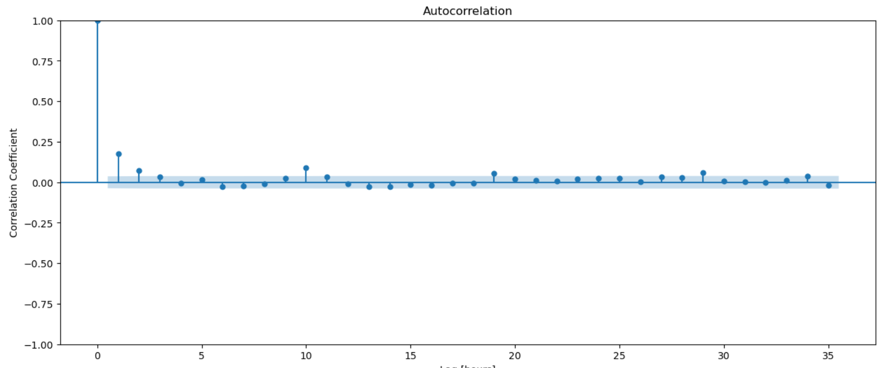

Each of the dots on our plot represents a correlation coefficient. The first data point in the top left of the graph tells us that at time-step 0, the correlation coefficient was 1, meaning that there was a perfect correlation. That makes sense, because you can't lag from time-step 0, so the coefficient can't be anything other than 1. But, starting at hour 1, the coefficient drops precipitously, and we see our autocorrelation coefficients slowly decay over time. As our lag recedes further into the past, the correlations break down; a prediction you made five hours ago about what's happening right now is going to be a lot more reliable than a prediction you made 96 hours ago.

The light blue shape across the bottom of the graph represents the confidence interval, or the extent to which we can be sure that our estimated correlations reflect the correlations that exist in reality. By default, this is set to 95%. Data points which fall either above or below the shape are likely not due to chance, and those which fall inside the shape are likely due to chance. It looks like all our data is the result of some kind of effect, so we're good to go.

**Creating a PACF Plot**
Let's make a PACF plot using our y Series.

```py
fig1, ax = plt.subplots(figsize=(15, 6))
​plot_pacf(y, ax=ax)
plt.xlabel("Lag [hours]")
plt.ylabel("Correlation Coefficient")
```

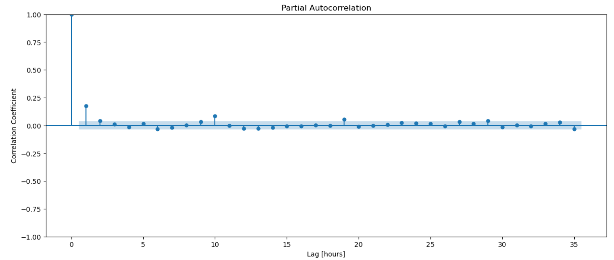

This looks very different. There are two things to notice here:
First, we now have lots of data points that we can be relatively certain aren't due to chance, but we also have lots of data points inside the blue shape at the bottom, indicating that some of our data points are indeed due to chance. That's not necessarily a problem, but it's something useful to keep in mind.

Second, recognize that even though the amplitude of the points on our graph has been significantly reduced, the trend has remained essentially the same: Strong positive correlations at the beginning, with the effect decaying over time. We would expect to see that, because the farther out into the future our predictions go, the less accurate they become.

#### Working with Rolling Windows

**Rolling window** is an important concept for time series analysis. We first define a window size, like 7 days, three months, etc. Then we calculate some statistics taking data from each window sequentially throughout the time series. For example, if I want to calculate a three-month rolling sum with the time series data below:

Original Sales Data
| Month   | Sales |
|---------|-------|
| 2022-01 | 10    |
| 2022-02 | 20    |
| 2022-03 | 25    |
| 2022-04 | 15    |
| 2022-05 | 20    |
| 2022-06 | 30    |

Three-Month Rolling Sum
| Rolling Months  | Rolling Sum Sales |
|-----------------|-------------------|
| 2022-01,02,03   | 55                |
| 2022-02,03,04   | 60                |
| 2022-03,04,05   | 60                |
| 2022-04,05,06   | 65                |

Rolling window statistics are very helpful in smoothing noisy data when making time series predictions. Let's see it with an example. Since we're interested in making predictions about the air quality in Lagos, it would be helpful to understand the rolling average for the PM 2.5 readings with a line plot. To keep things manageable, we'll set our window-size to one week.

```py
fig, ax = plt.subplots(figsize=(15, 6))
# `168` is the number of hours in a week.
df["P2"].rolling(168).mean().plot(ax=ax)
```

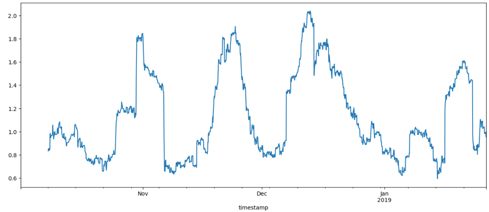
Even though there are lots of peaks and valleys here, we're starting to see an emerging trend.

We can make the same graph using pandas, like this:
`df["P2"].rolling(168).mean().plot(figsize=(15, 6))`

Besides rolling sum and rolling average, rolling window statistics can be applied to a lot of other statistics depends on the problem you are facing. In the example below, when we use **GARCH** model to analyze stock prices, we can use rolling window to calculate standard deviation.

#### Splitting the Data

The last thing to do in our data exploration is to split our data into training and test sets. For linear regression, we used an 80/20 split, where we used 80% of the data was our training set, and 20% of it was our test set. This time, we're going to expand the test set to 95%, and decrease the test set to %5 to bring it into line with statsmodels default confidence interval. This is important, because we'll need to use as much training data as we can if our model is going to accurately predict what's going to come next.

```py
cutoff_test1 = int(len(y) * 0.95)
​
y_train = y.iloc[:cutoff_test1]
y_test = y.iloc[cutoff_test1:]
```

#### Building the Model

```py
# Baseline
y_train_mean = y_train.mean()
y_pred_baseline = [y_train_mean] * len(y_train)
mae_baseline = mean_absolute_error(y_train, y_pred_baseline)
​
print("Mean P2 Reading:", round(y_train_mean, 2))
print("Baseline MAE:", round(mae_baseline, 2))
# Mean P2 Reading: 1.13
# Baseline MAE: 1.45
```

#### Iterating

Before we can go any further, we need to instantiate an autoregression model based on our y training data. We'll call the model model.

```py
model = AutoReg(y_train, lags=24, old_names=False).fit()
```

Notice that, unlike our linear regression model which we built using scikit-learn, we're combining instantiation and fitting into one step; statsmodels includes that ability in its AutoReg method.

Autoregression models need us to generate in-sample predictions in order to calculate the MAE of our training data. In-sample predictions use data that's already part of our sample. That's to distinguish it from out-of-sample predictions, which we'll talk about a bit later. The statsmodels library includes a method called predict that can help us here. Above, the AutoReg method includes this line:
`old_names=False`
The False value here tells the model that it can use in-sample lagged values to make predictions; if the value had been True, the model would have to look elsewhere to make its predictions.

Here's how to generate in-sample predictions:

```py
y_pred = model.predict().dropna()
```

Once we've done that, we can calculate the MAE of the predictions in our training set.

```py
training_mae = mean_absolute_error(y_train.loc[y_pred.index], y_pred)
print("Training MAE:", training_mae)
# Training MAE: 1.3732671312098252
```

#### Residuals

We're going to use our model's residuals to make some visualizations, but first, we need to calculate what those residuals are.

```py
y_train_resid = y_train - y_pred # OR model.resid
```

Now we can make a line plot of our model's residuals.

```py
fig1, ax = plt.subplots(figsize=(15, 6))
y_train_resid.plot(ax=ax)
```

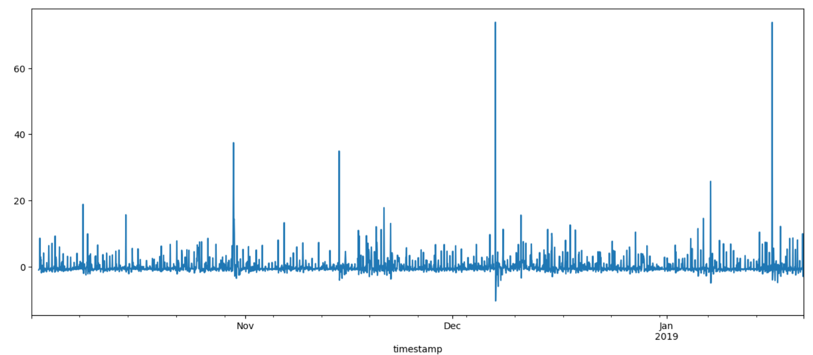

The ideal residual plot has a random set of datapoints spread evenly on both sides of the line. The plot we just made actually looks pretty good; there are some significant outliers, but, on the whole, the bars describe an even band of values, which is what we're looking for.
​
Let's also take a look at a histogram of the residuals to help us see how they're distributed.

`y_train_resid.hist()`

Remember, when we make histograms, we're trying to answer two questions:

1. Is it a normal distribution?
2. Are there any outliers?

For our histogram, that middle bar is pretty tall, but the shape described by all the bars looks like a normal distribution (albeit a stretched one), so the answer to the first question is "yes." Outliers are values that fall beyond the shape of a normal distribution, and it doesn't look like we have any of those, so the answer to the second question is "no." Those are the answers we're looking for, so let's move on to the next step.

We're now going to make an ACF plot to see how much variation there is in the dataset.

```py
fig, ax = plt.subplots(figsize=(15, 6))
plot_acf(y_train_resid.dropna(), ax=ax);
```

At first, this might seem wrong, but we're actually looking for a mostly-flat graph here. This is an indication that our model describes all the seasonality, or regular changes, in our data. In other words, this graph is exactly what we're looking for.

#### Evaluating the Model

Now that we've built an autoregression model that seems to be working pretty well, it's time to evaluate it. We've already established that the model works well when compared to itself, but what about how well it works when we start looking outside our original dataset?

**Out-of-Sample Predictions**
To look outside the data, we need to create a new set of predictions. The process here is very similar to the way we made our baseline predictions. We're still using predict, but we're using the test data instead of the train data.

```py
y_pred_test = model.predict(y_test.index.min(), y_test.index.max())
```

Now that we have a prediction, we can calculate the MAE of our out-of-sample data.

```py
test_mae = mean_absolute_error(y_test, y_pred_test)
print("Test MAE 1:", test_mae)
# Test MAE 1: 1.4720818987259616
```

Now that we have some out-of-sample predictions, we can compare it to our in-sample predictions using a line plot. The first step there is to create a new DataFrame called test1_predictions with two columns: one for the y_test data (the true data) and one for the y_pred (the predicted data). It's always a good idea to print the first five rows of a new DataFrame, just to make sure it looks the way it should.

```py
test1_predictions = pd.DataFrame(
    {"y_test": y_test, "y_pred": y_pred_test}, index=y_test.index
)
test1_predictions.head()
```

That looks correct, so we can move on to our line plot.

```py
fig = px.line(test1_predictions, labels={"value": "P2"})
fig.show()
```

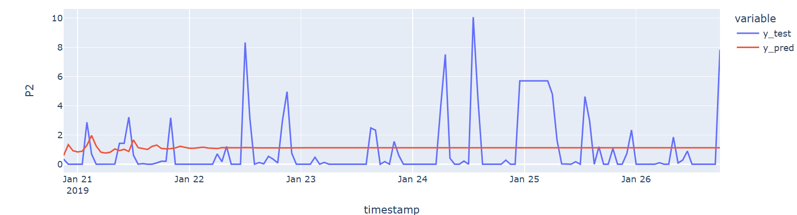
This looks kind of strange, but it's actually exactly what we would expect to see. At the beginning, the y_pred data has a fair amount of predictive power, but, as time goes on, the predictions become less and less accurate. It's kind of like what happened with our ACF plots, only in reverse. Last time, the model lost its predictive power as the lag increased. Here, the model loses its predictive power as the horizon — how far away from the present your predictions are — increases. But don't worry! We'll fix it in a second.

#### Walk-forward Validation

Our predictions lose power over time because the model gets farther and farther away from its beginning. But what if we could move that beginning forward with the model? That's what walk-forward validation is. In a walk-forward validation, we re-train the model at for each new observation in the dataset, dropping the data that's the farthest in the past. Let's say that our prediction for what's going to happen at 12:00 is based on what happened at 11:00, 10:00, and 9:00. When we move forward an hour to predict what's going to happen at 1:00, we only use data from 10:00, 11:00, and 12:00, dropping the data from 9:00 because it's now too far in the past. Let's see how it works.

```py
%%capture
# First, we define a walk-forward variable
y_pred_wfv = pd.Series()
# Then, we define a variable that takes into account what's happened in the past
history = y_train.copy()
# The `for` loop tells the model what to do with those variables.
for i in range(len(y_test)):
    # Here's where we generate the actual AR model
    r = AutoReg(history, 24, old_names=False).fit()
    # Now we're using `forecast` to create our next prediction
    next_pred = r.forecast()
    # We're adding the next prediction to the list
    y_pred_wfv = y_pred_wfv.append(next_pred)
    # And finally updating `history` to take into account the new observation
    history = history.append(y_test[next_pred.index])

```

You'll notice that we're using the same AutoReg method we used before, only this time, we're using the y_train data. Also like before, the 24 is telling the model how many hours it should pay attention to. If you change that number, the MAE will change too.

Speaking of the MAE, let's calculate it and see what we've got.

```py
test1_mae = mean_absolute_error(y_test, y_pred_wfv)
print("Test MAE 1 (walk forward validation):", round(test1_mae, 2))
# Test MAE 1 (walk forward validation): 1.32
```

#### Communicating the Results

In machine learning, the model's parameters are the parts of the model that are learned from the training data. There are also hyperparameters, which we'll discuss in the next module. For now, just know that parameters come from inside the model, and hyperparameters are specified outside the model.

So, let's print the parameters of our validated model and see what it looks like.
`print(model.params)`

That looks pretty good, but showing it in a line plot would be much better.

```py
test1_predictions = pd.DataFrame(
    {"y_test": y_test, "y_pred": y_pred_wfv}, index=y_test.index
)
fig = px.line(test1_predictions)
fig.show()
```

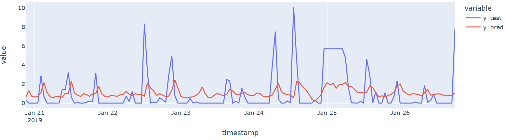
That looks much better! Now our predictions are actually tracking the test data, just like they did in the linear regression model.

### ARMA Model

**ARMA Models & Hyperparameters**
ARMA stands for Auto Regressive Moving Average, and it's a special kind of time-series analysis. So far, we've used autoregression (AR) to build our time-series models, and you might recall that AR models rely on values that remain relatively stable over time. That is, they can predict the future very well, as long as the future looks roughly the same as the past. The trouble with predicting the future is that things can suddenly change, and as a result, the future doesn't look much like the past anymore. These sudden changes — economists call them endogenous shocks — can be as big as a hurricane destroying a city or an unexpected increase in the minimum wage, and they can be as small as a new restaurant opening in a neighborhood or a single person losing their job. In our data, the air quality might be changed if there was a nearby forest fire, or if a building collapsed near one of the sensors and raised a giant cloud of dust.

Regardless of the size of the shock, ARMA models can still predict the future. All we need to make that work is data.

#### Cleaning the Data

As always, we need to import all the tools we'll need to make our model.

```py
import time
import warnings
​
import matplotlib.pyplot as plt
import pandas as pd
import plotly.express as px
import seaborn as sns
from pymongo import MongoClient
from sklearn.metrics import mean_absolute_error
from statsmodels.graphics.tsaplots import plot_acf, plot_pacf
from statsmodels.tsa.arima.model import ARIMA
​
warnings.filterwarnings("ignore")
```

And then we need to get our database client up and running.

```py
client = MongoClient(host="localhost", port=27017)
db = client["air-quality"]
lagos = db["lagos"]
```

Then, we need to clean our data. All the examples will use data from Site 3; all the practice sets will use Site 2. If you need a refresher on how all those methods work, refer back to the Autoregression notebook.

```py
results = lagos.find(
    # Note that the `3` refers to Site 3.
    {"metadata.site": 3, "metadata.measurement": "P2"},
    projection={"P2": 1, "timestamp": 1, "_id": 0},
)
df = pd.DataFrame(list(results)).set_index("timestamp")
df.index = df.index.tz_localize("UTC").tz_convert("Africa/Lagos")
df = df[df["P2"] < 500]
df["P2.L1"] = df["P2"].shift(1)
df.dropna(inplace=True)
y = df["P2"].resample("1H").mean().fillna(method="ffill")
```

#### Exploring the Data

Just like we did with AR, we'll start by exploring the data. Let's make a histogram.
`y.hist()`
​
This is what the data looks like when our sample is 1-hour intervals, but we might want to be able to quickly change our sample to other intervals of time. First, we'll create a function called wrangle, and then add an argument. In Python, arguments tell the function what to do. This function already has an argument called collection, so we'll need to add another to make resampling work. We'll call that argument resamp_pd.

```py
# Here's where the new argument goes. We're setting the default value to `"1H"`.
def wrangle(lagos, resamp_pd="1H"):
    results = lagos.find(
        # Note that the `3` refers to Site 3.
        {"metadata.site": 3, "metadata.measurement": "P2"},
        projection={"P2": 1, "timestamp": 1, "_id": 0},
    )
    df = pd.DataFrame(list(results)).set_index("timestamp")
    df.index = df.index.tz_localize("UTC").tz_convert("Africa/Lagos")
    df["P2.L1"] = df["P2"].shift(1)
    df.dropna(inplace=True)
    return y

# Now let's change "1H" to "1D" and see what happens.
y = wrangle(lagos, resamp_pd="1D")
print(y)
```

As you can see on the left side of the table, the samples are now at one day intervals, which is exactly what we wanted!
Let's make a new histogram to see if changing the sampling interval made a difference in the data.
`y.hist()`

This looks pretty different! It's always nice to have a diversified dataset.

```py
# Like with our AR model, we need to create ACF and PACF plots to see what's happening with the correlation coefficients.
fig, ax = plt.subplots(figsize=(15, 6))
plot_acf(y, ax=ax)
plt.xlabel("Lag [hours]")
plt.ylabel("Correlation Coefficient");

# And now let's make a PACF plot.

fig, ax = plt.subplots(figsize=(15, 6))
fig = plot_pacf(y, ax=ax)
plt.xlabel("Lag [hours]")
plt.ylabel("Correlation Coefficient")
```

#### Splitting Data

In our AR model, we split our data based on the number of observations we wanted to investigate. This time, we're going to split our data based on the date, using just the readings from October 2018. So, just like we did before, we'll create a training set using y, but instead of using percentages to split the data, we'll use dates.

```py
# Notice that the date format is `YYYY-MM-DD`
y_train = y.loc["2018-10-01":"2018-10-31"]
```

#### Building Model

```py
# Baseline
y_train_mean = y_train.mean()
y_pred_baseline = [y_train_mean] * len(y_train)
mae_baseline = mean_absolute_error(y_train, y_pred_baseline)
print("Mean P2 Reading:", round(y_train_mean, 2))
print("Baseline MAE:", round(mae_baseline, 2))
# Mean P2 Reading: 1.09
# Baseline MAE: 1.39
```

#### Iterate

So far, the only difference between our old AR model and the new ARMA model we're building is that the new model's data is based on the date rather than on the length of the variable. But the difference between AR and ARMA is the addition of hyperparameters.

**Hyperparameters**
Let's set our p values to include values from 0 to 25, moving in steps of 8:
`p_params = range(0, 25, 8)`

And let's set our q values to include values from 0 to 3, moving in steps of 1:
`q_params = range(0, 3)`

In order to tell the model to keep going through all the possible combinations, we'll add in a pair of for loops.

A **"hypermeter search grid"** generally refers to a multi-dimensional search or optimization grid that can be used to tune hyperparameters in machine learning models. These grids are often implemented using techniques like grid search or randomized search to explore combinations of hyperparameters in a systematic way.

```py
maes = dict()
for p in p_params:
    maes[p] = list()
    for q in q_params:
        order = (p, 0, q)
        start_time = time.time()
        # Here's where we actually define the model
        model = ARIMA(y_train, order=order).fit()
        # Here's where we tell the model how we want it to deal with time
        elapsed_time = round(time.time() - start_time, 2)
        print(f"Trained ARIMA {order} in {elapsed_time} seconds")
        # Here's where we get back into the MAE for the model
        y_pred = model.predict()
        mae = mean_absolute_error(y_train.iloc[24:], y_pred.iloc[24:])
        # And finally we append the MAES to the original list
        maes[p].append(mae)

# Trained ARIMA (0, 0, 0) in 0.06 seconds
# Trained ARIMA (0, 0, 1) in 0.21 seconds
# Trained ARIMA (0, 0, 2) in 0.89 seconds
# Trained ARIMA (8, 0, 0) in 8.5 seconds
# Trained ARIMA (8, 0, 1) in 35.7 seconds
# Trained ARIMA (8, 0, 2) in 61.7 seconds
# Trained ARIMA (16, 0, 0) in 46.69 seconds
# Trained ARIMA (16, 0, 1) in 121.21 seconds
# Trained ARIMA (16, 0, 2) in 218.39 seconds
# Trained ARIMA (24, 0, 0) in 44.12 seconds
# Trained ARIMA (24, 0, 1) in 134.3 seconds
# Trained ARIMA (24, 0, 2) in 297.42 seconds
```

Now that we have a working ARMA model, let's turn the output into a DataFrame so we can see what happened.

```py
mae_grid = pd.DataFrame(maes)
mae_grid.round(4)
# 0  8 16 24
# 0 1.4016 1.2603 1.2588 1.2586
# 1 1.3311 1.2604 1.2586 1.2586
# 2 1.2902 1.2696 1.2629 1.2668
```

And let's visualize the DataFrame in a heatmap. (If you need a refresher on how to create a heatmap in seaborn, refer to Notebook 008.)

```py
sns.heatmap(mae_grid, cmap="Blues")
plt.xlabel("p values")
plt.ylabel("q values")
plt.title("Grid Search (Criterion: MAE)")
```

It looks like our MAE values are in the right place, but let's try some other ways to explore our new model using the plot_diagnostics method.

```py
fig, ax = plt.subplots(figsize=(15, 12))
model.plot_diagnostics(fig=fig)
```

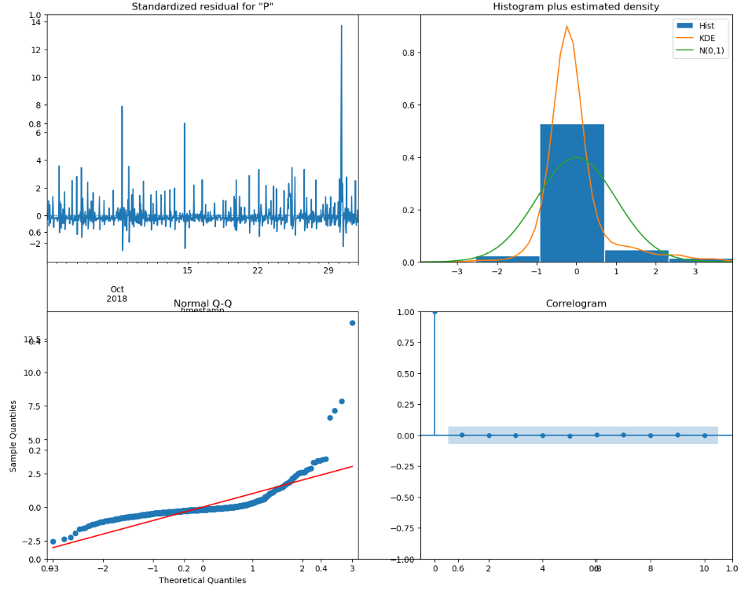
As usual, we have quite a lot to sift through here. The first graph is showing us our model's residuals. Ideally, we'd like to see this be as close to zero as possible, and this graph is telling us that, for the most part, we have a good model.

The next graph over shows us another version of the same thing. The histogram is similar to the one we made before, but there's a pair of lines superimposed. These lines are indicating the kernel density, which is another way of saying that it's a smoothed-out version of the blue histogram bars. The green line represents a normal distribution, and is included here just to give you something to compare to the values from your model. The orange line represents the smoothed-out version of the result off your model. Our model is actually pretty close to a normal distribution, so that's good!

The Q-Q plot on the bottom left is yet another way to visualize the same thing. Here, the red line is showing us a perfect 1:1 correlation between our variables, and the wavy blue line is showing us what we actually have. Again, our model is pretty close to the red line, so it's looking good.

And finally, we have a correlogram, which might look familiar; it's the same kind of plot as the ACF and PACF plots from our AR models.

#### Communicating Results

Now that we have an ARMA model that seems to be working well, it's time to communicate the results of our analysis in a line graph. Let's create a graph that shows the relationship between our training and predicting data. (For a refresher on how to do this and what it means, refer to the AR notebook.)

```py
y_train_pred = model.predict()
df_predictions = pd.DataFrame(
    {"y_train": y_train, "y_pred": y_train_pred}, index=y_train.index
)
fig = px.line(df_predictions, labels={"value": "P2"})
fig.show()
```

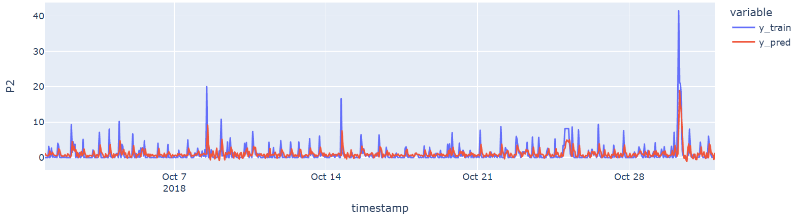

### ARCH and GARCH Models

ARCH stands for autoregressive conditionally heteroscedastic, which models the variance of a time series. ARCH model assumes variance at time $t$ depends on the past squared observations. A GARCH (generalized autoregressive conditionally heteroscedastic) model uses values of the past squared observations and past variances to model the variance at time $t$. ARCH and GARCH models are widely used in finance and econometric time series analysis.

Let's see an example of using GARCH model in forecasting Apple stock price volatility. We first import the data.

```py
df = pd.read_csv("./data/AAPL.csv", parse_dates=["date"], index_col="date")
​
print("df shape:", df.shape)
df.head()
```

The dataset range from 1999 to 2022. For simplicity, we only take 5 years of data.

```py
df = df["2015-10-13":]
df.shape
```

>(1765, 5)

#### Calculating Returns

The next step is to calculate the volatility of the stock close prices. Here we can use the pct_change function from pandas to calculate the daily percentage change, then multiply the result by 100 to get the returns:

```py
df.sort_index(ascending=True, inplace=True)
df["return"] = df["close"].pct_change() * 100
df.head()
```

We can then take out the return column as our training data. Note the first observation is missing since there is no past value to observe. We need to drop it:

```py
AAPL_return = df["return"].dropna()
AAPL_return.head()
```

We can check the histogram to see the distribution of the returns over the past five years:

```py
plt.hist(AAPL_return, bins=50)
​
plt.xlabel("Returns")
plt.ylabel("Frequency [count]")
​
# Add title
plt.title("Distribution of AAPL Daily Returns")
```

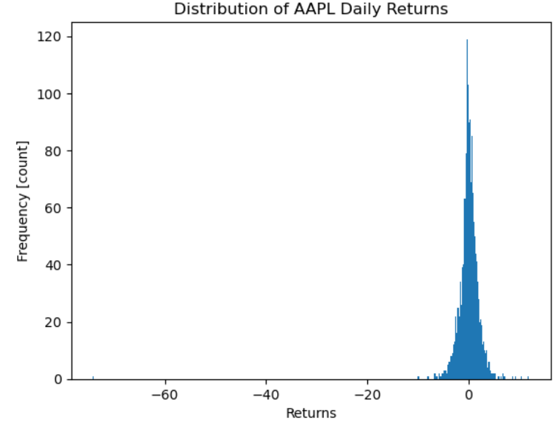

There's a negative outlier in this date range, with the idxmin function, we find out it was in 31 August 2020. The stock price has a huge drop due to a stock split.

`AAPL_return.idxmin(), AAPL_return.min()`
>(Timestamp('2020-08-31 00:00:00'), -74.1521943793442)

We can also check the standard deviation of the whole dataset with the pandas std() function:

`AAPL_return.std()`
> 2.581824271287778

To see the statistic more clearly, we can use some time series plots. In addition to the Apple stock price return plot, we can also plot rolling volatility of the return to smooth out the noise, and see how return and volatility are associated with each other. First we can calculate a 50-day rolling standard deviation series for Apple stock price return:

```py
AAPL_return_rolling_50d_volatility = AAPL_return.rolling(window=50).std().dropna()
AAPL_return_rolling_50d_volatility.head()
```

> date
2015-12-23    1.664367
2015-12-24    1.654218
2015-12-28    1.646409
2015-12-29    1.664682
2015-12-30    1.671630
Name: return, dtype: float64

We can plot these two series:

```py
fig, ax = plt.subplots(figsize=(15, 6))
​
AAPL_return.plot(ax=ax, label="daily return")
​
# Plot
AAPL_return_rolling_50d_volatility.plot(
    ax=ax, label="50d rolling volatility", linewidth=3
)
​
# Add axis labels
plt.xlabel("Date")
plt.ylabel("Return")
​
​
plt.legend()
```

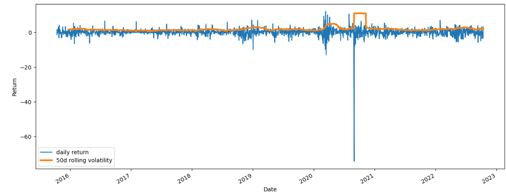

Here we can see that volatility goes up when the returns change drastically up or down. For instance, when return dropped enormously in 2020 August, volatility also increased a lot. However, this plot reveals a problem. We want to use returns to see if high volatility on one day is associated with high volatility on the following day. But high volatility is caused by large changes in returns, which can be either positive or negative. How can we assess negative and positive numbers together without them canceling each other out? The common solution used in building ARCH or GARCH models are to square the returns. Let's plot the squared returns:

```py
fig, ax = plt.subplots(figsize=(15, 6))
​
# Plot squared returns
(AAPL_return**2).plot(ax=ax, label="daily return")
​
# Add axis labels
plt.xlabel("date")
plt.ylabel("Squared Returns");
```

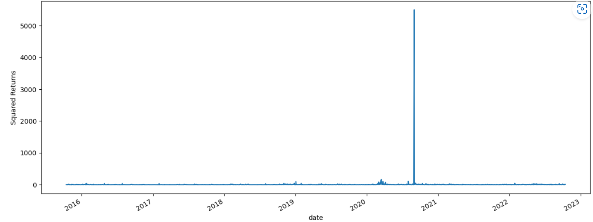

Now we it much easier to see groups high and low volatility and build a GARCH model. To build a GARCH model, we need to figure out both the p and q parameters. The p parameter is handling correlations at prior time steps and the q parameter deals with prior variances, like shocks. It also uses the notion of lag. To see how many lags we should have in our model, we should create an ACF and PACF plot — but using the squared returns.

```py
fig, ax = plt.subplots(figsize=(15, 6))
​
# Create ACF of squared returns
plot_acf(AAPL_return**2, ax=ax)
​
# Add axis labels
plt.xlabel("Lag [days]")
plt.ylabel("Correlation Coefficient");
```

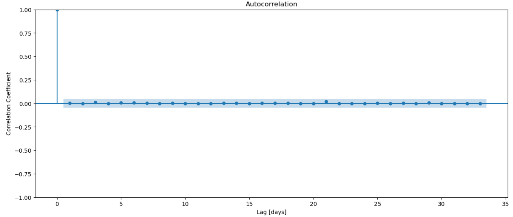

```py
fig, ax = plt.subplots(figsize=(15, 6))

# Create PACF of squared returns
plot_pacf(AAPL_return**2, ax=ax)

# Add axis labels
plt.xlabel("Lag [days]")
plt.ylabel("Correlation Coefficient")
```

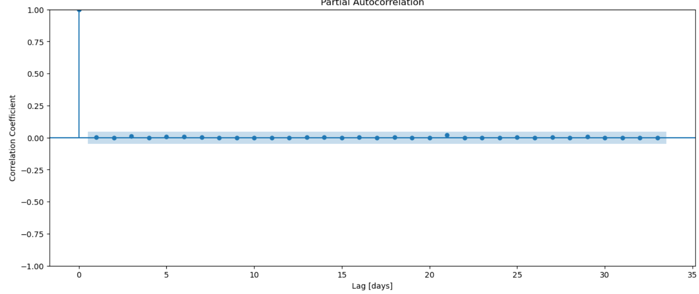

Both the ACF and PACF graph show one lag is enough to build the model.

#### Build Model

```py
# Build and train model
model = arch_model(AAPL_return, p=1, q=1, rescale=False).fit(disp=0)
​
print("model type:", type(model))
​
# Show model summary
model.summary()
```

The model summary provides a lot of information about the model, like the trained parameters, model performance, etc. AIC and BIC are important measurements for model performance. AIC stands for Akaike Information Criterion, it measures the goodness of fit of any estimated statistical model. BIC is Bayesian Information Criteria that selects model from a finite set of models. When fitting models, it is possible to increase model performance by adding more parameters, which would also result in overfitting. The BIC resolves this problem by introducing a penalty term for the number of parameters in the model. The penalty term is larger in BIC than in AIC. Though BIC is always higher than AIC, lower the value of these two measures, better the model.

#### Standardized Residuals

After fitting the model with the data, we can get also get the residuals to see how the model performs. The residual at time 𝑡 is the observed return at time 𝑡 minus the model's estimated mean return at time  𝑡 . For other models that model observations directly, like stock prices, the assumptions are the residuals are the noises that follow a normal distribution. In GARCH model, since we are model returns, which is the variance of the stock prices, the residuals of the variance will not follow a normal distribution. So we need to use standardized residuals instead of residuals to check the normality. Standardized residual at time 𝑡 is the residual at time 𝑡 divided by the square root of the model estimated variance at time  𝑡 . Let's check the plot of the standardized residuals across the time series:

```py
fig, ax = plt.subplots(figsize=(15, 6))
​
# Plot standardized residuals
model.std_resid.plot(ax=ax, label="Standardized Residuals")
​
# Add axis labels
plt.xlabel("Date")
plt.ylabel("Value")
​
# Add legend
plt.legend()
```

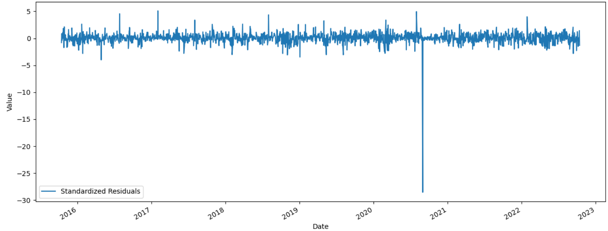

```py
# Create histogram of standardized residuals
plt.hist(model.std_resid, bins=500)

# Add axis labels
plt.xlabel("Standardized Residual")
plt.ylabel("Frequency [count]")

# Add title
plt.title("Distribution of Standardized Residuals");
```

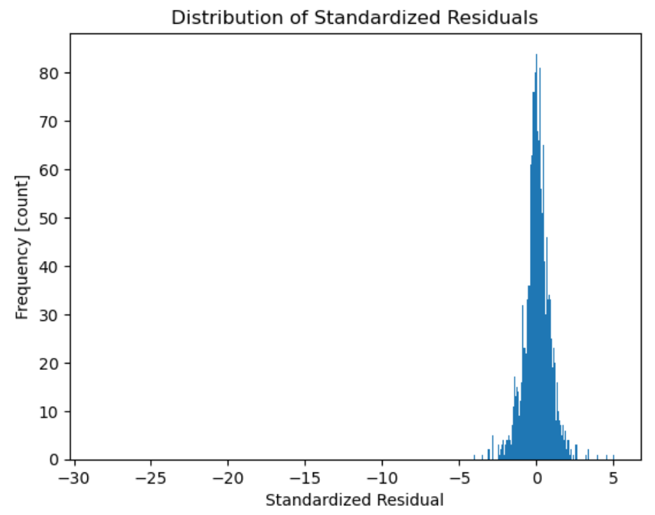

#### Evaluation

We can further evaluate the model by comparing its forecast with a subset of the observed returns to see whether the model has successfully captured the volatility. We can first check the model conditional volatility in its confidence interval throughout the dataset:

```py
fig, ax = plt.subplots(figsize=(15, 6))
​
# Plot `AAPL_return`
AAPL_return.plot(ax=ax)
​
# Plot conditional volatility * 2
(2 * model.conditional_volatility).plot(
    ax=ax, color="C1", label="2 SD Conditional Volatility"
)
​
​
# Plot conditional volatility * -2
(-2 * model.conditional_volatility.rename("")).plot(ax=ax, color="C1")
​
​
# Add axis labels
plt.xlabel("Date")
plt.ylabel("Daily Returns")
​
# Add legend
plt.legend()
```

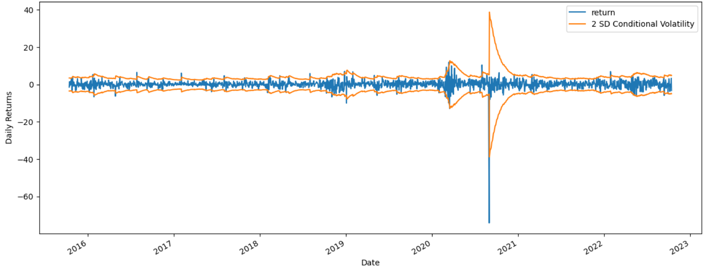

We can then select the test set of the data and do a walk-forward validation on the GARCH model:

```py
# Create empty list to hold predictions
predictions = []
​
# Calculate size of test data (20%)
test_size = int(len(AAPL_return) * 0.2)
​
# Walk forward
for i in range(test_size):
    # Create test data
    y_train = AAPL_return.iloc[: -(test_size - i)]
​
    # Train model
    model = arch_model(y_train, p=1, q=1, rescale=False).fit(disp=0)
​
    # Generate next prediction (volatility, not variance)
​
    next_pred = model.forecast(horizon=1, reindex=False).variance.values[0][0] ** 0.5
​
    # Append prediction to list
    predictions.append(next_pred)
​
# Create Series from predictions list
y_test_wfv = pd.Series(predictions, index=AAPL_return.tail(test_size).index)
​
print("y_test_wfv type:", type(y_test_wfv))
print("y_test_wfv shape:", y_test_wfv.shape)
y_test_wfv.head()
```

We can plot the predicted volatility versus return in this test set, and see the model has captured most of the variance here:

```py
fig, ax = plt.subplots(figsize=(15, 6))
​
# Plot returns for test data
AAPL_return.tail(test_size).plot(ax=ax, label="AAPL return")
​
# Plot volatility predictions * 2
(2 * y_test_wfv).plot(ax=ax, c="C1", label="2 SD Predicted Volatility")
​
# Plot volatility predictions * -2
(-2 * y_test_wfv).plot(ax=ax, c="C1")
​
# Label axes
plt.xlabel("Date")
plt.ylabel("Return")
​
# Add legend
plt.legend()
```

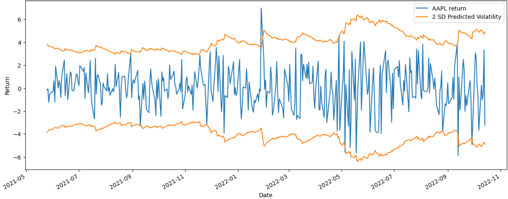

#### Forecasting

The last step is to make the forecasts with our trained model. Let's make a one-day forecast first to see how GARCH model forecasting works:

`one_day_forecast = model.forecast(horizon=1, reindex=False).variance`
`print("one_day_forecast type:", type(one_day_forecast))`
>one_day_forecast
one_day_forecast type: <class 'pandas.core.frame.DataFrame'>
h.1
date
2022-10-13 5.998737

There are two things we need to keep in mind here. First, our model forecast shows the predicted variance, not the standard deviation / volatility. So we'll need to take the square root of the value. Second, the prediction's index is in the format of "h.1" as the next date of the last training data date. It's not in the form of DatetimeIndex that we desire. So we need to format the forecasts to be more readable.

We first generate 5 days predictions with our trained GARCH model:

```py
# Generate 5-day volatility forecast
prediction = model.forecast(horizon=5, reindex=False).variance ** 0.5
​
# Calculate forecast start date
start = prediction.index[0] + pd.DateOffset(days=1)
​
# Create date range
prediction_dates = pd.bdate_range(start=start, periods=prediction.shape[1])
​
# Create prediction index labels, ISO 8601 format
prediction_index = [d.isoformat() for d in prediction_dates]
​
print("prediction_index type:", type(prediction_index))
print("prediction_index len:", len(prediction_index))
prediction_index[:3]
```

>prediction_index type: <class 'list'>
prediction_index len: 5
['2022-10-14T00:00:00', '2022-10-17T00:00:00', '2022-10-18T00:00:00']

Then we define a function to clean the predictions to be more readable:

```py
# Take the square root of the model forecasts
data = prediction.values.flatten() ** 0.5
​
# Format the forecasts with the correct date
prediction_formatted = pd.Series(data, index=prediction_index)
​
# Show the results
prediction_formatted.to_dict()
```

>{'2022-10-14T00:00:00': 1.565
0022107851496,
 '2022-10-17T00:00:00': 1.5695200439283639,
 '2022-10-18T00:00:00': 1.573999197428616,
 '2022-10-19T00:00:00': 1.578440435280944,
 '2022-10-20T00:00:00': 1.5828444980313872}
