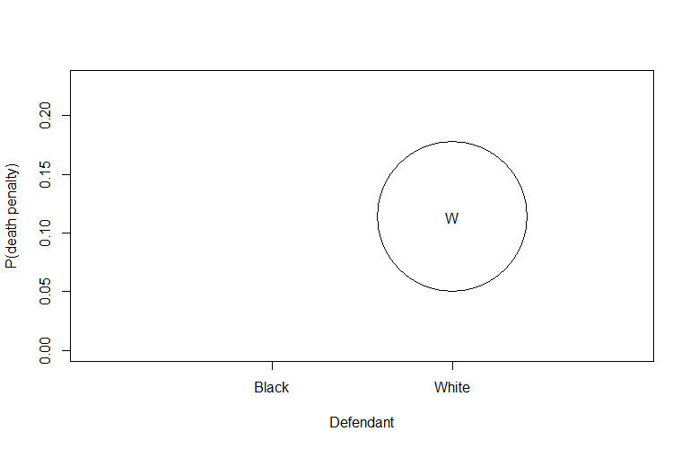
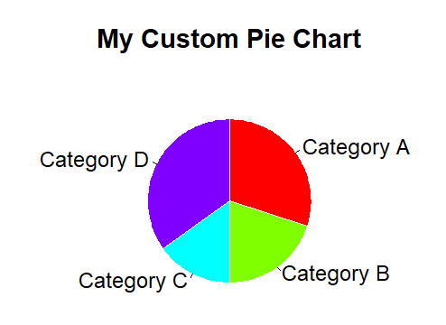

# R cheat sheet

This is an comprehensive guide to R programming language and its application in the world of Statistics.

> **Note:**  This is an intermediate introduction to R and how we can use the programming language to perform data manipulation, analysis and visualisation.
> I have learned these stuff from proffesor Arnab Chakraborty at ISI and a lot credit for this goes to him.
> You can check some problems to try related to these [here](https://github.com/amansingh2116/stat_assignments_sem1/tree/main).
> I will advise you to run the programs along side reading this to get a better learning experience. Also search the internet for some source files mentioned in the examples, this way you will actualy get your hands dirty and learn things even faster.
> Also since it is a pretty large collection of "short-notes", it is advised that you try to learn through it in a bite-sized format.


# R (cheatsheet)

## Basics

### Simple mathematics
R may be used like a simple calculator.

For example:-

``3+5`` returns ``8``

### Variables

```r
x = 4

y = -4 #now we can perform operations with these variables

speed.light = 3e8 # 3e8 means 3 times 10 to the power 8
```

### Assignments

- **`=`** and **`<-`** are both used for assignment in the current environment or scope.
- **`<<-`** is used for assignment in parent environments (outside of the current scope), which is useful for global modifications but should be used carefully to avoid unintended side effects.

### Standard functions

```r
sin(x)
cos(y)
sin(pi) #pi is a built-in constant
tan(pi/2)

exp(y)
log(x-y)

# To know the documentation of any function
help.search("sin") 
#or
??sin
```

## Vectors
R can handle vectors, which are basically lists of numbers.

### Initialising a vector
```r
x = c(1,2,3)
y = c(x, c(-1,5),x) # y = [1, 2, 3, -1, 5, 1, 2, 3]
length(x) # 8 - inbuilt function

x = 1:3 # x = [1, 2, 3]

#If the common difference is not 1 or −1 then we can use the seq function

y=seq(2,5,0.3) # y = [2.0, 2.3, 2.6, 2.9, 3.2, 3.5, 3.8, 4.1, 4.4, 4.7, 5.0]

y = seq(0,1,len=10) # y = [0.0000000, 0.1111111, 0.2222222, 0.3333333, 0.4444444, 0.5555556, 0.6666667, 0.7777778, 0.8888889, 1.0000000]

rep(1,10) # a vector of 1’s having length 10
rep(1:3,10) # 1,2,3, 1,2,3, 1,2,3,...ten times

numeric(length = 0) # `numeric(1000)` will give a vector of 1000 values all equal to 0
as.numeric(x, ...) #changes non numeric terms to NA
is.numeric(x) #true false values if elements in x are NA or not
```

### Entrywise operation on vectors

Most operations that work with numbers act entrywise when applied to vectors.

It is very easy to add/subtract/multiply/divide two vectors entry by entry. Try it yourself.

### Summarizing a vector
```r
val = c(2,1,-4,4,6,-4,2)
sum(val) # 7
mean(val) # 1
min(val) # -4
max(val) # 6
range(val) # min -4; max 6
sd(val) # standard deviation
```

**`summary()`** function is used to obtain a summary of the statistical properties of one or more R objects, output of **`summary()`** depends on the class of the object being summarized.
```r
val = c(2,1,-4,4,56,-4,2)
summary(val) 
```
Output: 

| Min   | 1st Qu. | Median | Mean  | 3rd Qu. | Max   |
|-------|---------|--------|-------|---------|-------|
| -4.000| -1.500  | 2.000  | 8.143 | 3.000   | 56.000|

```r
which.min(val) #index of min(val)
which.max(val) #index of max(val)

logical_vector = c(FALSE, TRUE, FALSE, TRUE, TRUE)
indices = which(logical_vector) #indices of TRUE values

numbers = c(2, 4, 6, 8, 10)
indices = which(numbers > 5) #indices of numbers greater than 5
```

### Extracting parts of a vector

* If x is a vector of length 3 then its entries may be accessed as ``x[1]``, ``x[2]`` and ``x[3]``.
* Note that the counting starts from 1 and proceeds left-to-right. The quantity
inside the square brackets is called the subscript or index.

```r
x = 3:10
x[1:4] #3 4 5 6
x[c(2,4,1)] # 4 6 3 prints the element at the given index, This technique is often useful to rearrange a vector.

odd = seq(1,50,2)
aman[odd] = seq(1,50,2) # changes odd numbers from 1 to 49 at the odd places of aman vector
aman[c(1,4,12,18)]=69 # changes the values at given places(1,4,12,18) to 69
```

You can also give negative subscripts.
```r
x = 3:10
x[-1] # deletes element at given index and print rest
x[-c(1,3)]

x[3.9] # prints only elment at 3rd index
```
### Comparing vectors

Boolean operators includes: ``<`` ,``<=``, ``>`` , ``>=``, ``==``, ``!=``. You can combine these with, ``&`` (and), ``|`` (or) and ``!`` (not).(modulo operator ``%%`` (e.g., ``5%%3`` is ``2``))
Boolean operator ``%in%`` which is the "belongs to" operator. For instance, ``4 %in% c(3,6,4,1)``
returns ``TRUE``.

```r
x = 3:10
x[x>5] # 6 7 8 9 10

sum(x[x>50]) # 6+7+8+9+10

x>50 # you will get a vector of TRUEs (T)(1) and FALSEs(F)(0)

sum(x>50) # you will get the number of entries exceeding 50

val=c(5,5,45,76,865,6754,897)

> sum(val >= 10 & val <= 40) 
# [1] 0
sum(val > 40 | val < 10) # | means "OR"
#[1] 7
sum(val == 30) #we are using == and not =
[1] 0
sum(val != 24)
#[1] 7

mean(val>50) # mean of truth false i.e., 0 and 1

mean(val) # mean of values in val

aman = c(2,2,2,2,3,3,3,5,8)
aman == 2 # true false values if elements in vector aman == 2
cumsum(aman == 2) # cumulative summation of 0 and 1’S thus the last number gives number of times 2 appears in aman vector
```

In R, the **`all`** function is used to determine whether all the elements of a given logical vector are **`TRUE`**. It returns a single **`TRUE`** if all elements are **`TRUE`**, and **`FALSE`** otherwise.
```r
logical_vector = c(TRUE, TRUE, TRUE)
result = all(logical_vector)
print(result)  # Output will be TRUE because all elements are TRUE
```

The **`any()`** function in R is used to determine if any elements in a logical vector are **`TRUE`**. It returns a single logical value: **`TRUE`** if at least one element is **`TRUE`**, and **`FALSE`** if all elements are **`FALSE`**

```r
logical_vector <- c(FALSE, FALSE, TRUE, FALSE, FALSE)
result <- any(logical_vector) #'result' will be TRUE because there is at least one TRUE value in the vector.
```

### SORTING

```r
x = c(2,3,4,5,3,1)
y = sort(x) # sorted in increasing

y = sort(x, decreasing = T) #sorted in decreasing
```

Sometimes we need to order one vector according to another vector.

```r
x = c(2,3,4,5,3,1)
y = c(3,4,1,3,8,9)
ord = order(x) # 6 1 2 5 3 4
```

Notice that ``ord[1]`` is the position of the smallest number, ``ord[2]`` is the position of the next smallest number, and so on.

```r
x[ord] # same as sort(x)
# 1 2 3 3 4 5
y[ord] # y sorted according to x
# 9 3 4 8 1 3
```

## Working directory and Libraries

If you are not sure check the current working directory using the **``getwd()``** function. You may change the working directory using **``setwd('path to your desired directory')``.** Use **``dir()``** to List the Files in a Directory/Folder.

To install a library or a package:

`install.packages('zyp')` # Quotes (single/double) are must!

To load a library in system:

`library(zyp)` # You may or may not use quotes.

## Matrix

```r
matrix(data = NA, nrow = 1, ncol = 1, byrow = FALSE,
       dimnames = NULL)

as.matrix(x, ...)
is.matrix(x)
```

| data | an optional data vector (including a list) |
| --- | --- |
| nrow | the desired number of rows. |
| ncol | the desired number of columns. |
| byrow | logical. If FALSE (the default) the matrix is filled by columns, otherwise the matrix is filled by rows. |
| dimnames | An attribute for the matrix: NULL or a list of length 2 giving the row and column names respectively. An empty list is treated as NULL, and a list of length one as row names. The list can be named, and the list names will be used as names for the dimensions. |
| x | an R object. |

### Matrix operations
```r
A = matrix(1:20,5,4)
#     [,1] [,2] [,3] [,4]
#[1,]    1    6   11   16
#[2,]    2    7   12   17
#[3,]    3    8   13   18
#[4,]    4    9   14   19
#[5,]    5   10   15   20

x = A[,1] # 1 2 3 4 5 (first column)
y = A[1,] # 1 6 11 16 (first row)

A[x >= 3, y < 10 ] 
#     [,1] [,2]
#[1,]    3    8
#[2,]    4    9
#[3,]    5   10

A[A>10] #11 12 13 14 15 16 17 18 19 20
x[A[,1]] #1 2 3 4 5
x[A[1,]] #1 NA NA NA
for(i in 1:4){ print(max(x[A[,i]]))} #loop to print the maximum value from each column of matrix "A"

 A = matrix(c(1,3,2,4), ncol=2)
 B = matrix(2:7, nrow=2)
 C = matrix(5:2, ncol=2)

dim(B) #dimension
# [1] 2 3

nrow(B)
# [1] 2

ncol(B)
# [1] 3

A+C 
#     [,1] [,2]
#[1,]    6    5
#[2,]    7    6

A-C
#     [,1] [,2]
#[1,]   -4   -1
#[2,]   -1    2

A%*%C #matrix multiplication
#     [,1] [,2]
#[1,]   13    7
#[2,]   31   17

A*C #entrywise multiplication
#     [,1] [,2]
#[1,]    5    6
#[2,]   12    8

t(B) #transpose
#     [,1] [,2]
#[1,]    2    3
#[2,]    4    5
#[3,]    6    7

``sin(A)`` # sin function applies entrywise.
```

Now suppose that we want to find the
sum of each column. We use ``apply`` function for that.

``apply(A,2,sum)`` # apply the sum function columnwise. The 2 above means columnwise. If we need to find the rowwise means we can use
``apply(A,1,mean)``

### vector vs matrix

Subscripting a matrix is done much like subscripting a vector, except that for a matrix we need two subscripts. To see the (1,2)-th entry (i.e., the entry in row 1 and column 2) of A type;   ``A[1,2]``

```r
x = 1:3 #a vector
A = matrix(1:9,3,3) #a matrix
A %*% x #x is treated as a column vector*

# result
#     [,1]
#[1,]   30
#[2,]   36
#[3,]   42

x %*% A #x is treated as a row vector

#result
#     [,1] [,2] [,3]
#[1,]   14   32   50
```

The ``as.matrix`` function converts a vector to a column matrix.
```r
x1 = as.matrix(x)
dim(x1) # 3 1
x1
#      [,1]
# [1,]    1
# [2,]    2
# [3,]    3
```

### Other matrix functions

#### *diag function*

The ``diag`` function has two purposes:

* When applied to matrices it extracts the diagonal entries.

    `diag(A)` - extracts the diagonal elements of matrix **`A`**
* When applied to vectors, it creates a diagonal matrix.
    ``diag(x)`` - creates a diagonal matrix using vector **`x`**. Since **`x`** has three elements (**`1, 2, 3`**), the resulting diagonal matrix will be a 3x3 matrix with the values of **`x`** on the diagonal and zeros elsewhere.

NOTE:-

``diag(x1)`` # 1

The reason for this behavior is that **`diag()`** extracts the diagonal elements from a matrix or creates a diagonal matrix when given a vector. In your case, since **`x1`** is a 1x3 matrix, it effectively returns the single element present at the intersection of the first row and the first column, which is **`1`**

In R, when you apply **`diag()`** to a single-row matrix (like your **`x1`**), it assumes that you want to extract the elements along the main diagonal of the matrix. In your case, since **`x1`** is a 1x3 matrix (a single row with three columns), it considers the first element (element at the intersection of the first row and the first column) as the main diagonal element.

The behavior is different when you apply **`diag()`** to a vector, where it constructs a diagonal matrix with the vector's elements on the main diagonal.

#### *bind functions*

In R, **`cbind`** and **`rbind`** are functions used for combining data frames or matrices by column or row, respectively. Here's how they work:

**`cbind` (Column Bind)**:

The **`cbind`** function is used to combine two or more data frames or matrices by adding their columns together. It appends the columns of one data structure to the right of the other

**`rbind` (Row Bind)**:

The **`rbind`** function is used to combine two or more data frames or matrices by adding their rows together. It appends the rows of one data structure below the other

```r
# Create two matrices
> mat1 <- matrix(1:4, ncol = 2)
> mat2 <- matrix(5:8, ncol = 2)
>
> # Combine them by rows
> combined_mat1 <- cbind(mat1, mat2)
> combined_mat2 <- rbind(mat1, mat2)
> mat1
     [,1] [,2]
[1,]    1    3
[2,]    2    4
> mat2
     [,1] [,2]
[1,]    5    7
[2,]    6    8
> combined_mat1
     [,1] [,2] [,3] [,4]
[1,]    1    3    5    7
[2,]    2    4    6    8
> combined_mat2
     [,1] [,2]
[1,]    1    3
[2,]    2    4
[3,]    5    7
[4,]    6    8
```

## **Lists**

Unlike a vector or a matrix a list can hold
different kinds of objects. Lists are useful in R because they allow R functions  to return multiple values.

Example 1:
```r
x = list(name="Chang", nationality="Chinese", height=5.5, grades=c(95,45,80))

names(x) #"name", "nationality", "height", and "grades".

x$name #return the value associated with the "name" element in the list **`x`**, which is "Chang".

x$hei #abbrevs are OK (height)

x$g[2] #return the second element of the "g" (grades) element in the list **`x`**

x$na #oops! , same for na(mes) and na(tionality)
```

Example 2:
```r
f = function(n) {
  list(all=1:n, sum=sum(1:n), sumOfSq=sum((1:n)^2))
}

val = f(10)
val$all # 1 2 3 4 5 6 7 8 9 10
val$sum # 55
val$sumOfSq # 385 sum of squares
```

In R, double square brackets **`[[]]`** are used for extracting elements from a list or a data frame. This indexing method allows you to access specific elements or columns within these data structures. If you want to extract elements using integer indices, you can use single square brackets **`[]`** with the integer index instead. For example, **`my_list[[1]]`** would extract the first element of a list or data frame.

```r
# FOR LISTS
my_list <- list(a = 1, b = 2, c = 3)

# Access the element with name 'a'
element_a <- my_list[["a"]]

# Access the element with name 'b'
element_b <- my_list[["b"]]
```

```r
# FOR DATA FRAMES
# Create a simple data frame
my_df <- data.frame(Name = c("Alice", "Bob", "Charlie"),
                    Age = c(25, 30, 35))

# Access the "Name" column
names_column <- my_df[["Name"]]

# Access the "Age" column
age_column <- my_df[["Age"]]
```

## Data Frame

`data.frame(..., row.names = NULL, check.rows = FALSE,
           check.names = TRUE, fix.empty.names = TRUE,
           stringsAsFactors = FALSE)`

The function `data.frame()` creates data frames, tightly coupled collections of variables which share many of the properties of matrices and of lists, used as the fundamental data structure by most of **R**'s modeling software.

| parameters | details|
| --- | --- |
| row.names | NULL or a single integer or character string specifying a column to be used as row names, or a character or integer vector giving the row names for the data frame. |
| check.rows | if TRUE then the rows are checked for consistency of length and names. |
| check.names | logical. If TRUE then the names of the variables in the data frame are checked to ensure that they are syntactically valid variable names and are not duplicated. If necessary they are adjusted (by make.names) so that they are. |
| fix.empty.names | logical indicating if arguments which are “unnamed” (in the sense of not being formally called as someName = arg) get an automatically constructed name or rather name "". Needs to be set to FALSE even when check.names is false if "" names should be kept. |
| stringsAsFactors | logical: should character vectors be converted to factors? The ‘factory-fresh’ default has been TRUE previously but has been changed to FALSE for R 4.0.0. |

example : -

```r
library(MASS) # installing MASS library
a = read.csv('horsekickdata.csv', head = T) # reading the prussian horse kick data
y = as.numeric(a$y) # extracting the data of death of people from the table and removing non numeric data abd replacing it with NA
y=y[!is.na(y)] # removing NA values
f=fitdistr(y,"Poisson") # estimating paramter for poisson distribution
l=f$estimate[["lambda"]] # estimating value of lambda for poisson distribution
x = 0:max(y) # denifing a vector with the possible values of number of dead people
pmf=dpois(x,l) # finding and creating poisson probability density table
ob_f= table(y)/length(y) # observed frequency density table obtained by divinding each of the frequency with total frequency
table = data.frame('number of deaths'= x,'Observed_Relative_Frequency' = ob_f, 'Fitted_Poisson_PMF' = pmf) # creating table of observed vs estimated probability density of poissson distribution
```
## **Arrays**

- An array in **R** can have one, two or more dimensions. It is simply a vector which is stored with additional attributes giving the dimensions (attribute `"dim"`) and optionally names for those dimensions (attribute `"dimnames"`).
- A two-dimensional array is the same thing as a `matrix`.
- One-dimensional arrays often look like vectors
- The `"dim"` attribute is an integer vector of length one or more containing non-negative values: the product of the values must match the length of the array.
- The `"dimnames"` attribute is optional: if present it is a list with one component for each dimension, either `NULL` or a character vector of the length given by the element of the `"dim"` attribute for that dimension.
- `as.array` is a generic function for coercing to arrays. The default method does so by attaching a `dim` attribute to it. It also attaches `dimnames` if `x` has `names`. The sole purpose of this is to make it possible to access the `dim[names]` attribute at a later time.
- `is.array` returns `TRUE` or `FALSE` depending on whether its argument is an array (i.e., has a `dim` attribute of positive length) or not.

`array(data = NA, dim = length(data), dimnames = NULL)
as.array(x, ...)
is.array(x)`

| parameters | details|
| --- | --- |
| data | a vector expression vector giving data to fill the array. Non-atomic classed objects are coerced by as.vector. |
| dim | the dim attribute for the array to be created, that is an integer vector of length one or more giving the maximal indices in each dimension. |
| dimnames | either NULL or the names for the dimensions. This must be a list (or it will be ignored) with one component for each dimension, either NULL or a character vector of the length given by dim for that dimension. The list can be named, and the list names will be used as names for the dimensions. If the list is shorter than the number of dimensions, it is extended by NULLs to the length required. |
| x | an R object. |

```r
# Creating an array with dimensions 3x4x2
arr <- array(1:24, dim = c(3, 4, 2))

# Accessing the element at position (2, 3, 1)
element <- arr[2, 3, 1]

# Modifying the element at position (1, 4, 2) to 99
arr[1, 4, 2] <- 99

# Looping through the array
for (i in 1:dim(arr)[1]) {
  for (j in 1:dim(arr)[2]) {
    for (k in 1:dim(arr)[3]) {
      cat("Element at (", i, ",", j, ",", k, ") is:", arr[i, j, k], "\n")
    }
  }
}

```

## **Control structures**

In R, loops allow you to repeat a block of code for each element in a vector or sequence. The for loop is commonly used for this purpose.

The basic syntax of a for loop in R is:

```r
for (x in someVector) {
  # Perform operations using x
}
```

This loop will iterate over each element in someVector, assigning the value of each element to x one by one, and then executing the code inside the loop for each value of x.

EXAMPLE:- 

1)

```r
# for with if and else
for(i in 1:10) {
      if(i < 5) {
      print("Small")
      }
      else {
      print("Large")
      }
}

      # OR

ifelse((1:10)<5, "Small", "Large")
```

2)
```r
tt = numeric(10) # OR ttt = rep(0,10)

for( i in 1:10) {
  tt[i] = sin(i)
}
```

## **FUNCTIONS**

### Definition

Let we have a function,

\(f(x)\) = \(\frac{\text{x}}{\text{1-x}} \)
 . we can write function to do this as follows:

```r
f = function(x) x/(1-x) #lambda function

#OR

f = function(x) {
x/(1-x)
} #The braces are compulsory for functions with more than one line.

#OR

f = function(x) {
return( x/(1-x) )
}
#By default a function returns the value of the very last line executed. So one does not have to mention return explicitly. But the following form is also allowed. In R return is a function, and so the parentheses after it are compulsory.
```

```r
f = function(x,y) (x+2*y) # two variable function
f(1,2) # calling a function

f(1:2,2:3) #5, 8
f(1:4,2:3) #The two input vectors are of different lengths!, it just start repeating, 5,8,7,12
f(1:4,1:5) #Oops! 3,6,9,12,**11**
```

In body of the function consists of one or more statements, each of which serve one or more of the these three purposes:

- internal computation, *e.g.*, the line  computes , which is not visible from outside the function.
    
    `z = x+y`
    
    `z`
    
- side-effect, *e.g.*, the line  prints a line on the screen.
    
    `cat("The difference = ',x-y,'\n')`
    
- output, *i.e.*, the last line outputs . The last line is always an output line in R. If you want to produce output at any other line, use .
    
    `sin(z)`
    
    `return(...)`
    

The input names are dummy variables (has nothing to do with other variables with the same name). More on this later. The inputs are called the **arguments** or the **parameters** of the function. The variables outside a function, and those inside a function are linked only via the arguments and returned value. If you are in a desperate need of a function that modifies a variable value outside, then use the `<<-` assignment instead of `=`. But use the `<<-` assignment very sparingly, as its careless use generally leads to bugs that are hard to detect.

### Peeping inside the body of a function

A simple way to peep inside the definition of a function is to type the name of the function (sans any parentheses or arguments) at the command prompt, and hit enter. The entire body of the function will be listed on screen.

### Functions returning multiple values
```r
f = function(x) list(len=length(x),total=sum(x),mean=mean(x))
dat = 1:10
result = f(dat)
names(result) #"len" "total" "mean”
result$len #10
```

### Named arguments

The name of an argument may be abbreviated as long as there is no ambiguity.
```r
f = function(maxval, minval, mintol)
cat("maxval = ",maxval," minval = ",minval," mintol = ",mintol,"\n")
f(max=10, minv=1, mint = 5)
f(max=10, min=1, mint = 5) #oops! argument 2 matches multiple formal arguments
```
> **Note:**
The `cat` function is a output function that can print a sequence objects in an unformatted way (unlike print that prints a single object in a formatted way).
>- **`print()`** is designed to print R objects (such as vectors, data frames, and results of expressions) in a user-friendly format. It often adds line breaks and formatting to make the output more readable. **`print()`** separates the printed objects with a space by default.
>- **`cat()`** is a lower-level function that simply concatenates and prints character strings or other objects without any additional formatting. It doesn't automatically add line breaks or formatting. **`cat()`** allows you to specify a custom separator using the **`sep`** argument. By default, it separates the objects with a single space.

### Defaults
```r
g = function(x,y=2,z){
cat("x = ",x," y = ",y," z = ",z,"\n")
}

g(1,3) #argument "z" is missing, with no default

g(1,z=3) #x = 1 y = 2 z = 3
```

A default value can be an expression also as shown next.
```r
f = function(x, y = x + 2*z, z) {
cat("x = ",x," y = ",y," z = ",z,"\n")
}
f(1,z=2)` #x = 1 y = 5 z = 2
```

### Optional arguments

```r
statFun = function(x,y,...) {
#Do whatever analysis you want, eg, compute the following two new variables, say.
newX = 2*x
newY = x+y
plot(newX,newY,...)
}

statFun(1:10,3:13) # error, not equal length
statFun(1:10,3:12,col=’red’)# plots newX, newY
```
The use of **`...`** allows you to pass any valid graphical parameters that the **`plot()`** function accepts, giving you flexibility in customizing the appearance of the plot according to your specific requirements.

### R as a functional programming language

`x = c(3,4,6,1)`

`x = function(t) t^2`

The first makes x an object, while the second makes it a function. R treats objects and functions on an equal footing. You can do with functions pretty much whatever you can do with objects, *e.g.*, you can pass a function as an input to another function, or return a function from a function, you can have arrays of functions, you can create functions on the fly.

### Passing functions as an input to another function

```r
x = function(t) t^2

fsq = function(g,x) {
  g(g(x))
}

fsq(x,5) # 625
```

### Returning a function from a function

```r
compose = function(f,g) {
  function(x) {
    f(g(x))
  }
}

sinOfCos = compose(sin,cos)
sinOfCos(1) #returns sin(cos(1))`
```

This is of course of limited value. Here is a really useful one:

```r
iter(f,n) {
  function(x) { # iter function that takes an initial guess x as its argument.
# for loop iterates n times (in your example, 100 times), and in each iteration, it updates x using the function f(x), which is cos(x) in this case. This effectively calculates cos(cos(cos(...cos(x))) with n repetitions.
    for(i in 1:n) x = f(x)
    x
  }
}
```

You can numerically solve the equation :
 
\(\text{x = cos(⁡x)}\)

using this function as: `iter(cos,100)`

```r
# Create a function for the equation x = cos(x)
equation_solver <- iter(cos, 100)

# Provide an initial guess
initial_guess <- 0

# Solve the equation
solution <- equation_solver(initial_guess)

```

### Special concepts

**`source()`**:

- **`source()`** is used to execute R code stored in an external script or file. It is commonly used to read and execute a script file and load its functions and variables into the R environment.

```r
# Create a simple script file (e.g., script.R)
# script.R content:
# my_function <- function(x) {
# return(x * 2)
# }
# Source the script to make its functions and variables available
source("script.R")
# Call the function from the sourced script
result <- my_function(5)
```

**`browser()`**:

- **`browser()`** is used for interactive debugging in R. When placed within a function, it suspends the execution of the function, and the user can interactively inspect variables, evaluate expressions, and step through code.
- It is often used for setting breakpoints and examining the program's state during debugging.

```r
my_function <- function(x) {
y <- x * 2
browser()  # Execution stops here, allowing interactive debugging
z <- y + 3
return(z)
}
```

**`invisible()`**:

- **`invisible()`** is a function used to make the return value of a function "invisible" to the console. It is often used when you want a function to return a value, but you don't want that value to be printed to the console.
- This can be useful when a function is meant to produce a side effect or when you don't want the function's result to clutter the console output.

Here is the code:

```r
my_function <- function(x) {
  result <- x * 2
  invisible(result) #when called the result is not printed to the console
}

output <- my_function(5)

```

**Closures**:

- A closure in R is a function that "closes over" its environment, meaning it retains access to the variables in the environment where it was created, even after that environment goes out of scope.
- Closures are created when a function is defined within another function and references variables from the outer function's environment.
- Closures are useful for creating functions with persistent state.

```r
make_counter <- function() {
count <- 0 #initializes a local variable count to 0.
increment <- function() { #increments the count variable by 1 in global (parent) environment
count <<- count + 1
}
get_count <- function() { #returns the current value of the count variable.
return(count)
}
list(increment = increment, get_count = get_count) 
#returns a list containing the two nested functions (increment and get_count) as its elements.
}
#These functions are essentially closures because they "close over" the count variable in the make_counter environment.
counter <- make_counter() #assigned the list of functions returned by make_counter.
counter$increment() #increments the count variable by 1
current_count <- counter$get_count() #retrieves the current value of the count variable (1)
```

**Apply**:

**`apply()`** function is used to apply a given function to the rows or columns of a matrix or array.

- `apply(X, MARGIN, FUN, ...)`
- **`X`**: The data matrix or array on which you want to apply the function.
- **`MARGIN`**: An integer vector specifying whether the function should be applied over rows (MARGIN = 1) or columns (MARGIN = 2).
- **`FUN`**: The function to be applied to each row or column.
- **`...`**: Additional arguments to be passed to the function specified in **`FUN`**.

## Stats

### variance/covariance/correlation

```r
var(x, y = NULL, na.rm = FALSE, use)

cov(x, y = NULL, use = "everything",
    method = c("pearson", "kendall", "spearman"))
cor(x, y = NULL, use = "everything",
    method = c("pearson", "kendall", "spearman"))
```

| x | a numeric vector, matrix or data frame. |
| --- | --- |
| y | NULL (default) or a vector, matrix or data frame with compatible dimensions to x. The default is equivalent to y = x (but more efficient). |
| na.rm | logical. Should missing values be removed? |
| use | an optional character string giving a method for computing covariances in the presence of missing values. This must be (an abbreviation of) one of the strings "everything", "all.obs", "complete.obs", "na.or.complete", or "pairwise.complete.obs". |

`var`, `cov` and `cor` compute the variance of `x` and the covariance or correlation of `x` and `y` if these are vectors. If `x` and `y` are matrices then the covariances (or correlations) between the columns of `x` and the columns of `y` are computed.

Sure! Here's the code rewritten with detailed explanations suitable for beginners:

### R-squared (R²) and Multiple Correlation

**R-squared (R²)**, also known as the coefficient of determination, is a statistical measure that represents the proportion of the variance for a dependent variable that's explained by independent variables in a regression model. Essentially, it indicates how well the independent variables predict the dependent variable. 

- **Formula**:

\[ R^2 = 1 - \frac{\text{Sum of Squared Residuals (SSR)}}{\text{Total Sum of Squares (TSS)}} \]


Where:
- **Sum of Squared Residuals (SSR)**: The sum of the squared differences between the observed values and the predicted values.
- **Total Sum of Squares (TSS)**: The sum of the squared differences between the observed values and the mean of the observed values.

**Interpretation**:
- An R² of 1 indicates that the regression predictions perfectly fit the data.
- An R² of 0 indicates that the model does not explain any of the variability of the response data around its mean.
- Values between 0 and 1 indicate the extent to which the independent variables explain the variability of the dependent variable.

**Multiple correlation** refers to the correlation between one dependent variable and a set of independent variables. It assesses the strength of the relationship between the dependent variable and the combination of independent variables.

- **Formula**: 

\( R = \sqrt{R^2} \)


Where R² is the coefficient of determination from a multiple regression analysis.

**Interpretation**:
- The multiple correlation coefficient \( R \) ranges from 0 to 1.
- An R close to 1 indicates a strong relationship between the dependent variable and the set of independent variables.
- An R close to 0 indicates a weak relationship.

```r
# Load the data from a file called 'amazon-books.txt'
x <- read.delim('amazon-books.txt') # Use read.delim to read delimited data (e.g., tab).

# Check the dimensions of the dataset (number of rows and columns)
dim(x)

# Check if there are any missing values (NA) in the dataset
any(is.na(x))

# Remove rows with missing values (NA)
dd <- na.omit(x)

# Check the dimensions of the dataset after removing missing values
dim(dd)

# Display the names of the columns in the dataset
names(dd)

# Select specific columns for analysis and assign them to a new data frame 'dat'
dat <- dd[,c(3, 4, 6, 10, 11, 12, 13)]

# Rename the selected columns for easier reference
names(dat) <- c('lp', 'ap', 'page', 'h', 'w', 't', 'wt')

# Find the multiple correlation between 'wt' (weight) and the predictors 'page', 'h' (height), 'w' (width), and 't' (thickness)
# Create a linear model where 'wt' is the dependent variable and 'page', 'h', 'w', 't' are independent variables
tmp <- lm(wt ~ page + h + w + t, data = dat)

# Display a summary of the linear model
summary(tmp)

# Get the R-squared value from the summary of the linear model
summary(tmp)$r.squared

# Direct check to calculate R-squared manually to verify the result from the model summary.
# 1. Calculate the sum of squared residuals (differences between observed and predicted values)
# 2. Divide by the product of (number of observations - 1) and the variance of 'wt'
# 3. Subtract from 1 to get R-squared
1 - sum(tmp$residuals^2) / ((311 - 1) * var(dat$wt)) # Note the use of n-1 in the denominator
```

### Partial Correlation

**Partial correlation** measures the strength and direction of the relationship between two continuous variables while controlling for the effect of one or more other continuous variables. It helps to understand the direct relationship between two variables by removing the influence of other variables.

```r
# Load the data from a file called 'amazon-books.txt'
x <- read.delim('amazon-books.txt') # Use read.delim to read tab-delimited data

# Check the dimensions of the dataset (number of rows and columns)
dim(x)

# Check if there are any missing values (NA) in the dataset
any(is.na(x))

# Remove rows with missing values (NA)
dd <- na.omit(x)

# Check the dimensions of the dataset after removing missing values
dim(dd)

# Display the names of the columns in the dataset
names(dd)

# Select specific columns for analysis and assign them to a new data frame 'dat'
dat <- dd[,c(3, 4, 6, 10, 11, 12, 13)]

# Rename the selected columns for easier reference
names(dat) <- c('lp', 'ap', 'page', 'h', 'w', 't', 'wt')

# Method 1: Using explicit regression to find partial correlation
# Calculate residuals of 'page' after regressing it on 'h', 'w', and 't'
page.filtered <- lm(page ~ h + w + t, data = dat)$residuals

# Calculate residuals of 'wt' after regressing it on 'h', 'w', and 't'
wt.filtered <- lm(wt ~ h + w + t, data = dat)$residuals

# Calculate the correlation between the residuals
cor(page.filtered, wt.filtered)

# Method 2: Using the covariance matrix to find partial correlation
# Order the data frame columns as needed
ordered.data <- with(dat, data.frame(h, w, t, page, wt))

# Calculate the covariance matrix of the ordered data
S <- cov(ordered.data)

# Extract submatrices from the covariance matrix
A <- S[1:3, 1:3]   # Covariance matrix of control variables (h, w, t)
B <- S[1:3, 4:5]   # Covariance between control variables and the variables of interest (page, wt)
C <- S[4:5, 4:5]   # Covariance matrix of the variables of interest (page, wt)

# Calculate the partial covariance matrix
pcov <- C - t(B) %*% solve(A) %*% B

# Extract the partial correlation from the partial covariance matrix
partial_correlation <- pcov[1, 2] / sqrt(pcov[1, 1] * pcov[2, 2])
partial_correlation

# Method 3: Using a library function to find partial correlation
# Install and load the 'ppcor' library
# install.packages('ppcor')
library(ppcor)

# Calculate the partial correlations using the pcor function
pcor_result <- pcor(ordered.data)

# Extract the partial correlation estimate
pcor_result$estimate
```

> **Note:**
An interesting feature of R is that allows arbitrary meta-information to be associated with any variable. These are called attributes.
>We want to associate an attribute date with it. Then we shall use `attr(x,’date’) = "June 6, 2011"`
>You may find the attributes associated with an object using the attributes function:
>`attributes(x)` #Looking up all attributes.
>`attr(x,’date’)` #Looking up a specific attribute.
>Certain attributes are special and are used internally by R. One such is the dim attribute that stores the dimension of an array.

### Simulation and Statistic

You have a random experiment, and you want to do some math with its outcome, and save the result. You repeat this a large number of times (say ) to obtain a long vector of results. Finally, look at the results through the lens of statistical regularity, i.e., draw histogram or compute mean, or whatever. The basic structure is:

```r
result = numeric(N)
for(i in 1:N) {
#Perform the random experiment once
#Do the math with the outcome
result = #Whatever you want to save
}
hist(result)
mean(result)
```

You have a random experiment, and you want to do some math with its outcome, and save the result. You repeat this a large number of times (say ) to obtain a long vector of results. Finally look at the results through the lens of statistical regularity, i.e., draw histogram or compute mean, or whatever. The basic structure is

```r
result = numeric(N)
for(i in 1:N) {
#Perform th random experiment once
#Do the math with the outcome
result = #Whatever you want to save
}
hist(result)
mean(result)
```

EXAMPLE:-

We may toss a coin 100 times in each pass, and save the number of heads obtained. If we repeat this 10
times, then we shall end up with a vector nhead of length 10, where `nhead[i]` stores the number of heads in the -
th batch of 100 tosses. Here is a code to do this:

```r
nhead = numeric(1000)
for( i in 1:1000) {
tosses = sample(c("Head","Tail"), 100, rep=T)
nhead = sum(tosses=="Head")
}
mean(nhead)
table(nhead) # frequency distribution
barplot(table(nhead))
```

**Approximating something using simulation**

Often we want to determine some quantity related to a statistical model. Since any statistical model involves some random experiment, it may become hard to determine the quantity. Indeed, probability theory is designed mainly to cope with this problem. But even the most sophisticated probability theory often proves inadequate to deal with even simple statistical models. So we need an alternative , Simulation is just that alternative, it is very general in its applicability, pretty routine to apply (once you get the hang of it). It provides only approximate answers, but then so does probability theory (it approximates using limit).

**Finding standard error of something**

Suppose that you have some statistical model, and you have somehow come up with some statistic based on them, i.e. some known function of the data. It could be something as simple as the mean of the data, or as complicated as the prediction to tomorrow's rainfall based on past 10 years' data. The function could be something mathematical, or a complicated program. But the function is known, i.e., given the data you have some means to compute it. Now you want to have an idea about the variability of its values (since its input is random). In this situation we compute the standard error of the statistic: it is simply the standard deviation of the statistic.

The general R code skeleton to compute standard error is:

```r
myStatistic = numeric(N) #N is some large number, say 10000
for(i in 1:N) {
##generate the data using the model
myStatistic[i] = #compute the value of the statistic for the data
}
sd(myStatistic)
```

**Finding sampling distribution of something**

If you want a broader perspective, then you might like to investigate the sampling distribution of your statistic, i.e., the probability distribution of the statistic, instead of just its standard error.
The R skeleton remains the same, except that the last line is changed to
`hist(myStatistic,prob=T)`

**Finding probability of something**

If you want probability of some event (like the probability that your statistic is less than 3.4), then you just simulate lots of values of your statistic, and find the proportion of cases your event has occured. If the event is "statistic is less than 3.4", then simply replace the last line of our R skeleton with
`mean(myStatistic < 3.4)`

**Finding cut-off values**

Often you want to find cut-off thresholds for your statistic, e.g., an upper bound that it crosses with 5% probability. We may find this using simulation by first sorting the simulated values of the statistic in ascending order, and then picking the cut-off where the top 5% values start. The R function quantile does this for you:

`quantile(myStatistic,0.95)` 

This finds a cut-off such that 95% of the statistic values are below it, and 5% are above it. Now, you may easily guess that this rather vague description has problems: what if we have no such cut-off, more than one such cut-off? There are different ways to solve this problem. If you look up the help of the quantile function, you will find a input called type that chooses the specific algorithm to be used. However, if you do the simulation a large number of times (i.e., after statistical regularity has set in), all the methods give you essentially the same answer for the continuous distribution. So you do not need to bother much about the exact algorithm being used. Generally, we refrain from using the quantile function for the discrete case

### **Fitting Distribution**

#### Linear regression

**`lm()`** function is used to fit linear regression models. Linear regression is a statistical method used to model the relationship between a dependent variable and one or more independent variables by fitting a linear equation to the observed data.

```r
#Create sample data for a simple linear regression
set.seed(123)
x <- 1:10
y <- 2 * x + rnorm(10)  # Simulated linear relationship with some noise
#Fit a simple linear regression model
model <- lm(y ~ x) #lm(x~.,data) regress x on all the variables in data frame (data)
```

```r
# Create sample data for multiple linear regression
set.seed(123)
x1 <- 1:10
x2 <- 3:12
y <- 2 * x1 + 3 * x2 + rnorm(10)  # Simulated linear relationship with noise
# Fit a multiple linear regression model
model <- lm(y ~ x1 + x2)
```

In R, the **`set.seed()`** function is used to set the seed for generating random numbers using various random number generators. This is important when you want to ensure that your code generates the same random numbers each time it's run, making your results reproducible.

```r
# Set a seed for reproducibility
set.seed(123)

# Generate some random numbers
random_numbers <- rnorm(5)
#In this example, set.seed(123) sets the seed to the value 123. 
#Subsequent calls to functions like rnorm(), runif(), 
#or any other random number generation functions will produce the same random numbers in the same order, assuming you use the same seed.
```

**`abline(lm(y ~ x), col = "purple")`** adds a linear regression line to the plot using the **`lm()`** function to fit a linear model to the data. It's colored purple.

**`names(lm(x ~ y))`** would return the names of the coefficients or parameters estimated by the linear regression model created using the **`lm()`** function. These names correspond to the coefficients that represent the intercept and the slope(s) for the independent variable(s) in the regression model.

In R, when you calculate the variance using the **`var()`** function, it may not always match the manual calculation of the variance due to differences in the formula used and potential differences in data handling. The discrepancy could be attributed to the following factors:

**Degree of Freedom (Bessel's correction):**

- By default, the **`var()`** function in R calculates the sample variance with Bessel's correction, which divides the sum of squared differences by (n - 1), where 'n' is the number of data points. This correction is used when working with sample data to provide an unbiased estimate of the population variance.
- If you manually calculate the variance without applying Bessel's correction by dividing by 'n' instead of 'n - 1', the result will differ.
- To avoid try var(x) * (n-1)/n, where n in length(n)

#### Univariate distributions

`fitdistr(x, densfun, start, ...)` # Maximum-likelihood fitting of univariate distributions, allowing parameters to be held fixed if desired

| x | A numeric vector of length at least one containing only finite values. |
| --- | --- |
| densfun | Either a character string or a function returning a density evaluated at its first argument. Distributions "beta", "cauchy", "chi-squared", "exponential", "gamma", "geometric", "log-normal", "lognormal", "logistic", "negative binomial", "normal", "Poisson", "t" and "weibull" are recognised, case being ignored.|

```r
f=fitdistr(y,"Poisson") # estimating paramter for poisson distribution
l=f$estimate[["lambda"]] 
# estracting value of lambda for poisson distribution from f
```

### Distributions

#### **THE NORMAL DISTRIBUTION**

```r
dnorm(x, mean = 0, sd = 1, log = FALSE) #gives the density
pnorm(q, mean = 0, sd = 1, lower.tail = TRUE, log.p = FALSE) #gives the distribution function
qnorm(p, mean = 0, sd = 1, lower.tail = TRUE, log.p = FALSE) #gives the quantile function
rnorm(n, mean = 0, sd = 1) #generates random deviates
```

Density, distribution function, quantile function and random generation for the normal distribution with mean equal to `mean` and standard deviation equal to `sd`. If `mean` or `sd` are not specified they assume the default values of `0` and `1`, respectively.

| x, q | vector of quantiles. |
| --- | --- |
| p | vector of probabilities. |
| n | number of observations. If length(n) > 1, the length is taken to be the number required. |
| mean | vector of means. |
| sd | vector of standard deviations. |

#### **Multivariate Normal Density and Random Deviates**

**Description**

These functions provide the density function and a random number generator for the multivariate normal distribution with mean equal to `mean` and covariance matrix `sigma`.

**Usage**

```r
dmvnorm(x, mean = rep(0, p), sigma = diag(p), log = FALSE)

rmvnorm(n, mean = rep(0, nrow(sigma)), sigma = diag(length(mean)),
           method=c("eigen", "svd", "chol"))
```

**Arguments**

| x | vector or matrix of quantiles. When x is a matrix, each row is taken to be a quantile and columns correspond to the number of dimensions, p. |
| --- | --- |
| n | number of observations. |
| mean | mean vector, default is rep(0, length = ncol(x)). In ldmvnorm or sldmvnorm, mean is a matrix with observation-specific means arranged in columns. |
| sigma | covariance matrix, default is diag(ncol(x)). |
| log | logical; if TRUE, densities d are given as log(d).|

**Details**

`dmvnorm` computes the density function of the multivariate normal specified by mean and the covariance matrix `sigma`.

`rmvnorm` generates multivariate normal variables.

**EXAMPLE:-**

`dat = rmvnorm(100000,c(0,0),sigma=matrix(c(2,1,1,2),2,2))` # This code generates 100,000 random samples from a bivariate normal distribution with mean (0, 0) and a covariance matrix: Σ=(2,1;1,2)

#### **The (non-central) Chi-Squared Distribution**

**Description**

Density, distribution function, quantile function and random generation for the chi-squared (`χ2`) distribution with `df` degrees of freedom and optional non-centrality parameter `ncp`.

**Usage**

```r
dchisq(x, df, ncp = 0, log = FALSE)
pchisq(q, df, ncp = 0,, log.p = FALSE)
qchisq(p, df, ncp = 0, log.p = FALSE)
rchisq(n, df, ncp = 0)
```

**Arguments**

| x, q | vector of quantiles. |
| --- | --- |
| p | vector of probabilities. |
| n | number of observations. If length(n) > 1, the length is taken to be the number required. |
| df | degrees of freedom (non-negative, but can be non-integer). |
| log, log.p | logical; if TRUE, probabilities p are given as log(p). |

**Values**

`dchisq` gives the density, `pchisq` gives the distribution function, `qchisq` gives the quantile function, and `rchisq` generates random deviates.

Invalid arguments will result in return value `NaN`, with a warning.

The length of the result is determined by `n` for `rchisq`, and is the maximum of the lengths of the numerical arguments for the other functions.

The numerical arguments other than `n` are recycled to the length of the result. Only the first elements of the logical arguments are used.

**Examples**

```r
require(graphics)

dchisq(1, df = 1:3)
pchisq(1, df =  3)
pchisq(1, df =  3, ncp = 0:4)  # includes the above

x <- 1:10
## Chi-squared(df = 2) is a special exponential distribution
all.equal(dchisq(x, df = 2), dexp(x, 1/2))
all.equal(pchisq(x, df = 2), pexp(x, 1/2))
```

#### **The Poisson Distribution**

Density, distribution function, quantile function and random generation for the Poisson distribution with parameter `lambda` . `dpois` gives the (log) density, `ppois` gives the (log) distribution function, `qpois` gives the quantile function, and `rpois` generates random deviates.

```r
dpois(x, lambda, log = FALSE)
ppois(q, lambda, lower.tail = TRUE, log.p = FALSE)
qpois(p, lambda, lower.tail = TRUE, log.p = FALSE)
rpois(n, lambda)`
```

| x | vector of (non-negative integer) quantiles. |
| --- | --- |
| q | vector of quantiles. |
| p | vector of probabilities. |
| n | number of random values to return. |
| lambda | vector of (non-negative) means. |
| log, log.p | logical; if TRUE, probabilities p are given as log(p). |
| lower.tail | logical; if TRUE (default), probabilities are P[X≤x], otherwise, P[X>x]. |

### Some function used frequently

1. `sample(x, size=n, replace = FALSE, prob = NULL)` # `sample` takes a sample (random) of the specified size from the elements of `x` using either with (`replace = T`) or without replacement with probability weights given as a vector, DEFAULT:- prob=rep(1,n) # that is equally likely

      example :-

      `sample(c("Heads", "Tail"),100,replace=T)`

2. `runif(n, min = a, max = b)` #generates random deviates/numbers (uniform distribution) between a and b (default 0 and 1)
3. 

## Contingency tables

### **Table**

`table(vector)` # uses cross-classifying factors to build a contingency table of the counts at each combination of factor levels.

```r
vec = sample(c("Head","Tail"), 100, rep=T)
table(vec)
# output:
# Heads  Tail
# 53    47

table(x)[1] # first column
table(x)[1:20] # column 1 to 20
sum(table(x)[1:20]) # sum of above
```

`as.table` and `is.table` coerce to and test for contingency table, respectively.

### **XTABS**

Create a contingency table (optionally a sparse matrix) from cross-classifying factors, usually contained in a data frame, using a formula interface.

```r
xtabs(formula = ~., data = parent.frame(), subset)
```
| parameter | details |
| --- | --- |
| formula | a formula object with the cross-classifying variables (separated by +) on the right hand side (or an object which can be coerced to a formula).|
| data | an optional matrix or data frame containing the variables in the formula formula. By default the variables are taken from environment(formula). |
| subset | an optional vector specifying a subset of observations to be used. |

**examples**: -

1. 

```r
data <- data.frame(
Gender = c("Male", "Female", "Male", "Female", "Male"),
Region = c("North", "South", "North", "South", "North"))

xtabs(~ Gender + Region, data = data)


#         Region
# Gender   North South
#   Female     0     2
#   Male       3     0
```

2. 

```r
xtabs(~Defendant+Death+Victim,dat)

> , , Victim = Black

         Death
Defendant  No Yes
    Black 139   4
    White  16   0

> , , Victim = White

         Death
Defendant  No Yes
    Black  37  11
    White 414  53
```

### **margin.table**

For a contingency table in array form, compute the sum of table entries for a given margin or set of margins.

`margin.table(x, margin = NULL)`
| parameter | details |
| --- | --- |
| x | an array |
| margin | a vector giving the margins to compute sums for. E.g., for a matrix 1 indicates rows, 2 indicates columns, c(1, 2) indicates rows and columns. When x has named dimnames, it can be a character vector selecting dimension names. |

example:-
```r
ft >>

          Defendant
Victim  Black White
Black   139    16
White    37   414

(vicTot=margin.table(ft,1))

### Output
#       Victim
# Black    155
# White    451
```

- **`margin.table(ft, 1)`**: This function calculates the marginal totals for the rows of the table **`ft`**. The argument **`1`** indicates that the operation is applied to the rows. The result is a vector containing the sum of counts for each level of the first margin (rows).
- **`(vicTot=...)`**: The result of the **`margin.table`** operation is assigned to the variable **`vicTot`** using the assignment operator **`=`**. This is a convenient way of both calculating the marginal totals and storing the result in a variable in a single line.

## Data Handling

### **DATA CLEANING**
```r
x = as.numeric(x) # changes non numeric terms to NA

is.numeric(x) # true false values if elements in x are NA or not

bad = **is.na(x) # true false values if elements in x are NA or not
x = x[!bad] # remove all NA values from x as it is taking those values of x for which bad is not true( ! ) that is whenever we don’t have a NA value in x and giving it to x again
```

### **Handle Missing Values in Objects**

In R, handling missing values is crucial for data analysis. Several functions are available to manage these missing values in different ways, depending on how you want to treat them during analysis. Here's an explanation of some common functions:

1. **`na.fail`**
   - This function ensures that the data has no missing values. If any missing values are found, it stops the function and returns an error.
   - **Usage**: `na.fail(object, ...)`
   - **Example**:
     ```r
     data <- data.frame(x = c(1, 2, NA), y = c(4, NA, 6))
     na.fail(data)
     ```
     This will produce an error because there are missing values in `data`.

2. **`na.omit`**
   - This function removes rows with any missing values from the data frame.
   - **Usage**: `na.omit(object, ...)`
   - **Example**:
     ```r
     data <- data.frame(x = c(1, 2, NA), y = c(4, NA, 6))
     clean_data <- na.omit(data)
     print(clean_data)
     ```
     This will return a data frame with rows containing missing values removed:
     ```
     x y
     1 4
     ```

3. **`na.exclude`**
   - Similar to `na.omit`, this function removes rows with missing values but keeps the positions of NA values in residuals and predictions for time series analysis.
   - **Usage**: `na.exclude(object, ...)`
   - **Example**:
     ```r
     data <- data.frame(x = c(1, 2, NA), y = c(4, NA, 6))
     clean_data <- na.exclude(data)
     print(clean_data)
     ```
     This will also return a data frame with rows containing missing values removed. The main difference is how residuals and predictions are handled in models.

4. **`na.pass`**
   - This function does nothing to the data and allows all NA values to pass through.
   - **Usage**: `na.pass(object, ...)`
   - **Example**:
     ```r
     data <- data.frame(x = c(1, 2, NA), y = c(4, NA, 6))
     clean_data <- na.pass(data)
     print(clean_data)
     ```
     This will return the original data frame, unchanged:
     ```
     x  y
     1  4
     2  NA
     NA 6
     ```

## Data Manipulation and analysis

We will understand this with example of `iris` dataset:

### Overview

`data()` # loads all and gives the names of all inbuilt databases in R

`data(iris)` #for specific loading

**`iris`** 

This famous (Fisher's or Anderson's) iris data set gives the measurements in centimeters of the variables sepal length and width and petal length and width, respectively, for 50 flowers from each of 3 species of iris. The species are Iris setosa, versicolor, and virginica.

`dim(iris)` # 150   5

`names(iris)` # gives names of the headings of the data set
**`names()`** function is used to access or modify the names of elements within various data structures such as vectors, lists, data frames, and arrays

```r

names(x)
names(x) = value
#Functions to get or set the names of an object.

#Arguments:
#x	: an R object
#value	: a character vector of up to the same length as x, or NULL.
```

### Insights

`plot(iris)` #The plot() function, when used with the iris dataset, by default, creates a matrix of scatter plots, where each feature is plotted against every other feature. In total, it produces a 5*5 grid of scatter plots (5 containing only names(headings) which act as the coordinates for the scatterplots), showing the relationships between the different features of the iris flowers.

`iris[,1] = 0` # all rows of first column of iris = 0

`rm(iris)` # will remove the "iris" dataset from your current R session. After executing this command, you won't be able to access the "iris" dataset or its variables until you load it again or restart R. It's essentially a way to free up memory and remove unnecessary objects from your workspace when you no longer need them.

The `tail()` function is used to display the last few rows of a dataset. By default, it shows the last 6 rows of the specified dataset

`head():` The head() function is used to display the first few rows of a dataset. By default, it shows the first 6 rows of the specified dataset.

#The **key difference** is which subset of the data you are viewing. The head() command displays the beginning of the subset, and the tail() command displays the end of the subset. The content of the displayed data will differ because you're looking at different rows within the dataset. If the rows within the subset are unique and not repeated in the dataset, these commands will display different rows of data.

```r

head(iris[,c(1,2,3,4)]) 
#command in R is used to display the first few rows of the "iris" dataset, specifically the columns 1 to 4
head(iris[,1:4]) # same
head(iris[,-5]) # same
head(iris[7:12,c(1,2,3,4)]) #row 7 to 12 of columns 1 to 4
#So, it shows the first 6 rows of the selected subset.

tail(iris[,c(1,2,3,4)]) 
#it will display the last 6 rows of the "iris" dataset, 
#including the values for columns 1 to 4 for each iris flower in those rows. 
#This is a way to quickly inspect the data at the end of the dataset.
tail(iris[7:12,c(1,2,3,4)]) 
#This command extracts rows 7 to 12 of the "iris" dataset and selects columns 1, 2, 3, and 4. 
#It then displays the last few rows of this subset.
#So, it shows the last 6 rows of the selected subset.

```

`iris[50:56,c("Petal.Length","Sepal.Width")]` #print row 50 to 56 of petal length and sepal width

`iris[c(45,78,98),c("sw","sl")]
names(iris) = c("sl","sw","pl","pw","spec")`#changes names of the headers

`iris[c(45,78,98),c("sw","sl")]`#gives respected rows of respected columns after changing the names

`sw` #Error: object 'sw' not found

`attach(iris)` #The database is attached to the R search path. This means that the database is searched by R when evaluating a variable, so objects in the database can be accessed by simply giving their names., now you can access columns by the changed names

`iris[ sw>4 , ]` #print all columns where spec>4

`iris[ sw>4 , 'spec']` #print spec columns where spec>4

`detach(iris)` #Detach a database, i.e., remove it from the search() path of available R objects. Usually this is either a data.frame which has been attached or a package which was attached by library.

`pairs(x, ...)`

`x`: the coordinates of points given as numeric columns of a matrix or data frame. Logical and factor columns are converted to numeric in the same way that data.matrix does.

```r
`pairs(iris)` #provides a compact matrix of scatterplots that show all pairwise relationships at once, whereas plot(iris) generates individual scatterplots for each pair of variables. The choice between them depends on your preference for viewing and analyzing the data.

`pairs(iris[,-5])` #This command creates a scatterplot matrix using a subset of the "iris" dataset. iris[,-5] means that all columns except the fifth column are included in the scatterplot matrix
`pairs(iris[,-5],col=iris[,5])`  #same + col=iris[,5]; This part of the command specifies that the color of the points in the scatterplots should be determined by the values in the fifth column of the "iris" dataset, which represents the species of iris flowers (setosa, versicolor, or virginica). Each species is assigned a different color.
```

### Visualisation

`library(rgl)` #3D visualization device system ; Description : 3D real-time rendering system. ;Details: RGL is a 3D real-time rendering system for R. Multiple windows are managed at a time.

`options(rgl.printRglwidget = TRUE)` # TRUE means that R will try to display interactive 3D graphics created with the "rgl" library in your current environment. This can be useful for visualizing 3D plots interactively.

`plot3d(x, ...)`

`plot3d(x, y, z,  
    xlab, ylab, zlab, type = "p", 
    col, size, lwd, radius,
    add = FALSE, aspect = !add, 
    xlim = NULL, ylim = NULL, zlim = NULL, 
    forceClipregion = FALSE, 
    decorate = !add, ...)`
| parameters | details|
| --- | --- |
| x, y, z | vectors of points to be plotted.|
| xlab, ylab, zlab | labels for the coordinates. |
| type | For the default method, a single character indicating the type of item to plot. Supported types are: 'p' for points, 's' for spheres, 'l' for lines, 'h' for line segments from z = 0, and 'n' for nothing.|
| col | the color to be used for plotted items. |
| size | the size for plotted points. |
| lwd | the line width for plotted items. |
| xlim, ylim, zlim | If not NULL, set clipping limits for the plot. |

```r
`plot3d(iris[,1:3],ty='s')` #This command creates a 3D scatterplot of the first three columns (sepal length, sepal width, and petal length) of the "iris" dataset. The ty = 's' argument specifies that you want to use spheres to represent the data points. The default size of the spheres is used.

`plot3d(iris[,1:3],ty='s',size=1)` #same+size = 1, which sets the size of the spheres to 1. This will make the spheres smaller compared to the default size.

`col = rep(c('red','green','blue'),c(50,50,50))` #function is used to replicate the elements of the color vector based on the specified repetition counts. It combines the color names 'red', 'green', and 'blue' into a longer vector, repeating each color the specified number of times.

#[1] "red"   "red"   "red"   ... (repeated 50 times)
#[151] "green" "green" "green" ... (repeated 50 times)
#[301] "blue"  "blue"  "blue"  ... (repeated 50 times)

`plot3d(iris[,1:3],ty='s',size=1,col=col)` #This argument specifies the colors to be used for the data points. The "col" vector you defined earlier determines the color of each data point. Since "col" contains repetitions of 'red', 'green', and 'blue', it assigns these colors to the data points based on the order of the repetitions. The colors will repeat in the order 'red', 'green', 'blue', and so on, as specified in the "col" vector.
```

`library(aplpack)` #This line loads the "aplpack" library, which provides various functions for creating different types of plots, including "faces" plots.

`faces(iris[,-5])` #This command generates a "faces" plot using the Iris dataset with the fifth column (species) excluded. The "faces" plot is a visualization technique that represents multivariate data in a grid of small faces, where each face corresponds to an observation in the dataset. Different facial expressions and features are used to encode the values of the variables.

`faces(iris[sample(150,20),-5])` #This command creates another "faces" plot, but this time it's based on a random sample of 20 observations from the Iris dataset, excluding the fifth column (species). This will give you a "faces" plot for a subset of the Iris data.

### Other datasets

Similarly there are are more in-built datasets in R you can work with:

1. `sunspot.year`
#Yearly numbers of sunspots from 1700 to 1988 (rounded to one digit).The univariate time series sunspot.year contains 289 observations, and is of class "ts"

    `plot(sunspot.year, ty='l')` #sunspot.year:
    This is the data you want to (line) plot. It appears to be a time series of sunspot observations over years. Each data point likely represents the number of sunspots observed in a given year.

2. `quakes`
#The data set give the locations of 1000 seismic events of MB > 4.0. The events occurred in a cube near Fiji since 1964. A data frame with 1000 observations on 5 variables.

   - [,1]	lat	numeric	Latitude of event
   - [,2]	long	numeric	Longitude
   - [,3]	depth	numeric	Depth (km)
   - [,4]	mag	numeric	Richter Magnitude
   - [,5]	stations	numeric	Number of stations reporting

   `plot(quakes[,-5])` #create a scatterplot of earthquake locations, where the longitude is on the x-axis, latitude is on the y-axis, and we've added labels to the axes and a title to the plot.

## **PLOT, LOCATOR and POINTS**

`plot(1:10, 1:10)` # This just creates scatterplot with the points ( for Now issue the command)

`locator(n = 512, type = "n", ...)` #Reads the position of the graphics cursor when the (first) mouse button is pressed.
If you use locator() without specifying the number of clicks, then it allows any number of clicks (you have to terminate by right-clicking).

| parameter | details |
| --- | --- |
| n | the maximum number of points to locate. Valid values start at 1. |
| type | One of "n", "p", "l" or "o". If "p" or "o" the points are plotted; if "l" or "o" they are joined by lines. |

example:-

- `locator(1)` #The prompt will go away, indicating that the program is running waiting for input from you. Visit the plot window, take your mouse over the plot region. You will notice the mouse cursor changing to a crosshair. Click at some point.Immediately the R prompt will return and coordinates (wrt the axis used in the plot) of the click point will be shown on screen. The 1 passed to locator tells it to return after a single click.

- `repeat {locator(2,ty="l"}` #creates an interactive loop where the user is prompted to click on two points along lines on a plot. The loop will continue indefinitely until the user decides to stop it manually (e.g., by closing the plot window), as there's no explicit condition to break the loop in the provided code.

- `p= locator(3)`
`p$x` #All the x values
`p$y` #All the y values
`p$x[1]` #x component of the first click
`p$y[1]` #y component of the first click

The function `points` adds points to an existing plot. Points outside the current plot region are silently ignored.

example:-
```r
plot(1:10,1:10)
points(5,6,col='red')
points(c(2,4,2), c(3,9,1), col='blue') # Plots (2,3), (4,9) and (2,1)
# The first vector c(2, 4, 2) specifies the x-coordinates of the points.
# The second vector c(3, 9, 1) specifies the y-coordinates of the points.
```

## Data Visualisation

### **curve**

The `curve` function in R is used to plot a curve corresponding to a function over a specified range of x values. This function is very useful for visualizing mathematical functions and probability distributions.

`curve(dchisq(x,df=10),xlim=c(0,50),col='black',lwd=5)` # generates a plot of the chi-squared probability density function with 10 degrees of freedom, evaluated over the x-axis range from 0 to 50, and displays it as a thick (line width of 5), black curve.

### **PLOT**

`plot(x, y = NULL, type = "p",  xlim = NULL, ylim = NULL, main = NULL, xlab = NULL, ylab = NULL, axes = TRUE)` # Draws a scatter plot with decorations such as axes and titles in the active graphics window.
| parameter | details |
| --- | --- |
| x, y | the x and y arguments provide the x and y coordinates for the plot. Any reasonable way of defining the coordinates is acceptable. If supplied separately, they must be of the same length. |
| type (ty) | 1-character string giving the type of plot desired. The following values are possible: "p" for points, "l" for lines, "b" for both points and lines, "c" for empty points joined by lines, "o" for overplotted points and lines, "s" and "S" for stair steps and "h" for histogram-like vertical lines. Finally, "n" does not produce any points or lines. |
| xlim | the x limits (x1, x2) of the plot. Note that x1 > x2 is allowed and leads to a ‘reversed axis’. The default value is NULL.|
| ylim | the y limits of the plot. |
| main | a main title for the plot, see also title. |
| sub | a subtitle for the plot. |
| xlab | a label for the x axis, defaults to a description of x. |
| ylab | a label for the y axis, defaults to a description of y. |
| col | The colors for lines and points. Multiple colors can be specified so that each point can be given its own color. If there are fewer colors than points they are recycled in the standard fashion. Lines will all be plotted in the first colour specified; e.g., `col=rgb(0,0,1,1/4)` different colour combinations can be made, 1/4 signifies the opacity of chosen color |
bg | a vector of background colors for open plot symbols, see points. Note: this is not the same setting as par("bg”) |
| pch | a vector of plotting characters or symbols: see points.
| lty | a vector of line types, see par |
| lwd | a vector of line widths, see par. |

examples :-

`plot(h1, col=rgb(0,0,1,1/4), xlim=c(-40000,40000), xlab="Histogram")`

`plot(x[,1],qnorm(p),pch = 20)` # pch is for different types of dots available with different integers

`plot(1:100,cumsum(sample(2,100,replace=T)==2)/1:100))` # guess the output then try it yourself

Let's see some practical examples:-

Example 1:

```r
dp >>

             Defendant
Victim      Black      White
Black   0.02797203    0.00000000
White   0.22916667    0.11349036

plot(1,ylim=range(dp),xlim=c(0,3),xlab='',ylab='',ty='n',xaxt='n')
axis(1,at=1:2,c("Black","White"))
title(xlab="Defendant",ylab='P(death penalty)')
text(2,dp["White","White"],'W')
points(2,dp["White","White"],cex=0.05*mt["White","White"])
```



Example 2:

```r
plot(1, ylim=range(dp), xlim=c(0,3), xlab='', ylab='', ty='n', xaxt='n')
```

This line initializes a plot with specific settings:

- **`1`** is a placeholder for the x-axis values (in this case, there's no actual data on the x-axis).
- **`ylim=range(dp)`** sets the y-axis limits based on the range of values in the **`dp`** matrix.
- **`xlim=c(0,3)`** sets the x-axis limits.
- **`xlab=''`** and **`ylab=''`** specify empty labels for the x and y axes.
- **`ty='n'`** specifies that no points should be plotted initially.
- **`xaxt='n'`** prevents drawing the x-axis.

```r
# Add custom x-axis labels
axis(1, at=1:2, labels=c("Black", "White"))

# Add labels to the x and y axes
title(xlab="Defendant", ylab='P(death penalty)')

# Add the letter 'W' at the specified coordinates
text(2, dp["White", "White"], 'W')

# Add a point at the same coordinates with a size proportional to the value in mt
points(2, dp["White", "White"], cex=0.05 * mt["White", "White"])
```

### **BARPLOT**

`barplot(height, width = 1, space = NULL, names.arg = NULL, col = NULL, main = NULL, xlab = NULL, ylab = NULL, xlim = NULL, ylim = NULL, axes = TRUE, axisnames = TRUE)` # Creates a bar plot with vertical or horizontal bars.

| parameter | details |
| --- | --- |
| height | either a vector or matrix of values describing the bars which make up the plot.|
| width | optional vector of bar widths. Re-cycled to length the number of bars drawn. Specifying a single value will have no visible effect unless xlim is specified. |
| names.arg | a vector of names to be plotted below each bar or group of bars. If this argument is omitted, then the names are taken from the names attribute of height if this is a vector, or the column names if it is a matrix. |
| col | a vector of colors for the bars or bar components. By default, "grey" is used if height is a vector, and a gamma-corrected grey palette if height is a matrix.|
| border | the color to be used for the border of the bars. Use border = NA to omit borders. If there are shading lines, border = TRUE means use the same colour for the border as for the shading lines. |
| main, sub | main title and subtitle for the plot. |
| xlab | a label for the x axis. |
| ylab | a label for the y axis. |
| xlim | limits for the x axis. |
| ylim | limits for the y axis. |
| axisnames | logical. If TRUE, and if there are names.arg (see above), the other axis is drawn (with lty = 0) and labeled. |

try examples: -

* `barplot(table(sample(c("Heads", "Tail"),100,replace=T))) `
* `barplot(table(rpois(1000,lambda=5))/1000)`
* `barplot(table(rbinom(100,10,0.3))/100)`

### **Legend**

 This function can be used to add legends to plots. Note that a call to the function `locator(1)` can be used in place of the `x` and `y` arguments.

`
legend(x, y = NULL, legend, fill = NULL, col = par("col"),
       border = "black", lty, lwd, pch,
       angle = 45, density = NULL)
`

| parameter | details |
| --- | --- |
| x, y | the x and y co-ordinates to be used to position the legend. They can be specified by keyword or in any way which is accepted by xy.coords: See ‘Details’. |
| legend | a character or expression vector of length \ge 1≥1 to appear in the legend. Other objects will be coerced by as.graphicsAnnot. |
| fill | if specified, this argument will cause boxes filled with the specified colors (or shaded in the specified colors) to appear beside the legend text. |
| col | the color of points or lines appearing in the legend. |
| border | the border color for the boxes (used only if fill is specified). |
| lty, lwd | the line types and widths for lines appearing in the legend. One of these two must be specified for line drawing. |
| pch | the plotting symbols appearing in the legend, as numeric vector or a vector of 1-character strings (see points). Unlike points, this can all be specified as a single multi-character string. Must be specified for symbol drawing. |
| angle | angle of shading lines. |
| density | the density of shading lines, if numeric and positive. If NULL or negative or NA color filling is assumed. |
| bty | the type of box to be drawn around the legend. The allowed values are "o" (the default) and "n". |
| bg | the background color for the legend box. (Note that this is only used if bty != "n".) |

### **Lines**

`lines(x, y = NULL, type = "l", ...)` #A generic function taking coordinates given in various ways and joining the corresponding points with line segment,

| parameter | details |
| --- | --- |
| x, y | coordinate vectors of points to join. |
| type | character indicating the type of plotting|

example :-

`lines(ntoss,cumsum(sample(2,100,replace=T)-1)/ntoss,col = 'red')`

NOTE:- generally “lines” plots on the pre plotted graph only without specifying any add = T

### abline

**`abline()`** function is used to add straight lines to a plot, typically a scatterplot or other types of plots.

- **`abline(h = 4, col = "red")`** adds a horizontal line at **`y = 4`** with a red color.
- **`abline(v = 3, col = "blue")`** adds a vertical line at **`x = 3`** with a blue color.
- **`abline(a = 1, b = 1, col = "green")`** adds a diagonal line with a slope of 1 and an intercept of 1, colored green.

### Histograms

#### **1-D histograms**

`hist(x, breaks = "Sturges",
     freq = NULL, probability = !freq,
     include.lowest = TRUE, col = "lightgray", border = NULL,
     main = paste("Histogram of" , xname),
     xlim = range(breaks), ylim = NULL,
     xlab = xname, ylab,
     axes = TRUE, plot = TRUE, labels = FALSE,
     nclass = NULL)`

| parameter | details |
| --- | --- |
| x | a vector of values for which the histogram is desired. |
| breaks | one of: 1. a vector giving the breakpoints between histogram cells, 2. a function to compute the vector of breakpoints, 3. a single number giving the number of cells for the histogram, 4. a character string naming an algorithm to compute the number of cells, 5. a function to compute the number of cells.|
| freq | logical; if TRUE, the histogram graphic is a representation of frequencies, the counts component of the result; if FALSE, probability densities, component density, are plotted (so that the histogram has a total area of one). Defaults to TRUE if and only if breaks are equidistant (and probability is not specified). |
| probability | an alias for !freq, for S compatibility. (when True gives probability density). The formula for probability density (PD) in a bin is: PD = (Count in Bin) / (Bin Width * Total Number of Data Points) where; • Count in Bin: The raw count of data points in the bin. • Bin Width: The width of the bin along the x-axis. • Total Number of Data Points: The total number of data points in your dataset. |
| col | a colour to be used to fill the bars. |
| border | the color of the border around the bars. The default is to use the standard foreground color. |
| main, xlab, ylab | main title and axis labels|
| xlim, ylim | the range of x and y values with sensible defaults. Note that xlim is not used to define the histogram (breaks), but only for plotting (when plot = TRUE). |
| axes | logical. If TRUE (default), axes are draw if the plot is drawn. |
| plot | logical. If TRUE (default), a histogram is plotted, otherwise a list of breaks and counts is returned. In the latter case, a warning is used if (typically graphical) arguments are specified that only apply to the plot = TRUE case. |

examples :-

`hist(x,n=785)` # 785 bars

`hist(cumsum(a)/b, xlim=c(0,2), prob = T, breaks = c(1))` # x axis from 0 to 2, breaks at 1

#### **2-D histograms**

`
hist2d(x,y=NULL, nbins=200, na.rm=TRUE, show=TRUE,
       col=c("black", heat.colors(12)), xlab, ylab,
       ... )` # Compute and plot a 2-dimensional histogram.

**Arguments**

| parameter | details |
| --- | --- |
| x | either a vector containing the x coordinates or a matrix with 2 columns. |
| y | a vector contianing the y coordinates, not required if ‘x’ is matrix |
| nbins | number of bins in each dimension. May be a scalar or a 2 element vector. Defaults to 200. |
| show | Indicates whether the histogram be displayed using image once it has been computed. Defaults to TRUE. |
| col | Colors for the histogram. Defaults to "black" for bins containing no elements, a set of 16 heat colors for other bins. |
| xlab, ylab | (Optional) x and y axis labels |

**Details**

This fucntion creates a 2-dimensional histogram by cutting the x and y dimensions into `nbins` sections. A 2-dimensional matrix is then constucted which holds the counts of the number of observed (x,y) pairs that fall into each bin. If `show=TRUE`, this matrix is then then passed to `image` for display.

2D histogram provides a way to visualize the joint distribution of two variables by dividing the data space into bins and counting the number of observations in each bin. It is particularly useful for identifying patterns and structures in the relationship between the variables.

Examples:-

```r
   ## example data, bivariate normal, no correlation
   x <- rnorm(2000, sd=4)
   y <- rnorm(2000, sd=1)

   ## separate scales for each axis, this looks circular
   hist2d(x,y)

   ## same scale for each axis, this looks oval
   hist2d(x,y, same.scale=TRUE)

   ## use different ## bins in each dimension
   hist2d(x,y, same.scale=TRUE, nbins=c(100,200) )

   ## use the hist2d function to create an h2d object
   h2d <- hist2d(x,y,show=FALSE, same.scale=TRUE, nbins=c(20,30))
```

#### **3-D histograms**

**Description**

`hist3D (x = seq(0, 1, length.out = nrow(z)),
      y = seq(0, 1, length.out = ncol(z)), z)` #  generates 3-D histograms.

| parameter | details |
| --- | --- |
| z | Matrix (2-D) containing the values to be plotted as a persp plot.|
| x, y | Vectors or matrices with x and y values. If a vector, x should be of length equal to nrow(z) and y should be equal to ncol(z). If a matrix (only for persp3D), x and y should have the same dimension as z. |
| col | Color palette to be used for the colvar variable.|
| NAcol | Color to be used for NA values of colvar; default is “white”. |
| breaks | a set of finite numeric breakpoints for the colors; must have one more breakpoint than color and be in increasing order. Unsorted vectors will be sorted, with a warning. |
| colkey | A logical, NULL (default), or a list with parameters for the color key (legend).|


### `pie()`

`pie(x, labels = names(x), edges = 200, radius = 0.8,
    clockwise = FALSE, init.angle = if(clockwise) 90 else 0,
    density = NULL, angle = 45, col = NULL, border = NULL,
    lty = NULL, main = NULL, ...)` # Draw a pie chart.

| parameter | details |
| --- | --- |
| x | a vector of non-negative numerical quantities. The values in x are displayed as the areas of pie slices. |
| labels | one or more expressions or character strings giving names for the slices.|
| edges | the circular outline of the pie is approximated by a polygon with this many edges. |
| radius | the pie is drawn centered in a square box whose sides range from −1−1 to 11. If the character strings labeling the slices are long it may be necessary to use a smaller radius. |
| clockwise | logical indicating if slices are drawn clockwise or counter clockwise (i.e., mathematically positive direction), the latter is default. |
| init.angle | number specifying the starting angle (in degrees) for the slices. Defaults to 0 (i.e., ‘3 o'clock’) unless clockwise is true where init.angle defaults to 90 (degrees), (i.e., ‘12 o'clock’). |
| density | the density of shading lines, in lines per inch. The default value of NULL means that no shading lines are drawn. Non-positive values of density also inhibit the drawing of shading lines. |
| angle | the slope of shading lines, given as an angle in degrees (counter-clockwise). |
| col | a vector of colors to be used in filling or shading the slices. If missing a set of 6 pastel colours is used, unless density is specified when par("fg") is used. |

Example:-

```r
categories <- c("Category A", "Category B", "Category C", "Category D")

values <- c(30, 20, 15, 35)

pie(values, labels = categories, col = rainbow(length(values)), main = "My Custom Pie Chart", border = "white", init.angle = 90, clockwise = TRUE, explode = c(0.1, 0, 0, 0.1))
```



## Files Handling

### **READTABLE** & **ReadCSV**

`read.table(file, header = FALSE, sep = "", row.names, col.names, nrows = -1, skip = 0)`

`read.csv(file, header = TRUE, sep = ",")`

| parameter | details |
| --- | --- |
| file | the name of the file which the data are to be read from. Each row of the table appears as one line of the file. If it does not contain an absolute path, the file name is relative to the current working directory|
| header | a logical value indicating whether the file contains the names of the variables as its first line. If missing, the value is determined from the file format: header is set to TRUE if and only if the first row contains one fewer field than the number of columns. If head = T, then the first row is made to be the header rather than V(i)’s and now it can be accessed that way too that is using (table_name)$(column_name) |
| sep | the field separator character. Values on each line of the file are separated by this character. If sep = "" (the default for read.table) the separator is ‘white space’, that is one or more spaces, tabs, newlines or carriage returns. |
| row.names | a vector of row names. This can be a vector giving the actual row names, or a single number giving the column of the table which contains the row names, or character string giving the name of the table column containing the row names.|
| col.names | a vector of optional names for the variables. The default is to use "V" followed by the column number. |
| nrows | integer: the maximum number of rows to read in. Negative and other invalid values are ignored. |
| skip | integer: the number of lines of the data file to skip before beginning to read data. |

Example:-

```r
`x = read.table('~/Code/R programming/runs.txt',head = T)` #The output of read.table is always a data frame, i.e., a matrix-like rectangular object, where the rows are the cases, and the columns are the variables

**`dim(x)`** # dimensions(rows and colums) of x

`x = read.table('./assignment 2/data_probit.txt',head = T)`  # header involved
`x[,1]` # complete first column
`x[1,]` # complete first row 
`x[1,3]` # first row third column element

`p = x[,3]/x[,2]` # corresponding element of column 3/ column 2
```

The **\$** operator can be used to select a variable/column, assign new values to a variable/column, or add a new variable/column in an R object. This R operator can be used on e.g., lists, and dataframes.

For example, if we want to print the values in the column “A” in the dataframe called “dollar,” we can use the following code: 

`print(dollar$A)`.First, using the double brackets enables us to select multiple columns, e.g., whereas the **\$** operator only enables us to select one column.

so `x[,1] = x$V1` or like `x[,2] = x$col2`

### Text Files

File handling in R involves two main tasks: writing data to files and reading data from files. Here’s an overview of how to handle these tasks:

1. **Writing to Files**:
   - The primary function for outputting data in R is `print`, which displays data in a formatted way on the screen. To redirect this output to a file, use the `sink` function.
     ```r
     x = matrix(1:12, 3, 4)  # Creating an example matrix
     sink("myfile.txt")      # Redirecting output to a file
     summary(x)              # Output is redirected to 'myfile.txt'
     sink()                  # Reverting output back to the console
     ```
   
2. **Custom File Output**:
   - For finer control over file output, the `cat` function can be used.
     ```r
     y = 20
     cat("The answer is", y, "\n", file="myfile.txt")  # Writing a string to 'myfile.txt'
     cat("This is a second line\n", file="myfile.txt", append=TRUE)  # Appending another line
     ```

3. **Writing Objects to Files**:
   - To save the content of an R object in a human-readable format, the `write` function is useful.
     ```r
     x = matrix(1:12, 3, 4)  # Creating an example matrix
     write(x, ncol=4, file="myfile.txt")  # Writing matrix 'x' to 'myfile.txt'
     ```
   
4. **Saving and Loading Objects**:
   - If the goal is to save an R object for future use, the `save` and `load` functions are the most straightforward approach.
     ```r
     save(x, file="abc.RData")  # Saving the object 'x' to 'abc.RData'
     rm(x)                      # Removing the object 'x'
     load("abc.RData")          # Loading the object 'x' from 'abc.RData'
     ```

## **Audio handling**

`install.packages(tuneR)`

`library(tuneR)` #importing tuneR package

*tuneR* consists of several functions to work with and to analyze Wave files. In the following examples, some of the functions to generate some data (such as `sine`), to read and write Wave files (`readWave`, `writeWave`), to represent or construct (multi channel) Wave files (`Wave`, `WaveMC`), to transform Wave objects (`bind`, `channel`, `downsample`, `extractWave`, `mono`, `stereo`), and to `play` Wave objects are used. 

`s = readWave('recording.wav')`  #reading .wav file

`str(s)` # Compactly display the internal **str**ucture of an **R** object, a diagnostic function and an alternative to `summary` (here, audio file)

example: - 

```
> str(x) # x reads a .wav file
Formal class 'Wave' [package "tuneR"] with 6 slots
  ..@ left     : int [1:440347] 28 36 43 46 48 48 49 50 52 52 ... (**position of membranes of left microphone as recorded, first its count is given then some of its values**)
  ..@ right    : int [1:440347] 29 36 42 47 49 49 49 51 53 53 ...(**similar**)
  ..@ stereo   : logi TRUE (**meaning both sounds recorded, in case only one that is mono audio then FALSE**)
  ..@ samp.rate: int 44100 (**frequency in hertz (number of recording per second**))
  ..@ bit      : int 16 (**each of value is stored in 16 bits**)
  ..@ pcm      : logi TRUE (**pulse code modification, TRUE means no changes being made to recorded data**)
```

`s@left` or `s@right`  #extracting left or right part of our audio

> `object@name`
Extract or replace the contents of a slot or property name given of an object.

**plotting s@left using diffrent functions**

- `hist(s@left,prob=T,breaks=seq(-15000,15000,1000))`
- `hist(s@left,prob=T,breaks=seq(min(s@left),max(s@left),len=50))`
- `curve(dnorm(x,mean=0,sd=2463),add=T,col='blue',lwd=3)`

## **Image Handling**

### Reading image

`install.packages(c('png','jpeg'))` # installing packages required for image manipulation
`library(png)` # importing packages to manipulate images
`library(jpeg)`

`x = readPNG('image_path.png')`  # reading image data and storing in an object (variable)

`y = readJPEG('gorkhey.jpg')`

`dim(x)` # 648   1042   3

`str(x)` #  num [1:648, 1:1042, 1:3] 0.71 0.71 0.71 0.71 0.71 ...

648 is no of rows and 1042 is no of columns while 1,2,3 signifies red,green,blue component of a specific pixel. There is (can be) a 4th component alpha that signifies the transparency level of the pixel from 0(invisible) to 1(completely visible)

### Plotting image

`plot(as.raster(x))`

Functions to create a raster object (representing a bitmap image) and coerce other objects to a raster object. An object of class `"raster"` is a matrix of colour values as given by `rgb` representing a bitmap image.

**example**:-

`plot(as.raster(x),xlim=c(105,110),ylim=c(80,86),inter=F)` # plotting specific selected part of image, inter = interpolation , default TRUE gives smooth out(blur) image

`x[1,1,]` # gives all structure of 1st row 1st column pixel ; 0 0 0 1 (black)

`plot(as.raster(x[,,1]))` #should gives all row all column red colour , but don’t as 1==red but in presence of no other we can’t differentiate between colors so we get black&white image, to avoid this

### Image manipulation

`x[,,2] = 0` #green component 0

`x[,,3] = 0` #blue component 0

`x[,,4] = 1` #transparency 1 

`plot(as.raster(x))` #now you will get the required red parts of image only

`x[,,1] = x[,,1]/2` #reducing the red component to half

`plot(as.raster(x))`

`p = locator(1)`

```bash
# after choosing p

>p
$x
[1] 109.3673

$y
[1] 542.4062
```

`x[p$y,p$x,]` # should give structure of the selected p, but don’t as we wrote p$y,p$x, and not p$x,p$y, as we choose row then column but for locator x axis is horizontal one so it give the column and same argument for y axis so it starts from bottom to top of image while we need opposite and hence we got the data of wrong point (mirror image in mid row) 

`x[144 - p$y,p$x,]` # so to correct that we subtract p$y from no of rows (=144) to get data of selected point

### **Creating an image**

**example**:-  

`y = array(0,dim=c(100,200,3))` # initailly 0, three dimensional (100 * 200 * 3) array

`y[,,1:2] = 1` # red = green = 1

`plot(as.raster(y))` # you will get 100*200 yellow(r+g) image

## Try yourself

TRY TO UNDERSTAND THE FOLLOWING R CODE (with reference to what you have learned above) and to run them.

- 
```r
library(MASS)
fitdistr(x,"weibull") #estimates parameters:
fitdistr(x+1,"weibull") #keep R happy by adding a little offset, say 1.
curve(dweibull(x,shape = 0.93339,scale = 43.488),add = T, col = 'red',lwd=3)
#overlay the best fitting Weibull density on the histogram to see if the best fit is indeed a good fit or not:
```
-

```r
Nhat = numeric(1000)#
for(i in 1:1000) {#
  marked = rep(F,N)#
  cap = sample(N,m)#
  marked[cap] = T#
  recap = sample(N,n)#
  X = sum(marked[recap])#
  Nhat[i] = m*n/X#
}
NHAT
```
- 
```r
link = matrix(c(2,3,4,2,1,4,5,5,5,5),5,2)
x = numeric(1000)
x[1] = sample(5,1)
for(i in 2:1000) x[i] = link[  x[i-1] , sample(2,1)  ]
```
- 
```r
## : Start a blank plot
plot(c(0, 1, 0, 0), c(0, 0, 1, 0), ty = "l", xlab = "P(yy)", ylab = "P(nn)", asp = 1)
polygon(c(0, 1, 0, 0), c(0, 0, 1, 0), col = "pink")
## |

doit <- function() {
    ## : Create the parent generation

    ## : Take p0 and p2 from user
    strt <- locator(1)
    p0 <- strt$x
    p2 <- strt$y
    ## |

    points(p0, p2, pch = 20, col = "red")

    freq <- 1000 * c(p0, 1 - p0 - p2, p2)
    parentGen <- rep(0:2, freq)

    N <- length(parentGen)
    ## |

    for (k in 1:10) {
        ## : Generate nextGen, the next generation
        nextGen <- rep(0, N)
        for (i in 1:N) {
            parents <- parentGen[sample(N, 2)]
            dad <- parents[1]
            mom <- parents[2]

            ## : Get a sperm from Daddy
            if (dad == 0) {
                sperm <- 0
            } else if (dad == 2) {
                sperm <- 1
            } else {
                sperm <- sample(0:1, 1)
            }
            ## |

            ## : and an ovum from Mommy
            if (mom == 0) {
                ovum <- 0
            } else if (mom == 2) {
                ovum <- 1
            } else {
                ovum <- sample(0:1, 1)
            }
            ## |

            nextGen[i] <- sperm + ovum
        }
        ## |
        propn <- table(nextGen) / N
        points(propn[1], propn[3], pch = 20)
        parentGen <- nextGen
    }
}

repeat {
    doit()
}
```
- 
```r
A1 = array(0,dim=c(2,2,4))

A1[,,1] = diag(c(0.8,0.8))
A1[,,2] = diag(c(0.5,0.5))
A1[,,3] = matrix(c(0.355,0.355,-0.355,0.355),2)
A1[,,4] = matrix(c(0.355,-0.355,0.355,0.355),2)

b1 = matrix(c(0.1,0.04,
             0.25,0.4,
             0.266,0.078,0.378,0.434),2)
p1 = rep(1,4)

A2 = array(0,dim=c(2,2,4))

A2[,,1] = matrix(c(0,0,0,0.16),2)
A2[,,2] = matrix(c(0.85,-0.04,-0.04,0.85),2)
A2[,,3] = matrix(c(0.2,0.23,-0.26,0.22),2)
A2[,,4] = matrix(c(-0.15,0.26,0.28,0.24),2)

b2 = matrix(c(0.0,0.0,0.0,1.6,0.0,1.6,0.0,0.44),2)
p2 = c(0.01,0.85,0.07,0.07)

doit = function(n,cc) {

    x = matrix(0,n,2)
    if(cc==1) {
      A = A1
      b = b1
      p = p1
    }
    else {
      A = A2
      b = b2
      p = p2
    }
    
  
    for(i in 2:n) {
      j = sample(4,1,prob=p);
      x[i,] = A[,,j]%*%x[i-1,] + b[,j]
    }

    x
}

x = doit(100000,1)
f = function(x,howMany=nrow(x)) {
     p=ifelse(howMany<=500, 20, '.')
     plot(x[1:howMany,1],x[1:howMany,2],xlim=c(0,1),ylim=c(0,1),pch=p,xlab='',ylab='',main=howMany)
}

g = function(x,howMany=nrow(x)) {
     p=ifelse(howMany<=500, 20, '.')
     plot(x[1:howMany,1],x[1:howMany,2],pch=p,xlab='',ylab='',main=howMany)
}

playAndShow = function(n, k) {
    g(doit(n,k))
}
```
- 
```r
idealQuantity = 500
startProcess = function() {
    processMean <<- idealQuantity
    processSD <<- 5
}

grabBottles = function(howMany) {
    tmp = rep(processMean, howMany)
    error = rnorm(howMany, mean=0, sd=processSD)

    tmp + error
}

tamperMean = function(howMuch) {
    processMean <<- processMean + howMuch
}

tamperSD = function(howMuch) {
    tmp =  processSD + howMuch
    stopifnot(tmp>0)
    processSD <<- tmp
}

###########

startProcess()
samp = grabBottles(50)
var(samp) #ideally, it should have been 25
trueSD = sd(samp)
trueSD
samp = grabBottles(10)
mean(samp)
tamperMean(3)
mean(grabBottles(10)) #Run this line multiple times and check
tamperMean(4)
mean(grabBottles(10))
#Q.How to choose the cutoff? 
tamperMean(-20)
mean(grabBottles(10))
n = 10
sigma = trueSD
a = trueSD/sqrt(n)*qnorm(0.975)
lo = 500-a; hi = 500+a
ringBell = function(xbar){
  if (xbar<lo||xbar>hi)
    cat("Stop that fucking machine immediately!")
  else
    cat("Cool!")
}
startProcess()
trueSD = sd(grabBottles(50))
trueSD
ringBell(mean(grabBottles(10))) #Run this line multiple times and see
ringBell2 = function(xbar){
  if (xbar<lo||xbar>hi) 
    return (TRUE)
  else
    return (FALSE)
}
stopMachine = numeric(10000)  
for(i in 1:10000){
  stopMachine[i]=ringBell2(mean(grabBottles(10)))
}
mean(stopMachine)
```
- 
```r

rawDat = sample(6,1000,rep=T,prob=c(1,3,2,1,4,1))
of = table(rawDat)
expProb = rep(1/6,6)
ef = 1000 * expProb
T = sum ( (of-ef)^2/ef )
curve(dchisq(x,df=6-1),xlim=c(0,20))
abline(v = T)
p.value = 1-pchisq(T,df=5)

val = numeric(10000)
for(i in 1:10000) {
  rawDat = sample(6,1000,rep=T)
  of = table(rawDat)
  expProb = rep(1/6,6)
  ef = 1000 * expProb
  val[i] = sum ( (of-ef)^2/ef )
}
curve(dchisq(x,df=6-1),add=TRUE)

rawDat = sample(6,1000,rep=T)
chisq.test(table(rawDat))

chisq.test(c(10,20,30,1,230,3))

rawDat = sample(6,1000,rep=TRUE,prob=1:6)
of = table(rawDat)
phat1 = (of[1]+of[6])/2000
phat2 = (of[2]+of[5])/2000
phat3 = 0.5 - phat1 -phat2
expProb = c(phat1, phat2, phat3, phat3, phat2, phat1)
ef = 1000 * expProb
val = sum ( (of-ef)^2/ef )
curve(dchisq(x,df=6-1-2),xlim=c(0,20))
abline(v = val)
p.value = 1-pchisq(val,df=(6-1)-2)

val = numeric(10000)
for(i in 1:10000) {
    rawDat = sample(6,1000,rep=TRUE,prob=c(2,5,1,1,5,2))
of = table(rawDat)
phat1 = (of[1]+of[6])/2000
phat2 = (of[2]+of[5])/2000
phat3 = 0.5 - phat1 -phat2
expProb = c(phat1, phat2, phat3, phat3, phat2, phat1)
ef = 1000 * expProb
val[i] = sum ( (of-ef)^2/ef )
}
curve(dchisq(x,df=6-1),add=T)
curve(dchisq(x,df=6-1-2),add=T,col='red',lwd=3)

xbar = numeric(1000)
randProb = sample(100,5)
for(i in 1:1000) {
    x = sample(1:5,50,rep=TRUE, prob=randProb)
    xbar[i] = mean(x)
}

hist(xbar,prob=TRUE)
```
- 
```r
set.seed(3235325)
mu = 5
sigma = 1
dose = rep(seq(1,9,0.5),20)
tolerance = rnorm(340,mean=mu,sd=sigma)
dead = tolerance <= dose


loglik = function(param) {
    tmp = param[1]+param[2]*dose
    prob = pnorm(tmp)
    sum(dead*log(prob)) + sum( (1-dead)*log(1-prob) )
}

aval = -mu/sigma

bval = 1/sigma

agrid = aval + seq(-5,2,0.1)
bgrid = bval + seq(-0.5,1.5,0.01)
val = outer(agrid,bgrid,Vectorize(function(a,b)loglik(c(a,b))))

library(rgl)
options(rgl.printRglwidget = TRUE)
persp3d(agrid,bgrid,val)

#--------------------------------------
f = function(x) dnorm(x)/pnorm(x)
g = function(x) dnorm(x)/(1-pnorm(x))

fp = function(x) {fx = f(x); -fx*(x+fx)}
gp = function(x) {gx = g(x); -gx*(x-gx)}

    
grad = function(param) {
    tmp = param[1]+param[2]*dose
    h = dead*f(tmp)-(1-dead)*g(tmp)
    c(sum(h), sum(dose*h))
}

hessinv = function(param) {
    tmp = param[1]+param[2]*dose
    ha = dead*fp(tmp)-(1-dead)*gp(tmp)
    hb = dose*ha
    aa = sum(ha)
    bb = sum(dose*hb)
    ab = sum(dose*ha)
    dt = aa*bb-ab*ab
    matrix(c(bb,-ab,-ab,aa)/dt,2,2)
}
infinv = function(param) {
    tmp = param[1]+param[2]*dose
    edead = pnorm(tmp)
    ha = edead*fp(tmp)-(1-edead)*gp(tmp)
    hb = dose*ha
    aa = sum(ha)
    bb = sum(dose*hb)
    ab = sum(dose*ha)
    dt = aa*bb-ab*ab
    -matrix(c(bb,-ab,-ab,aa)/dt,2,2)
}

nr = function(param) {
    newval = param -  hessinv(param) %*% grad(param)
    cat('l(',newval,') = ',loglik(newval),'\n')
    newval
}
fs = function(param) {
    newval = param +  infinv(param) %*% grad(param)
    cat('l(',newval,') = ',loglik(newval),'\n')
    newval
}


param=c(-4,1)
for(i in 1:10) param=nr(param)

param=c(-4,1)
for(i in 1:10) param=fs(param)
infinv(param)

est = c()
for(count in 1:1000) {
    tolerance = rnorm(340,mean=mu,sd=sigma)
    dead = tolerance <= dose
    param=c(-4,1)
    converged = FALSE
    for(i in 1:10) {
        newparam=fs(param)
        if(any(is.nan(newparam))) break
        if(all(abs(newparam-param)< c(1e-5,1e-5))) {
            converged = TRUE
            break
        }
        param = newparam
    }
    if(converged) est = rbind(est,t(newparam)) 
}
cov(est)
infinv(param)

```
- 
```r
library(rgl)

options(rgl.printRglwidget = TRUE) #You may not need this.
mydata = read.csv('data.csv')

> data.csv
X	    Y   	Z
0.06	3.14	-2.83
1.02	0.05	1.67
0.31	0.51	0.21
-0.34	-1.09	0.48
0.24	0.66	-0.35
..      ..      ..

mn = apply(mydata,2,mean)
cov(mydata)
(eig = eigen(cov(mydata)))
r = range(mydata,mn + 10*eig$vec)

plot3d(mydata,xlim=r,ylim=r,zlim=r)

segments3d(c(mn[1],mn[1]+10*eig$vec[1,1]), c(mn[1],mn[2]+10*eig$vec[2,1]), c(mn[3],mn[3]+10*eig$vec[3,1]),col="red",lwd=3)
segments3d(c(mn[1],mn[1]+10*eig$vec[1,2]), c(mn[1],mn[2]+10*eig$vec[2,2]), c(mn[3],mn[3]+10*eig$vec[3,2]),col="blue",lwd=3)
segments3d(c(mn[1],mn[1]+10*eig$vec[1,3]), c(mn[1],mn[2]+10*eig$vec[2,3]), c(mn[3],mn[3]+10*eig$vec[3,3]),col="green",lwd=3)
```

Please report any mistake/error or doubt via [mail](mailto:aman211116%40gmail.com).